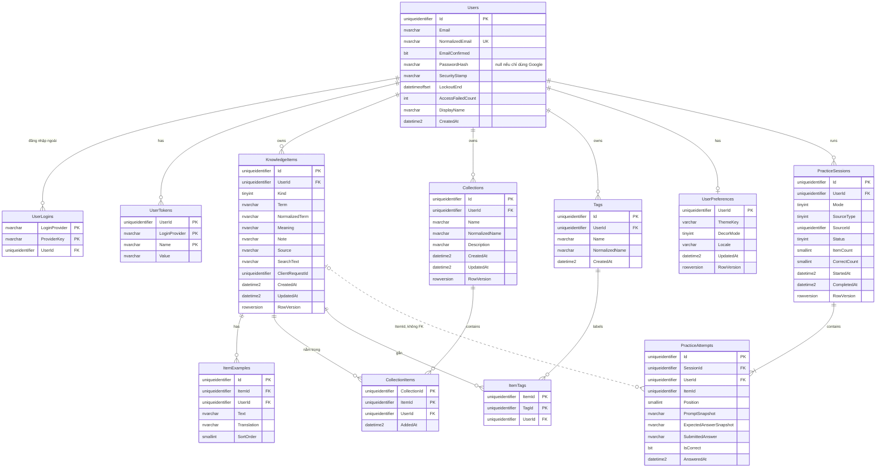

# ERD tổng thể — Lingozi

- Cập nhật: 2026-11-08.
- Trạng thái: **Draft, chờ chủ dự án duyệt**. Đây là bản phác thảo tổng thể của Vòng 0. Bảng của từng tính năng được chốt chi tiết ở bước Thiết kế của vòng tương ứng, trong `docs/features/<feature>/srs/`. Migration chỉ được tạo từ phần đã chốt.
- Nguồn:
  - [ADR 0001](../decisions/0001-system-architecture-and-repo-layout.md): mỗi module một schema và một `DbContext`.
  - [ADR 0002](../decisions/0002-backend-stack.md): SQL Server 2025, EF Core 10.
  - [ADR 0004](../decisions/0004-authentication.md): Identity.
  - [mvp-scope.md](../product/mvp-scope.md).
  - [Brainstorm](../product/brainstorms/personal-english-knowledge.md): `Q-02`, `Q-03`, `Q-05`–`Q-08`.

## 1. Quy ước chung

| Quy ước | Nội dung |
| --- | --- |
| Tên | Bảng và cột dùng PascalCase tiếng Anh theo mặc định EF Core; bảng ở số nhiều. Mỗi module một schema: `accounts`, `library`, `practice`, `personalization` |
| Khóa chính | `uniqueidentifier`, sinh theo thứ tự (sequential GUID của EF Core cho SQL Server) để hạn chế phân mảnh index. Không đoán được nên an toàn khi xuất hiện trong URL |
| Chủ sở hữu | Mọi bảng dữ liệu người dùng có `UserId`. Bảng nối có thêm `UserId` và **foreign key ghép** (`Id`, `UserId`), để database **chặn việc nối dữ liệu của hai người khác nhau** (NFR-PRIV-001), không chỉ dựa vào code |
| Thời gian | `datetime2(3)`, lưu UTC; tên cột kết thúc bằng `At` |
| Chuỗi | `nvarchar` (Unicode, tiếng Việt). Mỗi cột có giới hạn độ dài; chỉ dùng `nvarchar(max)` khi có lý do. Collation database: `Latin1_General_100_CI_AS_SC_UTF8`. Chuẩn hóa phục vụ tìm kiếm và so trùng được làm ở tầng ứng dụng (cột `Normalized*`, `SearchText`) |
| Đồng thời | Bảng người dùng hay sửa có `RowVersion rowversion`, dùng cho optimistic concurrency |
| Enum | Lưu `tinyint`, có `CHECK` constraint giới hạn giá trị hợp lệ; tên giá trị ghi ở từ điển dữ liệu |
| Xóa | Xóa cứng ở MVP (phục hồi sau xóa nằm ngoài phạm vi). Cascade chỉ đi từ bản ghi cha xuống bảng nối và bảng con trong cùng module. FK tới `accounts.Users` dùng `NO ACTION`, để tránh lỗi "multiple cascade paths" của SQL Server; khi có tính năng xóa tài khoản, ứng dụng xóa dữ liệu theo thứ tự trong một transaction |
| FK chéo module | Chỉ có FK tới `accounts.Users`, tạo bằng migration SQL của module tương ứng, vì `Users` thuộc `DbContext` khác. Các tham chiếu chéo khác (ví dụ `practice` → `library`) chỉ lưu ID và snapshot, không có FK |

## 2. Sơ đồ

Tên bảng trong sơ đồ bỏ tiền tố schema, vì Mermaid không hỗ trợ dấu chấm. Schema của từng bảng ghi ở mục 3.

Các bảng kỹ thuật không vẽ trong sơ đồ: `accounts.EmailOutbox` và `accounts.DataProtectionKeys` (mục 3.1).

## 3. Từ điển dữ liệu

Các cột theo `rules/09-data-dictionary-standard.md`. Độ dài là đề xuất, chốt ở bước Thiết kế của từng vòng.

### 3.1 Schema `accounts` — Vòng 1 (FEAT-01)

Các bảng Identity dùng schema mặc định của ASP.NET Core Identity, đổi tên bỏ tiền tố `AspNet`. Không dùng role và claim ở MVP; không tạo `Roles`, `UserRoles`, `RoleClaims`, `UserClaims`.

**`accounts.Users`**

| Tên trường | Cột | Kiểu | Độ dài | Null? | Khóa | Ràng buộc / mặc định | Diễn giải nghiệp vụ |
| --- | --- | --- | --- | --- | --- | --- | --- |
| Mã người dùng | `Id` | uniqueidentifier | — | Không | PK | Sequential GUID | Định danh dùng ở mọi module |
| Email | `Email` | nvarchar | 256 | Không | — | Định dạng email, validate ở server | Email đăng nhập và nhận thư |
| Email chuẩn hóa | `NormalizedEmail` | nvarchar | 256 | Không | UK | Viết hoa theo Identity | Bảo đảm mỗi email chỉ có một tài khoản |
| Đã xác thực email | `EmailConfirmed` | bit | — | Không | — | Mặc định 0 | Tài khoản mật khẩu phải là 1 mới dùng được thư viện (ADR 0004) |
| Mật khẩu băm | `PasswordHash` | nvarchar | max | Có | — | `PasswordHasher` của Identity | Null với tài khoản chỉ đăng nhập Google |
| Security stamp | `SecurityStamp` | nvarchar | 64 | Không | — | Đổi khi đổi mật khẩu hoặc đăng xuất mọi nơi | Vô hiệu hóa phiên cũ |
| Concurrency stamp | `ConcurrencyStamp` | nvarchar | 64 | Không | — | Identity quản lý | Optimistic concurrency của Identity |
| Khóa tới | `LockoutEnd` | datetimeoffset | — | Có | — | — | Hết khóa sau 15 phút (NFR-SEC-001) |
| Cho phép khóa | `LockoutEnabled` | bit | — | Không | — | Mặc định 1 | — |
| Số lần sai | `AccessFailedCount` | int | — | Không | — | Mặc định 0; khóa khi đạt 5 | — |
| Tên hiển thị | `DisplayName` | nvarchar | 100 | Có | — | — | Hiển thị trên giao diện |
| Thời điểm tạo | `CreatedAt` | datetime2(3) | — | Không | — | UTC | — |

Các cột Identity không dùng ở MVP (`PhoneNumber`, `TwoFactorEnabled`, …) được giữ mặc định, không có chức năng nào dùng tới.

**`accounts.UserLogins`**: đăng nhập ngoài (Google).

- PK: (`LoginProvider` nvarchar(128), `ProviderKey` nvarchar(128)).
- `UserId` FK → `Users.Id`, cascade.
- `ProviderDisplayName` nvarchar(128), null.
- Một tài khoản Google chỉ gắn với một user.

**`accounts.UserTokens`**: token của Identity (xác thực email, đặt lại mật khẩu dùng token có chữ ký nên không cần bảng riêng).

- PK: (`UserId`, `LoginProvider`, `Name`).
- `Value` nvarchar(max), null.

**`accounts.EmailOutbox`** (ADR 0005)

| Cột | Kiểu | Null? | Ràng buộc | Diễn giải |
| --- | --- | --- | --- | --- |
| `Id` | uniqueidentifier | Không | PK | — |
| `Type` | tinyint | Không | CHECK: 1 = EmailConfirmation, 2 = PasswordReset | Loại thư |
| `ToAddress` | nvarchar(256) | Không | — | Người nhận. Xóa bản ghi đã gửi sau 30 ngày |
| `PayloadJson` | nvarchar(4000) | Không | JSON hợp lệ (`ISJSON`) | Dữ liệu dựng nội dung thư, ví dụ link có token. Không ghi ra log |
| `Status` | tinyint | Không | CHECK: 0 = Pending, 1 = Sent, 2 = Failed | — |
| `Attempts` | tinyint | Không | Mặc định 0; tối đa 5 | — |
| `NextAttemptAt` | datetime2(3) | Không | Index (`Status`, `NextAttemptAt`) | Worker lấy thư đến hạn gửi |
| `SentAt` | datetime2(3) | Có | — | — |
| `LastError` | nvarchar(500) | Có | Chỉ lưu mã lỗi hoặc thông điệp đã lọc | Không chứa nội dung thư |
| `CreatedAt` | datetime2(3) | Không | UTC | — |

**`accounts.DataProtectionKeys`** (ADR 0006): bảng chuẩn của `Microsoft.AspNetCore.DataProtection.EntityFrameworkCore`, gồm `Id` int identity PK, `FriendlyName` nvarchar(max), `Xml` nvarchar(max). Lưu khóa mã hóa cookie bền vững để cookie đăng nhập không mất hiệu lực khi container khởi động lại.

### 3.2 Schema `library` — Vòng 1–2 (FEAT-02, 03, 04)

**`library.KnowledgeItems`**: một mục kiến thức. Một bản ghi được nhiều bộ sưu tập và thẻ cùng tham chiếu.

| Tên trường | Cột | Kiểu | Độ dài | Null? | Khóa | Ràng buộc / mặc định | Diễn giải nghiệp vụ |
| --- | --- | --- | --- | --- | --- | --- | --- |
| Mã mục | `Id` | uniqueidentifier | — | Không | PK | Sequential GUID | — |
| Chủ sở hữu | `UserId` | uniqueidentifier | — | Không | FK → `accounts.Users` | NO ACTION; UK (`Id`, `UserId`) phục vụ FK ghép | — |
| Loại nội dung | `Kind` | tinyint | — | Không | — | CHECK 1–9: 1 Word, 2 Phrase, 3 PhrasalVerb, 4 Idiom, 5 Grammar, 6 SentencePattern, 7 Expression, 8 Quote, 9 UsageNote. Mặc định 1 | Một form chung kèm trường loại (phương án mặc định `Q-02`) |
| Nội dung tiếng Anh | `Term` | nvarchar | 1000 | Không | — | Sau khi trim phải có ít nhất 1 ký tự | "Từ" bắt buộc. Đủ dài cho câu hoặc đoạn trích |
| Nội dung chuẩn hóa | `NormalizedTerm` | nvarchar | 1000 | Không | — | Ứng dụng tính: chữ thường, trim, gộp khoảng trắng | Dùng để gợi ý mục trùng (`Q-03`). **Không unique**, vì người dùng được phép tạo mục riêng |
| Nghĩa | `Meaning` | nvarchar | 2000 | Không | — | Sau khi trim phải có ít nhất 1 ký tự | "Nghĩa" bắt buộc; dùng làm câu hỏi khi luyện gõ |
| Ghi chú | `Note` | nvarchar | 4000 | Có | — | — | Ghi chú cá nhân, cách dùng |
| Nguồn / bối cảnh | `Source` | nvarchar | 300 | Có | — | — | Gặp ở đâu: phim, sách, bài hát… |
| Văn bản tìm kiếm | `SearchText` | nvarchar | max | Không | — | Ứng dụng tính lại mỗi khi lưu: ghép Term, Meaning, Note, Source và các ví dụ; chữ thường, bỏ dấu tiếng Việt, đ → d | Tìm kiếm Vòng 2 (`Q-07`). Cách đánh index chốt ở Vòng 2 (mục 5) |
| Mã yêu cầu tạo | `ClientRequestId` | uniqueidentifier | — | Có | — | Unique có lọc (`UserId`, `ClientRequestId`) WHERE NOT NULL | Idempotency: gửi lại cùng yêu cầu tạo thì không sinh mục trùng |
| Tạo lúc | `CreatedAt` | datetime2(3) | — | Không | — | UTC | Mốc của dòng thời gian (`Q-06`) |
| Sửa lúc | `UpdatedAt` | datetime2(3) | — | Không | — | UTC | — |
| Phiên bản | `RowVersion` | rowversion | — | Không | — | — | Phát hiện sửa đồng thời từ hai tab |

Index:

- (`UserId`, `CreatedAt` DESC) cho dòng thời gian và danh sách mặc định.
- (`UserId`, `NormalizedTerm`) cho gợi ý trùng.
- (`UserId`, `Kind`) cho lọc theo loại.

**`library.ItemExamples`**: một mục có 0..n ví dụ.

| Cột | Kiểu | Null? | Ràng buộc | Diễn giải |
| --- | --- | --- | --- | --- |
| `Id` | uniqueidentifier | Không | PK | — |
| `ItemId`, `UserId` | uniqueidentifier | Không | FK ghép → `KnowledgeItems(Id, UserId)`, cascade | Ví dụ luôn cùng chủ với mục |
| `Text` | nvarchar(1000) | Không | Sau khi trim phải có ít nhất 1 ký tự | Câu ví dụ tiếng Anh |
| `Translation` | nvarchar(1000) | Có | — | Dịch nghĩa |
| `SortOrder` | smallint | Không | UK (`ItemId`, `SortOrder`) | Thứ tự hiển thị |

Tối đa 20 ví dụ mỗi mục (đề xuất), kiểm tra ở tầng ứng dụng.

**`library.Collections`**

| Cột | Kiểu | Null? | Ràng buộc | Diễn giải |
| --- | --- | --- | --- | --- |
| `Id` | uniqueidentifier | Không | PK; UK (`Id`, `UserId`) | — |
| `UserId` | uniqueidentifier | Không | FK → `accounts.Users`, NO ACTION | — |
| `Name` | nvarchar(100) | Không | Sau khi trim phải có ít nhất 1 ký tự | Ví dụ: "English for Work" |
| `NormalizedName` | nvarchar(100) | Không | UK (`UserId`, `NormalizedName`) | Mỗi người không có hai bộ sưu tập trùng tên (đề xuất) |
| `Description` | nvarchar(500) | Có | — | — |
| `CreatedAt`, `UpdatedAt` | datetime2(3) | Không | UTC | — |
| `RowVersion` | rowversion | Không | — | — |

**`library.CollectionItems`**: quan hệ nhiều-nhiều.

- PK: (`CollectionId`, `ItemId`).
- `UserId`, cộng hai FK ghép:
  - (`CollectionId`, `UserId`) → `Collections(Id, UserId)`, cascade.
  - (`ItemId`, `UserId`) → `KnowledgeItems(Id, UserId)`, cascade.
- `AddedAt` datetime2(3).
- Xóa bộ sưu tập chỉ xóa liên kết, không xóa mục (phương án mặc định `Q-05`).
- Index (`ItemId`) để biết một mục thuộc những bộ sưu tập nào.

**`library.Tags`**

- Các cột: `Id` PK; UK (`Id`, `UserId`); `UserId` FK NO ACTION; `Name` nvarchar(50); `NormalizedName` nvarchar(50); `CreatedAt`.
- UK (`UserId`, `NormalizedName`): mỗi người không có hai thẻ trùng tên.

**`library.ItemTags`**

- PK: (`ItemId`, `TagId`).
- `UserId`, cộng hai FK ghép, đều cascade: (`ItemId`, `UserId`) → `KnowledgeItems`, (`TagId`, `UserId`) → `Tags`.
- Index (`TagId`) để lọc theo thẻ.

### 3.3 Schema `practice` — Vòng 3 (FEAT-05)

**`practice.PracticeSessions`**: một phiên luyện.

| Cột | Kiểu | Null? | Ràng buộc | Diễn giải |
| --- | --- | --- | --- | --- |
| `Id` | uniqueidentifier | Không | PK; UK (`Id`, `UserId`) | — |
| `UserId` | uniqueidentifier | Không | FK → `accounts.Users`, NO ACTION | — |
| `Mode` | tinyint | Không | CHECK: 1 = Typing (Vòng 3); 2 = Sentence dành cho Vòng 4 | — |
| `SourceType` | tinyint | Không | CHECK: 1 = All, 2 = Collection, 3 = Tag | Nguồn câu hỏi |
| `SourceId` | uniqueidentifier | Có | Bắt buộc khi `SourceType` là 2 hoặc 3 (CHECK) | ID bộ sưu tập hoặc thẻ. Không FK vì khác module |
| `Status` | tinyint | Không | CHECK: 0 = InProgress, 1 = Completed, 2 = Abandoned | — |
| `ItemCount`, `CorrectCount` | smallint | Không | 1 ≤ `ItemCount` ≤ 50 (đề xuất); 0 ≤ `CorrectCount` ≤ `ItemCount` | Kết quả phiên |
| `StartedAt` | datetime2(3) | Không | UTC | — |
| `CompletedAt` | datetime2(3) | Có | — | — |
| `RowVersion` | rowversion | Không | — | — |

Index (`UserId`, `StartedAt` DESC).

**`practice.PracticeAttempts`**: một câu hỏi trong phiên.

| Cột | Kiểu | Null? | Ràng buộc | Diễn giải |
| --- | --- | --- | --- | --- |
| `Id` | uniqueidentifier | Không | PK | — |
| `SessionId`, `UserId` | uniqueidentifier | Không | FK ghép → `PracticeSessions(Id, UserId)`, cascade | — |
| `ItemId` | uniqueidentifier | Không | Không FK (khác module) | Mục gốc. Mục có thể bị xóa sau đó |
| `Position` | smallint | Không | UK (`SessionId`, `Position`) | Thứ tự câu hỏi |
| `PromptSnapshot` | nvarchar(2000) | Không | — | Nghĩa hiển thị cho người dùng, chụp lại lúc tạo phiên |
| `ExpectedAnswerSnapshot` | nvarchar(1000) | Không | **Không bao giờ trả về client trước khi người dùng nộp đáp án** (`AGENTS.md` §7) | Đáp án dùng để chấm ở server |
| `SubmittedAnswer` | nvarchar(1000) | Có | — | Câu trả lời của người dùng |
| `IsCorrect` | bit | Có | Chấm theo `Q-08` | Null khi chưa trả lời |
| `AnsweredAt` | datetime2(3) | Có | Chỉ ghi được một lần: nộp lại câu đã chấm thì trả về kết quả cũ | Idempotency khi nộp |

Snapshot giúp kết quả phiên không đổi khi mục gốc bị sửa hoặc xóa sau đó.

### 3.4 Schema `personalization` — Vòng 3 (FEAT-07)

**`personalization.UserPreferences`**: mỗi user một dòng, tạo khi lưu lựa chọn lần đầu.

| Cột | Kiểu | Null? | Ràng buộc | Diễn giải |
| --- | --- | --- | --- | --- |
| `UserId` | uniqueidentifier | Không | PK; FK → `accounts.Users`, NO ACTION | — |
| `ThemeKey` | varchar(50) | Không | Server kiểm tra thuộc danh mục theme định nghĩa trong code; mặc định `default` | Danh mục theme là cấu hình của sản phẩm, không phải dữ liệu người dùng, nên không có bảng `Themes` |
| `DecorMode` | tinyint | Không | CHECK: 0 = Full, 1 = Reduced; mặc định 0 | Chế độ giảm trang trí |
| `Locale` | varchar(10) | Không | CHECK IN ('vi', 'en'); mặc định 'vi' | NFR-I18N-001 |
| `UpdatedAt` | datetime2(3) | Không | UTC | — |
| `RowVersion` | rowversion | Không | — | — |

## 4. Phác thảo cho Vòng 4–5

Các bảng dưới chưa có thiết kế chi tiết và **không tạo migration** trước vòng tương ứng.

- **`practice.SentenceFeedbacks`** (FEAT-06):
  - `Id`, `UserId`, `ItemId` (không FK).
  - `OriginalSentence` (giữ câu gốc để đối chiếu).
  - `Status`: Pending, Completed hoặc Failed. Khi Failed thì thông báo không nhận xét được.
  - `FeedbackJson`, `SuggestedSentence`.
  - `Provider`, `Model`, `InputTokens`, `OutputTokens`, `CreatedAt`.
  - Phục vụ hạn mức và chi phí theo user.
- **`practice.AiUsageQuotas`** (FEAT-06): hạn mức theo user và theo kỳ. Thiết kế khi có ADR AI.
- **`personalization.ThemeCustomizations`** (FEAT-08): `UserId`, `ThemeKey`, `SettingsJson` (màu, nền, font, linh vật, sticker), được validate theo schema.

## 5. Điểm còn mở

| ID | Vấn đề | Chốt ở | Ghi chú |
| --- | --- | --- | --- |
| `ERD-01` | Cách tìm kiếm trên `SearchText`: `LIKE` sau khi đã lọc theo `UserId`, hay Full-Text Search | Vòng 2 | Image Docker SQL Server trên Linux không có sẵn Full-Text Search (cần cài thêm gói), Express edition cũng có giới hạn. Với 5.000 mục mỗi user, `LIKE` sau khi lọc theo `UserId` có thể đạt NFR-PERF-001; **phải đo trước khi chốt** |
| `ERD-02` | Độ dài tối đa của `Term`, `Meaning`, `Note` | Vòng 1 | Đang đề xuất 1000 / 2000 / 4000 ký tự |
| `ERD-03` | Giới hạn số mục mỗi user (chống lạm dụng, giới hạn 10 GB của Express) | Vòng 1 | Phụ thuộc `HOST-02` |
| `ERD-04` | Tên bộ sưu tập và thẻ có bắt buộc unique theo user không | Vòng 2 | Đang đề xuất có |
| `ERD-05` | Xóa tài khoản và dữ liệu (quyền của người dùng) | Sau MVP | FK `NO ACTION` đã chừa sẵn đường cho việc xóa có thứ tự |
