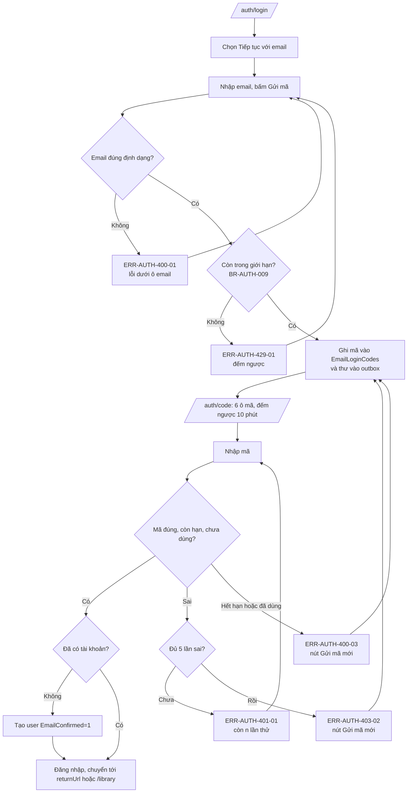
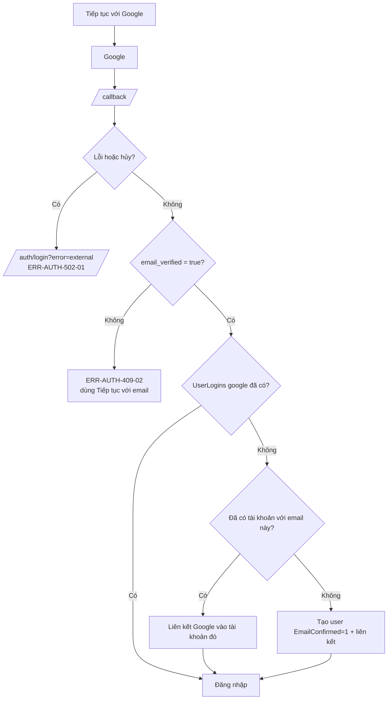
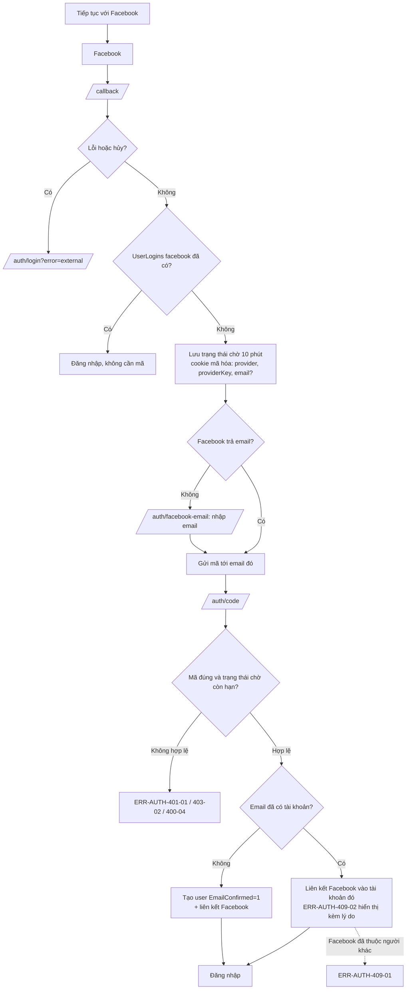
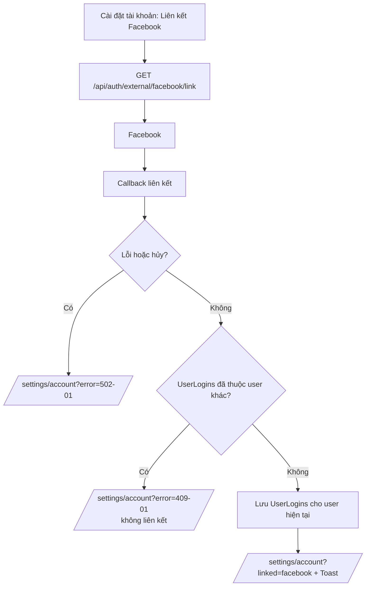
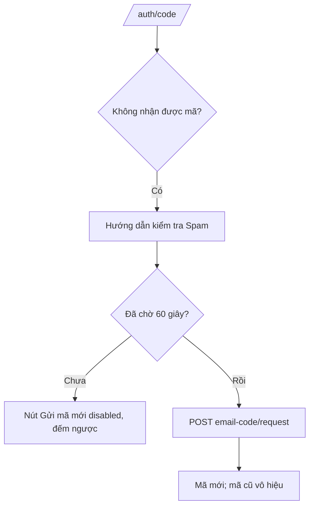
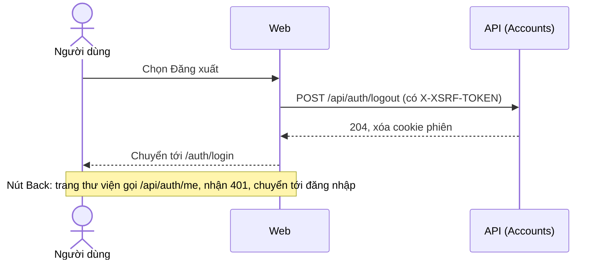
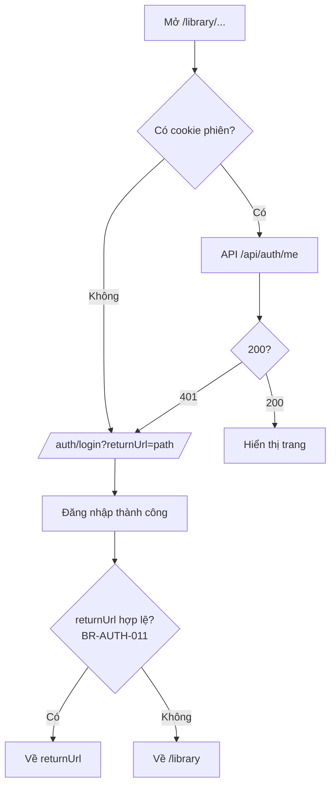

# Luồng — FEAT-01 Tài khoản

- Cập nhật: 2026-11-09 (v0.3: đăng nhập bằng mã email; Facebook thay Apple). Trạng thái: **chờ duyệt**.

## 1. Đăng nhập hoặc tạo tài khoản bằng mã email



Đăng nhập và đăng ký là cùng một luồng. Không có ô mật khẩu ở bất kỳ bước nào.

## 2. Đăng nhập bằng Google



## 3. Đăng nhập bằng Facebook (qua mã email)



## 4. Sequence: thư mã trong outbox

```mermaid
sequenceDiagram
    participant A as API request
    participant DB as SQL Server
    participant Wk as Email worker (trong API)
    participant M as Nhà cung cấp email / Mailpit
    A->>DB: BEGIN; vô hiệu mã còn hiệu lực cũ; INSERT EmailLoginCodes; INSERT EmailOutbox(Pending, LoginCode); COMMIT
    loop Mỗi 10 giây
        Wk->>DB: Lấy thư Pending đến hạn (khóa hàng, tránh gửi trùng)
        Wk->>M: Gửi (timeout 10 giây); nội dung không ghi log
        alt Thành công
            Wk->>DB: Status=Sent, SentAt
        else Lỗi
            Wk->>DB: Attempts+1, NextAttemptAt theo backoff; quá 5 lần thì Failed
        end
    end
```

## 5. Theo từng user story

### US-AUTH-06 — Liên kết Google hoặc Facebook trong Cài đặt



Đã đăng nhập nên không cần mã: liên kết dựa trên phiên hiện tại và danh tính Facebook.

### US-AUTH-07 — Mã không đến hoặc đã hết hạn



Phản hồi và thời gian chờ giống hệt với email chưa có tài khoản (BR-AUTH-007).

### US-AUTH-08 — Đăng xuất



### US-AUTH-09 — Bảo vệ thư viện riêng tư



### US-AUTH-10 — Chính sách và hướng dẫn xóa dữ liệu

```mermaid
flowchart LR
    U[Người dùng, chưa đăng nhập] --> F[Chân trang của /auth/login]
    F --> P[/privacy]
    F --> D[/data-deletion]
    D --> M[Gửi email yêu cầu xóa dữ liệu<br/>xử lý thủ công trong 30 ngày, Q-12]
```
