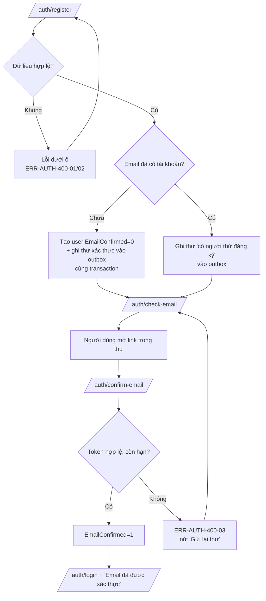
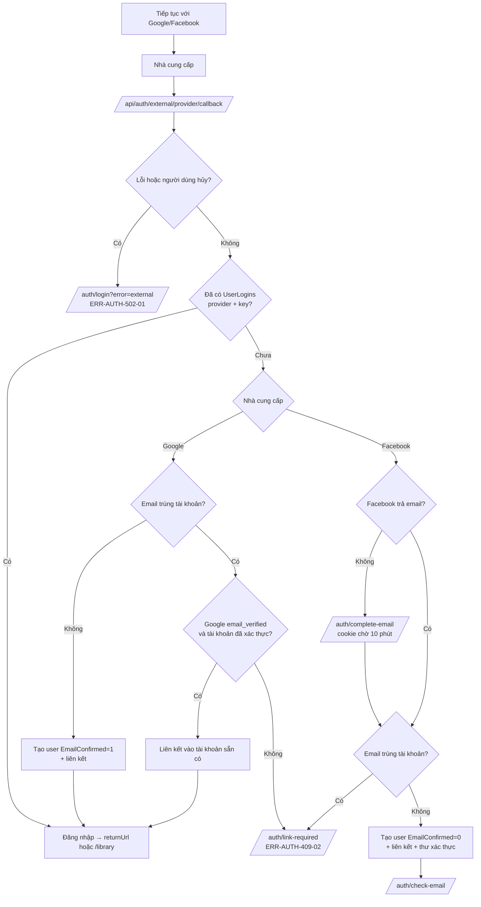
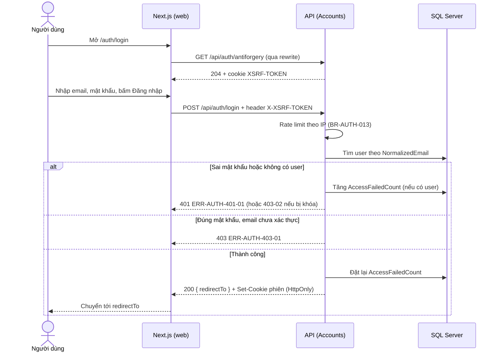
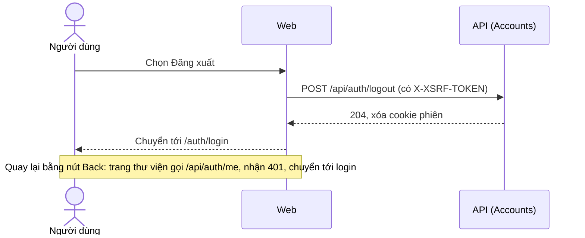
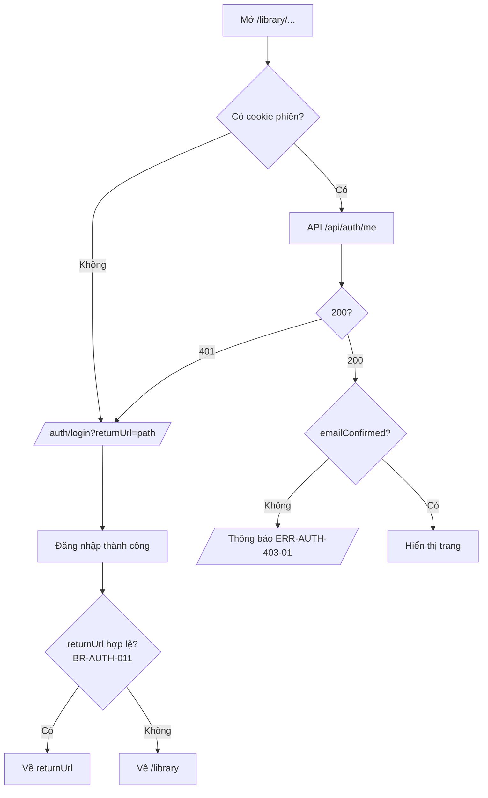

# Luồng — FEAT-01 Tài khoản

- Cập nhật: 2026-11-08. Trạng thái: **chờ duyệt**.

## 1. Đăng ký và xác thực email



## 2. Đăng nhập bằng Google hoặc Facebook



## 3. Sequence: đăng nhập bằng email



## 4. Sequence: thư trong outbox

```mermaid
sequenceDiagram
    participant A as API request
    participant DB as SQL Server
    participant Wk as Email worker (trong API)
    participant M as Nhà cung cấp email / Mailpit
    A->>DB: BEGIN; INSERT Users; INSERT EmailOutbox(Pending); COMMIT
    loop Mỗi 10 giây
        Wk->>DB: Lấy thư Pending có NextAttemptAt <= now (khóa hàng, tránh gửi trùng)
        Wk->>M: Gửi (timeout 10 giây)
        alt Thành công
            Wk->>DB: Status=Sent, SentAt
        else Lỗi
            Wk->>DB: Attempts+1, NextAttemptAt theo backoff; quá 5 lần thì Status=Failed
        end
    end
```

## 5. Theo từng user story (bổ sung 2026-11-08)

### US-AUTH-06 — Liên kết Google hoặc Facebook vào tài khoản đang đăng nhập


### US-AUTH-07 — Quên và đặt lại mật khẩu

```mermaid
sequenceDiagram
    actor U as Người dùng
    participant W as Web
    participant A as API (Accounts)
    participant DB as SQL Server
    U->>W: /auth/forgot-password, nhập email
    W->>A: POST /api/auth/forgot-password
    A->>DB: Tìm user; nếu có, ghi thư đặt lại vào outbox (BR-AUTH-009 giới hạn tần suất)
    A-->>W: 202 (luôn giống nhau, BR-AUTH-007)
    W-->>U: "Nếu email có tài khoản, chúng tôi đã gửi hướng dẫn"
    U->>W: Mở link trong thư (userId, token)
    W->>A: POST /api/auth/reset-password {userId, token, newPassword}
    A->>DB: Kiểm tra token (60 phút, dùng một lần); kiểm tra BR-AUTH-001
    alt Token hợp lệ
        A->>DB: Đổi mật khẩu, đổi SecurityStamp (BR-AUTH-010)
        A-->>W: 204
        W-->>U: "Đã đặt lại mật khẩu" + nút Đăng nhập
    else Hết hạn hoặc đã dùng
        A-->>W: 400 ERR-AUTH-400-03
        W-->>U: Nút "Gửi lại hướng dẫn"
    end
```

### US-AUTH-08 — Đăng xuất



### US-AUTH-09 — Bảo vệ thư viện riêng tư



### US-AUTH-10 — Chính sách quyền riêng tư và hướng dẫn xóa dữ liệu

```mermaid
flowchart LR
    U[Người dùng, chưa đăng nhập] --> F[Chân trang của /auth/login hoặc /auth/register]
    F --> P[/privacy]
    F --> D[/data-deletion]
    D --> M[Gửi email yêu cầu xóa dữ liệu<br/>xử lý thủ công trong 30 ngày, Q-12]
```


