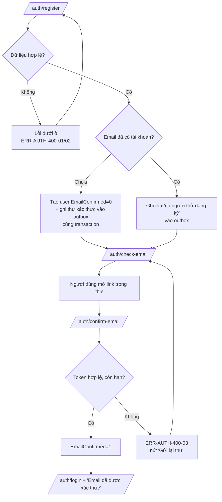
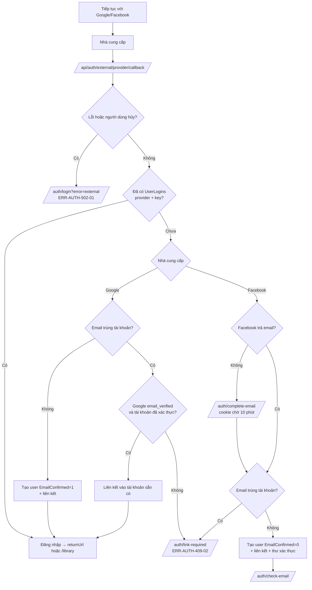
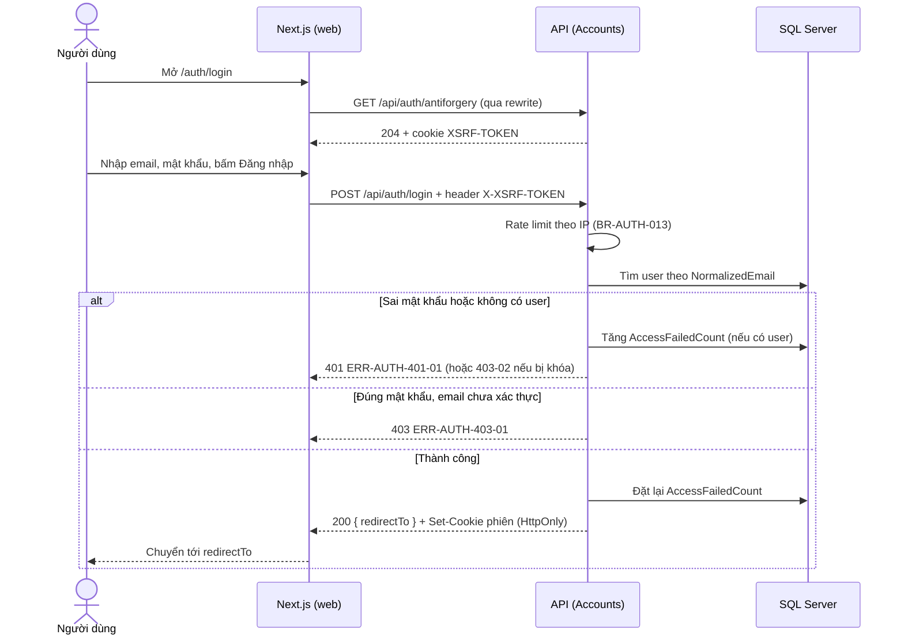

# Luồng — FEAT-01 Tài khoản

- Cập nhật: 2026-11-08. Trạng thái: **chờ duyệt**.

## 1. Đăng ký và xác thực email



## 2. Đăng nhập bằng Google hoặc Facebook



## 3. Sequence: đăng nhập bằng email



## 4. Sequence: thư trong outbox

```mermaid
sequenceDiagram
    participant A as API request
    participant DB as SQL Server
    participant Wk as Email worker (trong API)
    participant M as Nhà cung cấp email / Mailpit
    A->>DB: BEGIN; INSERT Users; INSERT EmailOutbox(Pending); COMMIT
    loop Mỗi 10 giây
        Wk->>DB: Lấy thư Pending có NextAttemptAt <= now (khóa hàng, tránh gửi trùng)
        Wk->>M: Gửi (timeout 10 giây)
        alt Thành công
            Wk->>DB: Status=Sent, SentAt
        else Lỗi
            Wk->>DB: Attempts+1, NextAttemptAt theo backoff; quá 5 lần thì Status=Failed
        end
    end
```
