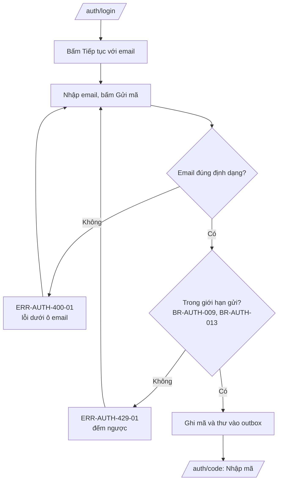
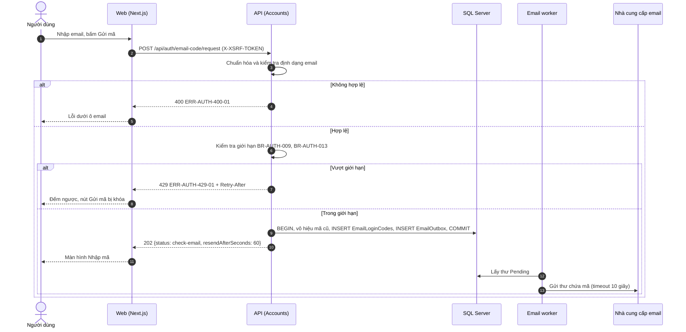

# SRS US-AUTH-01 — Yêu cầu mã đăng nhập bằng email

- Tính năng: FEAT-01 Tài khoản và thư viện riêng tư (`accounts`).
- User story: [US-AUTH-01](../requirements/user-stories.md#us-auth-01--yêu-cầu-mã-đăng-nhập-bằng-email).
- Phiên bản 0.4 (2026-11-10). Trạng thái thiết kế: **chờ duyệt**. Trạng thái triển khai: đã code backend, frontend và test (xem [README tính năng](../README.md#trạng-thái-triển-khai)).
- Tài liệu chung: [README.md](README.md) (danh mục FR, BR, ERR, NFR, quy ước API, ngữ cảnh).
- Test case: [testing/test-cases.md](../testing/test-cases.md).
- Skill OpenBA áp dụng: `srs` (FR, BR, ERR, NFR), `user-flow`, `sequence`, `wireframe-ascii`, `api-design`, `ac`.

## 1. Giới thiệu

Là người dùng, tôi muốn nhập email để nhận mã đăng nhập, không cần nhớ mật khẩu.

**Trong phạm vi:**

- Màn hình "Đăng nhập" với nút "Tiếp tục với email" và ô nhập email.
- Gửi mã 6 số tới email; chuyển sang màn hình nhập mã.
- Giới hạn tần suất gửi mã.

**Ngoài phạm vi:**

- Xác minh mã (US-AUTH-02).
- Gửi lại mã khi không nhận được (US-AUTH-07).

## 2. Yêu cầu áp dụng

### 2.1 Yêu cầu chức năng (FR)

**`FR-AUTH-CODE-001` — Gửi mã đăng nhập 6 số tới email**

- Input: `email`.
- Xử lý: Chuẩn hóa email (trim, không phân biệt hoa thường) và kiểm tra định dạng. Kiểm tra giới hạn gửi theo email và theo IP (BR-AUTH-009, BR-AUTH-013). Trong một transaction: vô hiệu mã còn hiệu lực cũ của email, sinh mã bằng bộ sinh ngẫu nhiên an toàn, lưu HMAC của mã vào `accounts.EmailLoginCodes`, ghi thư vào `accounts.EmailOutbox` (loại LoginCode). Worker gửi thư bất đồng bộ.
- Output: `202 {status: "check-email", resendAfterSeconds: 60}`. Luôn giống nhau dù email có tài khoản hay không (BR-AUTH-007).

### 2.2 Quy tắc nghiệp vụ (BR)

Phát biểu theo dạng KHI, THÌ, NGOẠI LỆ (`rules/02`). Nội dung chính thức nằm ở [README.md](README.md); bảng dưới là bản sao các quy tắc áp dụng cho story này.

| Mã BR | Quy tắc | KHI | THÌ | NGOẠI LỆ |
| --- | --- | --- | --- | --- |
| `BR-AUTH-001` | Mã đăng nhập | Gửi mã | Mã 6 chữ số, sinh bằng bộ sinh ngẫu nhiên an toàn. Dùng một lần. Chỉ lưu HMAC-SHA256 của mã với khóa bí mật từ biến môi trường, không lưu mã thô. Không ghi mã vào log | — |
| `BR-AUTH-007` | Không lộ sự tồn tại của tài khoản | Gửi mã, nhập email Facebook | Cùng phản hồi và cùng HTTP status cho email có và không có tài khoản; thư được ghi vào outbox, không gửi trực tiếp trong request | — |
| `BR-AUTH-009` | Giới hạn gửi mã | Gửi mã | Mỗi email tối đa 1 mã mỗi 60 giây và 5 mã mỗi giờ. Vượt thì 429 và không gửi | — |
| `BR-AUTH-013` | Giới hạn theo IP | Gọi endpoint xác thực | Gửi mã: 10 lần/10 phút/IP. Xác minh mã: 20 lần/10 phút/IP. Bắt đầu đăng nhập ngoài: 20 lần/phút/IP. Vượt thì ERR-AUTH-429-01 | — |

### 2.3 Ma trận lỗi (ERR)

Theo `rules/03` và `rules/11`. Nội dung chính thức nằm ở [README.md](README.md); bảng dưới là bản sao các lỗi áp dụng cho story này.

| Mã ERR | HTTP | Điều kiện phát sinh | Khóa i18n | Thông báo người dùng | Mức độ | Hành động trên giao diện | Ghi log (không chứa mã hay email đầy đủ) |
| --- | --- | --- | --- | --- | --- | --- | --- |
| `ERR-AUTH-400-01` | 400 | Email rỗng, sai định dạng hoặc dài hơn 256 ký tự | `auth.error.400-01` | "Email không đúng định dạng." | Medium | Lỗi dưới ô email | Validation failed: email |
| `ERR-AUTH-429-01` | 429 | Vượt giới hạn gửi mã hoặc giới hạn theo IP (BR-AUTH-009, BR-AUTH-013) | `auth.error.429-01` | "Bạn thao tác quá nhanh. Vui lòng đợi {giây} giây." | Medium | Vô hiệu nút, đếm ngược theo `Retry-After` | Rate limited: policy |

### 2.4 Yêu cầu phi chức năng (NFR)

- `NFR-SEC-001`: Mã: HMAC-SHA256, hiệu lực 10 phút, 5 lần sai, giới hạn gửi (BR-AUTH-001, 002, 009). HTTPS ngoài Development.
- `NFR-PERF-001`: Gửi mã và xác minh có P95 ≤ 300 ms, không tính thời gian gửi thư (gửi bất đồng bộ qua outbox).
- `NFR-A11Y-001`: Ô mã là 6 ô có nhãn, `autocomplete="one-time-code"`, dán được cả 6 số vào ô đầu; thông báo lỗi có `role="alert"`; thao tác được bằng bàn phím.

## 3. Luồng

### 3.1 User flow

_Skill `user-flow`: màn hình và chuyển đổi, kèm các trạng thái giao diện._



| Trạng thái | Hiển thị |
| --- | --- |
| Bình thường | Ba nút phương thức; ô email ẩn cho tới khi bấm "Tiếp tục với email". |
| Đang tải | "Gửi mã" có spinner, giữ nguyên chiều rộng; ô email bị khóa. |
| Trống | Không áp dụng. |
| Lỗi | 400-01 dưới ô email; 429-01 vô hiệu nút và đếm ngược; lỗi mạng hiện "Thử lại". |
| Mất kết nối | Không hỗ trợ ngoại tuyến. Hiện "Mất kết nối" và nút "Thử lại"; không mất dữ liệu đã nhập. |

### 3.2 Sequence

_Skill `sequence`: tương tác giữa các thành phần; nhánh lỗi ghi mã `ERR-xxx`._



## 4. Acceptance criteria

_Skill `ac`. Văn bản Gherkin trùng với [user story](../requirements/user-stories.md) (nguồn chính thức); sửa ở đó rồi cập nhật lại đây. Script `tools/feature-docs/check_feature_docs.py` kiểm tra hai bản khớp nhau._

```gherkin
Scenario: AC-01 Gửi mã tới email mới
  Given tôi mở "Đăng nhập" và chọn "Tiếp tục với email"
  When tôi nhập "an@example.com" và bấm "Gửi mã"
  Then hệ thống gửi một mã 6 số tới "an@example.com" (BR-AUTH-001)
  And tôi thấy màn hình "Nhập mã" có 6 ô và đếm ngược 10 phút

Scenario: AC-02 Email sai định dạng
  When tôi nhập "an@" và bấm "Gửi mã"
  Then không gửi gì và ô email hiện "Email không đúng định dạng" (ERR-AUTH-400-01)

Scenario: AC-03 Gửi lại quá nhanh
  Given tôi vừa yêu cầu mã cách đây 30 giây
  When tôi bấm "Gửi mã" lần nữa
  Then không có thư mới được gửi và thấy "Vui lòng đợi 30 giây trước khi gửi lại" (ERR-AUTH-429-01)

Scenario: AC-04 Email đã có tài khoản không bị lộ
  Given đã có tài khoản "an@example.com"
  When ai đó yêu cầu mã cho "an@example.com"
  Then tôi thấy đúng màn hình "Nhập mã" như AC-01, và cùng phản hồi HTTP
  And mã đăng nhập vẫn được gửi (BR-AUTH-007)

Scenario: AC-05 Vượt giới hạn trong một giờ
  Given email "an@example.com" đã nhận 5 mã trong giờ này
  When có yêu cầu thứ sáu
  Then không gửi thêm và trả ERR-AUTH-429-01 (BR-AUTH-009)
```

| AC | Nội dung | FR | BR | ERR | Wireframe | Test case |
| --- | --- | --- | --- | --- | --- | --- |
| AC-01 | Gửi mã tới email mới | `FR-AUTH-CODE-001` | `BR-AUTH-001` | — | W-AUTH-02, W-AUTH-05 | TC-AUTH-001 |
| AC-02 | Email sai định dạng | `FR-AUTH-CODE-001` | — | `ERR-AUTH-400-01` | W-AUTH-03 | TC-AUTH-002 |
| AC-03 | Gửi lại quá nhanh | `FR-AUTH-CODE-001` | `BR-AUTH-009` | `ERR-AUTH-429-01` | W-AUTH-04 | TC-AUTH-003 |
| AC-04 | Email đã có tài khoản không bị lộ | `FR-AUTH-CODE-001` | `BR-AUTH-007` | — | W-AUTH-05 | TC-AUTH-004 |
| AC-05 | Vượt giới hạn trong một giờ | `FR-AUTH-CODE-001` | `BR-AUTH-009` | `ERR-AUTH-429-01` | W-AUTH-04 | TC-AUTH-005 |

## 5. Wireframe

_Skill `wireframe-ascii`. Figma: chưa dựng màn hình (`DES-01`); wireframe ASCII là căn cứ cho DoR. Quy tắc: vẽ đủ mọi màn hình, hộp thoại và trạng thái mà AC của story nhắc tới._

### W-AUTH-01 — Đăng nhập: trạng thái ban đầu (`/auth/login`)

```text
┌────────────────────────────────────────────────────────────────┐
│                         [Logo Lingozi]                         │
│                                                                │
│         ┌────────────────────────────────────────────┐         │
│         │ Đăng nhập                                  │         │
│         │ Đăng nhập hoặc tạo tài khoản mới.          │         │
│         │                                            │         │
│         │ [ G   Tiếp tục với Google     ]            │         │
│         │ [ f   Tiếp tục với Facebook   ]            │         │
│         │ ────────────── hoặc ──────────────         │         │
│         │ [     Tiếp tục với email      ]            │         │
│         └────────────────────────────────────────────┘         │
│                                                                │
│            Chính sách quyền riêng tư · Xóa dữ liệu             │
└────────────────────────────────────────────────────────────────┘
```

- Ba phương thức theo thứ tự: Google, Facebook, email. Facebook thay cho Apple.
- Ô email ẩn cho tới khi bấm "Tiếp tục với email".
- Không có ô mật khẩu và không có liên kết "Quên mật khẩu".
- Chân trang có liên kết tới `/privacy` và `/data-deletion`.
- Nút Google và Facebook hiện nhưng không bấm được cho tới US-AUTH-04 và US-AUTH-05; mô tả cho trình đọc màn hình: "chưa khả dụng".

### W-AUTH-02 — Đăng nhập: bước nhập email

```text
┌────────────────────────────────────────────────────────────────┐
│                         [Logo Lingozi]                         │
│                                                                │
│         ┌────────────────────────────────────────────┐         │
│         │ Đăng nhập                                  │         │
│         │ Đăng nhập hoặc tạo tài khoản mới.          │         │
│         │                                            │         │
│         │ [ G   Tiếp tục với Google     ]            │         │
│         │ [ f   Tiếp tục với Facebook   ]            │         │
│         │ ────────────── hoặc ──────────────         │         │
│         │ Email *                                    │         │
│         │ [__________________________________]       │         │
│         │ [             Gửi mã             ]         │         │
│         └────────────────────────────────────────────┘         │
│                                                                │
│            Chính sách quyền riêng tư · Xóa dữ liệu             │
└────────────────────────────────────────────────────────────────┘
```

- Mở ra khi bấm "Tiếp tục với email"; focus vào ô email.
- Đang gửi: nút "Gửi mã" có spinner, giữ nguyên chiều rộng, ô email bị khóa.
- Enter trong ô email tương đương bấm "Gửi mã".

### W-AUTH-03 — Đăng nhập: email sai định dạng (ERR-AUTH-400-01)

```text
┌────────────────────────────────────────────────────────────────┐
│                         [Logo Lingozi]                         │
│                                                                │
│         ┌────────────────────────────────────────────┐         │
│         │ Đăng nhập                                  │         │
│         │ Đăng nhập hoặc tạo tài khoản mới.          │         │
│         │                                            │         │
│         │ [ G   Tiếp tục với Google     ]            │         │
│         │ [ f   Tiếp tục với Facebook   ]            │         │
│         │ ────────────── hoặc ──────────────         │         │
│         │ Email *                                    │         │
│         │ [an@____________________________]          │         │
│         │ (!) Email không đúng định dạng.            │         │
│         │ [             Gửi mã             ]         │         │
│         └────────────────────────────────────────────┘         │
│                                                                │
│            Chính sách quyền riêng tư · Xóa dữ liệu             │
└────────────────────────────────────────────────────────────────┘
```

- Viền ô email đổi sang màu lỗi; lỗi gắn với ô qua `aria-describedby`, có icon và chữ.
- Không gửi gì; nội dung đã nhập được giữ lại.

### W-AUTH-04 — Đăng nhập: vượt giới hạn gửi (ERR-AUTH-429-01)

```text
┌────────────────────────────────────────────────────────────────┐
│                         [Logo Lingozi]                         │
│                                                                │
│         ┌────────────────────────────────────────────┐         │
│         │ Đăng nhập                                  │         │
│         │ Đăng nhập hoặc tạo tài khoản mới.          │         │
│         │                                            │         │
│         │ [ G   Tiếp tục với Google     ]            │         │
│         │ [ f   Tiếp tục với Facebook   ]            │         │
│         │ ────────────── hoặc ──────────────         │         │
│         │ Email *                                    │         │
│         │ [an@example.com__________________]         │         │
│         │ (!) Vui lòng đợi 30 giây trước khi gửi     │         │
│         │     lại.                                   │         │
│         │ [      Gửi mã (đợi 30 giây)      ]         │         │
│         └────────────────────────────────────────────┘         │
│                                                                │
│            Chính sách quyền riêng tư · Xóa dữ liệu             │
└────────────────────────────────────────────────────────────────┘
```

- Nút "Gửi mã" bị vô hiệu và đếm ngược theo header `Retry-After`.
- Cùng hiển thị cho giới hạn theo email (1 mã mỗi 60 giây, 5 mã mỗi giờ) và theo IP.

### W-AUTH-05 — Nhập mã: trạng thái ban đầu (`/auth/code`)

```text
┌────────────────────────────────────────────────────────────────┐
│                         [Logo Lingozi]                         │
│                                                                │
│         ┌────────────────────────────────────────────┐         │
│         │ Nhập mã                                    │         │
│         │ Chúng tôi đã gửi mã 6 số tới               │         │
│         │ an@example.com.                            │         │
│         │ Mã có hiệu lực 10 phút (còn 09:58).        │         │
│         │                                            │         │
│         │ [ ] [ ] [ ] [ ] [ ] [ ]                    │         │
│         │                                            │         │
│         │ [            Xác nhận            ]         │         │
│         │                                            │         │
│         │ Không nhận được mã?   Đổi email            │         │
│         └────────────────────────────────────────────┘         │
│                                                                │
│            Chính sách quyền riêng tư · Xóa dữ liệu             │
└────────────────────────────────────────────────────────────────┘
```

- Sáu ô, mỗi ô có nhãn riêng; `autocomplete="one-time-code"`, `inputmode="numeric"`.
- Dán 6 số vào ô đầu thì điền cả sáu ô; đủ 6 số thì tự gửi xác nhận.
- Đếm ngược 10 phút theo thời hạn của mã.
- Không có ô mật khẩu.

### Thiết kế Figma (ảnh xuất, nguồn để code)

Ảnh xuất từ file Figma Lingozi (khung 1440 × 1024, xuất rộng 2000 px). Đặt trong [design-assets/](../design-assets/). Nếu Figma và wireframe ASCII khác nhau, ảnh Figma là căn cứ cho giao diện; AC và SRS là căn cứ cho hành vi.

| Wireframe | Ảnh Figma |
| --- | --- |
| W-AUTH-01 | [W-AUTH-01-login-initial.webp](../design-assets/W-AUTH-01-login-initial.webp) |
| W-AUTH-02 | [W-AUTH-02-email-step.webp](../design-assets/W-AUTH-02-email-step.webp) |
| W-AUTH-03 | [W-AUTH-03-email-invalid.webp](../design-assets/W-AUTH-03-email-invalid.webp) |
| W-AUTH-04 | [W-AUTH-04-rate-limited.webp](../design-assets/W-AUTH-04-rate-limited.webp) |
| W-AUTH-05 | [W-AUTH-05-code-entry.webp](../design-assets/W-AUTH-05-code-entry.webp) |

Khác biệt đã biết giữa Figma và bản code:

- Figma không có biểu tượng "G" và "f" trên nút Google và Facebook, và chỉ có chữ "hoặc" căn trái thay cho đường kẻ; bản code theo Figma.
- Nút Google và Facebook hiện đúng như Figma nhưng ở trạng thái không bấm được (`disabled`) cho tới khi US-AUTH-04 và US-AUTH-05 được làm; có mô tả cho trình đọc màn hình. Không dùng nút giả có vẻ hoạt động (AGENTS.md §6). W-AUTH-01 ghi lại việc này.
- Chân trang "Chính sách quyền riêng tư · Xóa dữ liệu" là chữ thường cho tới US-AUTH-10 (trang đích chưa có).
- Ở W-AUTH-05, nút "Xác nhận" và "Không nhận được mã?" bị vô hiệu cho tới US-AUTH-02 và US-AUTH-07; "Đổi email" quay về `/auth/login`.
- W-AUTH-04 trong Figma ghi 30 giây (ví dụ); số giây thật lấy từ `Retry-After` và đếm ngược mỗi giây. Nút vẫn giữ màu như Figma, nhưng có `aria-disabled="true"` và không gửi khi bấm.
- Cỡ chữ đo từ ảnh: tiêu đề 30 px, đoạn mô tả 16 px, nút và nhãn 14 px, chữ phụ và chân trang 12 px; thẻ rộng 440 px, đệm 32 px, nút cao 48 px.

## 6. API

_Skill `api-design`; lỗi theo Problem Details (RFC 9457) như ADR 0002. Quy ước chung ở [README.md](README.md)._

| Method và path | Quyền | Body | Thành công | Lỗi |
| --- | --- | --- | --- | --- |
| `GET /api/auth/antiforgery` | Công khai | — | 204 + cookie `XSRF-TOKEN` | — |
| `POST /api/auth/email-code/request` | Công khai | `{ email }` | 202 `{ status: "check-email", resendAfterSeconds: 60 }`, luôn giống nhau (BR-AUTH-007) | 400-01, 429-01 |

Yêu cầu:

```http
POST /api/auth/email-code/request
Content-Type: application/json
X-XSRF-TOKEN: <token>

{ "email": "an@example.com" }
```

Phản hồi thành công (luôn giống nhau, BR-AUTH-007):

```json
{ "status": "check-email", "resendAfterSeconds": 60 }
```

Lỗi (`application/problem+json`):

```json
{ "type": "about:blank", "title": "Too Many Requests", "status": 429, "code": "ERR-AUTH-429-01" }
```

## 7. Truy vết test case

| TC | Loại | Bước chính | Kết quả mong đợi |
| --- | --- | --- | --- |
| `TC-AUTH-001` | INT + E2E | POST request email mới | 202 `resendAfterSeconds=60`; có dòng `EmailLoginCodes` và `EmailOutbox` (LoginCode) cùng transaction; UI hiện "Nhập mã" |
| `TC-AUTH-002` | INT + UNIT (Vitest) | Email `an@` | 400-01; không có dòng mới trong database |
| `TC-AUTH-003` | INT + E2E | Hai request trong 30 giây | Request thứ hai 429-01 với `Retry-After`; outbox không tăng |
| `TC-AUTH-004` | INT | Request cho email có tài khoản và email mới | Cùng HTTP status, cùng body; số user không đổi |
| `TC-AUTH-005` | INT | Năm request thành công rồi request thứ sáu trong một giờ (đẩy thời gian) | Request thứ sáu 429-01; không có mã mới |

## 8. Lịch sử sửa đổi

| Phiên bản | Ngày | Thay đổi |
| --- | --- | --- |
| 0.3 | 2026-11-09 | Tách từ `srs.md` và `design/` thành file riêng cho story; thêm FR chi tiết, sequence, state, bảng AC → FR/BR/ERR/TC. |
| 0.4 | 2026-11-10 | Thêm ảnh Figma (`design-assets/`) và các khác biệt đã biết; ghi nhận triển khai. |
