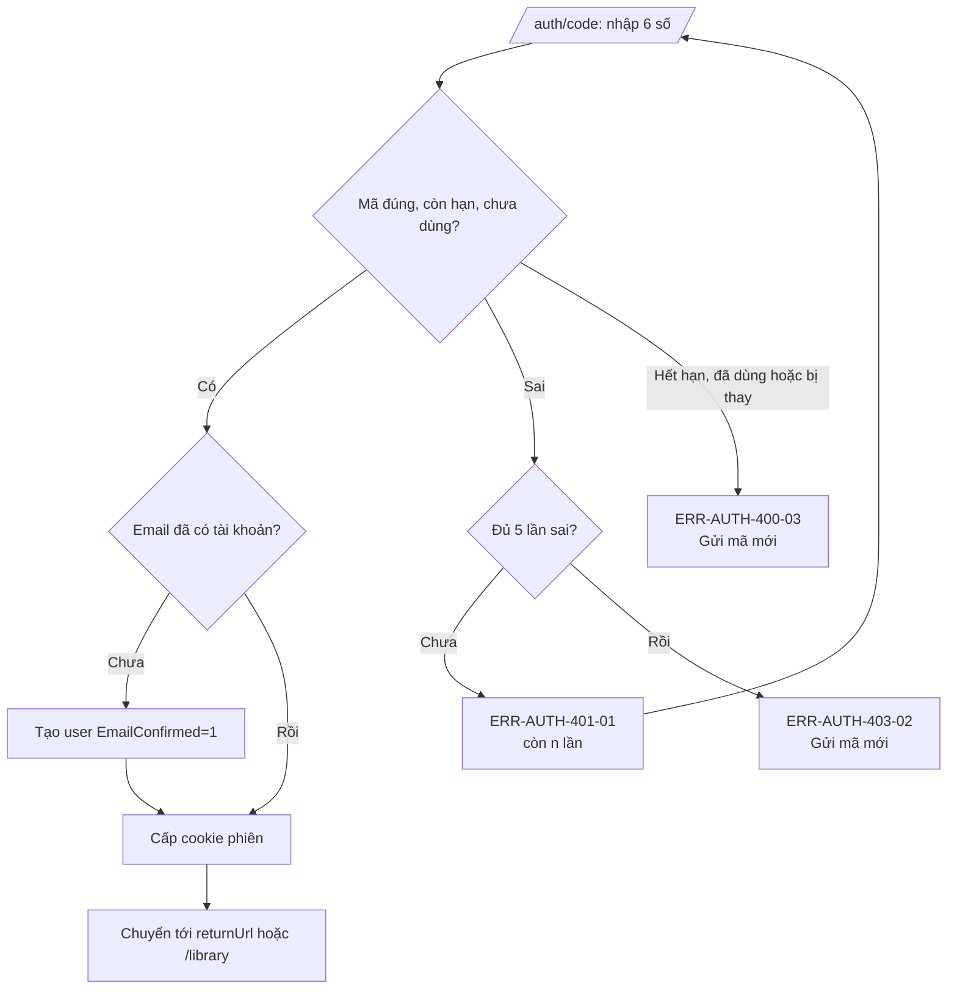
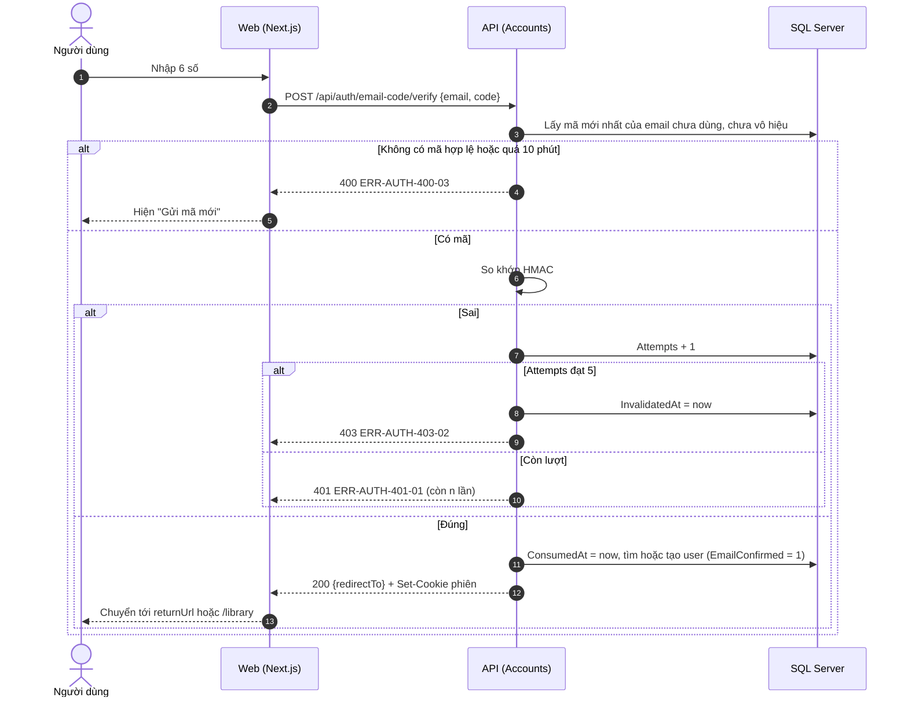
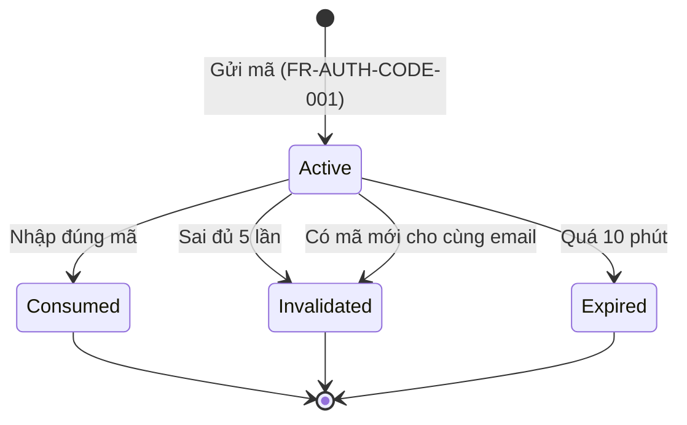

# SRS US-AUTH-02 — Nhập mã để đăng nhập hoặc tạo tài khoản

- Tính năng: FEAT-01 Tài khoản và thư viện riêng tư (`accounts`).
- User story: [US-AUTH-02](../requirements/user-stories.md#us-auth-02--nhập-mã-để-đăng-nhập-hoặc-tạo-tài-khoản).
- Phiên bản 0.3 (2026-11-09). Trạng thái: **chờ duyệt**.
- Tài liệu chung: [README.md](README.md) (danh mục FR, BR, ERR, NFR, quy ước API, ngữ cảnh).
- Test case: [testing/test-cases.md](../testing/test-cases.md).
- Skill OpenBA áp dụng: `srs` (FR, BR, ERR, NFR), `user-flow`, `sequence`, `state`, `wireframe-ascii`, `api-design`, `ac`.

## 1. Giới thiệu

Là người dùng, tôi muốn nhập mã từ email để vào thư viện; lần đầu thì tài khoản được tạo luôn.

**Trong phạm vi:**

- Màn hình "Nhập mã" 6 ô, đếm ngược 10 phút.
- Xác minh mã; tạo tài khoản mới khi email chưa có; đăng nhập khi đã có.
- Xử lý mã sai, hết hạn, đã dùng, bị thay thế.

**Ngoài phạm vi:**

- Gửi lại mã (US-AUTH-07).
- Duy trì phiên sau khi đăng nhập (US-AUTH-03).

## 2. Yêu cầu áp dụng

### 2.1 Yêu cầu chức năng (FR)

**`FR-AUTH-CODE-002` — Xác minh mã; tạo tài khoản lần đầu hoặc đăng nhập**

- Input: `email`, `code`.
- Xử lý: Tìm mã còn hiệu lực mới nhất của email. So khớp HMAC. Sai thì tăng `Attempts`, đủ 5 thì vô hiệu mã (BR-AUTH-002). Đúng thì đánh dấu `ConsumedAt`, tìm user theo email; chưa có thì tạo user với `EmailConfirmed = 1` (BR-AUTH-003); phát cookie phiên (BR-AUTH-008).
- Output: `200 {redirectTo}` và `Set-Cookie`; hoặc lỗi 400-03, 401-01, 403-02, 429-01.

### 2.2 Quy tắc nghiệp vụ (BR)

Phát biểu theo dạng KHI, THÌ, NGOẠI LỆ (`rules/02`). Nội dung chính thức nằm ở [README.md](README.md); bảng dưới là bản sao các quy tắc áp dụng cho story này.

| Mã BR | Quy tắc | KHI | THÌ | NGOẠI LỆ |
| --- | --- | --- | --- | --- |
| `BR-AUTH-001` | Mã đăng nhập | Gửi mã | Mã 6 chữ số, sinh bằng bộ sinh ngẫu nhiên an toàn. Dùng một lần. Chỉ lưu HMAC-SHA256 của mã với khóa bí mật từ biến môi trường, không lưu mã thô. Không ghi mã vào log | — |
| `BR-AUTH-002` | Sai mã | Xác minh mã | Mỗi lần sai tăng `Attempts`; đủ 5 lần thì vô hiệu mã đó. Muốn có mã mới thì yêu cầu lại (BR-AUTH-009) | — |
| `BR-AUTH-003` | Tài khoản luôn có email đã xác minh | Tạo tài khoản | Tài khoản chỉ được tạo sau khi email đã được chứng minh (mã đúng hoặc Google `email_verified`). `EmailConfirmed = 1` cho mọi tài khoản | — |
| `BR-AUTH-006` | Hạn thời gian | Tạo mã, trạng thái chờ Facebook | Mã hết hạn sau 10 phút. Trạng thái chờ Facebook hết hạn sau 10 phút | — |
| `BR-AUTH-013` | Giới hạn theo IP | Gọi endpoint xác thực | Gửi mã: 10 lần/10 phút/IP. Xác minh mã: 20 lần/10 phút/IP. Bắt đầu đăng nhập ngoài: 20 lần/phút/IP. Vượt thì ERR-AUTH-429-01 | — |

### 2.3 Ma trận lỗi (ERR)

Theo `rules/03` và `rules/11`. Nội dung chính thức nằm ở [README.md](README.md); bảng dưới là bản sao các lỗi áp dụng cho story này.

| Mã ERR | HTTP | Điều kiện phát sinh | Khóa i18n | Thông báo người dùng | Mức độ | Hành động trên giao diện | Ghi log (không chứa mã hay email đầy đủ) |
| --- | --- | --- | --- | --- | --- | --- | --- |
| `ERR-AUTH-400-03` | 400 | Mã đã quá 10 phút, đã dùng, hoặc đã bị mã mới thay thế | `auth.error.400-03` | "Mã đã hết hạn hoặc đã dùng. Hãy yêu cầu mã mới." | High | Hiện nút "Gửi mã mới" | Code expired or consumed |
| `ERR-AUTH-401-01` | 401 | Mã không khớp (dưới 5 lần sai) | `auth.error.401-01` | "Mã không đúng. Bạn còn {n} lần thử." | Medium | Xóa các ô mã, focus ô đầu | Code mismatch: attempts |
| `ERR-AUTH-403-02` | 403 | Mã bị vô hiệu do sai 5 lần | `auth.error.403-02` | "Mã này đã bị khóa do nhập sai nhiều lần. Hãy yêu cầu mã mới." | High | Hiện nút "Gửi mã mới" | Code locked: attempts |
| `ERR-AUTH-429-01` | 429 | Vượt giới hạn gửi mã hoặc giới hạn theo IP (BR-AUTH-009, BR-AUTH-013) | `auth.error.429-01` | "Bạn thao tác quá nhanh. Vui lòng đợi {giây} giây." | Medium | Vô hiệu nút, đếm ngược theo `Retry-After` | Rate limited: policy |

### 2.4 Yêu cầu phi chức năng (NFR)

- `NFR-SEC-001`: Mã: HMAC-SHA256, hiệu lực 10 phút, 5 lần sai, giới hạn gửi (BR-AUTH-001, 002, 009). HTTPS ngoài Development.
- `NFR-PERF-001`: Gửi mã và xác minh có P95 ≤ 300 ms, không tính thời gian gửi thư (gửi bất đồng bộ qua outbox).
- `NFR-A11Y-001`: Ô mã là 6 ô có nhãn, `autocomplete="one-time-code"`, dán được cả 6 số vào ô đầu; thông báo lỗi có `role="alert"`; thao tác được bằng bàn phím.

## 3. Luồng

### 3.1 User flow

_Skill `user-flow`: màn hình và chuyển đổi, kèm các trạng thái giao diện._



| Trạng thái | Hiển thị |
| --- | --- |
| Bình thường | 6 ô mã, đếm ngược 10 phút, nút "Xác nhận", "Gửi mã mới" sau 60 giây. |
| Đang tải | Sau khi đủ 6 số: các ô bị khóa, hiện spinner trên nút "Xác nhận". |
| Trống | 6 ô trống, focus ô đầu. |
| Lỗi | 401-01: số lần còn lại, xóa ô, focus ô đầu. 403-02 và 400-03: nút "Gửi mã mới". |
| Mất kết nối | Không hỗ trợ ngoại tuyến. Hiện "Mất kết nối" và nút "Thử lại"; không mất dữ liệu đã nhập. |

### 3.2 Sequence

_Skill `sequence`: tương tác giữa các thành phần; nhánh lỗi ghi mã `ERR-xxx`._



### 3.3 Trạng thái

_Skill `state`._

Vòng đời của một mã đăng nhập (`accounts.EmailLoginCodes`), theo `rules/12`:



| Trạng thái hiện tại | Sự kiện | Điều kiện bảo vệ (Guard) | Trạng thái tiếp theo | Vai trò thực hiện |
| --- | --- | --- | --- | --- |
| Active | Nhập đúng mã | Chưa quá 10 phút, `ConsumedAt` và `InvalidatedAt` trống | Consumed | Người dùng |
| Active | Nhập sai mã | `Attempts` + 1 < 5 | Active | Người dùng |
| Active | Nhập sai mã | `Attempts` + 1 = 5 | Invalidated | Hệ thống |
| Active | Yêu cầu mã mới cho cùng email | Qua kiểm tra BR-AUTH-009 | Invalidated | Hệ thống |
| Active | Hết 10 phút | `ExpiresAt` < hiện tại | Expired | Hệ thống |

## 4. Acceptance criteria

_Skill `ac`. Văn bản Gherkin trùng với [user story](../requirements/user-stories.md) (nguồn chính thức); sửa ở đó rồi cập nhật lại đây. Script `tools/feature-docs/check_feature_docs.py` kiểm tra hai bản khớp nhau._

```gherkin
Scenario: AC-01 Mã đúng với email mới
  Given tôi đã yêu cầu mã cho "an@example.com" chưa có tài khoản
  When tôi nhập đúng mã
  Then hệ thống tạo tài khoản với email đã xác minh (BR-AUTH-003)
  And tôi được đăng nhập và chuyển tới "Thư viện"

Scenario: AC-02 Mã đúng với email đã có tài khoản
  Given "an@example.com" đã có tài khoản
  When tôi nhập đúng mã
  Then tôi được đăng nhập vào tài khoản đó, không tạo tài khoản mới

Scenario: AC-03 Mã sai
  When tôi nhập sai mã
  Then tôi thấy "Mã không đúng. Bạn còn 4 lần thử." (ERR-AUTH-401-01)
  And các ô mã được xóa và focus về ô đầu tiên

Scenario: AC-04 Sai đủ 5 lần
  Given tôi đã nhập sai 4 lần
  When tôi nhập sai lần thứ 5
  Then mã đó bị vô hiệu và tôi thấy ERR-AUTH-403-02 với nút "Gửi mã mới" (BR-AUTH-002)
  And mã đó không dùng được nữa dù nhập đúng

Scenario: AC-05 Mã hết hạn
  Given đã quá 10 phút kể từ khi gửi mã
  When tôi nhập mã đó
  Then tôi thấy ERR-AUTH-400-03 "Mã đã hết hạn hoặc đã dùng" và nút "Gửi mã mới"

Scenario: AC-06 Mã đã dùng
  Given tôi đã đăng nhập bằng mã này
  When tôi nhập lại đúng mã đó
  Then tôi thấy ERR-AUTH-400-03 (BR-AUTH-001)

Scenario: AC-07 Mã mới làm mã cũ mất hiệu lực
  Given tôi có hai mã đã gửi cho cùng email
  When tôi nhập mã cũ sau khi đã có mã mới
  Then mã cũ bị từ chối với ERR-AUTH-400-03
```

| AC | Nội dung | FR | BR | ERR | Wireframe | Test case |
| --- | --- | --- | --- | --- | --- | --- |
| AC-01 | Mã đúng với email mới | `FR-AUTH-CODE-002` | `BR-AUTH-003` | — | W-AUTH-05 | TC-AUTH-006 |
| AC-02 | Mã đúng với email đã có tài khoản | `FR-AUTH-CODE-002` | — | — | W-AUTH-05 | TC-AUTH-007 |
| AC-03 | Mã sai | `FR-AUTH-CODE-002` | `BR-AUTH-002` | `ERR-AUTH-401-01` | W-AUTH-06 | TC-AUTH-008 |
| AC-04 | Sai đủ 5 lần | `FR-AUTH-CODE-002` | `BR-AUTH-002` | `ERR-AUTH-403-02` | W-AUTH-07 | TC-AUTH-009 |
| AC-05 | Mã hết hạn | `FR-AUTH-CODE-002` | `BR-AUTH-006` | `ERR-AUTH-400-03` | W-AUTH-08 | TC-AUTH-010 |
| AC-06 | Mã đã dùng | `FR-AUTH-CODE-002` | `BR-AUTH-001` | `ERR-AUTH-400-03` | W-AUTH-08 | TC-AUTH-011 |
| AC-07 | Mã mới làm mã cũ mất hiệu lực | `FR-AUTH-CODE-002` | `BR-AUTH-009` | `ERR-AUTH-400-03` | W-AUTH-08 | TC-AUTH-012 |

## 5. Wireframe

_Skill `wireframe-ascii`. Figma: chưa dựng màn hình (`DES-01`); wireframe ASCII là căn cứ cho DoR. Quy tắc: vẽ đủ mọi màn hình, hộp thoại và trạng thái mà AC của story nhắc tới._

### W-AUTH-05 — Nhập mã: trạng thái ban đầu (`/auth/code`)

```text
┌────────────────────────────────────────────────────────────────┐
│                         [Logo Lingozi]                         │
│                                                                │
│         ┌────────────────────────────────────────────┐         │
│         │ Nhập mã                                    │         │
│         │ Chúng tôi đã gửi mã 6 số tới               │         │
│         │ an@example.com.                            │         │
│         │ Mã có hiệu lực 10 phút (còn 09:58).        │         │
│         │                                            │         │
│         │ [ ] [ ] [ ] [ ] [ ] [ ]                    │         │
│         │                                            │         │
│         │ [            Xác nhận            ]         │         │
│         │                                            │         │
│         │ Không nhận được mã?   Đổi email            │         │
│         └────────────────────────────────────────────┘         │
│                                                                │
│            Chính sách quyền riêng tư · Xóa dữ liệu             │
└────────────────────────────────────────────────────────────────┘
```

- Sáu ô, mỗi ô có nhãn riêng; `autocomplete="one-time-code"`, `inputmode="numeric"`.
- Dán 6 số vào ô đầu thì điền cả sáu ô; đủ 6 số thì tự gửi xác nhận.
- Đếm ngược 10 phút theo thời hạn của mã.
- Không có ô mật khẩu.

### W-AUTH-06 — Nhập mã: mã sai (ERR-AUTH-401-01)

```text
┌────────────────────────────────────────────────────────────────┐
│                         [Logo Lingozi]                         │
│                                                                │
│         ┌────────────────────────────────────────────┐         │
│         │ Nhập mã                                    │         │
│         │ Chúng tôi đã gửi mã 6 số tới               │         │
│         │ an@example.com.                            │         │
│         │ Mã có hiệu lực 10 phút (còn 09:58).        │         │
│         │                                            │         │
│         │ [ ] [ ] [ ] [ ] [ ] [ ]                    │         │
│         │ (!) Mã không đúng. Bạn còn 4 lần thử.      │         │
│         │ [            Xác nhận            ]         │         │
│         │                                            │         │
│         │ Không nhận được mã?   Đổi email            │         │
│         └────────────────────────────────────────────┘         │
│                                                                │
│            Chính sách quyền riêng tư · Xóa dữ liệu             │
└────────────────────────────────────────────────────────────────┘
```

- Cả sáu ô được xóa và focus về ô đầu tiên; thông báo có `role="alert"`.
- Số lần còn lại giảm theo mỗi lần sai (tối đa 5 lần).

### W-AUTH-07 — Nhập mã: mã bị khóa (ERR-AUTH-403-02)

```text
┌────────────────────────────────────────────────────────────────┐
│                         [Logo Lingozi]                         │
│                                                                │
│         ┌────────────────────────────────────────────┐         │
│         │ Nhập mã                                    │         │
│         │ Mã này đã bị khóa.                         │         │
│         │                                            │         │
│         │ [x] [x] [x] [x] [x] [x]  (vô hiệu)         │         │
│         │ (!) Mã này đã bị khóa do nhập sai          │         │
│         │     nhiều lần. Hãy yêu cầu mã mới.         │         │
│         │ [           Gửi mã mới           ]         │         │
│         │                                            │         │
│         │ Đổi email                                  │         │
│         └────────────────────────────────────────────┘         │
│                                                                │
│            Chính sách quyền riêng tư · Xóa dữ liệu             │
└────────────────────────────────────────────────────────────────┘
```

- Sáu ô bị vô hiệu; nút "Gửi mã mới" nổi bật (tuân thủ giới hạn BR-AUTH-009).
- Mã đã khóa không dùng được dù nhập đúng.

### W-AUTH-08 — Nhập mã: hết hạn hoặc đã dùng (ERR-AUTH-400-03)

```text
┌────────────────────────────────────────────────────────────────┐
│                         [Logo Lingozi]                         │
│                                                                │
│         ┌────────────────────────────────────────────┐         │
│         │ Nhập mã                                    │         │
│         │                                            │         │
│         │ [ ] [ ] [ ] [ ] [ ] [ ]                    │         │
│         │ (!) Mã đã hết hạn hoặc đã dùng.            │         │
│         │     Hãy yêu cầu mã mới.                    │         │
│         │ [           Gửi mã mới           ]         │         │
│         │                                            │         │
│         │ Đổi email                                  │         │
│         └────────────────────────────────────────────┘         │
│                                                                │
│            Chính sách quyền riêng tư · Xóa dữ liệu             │
└────────────────────────────────────────────────────────────────┘
```

- Dùng chung cho mã quá 10 phút, mã đã dùng, và mã bị thay bằng mã mới hơn.

### Điều hướng và liên kết màn hình

- Sau khi đăng nhập, người dùng chuyển tới "Thư viện" [W-LIB-01](../../knowledge-items/srs/US-LIB-03-list-items.md) (thuộc FEAT-02).

## 6. API

_Skill `api-design`; lỗi theo Problem Details (RFC 9457) như ADR 0002. Quy ước chung ở [README.md](README.md)._

| Method và path | Quyền | Body | Thành công | Lỗi |
| --- | --- | --- | --- | --- |
| `POST /api/auth/email-code/verify` | Công khai | `{ email, code }` | 200 `{ redirectTo }` + cookie phiên | 400-03, 401-01, 403-02, 429-01 |

Yêu cầu:

```http
POST /api/auth/email-code/verify
Content-Type: application/json
X-XSRF-TOKEN: <token>

{ "email": "an@example.com", "code": "417128" }
```

Phản hồi thành công (kèm `Set-Cookie: __Host-lingozi.session=...; HttpOnly; Secure; SameSite=Lax`):

```json
{ "redirectTo": "/library" }
```

Lỗi sai mã:

```json
{ "status": 401, "code": "ERR-AUTH-401-01", "remainingAttempts": 4 }
```

## 7. Truy vết test case

| TC | Loại | Bước chính | Kết quả mong đợi |
| --- | --- | --- | --- |
| `TC-AUTH-006` | INT + E2E | Mã đúng với email mới | 200 + cookie; user mới `EmailConfirmed=1`; chuyển tới "Thư viện" |
| `TC-AUTH-007` | INT | Mã đúng với email đã có tài khoản | 200; số user không đổi |
| `TC-AUTH-008` | INT + E2E | Mã sai một lần | 401-01 "còn 4 lần thử"; ô mã được xóa (E2E) |
| `TC-AUTH-009` | INT | Năm lần sai, rồi nhập đúng mã | Lần năm 403-02; mã đúng vẫn bị từ chối |
| `TC-AUTH-010` | INT | Mã đúng sau 10 phút (đẩy thời gian) | 400-03 |
| `TC-AUTH-011` | INT | Mã đúng dùng lần thứ hai | 400-03 |
| `TC-AUTH-012` | INT | Yêu cầu mã thứ hai (sau 60 giây), nhập mã thứ nhất | 400-03 cho mã thứ nhất; mã thứ hai đăng nhập được |

## 8. Lịch sử sửa đổi

| Phiên bản | Ngày | Thay đổi |
| --- | --- | --- |
| 0.3 | 2026-11-09 | Tách từ `srs.md` và `design/` thành file riêng cho story; thêm FR chi tiết, sequence, state, bảng AC → FR/BR/ERR/TC. |
