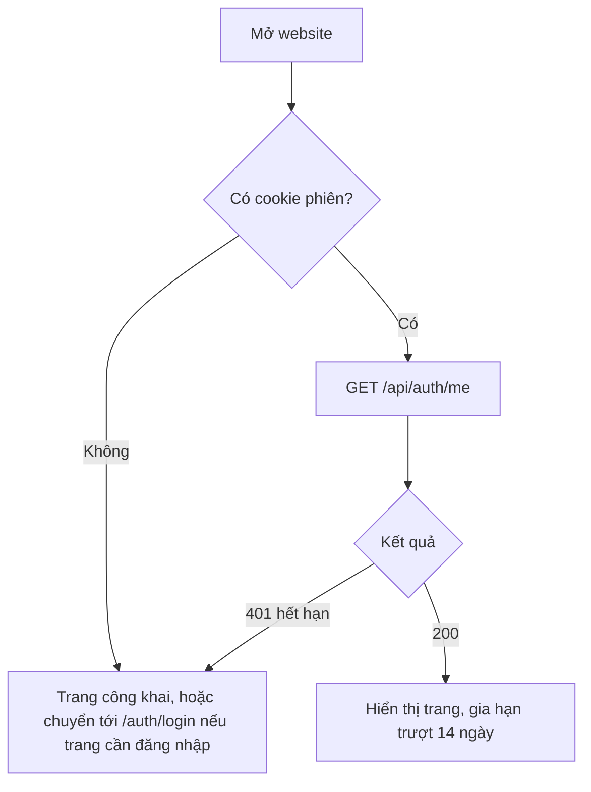
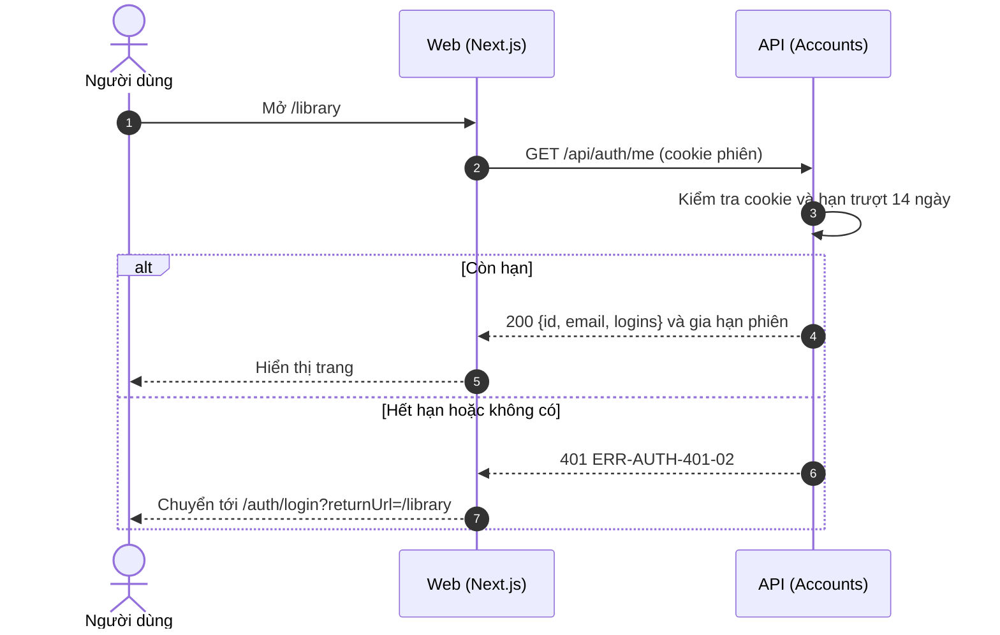
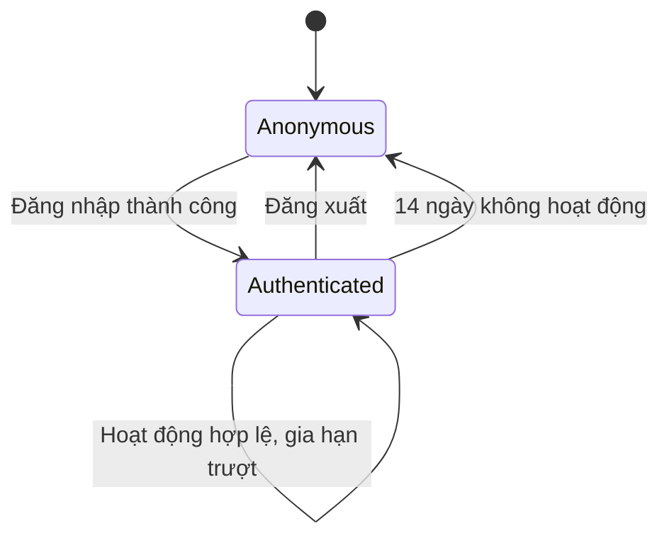

# SRS US-AUTH-03 — Giữ phiên đăng nhập

- Tính năng: FEAT-01 Tài khoản và thư viện riêng tư (`accounts`).
- User story: [US-AUTH-03](../requirements/user-stories.md#us-auth-03--giữ-phiên-đăng-nhập).
- Phiên bản 0.3 (2026-11-09). Trạng thái: **chờ duyệt**.
- Tài liệu chung: [README.md](README.md) (danh mục FR, BR, ERR, NFR, quy ước API, ngữ cảnh).
- Test case: [testing/test-cases.md](../testing/test-cases.md).
- Skill OpenBA áp dụng: `srs` (FR, BR, ERR, NFR), `user-flow`, `sequence`, `state`, `wireframe-ascii`, `api-design`, `ac`.

## 1. Giới thiệu

Là người dùng, tôi muốn không phải đăng nhập lại mỗi lần mở trình duyệt.

**Trong phạm vi:**

- Cookie phiên HttpOnly, hết hạn trượt 14 ngày.
- Khôi phục phiên khi mở lại website.
- Không có mật khẩu ở bất kỳ trang xác thực nào.

**Ngoài phạm vi:**

- Đăng nhập (US-AUTH-01, 02, 04, 05).
- Đăng xuất (US-AUTH-08).

## 2. Yêu cầu áp dụng

### 2.1 Yêu cầu chức năng (FR)

**`FR-AUTH-SES-001` — Giữ phiên đăng nhập bằng cookie**

- Input: Cookie phiên `__Host-lingozi.session`.
- Xử lý: Kiểm tra cookie hợp lệ và chưa hết hạn trượt (14 ngày không hoạt động, BR-AUTH-008). Mỗi lần hoạt động hợp lệ gia hạn thời gian trượt.
- Output: Người dùng được xác định, hoặc `401 ERR-AUTH-401-02`.

**`FR-AUTH-SES-003` — Lấy thông tin người dùng hiện tại**

- Input: Cookie phiên.
- Xử lý: Đọc `UserId` từ phiên; trả thông tin cơ bản và các phương thức đăng nhập đã liên kết.
- Output: `200 {id, email, displayName, logins}` hoặc `401 ERR-AUTH-401-02`.

### 2.2 Quy tắc nghiệp vụ (BR)

Phát biểu theo dạng KHI, THÌ, NGOẠI LỆ (`rules/02`). Nội dung chính thức nằm ở [README.md](README.md); bảng dưới là bản sao các quy tắc áp dụng cho story này.

| Mã BR | Quy tắc | KHI | THÌ | NGOẠI LỆ |
| --- | --- | --- | --- | --- |
| `BR-AUTH-008` | Phiên đăng nhập | Đăng nhập thành công | Cookie `__Host-lingozi.session`: HttpOnly, Secure, SameSite=Lax; hết hạn trượt 14 ngày không hoạt động | Development dùng HTTP: không có tiền tố `__Host-` và không Secure |
| `BR-AUTH-010` | Không có mật khẩu | — | Không có chức năng đặt hoặc đổi mật khẩu. Thay bằng mã đăng nhập (US-AUTH-02). Mục này thay cho quy tắc mật khẩu của v0.2 | — |

### 2.3 Ma trận lỗi (ERR)

Theo `rules/03` và `rules/11`. Nội dung chính thức nằm ở [README.md](README.md); bảng dưới là bản sao các lỗi áp dụng cho story này.

| Mã ERR | HTTP | Điều kiện phát sinh | Khóa i18n | Thông báo người dùng | Mức độ | Hành động trên giao diện | Ghi log (không chứa mã hay email đầy đủ) |
| --- | --- | --- | --- | --- | --- | --- | --- |
| `ERR-AUTH-401-02` | 401 | Không có phiên hợp lệ khi truy cập API hoặc trang cần đăng nhập | `auth.error.401-02` | "Vui lòng đăng nhập để tiếp tục." | Medium | Chuyển tới "Đăng nhập" kèm `returnUrl` | Unauthenticated request: đường dẫn |

### 2.4 Yêu cầu phi chức năng (NFR)

- `NFR-SEC-001`: Mã: HMAC-SHA256, hiệu lực 10 phút, 5 lần sai, giới hạn gửi (BR-AUTH-001, 002, 009). HTTPS ngoài Development.

## 3. Luồng

### 3.1 User flow

_Skill `user-flow`: màn hình và chuyển đổi, kèm các trạng thái giao diện._



| Trạng thái | Hiển thị |
| --- | --- |
| Bình thường | Đã đăng nhập: hiển thị trang và tên tài khoản. |
| Đang tải | `Skeleton` trong lúc gọi `/api/auth/me`. |
| Trống | Không áp dụng. |
| Lỗi | 401-02: chuyển tới "Đăng nhập" kèm `returnUrl`. |
| Mất kết nối | Không hỗ trợ ngoại tuyến. Hiện "Mất kết nối" và nút "Thử lại"; không mất dữ liệu đã nhập. |

### 3.2 Sequence

_Skill `sequence`: tương tác giữa các thành phần; nhánh lỗi ghi mã `ERR-xxx`._



### 3.3 Trạng thái

_Skill `state`._

Vòng đời phiên đăng nhập, theo `rules/12`:



| Trạng thái hiện tại | Sự kiện | Điều kiện bảo vệ (Guard) | Trạng thái tiếp theo | Vai trò thực hiện |
| --- | --- | --- | --- | --- |
| Anonymous | Mã đúng, hoặc Google/Facebook hoàn tất | Qua các kiểm tra ở US-AUTH-02, 04, 05 | Authenticated | Người dùng |
| Authenticated | Request hợp lệ | Cookie hợp lệ | Authenticated | Hệ thống |
| Authenticated | Đăng xuất | — | Anonymous | Người dùng |
| Authenticated | Không hoạt động | Quá 14 ngày | Anonymous | Hệ thống |

## 4. Wireframe

_Skill `wireframe-ascii`. Figma: chưa dựng màn hình (`DES-01`); wireframe ASCII là căn cứ cho DoR. Quy tắc: vẽ đủ mọi màn hình, hộp thoại và trạng thái mà AC của story nhắc tới._

### W-AUTH-01 — Đăng nhập: trạng thái ban đầu (`/auth/login`)

```text
┌────────────────────────────────────────────────────────────────┐
│                         [Logo Lingozi]                         │
│                                                                │
│         ┌────────────────────────────────────────────┐         │
│         │ Đăng nhập                                  │         │
│         │ Đăng nhập hoặc tạo tài khoản mới.          │         │
│         │                                            │         │
│         │ [ G   Tiếp tục với Google     ]            │         │
│         │ [ f   Tiếp tục với Facebook   ]            │         │
│         │ ────────────── hoặc ──────────────         │         │
│         │ [     Tiếp tục với email      ]            │         │
│         └────────────────────────────────────────────┘         │
│                                                                │
│            Chính sách quyền riêng tư · Xóa dữ liệu             │
└────────────────────────────────────────────────────────────────┘
```

- Ba phương thức theo thứ tự: Google, Facebook, email. Facebook thay cho Apple.
- Ô email ẩn cho tới khi bấm "Tiếp tục với email".
- Không có ô mật khẩu và không có liên kết "Quên mật khẩu".
- Chân trang có liên kết tới `/privacy` và `/data-deletion`.
- Nút của nhà cung cấp chưa được cấu hình bị ẩn (API `start` trả 404).

### W-AUTH-05 — Nhập mã: trạng thái ban đầu (`/auth/code`)

```text
┌────────────────────────────────────────────────────────────────┐
│                         [Logo Lingozi]                         │
│                                                                │
│         ┌────────────────────────────────────────────┐         │
│         │ Nhập mã                                    │         │
│         │ Chúng tôi đã gửi mã 6 số tới               │         │
│         │ an@example.com.                            │         │
│         │ Mã có hiệu lực 10 phút (còn 09:58).        │         │
│         │                                            │         │
│         │ [ ] [ ] [ ] [ ] [ ] [ ]                    │         │
│         │                                            │         │
│         │ [            Xác nhận            ]         │         │
│         │                                            │         │
│         │ Không nhận được mã?   Đổi email            │         │
│         └────────────────────────────────────────────┘         │
│                                                                │
│            Chính sách quyền riêng tư · Xóa dữ liệu             │
└────────────────────────────────────────────────────────────────┘
```

- Sáu ô, mỗi ô có nhãn riêng; `autocomplete="one-time-code"`, `inputmode="numeric"`.
- Dán 6 số vào ô đầu thì điền cả sáu ô; đủ 6 số thì tự gửi xác nhận.
- Đếm ngược 10 phút theo thời hạn của mã.
- Không có ô mật khẩu.

### Điều hướng và liên kết màn hình

- Màn hình "Thư viện" mà người dùng vẫn ở lại khi phiên còn hạn: [W-LIB-01](../../knowledge-items/srs/US-LIB-03-list-items.md) (thuộc FEAT-02).
- Khi phiên hết hạn, người dùng thấy W-AUTH-01 với URL `/auth/login?returnUrl=...`; không có thông báo riêng.

## 5. API

_Skill `api-design`; lỗi theo Problem Details (RFC 9457) như ADR 0002. Quy ước chung ở [README.md](README.md)._

| Method và path | Quyền | Body | Thành công | Lỗi |
| --- | --- | --- | --- | --- |
| `GET /api/auth/me` | Đã đăng nhập | — | 200 `{ id, email, displayName, logins: ["google"?, "facebook"?] }` | 401-02 |

Yêu cầu:

```http
GET /api/auth/me
Cookie: __Host-lingozi.session=...
```

Phản hồi:

```json
{ "id": "7c1f...", "email": "an@example.com", "displayName": null, "logins": ["google"] }
```

## 6. Acceptance criteria

_Skill `ac`. Văn bản Gherkin trùng với [user story](../requirements/user-stories.md) (nguồn chính thức); sửa ở đó rồi cập nhật lại đây. Script `tools/feature-docs/check_feature_docs.py` kiểm tra hai bản khớp nhau._

```gherkin
Scenario: AC-01 Phiên còn hạn
  Given tôi đã đăng nhập cách đây 3 ngày
  When tôi mở lại website
  Then tôi vẫn ở trong thư viện (BR-AUTH-008)

Scenario: AC-02 Phiên hết hạn
  Given phiên của tôi đã không hoạt động trong 14 ngày
  When tôi mở "Thư viện"
  Then tôi được chuyển tới "Đăng nhập" với returnUrl (ERR-AUTH-401-02)

Scenario: AC-03 Không có ô mật khẩu ở đâu
  When tôi mở bất kỳ trang nào trong "/auth/*"
  Then không có ô nhập mật khẩu và không có liên kết "Quên mật khẩu"
```

| AC | Nội dung | FR | BR | ERR | Wireframe | Test case |
| --- | --- | --- | --- | --- | --- | --- |
| AC-01 | Phiên còn hạn | `FR-AUTH-SES-001` | `BR-AUTH-008` | — | [W-LIB-01](../../knowledge-items/srs/US-LIB-03-list-items.md) | TC-AUTH-013 |
| AC-02 | Phiên hết hạn | `FR-AUTH-SES-001` | `BR-AUTH-008` | `ERR-AUTH-401-02` | W-AUTH-01 | TC-AUTH-014 |
| AC-03 | Không có ô mật khẩu ở đâu | `FR-AUTH-SES-001` | `BR-AUTH-010` | — | W-AUTH-01, W-AUTH-05 | TC-AUTH-015 |

## 7. Truy vết test case

| TC | Loại | Bước chính | Kết quả mong đợi |
| --- | --- | --- | --- |
| `TC-AUTH-013` | INT + E2E | Đăng nhập; đẩy 3 ngày; tải lại | Vẫn trong thư viện; cookie HttpOnly, SameSite=Lax |
| `TC-AUTH-014` | INT + E2E | Đẩy 14 ngày không hoạt động; mở thư viện | 401-02; chuyển tới đăng nhập với returnUrl |
| `TC-AUTH-015` | E2E | Quét `/auth/login`, `/auth/code` | Không có `input[type=password]`; không có link "Quên mật khẩu" |

## 8. Lịch sử sửa đổi

| Phiên bản | Ngày | Thay đổi |
| --- | --- | --- |
| 0.3 | 2026-11-09 | Tách từ `srs.md` và `design/` thành file riêng cho story; thêm FR chi tiết, sequence, state, bảng AC → FR/BR/ERR/TC. |
