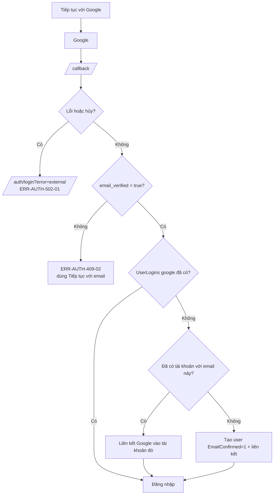
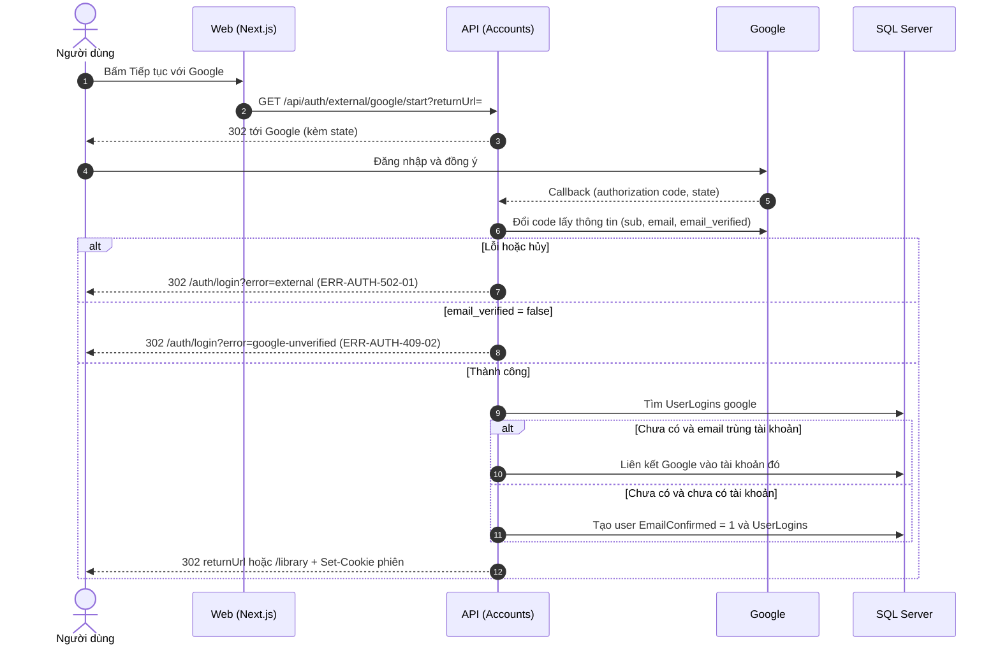

# SRS US-AUTH-04 — Đăng nhập bằng Google

- Tính năng: FEAT-01 Tài khoản và thư viện riêng tư (`accounts`).
- User story: [US-AUTH-04](../requirements/user-stories.md#us-auth-04--đăng-nhập-bằng-google).
- Phiên bản 0.3 (2026-11-09). Trạng thái: **chờ duyệt**.
- Tài liệu chung: [README.md](README.md) (danh mục FR, BR, ERR, NFR, quy ước API, ngữ cảnh).
- Test case: [testing/test-cases.md](../testing/test-cases.md).
- Skill OpenBA áp dụng: `srs` (FR, BR, ERR, NFR), `user-flow`, `sequence`, `wireframe-ascii`, `api-design`, `ac`.

## 1. Giới thiệu

Là người dùng, tôi muốn đăng nhập bằng Google để không phải nhập mã.

**Trong phạm vi:**

- Nút "Tiếp tục với Google" trên màn hình "Đăng nhập".
- Tạo tài khoản hoặc liên kết với tài khoản có sẵn theo email Google đã xác minh.

**Ngoài phạm vi:**

- Liên kết trong Cài đặt tài khoản (US-AUTH-06).

## 2. Yêu cầu áp dụng

### 2.1 Yêu cầu chức năng (FR)

**`FR-AUTH-EXT-001` — Đăng nhập hoặc đăng ký bằng Google**

- Input: Kết quả callback OAuth 2.0 (authorization code) từ Google: `sub`, `email`, `email_verified`.
- Xử lý: Kiểm tra `state` và kết quả. Tin cậy email khi `email_verified = true` (BR-AUTH-004): đã có `UserLogins` google thì đăng nhập; chưa có nhưng email đã có tài khoản thì liên kết; chưa có tài khoản thì tạo mới với `EmailConfirmed = 1`. `email_verified = false` thì không đăng nhập (ERR-AUTH-409-02).
- Output: `302` về `returnUrl` hoặc `/library`; hoặc `302` về `/auth/login?error=...`.

### 2.2 Quy tắc nghiệp vụ (BR)

Phát biểu theo dạng KHI, THÌ, NGOẠI LỆ (`rules/02`). Nội dung chính thức nằm ở [README.md](README.md); bảng dưới là bản sao các quy tắc áp dụng cho story này.

| Mã BR | Quy tắc | KHI | THÌ | NGOẠI LỆ |
| --- | --- | --- | --- | --- |
| `BR-AUTH-004` | Google theo email | Google trả email | Tự liên kết hoặc tạo khi `email_verified = true`. Nếu `false` thì không đăng nhập, trả ERR-AUTH-409-02 | — |
| `BR-AUTH-012` | Một tài khoản ngoài thuộc một người | Liên kết hoặc tạo bằng Google/Facebook | (`LoginProvider`, `ProviderKey`) là duy nhất; đã thuộc user khác thì ERR-AUTH-409-01 | — |

### 2.3 Ma trận lỗi (ERR)

Theo `rules/03` và `rules/11`. Nội dung chính thức nằm ở [README.md](README.md); bảng dưới là bản sao các lỗi áp dụng cho story này.

| Mã ERR | HTTP | Điều kiện phát sinh | Khóa i18n | Thông báo người dùng | Mức độ | Hành động trên giao diện | Ghi log (không chứa mã hay email đầy đủ) |
| --- | --- | --- | --- | --- | --- | --- | --- |
| `ERR-AUTH-409-02` | 409 | Facebook: email đã có tài khoản (cần mã để liên kết). Google: `email_verified = false` | `auth.error.409-02` | Facebook: "Email này đã có tài khoản Lingozi. Chúng tôi sẽ gửi mã để xác nhận trước khi liên kết." Google: "Email này chưa được Google xác minh. Hãy dùng Tiếp tục với email." | Medium | Hiện dưới nút nhà cung cấp | Link requires verification: provider |
| `ERR-AUTH-502-01` | 502 | Nhà cung cấp ngoài lỗi, bị hủy, hoặc không phản hồi | `auth.error.502-01` | "Không đăng nhập được bằng {Google/Facebook}. Vui lòng thử lại." | High | Về trang "Đăng nhập" | External provider error or cancelled: provider |

### 2.4 Yêu cầu phi chức năng (NFR)

- `NFR-SEC-002`: Khóa HMAC, Google và Facebook client secret, cấu hình email chỉ đọc từ biến môi trường hoặc secret store.

## 3. Luồng

### 3.1 User flow

_Skill `user-flow`: màn hình và chuyển đổi, kèm các trạng thái giao diện._



| Trạng thái | Hiển thị |
| --- | --- |
| Bình thường | Nút "Tiếp tục với Google" hiển thị. |
| Đang tải | Sau khi bấm: nút có spinner trong lúc chuyển hướng. |
| Trống | Không áp dụng. |
| Lỗi | 502-01 khi hủy hoặc lỗi; 409-02 khi Google chưa xác minh email. |
| Mất kết nối | Không hỗ trợ ngoại tuyến. Hiện "Mất kết nối" và nút "Thử lại"; không mất dữ liệu đã nhập. |

### 3.2 Sequence

_Skill `sequence`: tương tác giữa các thành phần; nhánh lỗi ghi mã `ERR-xxx`._



## 4. Acceptance criteria

_Skill `ac`. Văn bản Gherkin trùng với [user story](../requirements/user-stories.md) (nguồn chính thức); sửa ở đó rồi cập nhật lại đây. Script `tools/feature-docs/check_feature_docs.py` kiểm tra hai bản khớp nhau._

```gherkin
Scenario: AC-01 Lần đầu dùng Google
  Given chưa có tài khoản Lingozi nào với email Google "binh@gmail.com"
  When tôi chọn "Tiếp tục với Google" và đồng ý trên Google
  Then hệ thống tạo tài khoản với email đã xác minh bởi Google
  And tôi được đăng nhập và chuyển tới "Thư viện"

Scenario: AC-02 Email Google trùng tài khoản sẵn có
  Given đã có tài khoản Lingozi với "binh@gmail.com"
  And Google báo email đã xác minh
  When tôi tiếp tục với Google
  Then Google được liên kết vào tài khoản đó và tôi được đăng nhập (BR-AUTH-004)

Scenario: AC-03 Google chưa xác minh email
  Given Google trả email "binh@gmail.com" với email_verified = false
  When tôi tiếp tục với Google
  Then không đăng nhập và không tạo tài khoản
  And tôi thấy "Email này chưa được Google xác minh. Hãy dùng Tiếp tục với email." (ERR-AUTH-409-02)

Scenario: AC-04 Hủy hoặc lỗi ở phía Google
  When tôi hủy trên Google, hoặc Google trả lỗi
  Then tôi quay về "Đăng nhập" với ERR-AUTH-502-01 và không có tài khoản nào được tạo
```

| AC | Nội dung | FR | BR | ERR | Wireframe | Test case |
| --- | --- | --- | --- | --- | --- | --- |
| AC-01 | Lần đầu dùng Google | `FR-AUTH-EXT-001` | `BR-AUTH-004`, `BR-AUTH-012` | — | W-AUTH-01 | TC-AUTH-016 |
| AC-02 | Email Google trùng tài khoản sẵn có | `FR-AUTH-EXT-001` | `BR-AUTH-004` | — | W-AUTH-01 | TC-AUTH-017 |
| AC-03 | Google chưa xác minh email | `FR-AUTH-EXT-001` | `BR-AUTH-004` | `ERR-AUTH-409-02` | W-AUTH-11 | TC-AUTH-018 |
| AC-04 | Hủy hoặc lỗi ở phía Google | `FR-AUTH-EXT-001` | — | `ERR-AUTH-502-01` | W-AUTH-10 | TC-AUTH-019 |

## 5. Wireframe

_Skill `wireframe-ascii`. Figma: chưa dựng màn hình (`DES-01`); wireframe ASCII là căn cứ cho DoR. Quy tắc: vẽ đủ mọi màn hình, hộp thoại và trạng thái mà AC của story nhắc tới._

### W-AUTH-01 — Đăng nhập: trạng thái ban đầu (`/auth/login`)

```text
┌────────────────────────────────────────────────────────────────┐
│                         [Logo Lingozi]                         │
│                                                                │
│         ┌────────────────────────────────────────────┐         │
│         │ Đăng nhập                                  │         │
│         │ Đăng nhập hoặc tạo tài khoản mới.          │         │
│         │                                            │         │
│         │ [ G   Tiếp tục với Google     ]            │         │
│         │ [ f   Tiếp tục với Facebook   ]            │         │
│         │ ────────────── hoặc ──────────────         │         │
│         │ [     Tiếp tục với email      ]            │         │
│         └────────────────────────────────────────────┘         │
│                                                                │
│            Chính sách quyền riêng tư · Xóa dữ liệu             │
└────────────────────────────────────────────────────────────────┘
```

- Ba phương thức theo thứ tự: Google, Facebook, email. Facebook thay cho Apple.
- Ô email ẩn cho tới khi bấm "Tiếp tục với email".
- Không có ô mật khẩu và không có liên kết "Quên mật khẩu".
- Chân trang có liên kết tới `/privacy` và `/data-deletion`.
- Nút Google và Facebook hiện nhưng không bấm được cho tới US-AUTH-04 và US-AUTH-05; mô tả cho trình đọc màn hình: "chưa khả dụng".

### W-AUTH-10 — Đăng nhập: lỗi nhà cung cấp hoặc phiên chờ hết hạn (ERR-AUTH-502-01, ERR-AUTH-400-04)

```text
┌────────────────────────────────────────────────────────────────┐
│                         [Logo Lingozi]                         │
│                                                                │
│         ┌────────────────────────────────────────────┐         │
│         │ Đăng nhập                                  │         │
│         │ (!) Không đăng nhập được bằng Facebook.    │         │
│         │     Vui lòng thử lại.                      │         │
│         │                                            │         │
│         │ [ G   Tiếp tục với Google     ]            │         │
│         │ [ f   Tiếp tục với Facebook   ]            │         │
│         │ ────────────── hoặc ──────────────         │         │
│         │ [     Tiếp tục với email      ]            │         │
│         └────────────────────────────────────────────┘         │
│                                                                │
│            Chính sách quyền riêng tư · Xóa dữ liệu             │
└────────────────────────────────────────────────────────────────┘
```

- Hiện khi trang mở với `?error=external` (hủy hoặc lỗi nhà cung cấp) hoặc khi phiên chờ Facebook hết hạn (400-04: "Phiên đăng nhập bằng Facebook đã hết hạn. Vui lòng thử lại.").
- Không có tài khoản nào được tạo.

### W-AUTH-11 — Đăng nhập: Google chưa xác minh email (ERR-AUTH-409-02)

```text
┌────────────────────────────────────────────────────────────────┐
│                         [Logo Lingozi]                         │
│                                                                │
│         ┌────────────────────────────────────────────┐         │
│         │ Đăng nhập                                  │         │
│         │ Đăng nhập hoặc tạo tài khoản mới.          │         │
│         │                                            │         │
│         │ [ G   Tiếp tục với Google     ]            │         │
│         │ (!) Email này chưa được Google xác minh.   │         │
│         │     Hãy dùng Tiếp tục với email.           │         │
│         │ [ f   Tiếp tục với Facebook   ]            │         │
│         │ ────────────── hoặc ──────────────         │         │
│         │ [     Tiếp tục với email      ]            │         │
│         └────────────────────────────────────────────┘         │
│                                                                │
│            Chính sách quyền riêng tư · Xóa dữ liệu             │
└────────────────────────────────────────────────────────────────┘
```

- Hiện khi trang mở với `?error=google-unverified`.
- Thông báo nằm ngay dưới nút Google; không đăng nhập và không tạo tài khoản.

## 6. API

_Skill `api-design`; lỗi theo Problem Details (RFC 9457) như ADR 0002. Quy ước chung ở [README.md](README.md)._

| Method và path | Quyền | Body | Thành công | Lỗi |
| --- | --- | --- | --- | --- |
| `GET /api/auth/external/{provider}/start?returnUrl=` | Công khai | — | 302 tới nhà cung cấp; `provider` là `google` hoặc `facebook`; provider khác hoặc chưa cấu hình thì 404 | 429-01 |
| `GET /api/auth/external/{provider}/callback` | Nhà cung cấp gọi về | — | 302 (xem mục 3) | 502-01 qua query `?error=external` |

Bắt đầu: `GET /api/auth/external/google/start?returnUrl=/library` trả `302` tới Google.

Callback: `GET /api/auth/external/google/callback?code=...&state=...` trả `302` theo bảng kết quả callback ở [README](README.md#kết-quả-callback-của-nhà-cung-cấp).

## 7. Truy vết test case

| TC | Loại | Bước chính | Kết quả mong đợi |
| --- | --- | --- | --- |
| `TC-AUTH-016` | INT + E2E | Google giả: email mới, verified | Tài khoản mới `EmailConfirmed=1`, có `UserLogins` google |
| `TC-AUTH-017` | INT | Google verified, tài khoản có sẵn | Liên kết vào user cũ; không tạo user |
| `TC-AUTH-018` | INT + E2E | Google `email_verified=false` | Không đăng nhập; 409-02 với thông báo Google |
| `TC-AUTH-019` | INT | Google hủy hoặc trả lỗi | Về `/auth/login?error=external`; không tạo user |

## 8. Lịch sử sửa đổi

| Phiên bản | Ngày | Thay đổi |
| --- | --- | --- |
| 0.3 | 2026-11-09 | Tách từ `srs.md` và `design/` thành file riêng cho story; thêm FR chi tiết, sequence, state, bảng AC → FR/BR/ERR/TC. |
