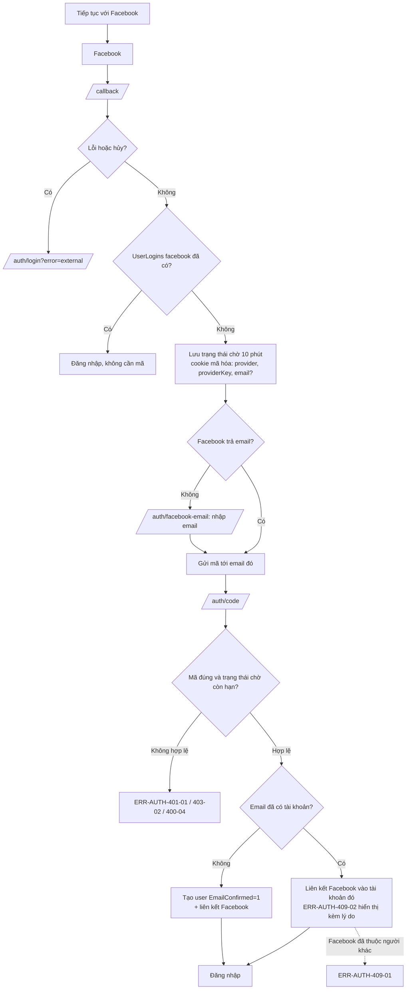
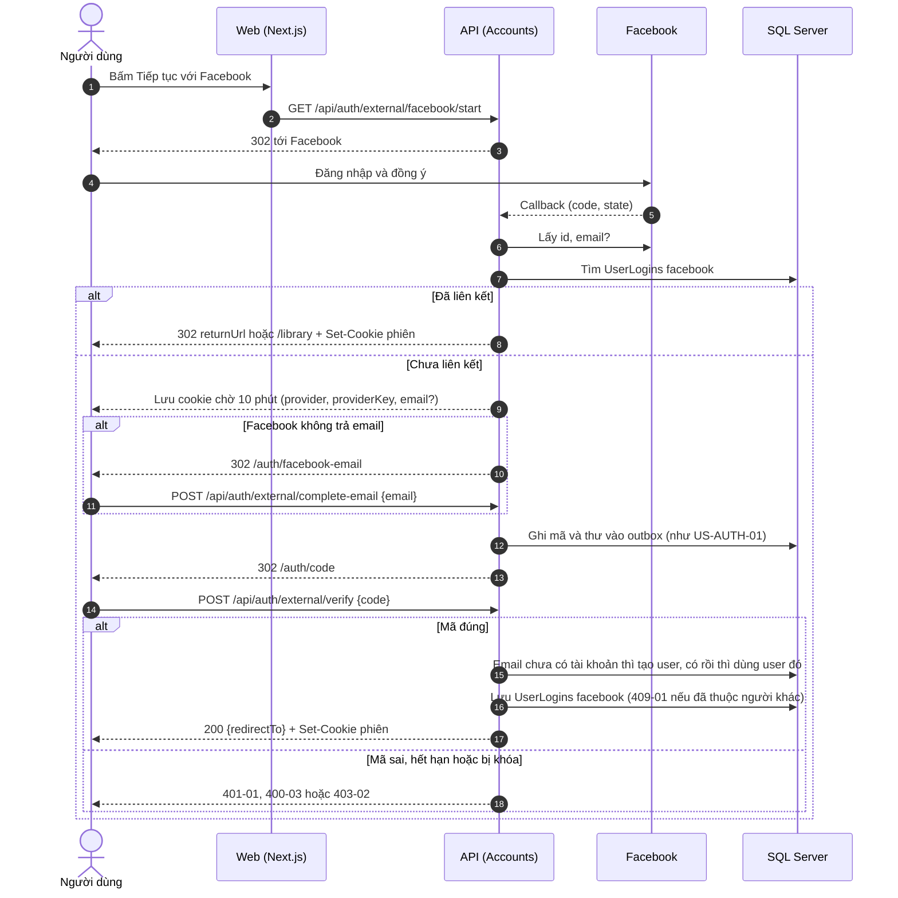
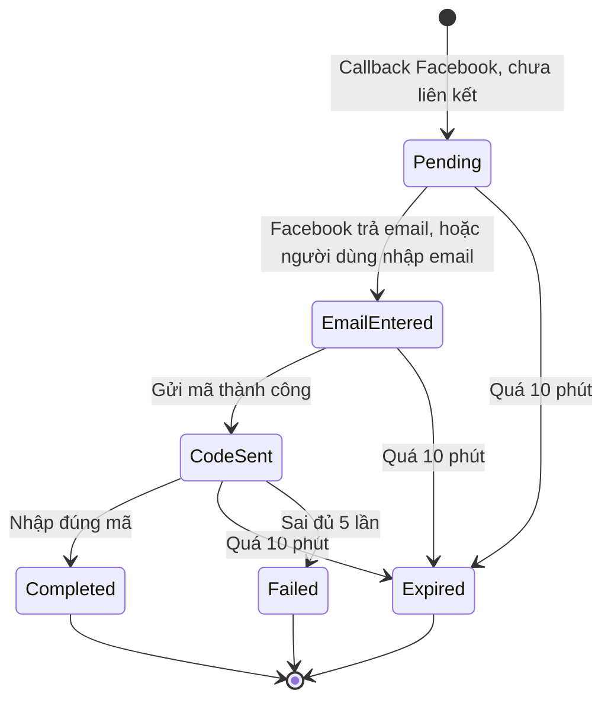

# SRS US-AUTH-05 — Đăng nhập bằng Facebook

- Tính năng: FEAT-01 Tài khoản và thư viện riêng tư (`accounts`).
- User story: [US-AUTH-05](../requirements/user-stories.md#us-auth-05--đăng-nhập-bằng-facebook).
- Phiên bản 0.3 (2026-11-09). Trạng thái: **chờ duyệt**.
- Tài liệu chung: [README.md](README.md) (danh mục FR, BR, ERR, NFR, quy ước API, ngữ cảnh).
- Test case: [testing/test-cases.md](../testing/test-cases.md).
- Skill OpenBA áp dụng: `srs` (FR, BR, ERR, NFR), `user-flow`, `sequence`, `state`, `wireframe-ascii`, `api-design`, `ac`.

## 1. Giới thiệu

Là người dùng, tôi muốn đăng nhập bằng Facebook thay cho Apple. Vì Facebook có thể không trả email hoặc trả email chưa xác minh, tôi phải nhập mã gửi tới email đó trước khi tài khoản được tạo hay liên kết.

**Trong phạm vi:**

- Nút "Tiếp tục với Facebook" (thay cho Apple) trên màn hình "Đăng nhập".
- Xác minh bằng mã gửi tới email trước khi tạo hoặc liên kết tài khoản.
- Nhập email khi Facebook không trả email.

**Ngoài phạm vi:**

- Liên kết Facebook trong Cài đặt (US-AUTH-06).
- Nhận email xác minh của Facebook (không tin cậy).

## 2. Yêu cầu áp dụng

### 2.1 Yêu cầu chức năng (FR)

**`FR-AUTH-EXT-002` — Đăng nhập hoặc đăng ký bằng Facebook (qua mã email)**

- Input: Kết quả callback OAuth từ Facebook: `id`, `email?`. Với bước phụ: `email`, `code`.
- Xử lý: Đã có `UserLogins` facebook thì đăng nhập ngay, không cần mã. Chưa có thì lưu trạng thái chờ 10 phút trong cookie mã hóa Data Protection (`provider`, `providerKey`, `email?`). Không có email thì yêu cầu nhập. Gửi mã tới email đó (FR-AUTH-CODE-001). Mã đúng: email chưa có tài khoản thì tạo tài khoản và liên kết Facebook; đã có thì liên kết Facebook vào tài khoản đó. Facebook đã thuộc người khác thì ERR-AUTH-409-01 (BR-AUTH-005, BR-AUTH-012).
- Output: `302` tới bước tiếp theo (xem API); `202` khi gửi mã; `200 {redirectTo}` + cookie phiên khi hoàn tất.

**`FR-AUTH-CODE-001` — Gửi mã đăng nhập 6 số tới email**

- Input: `email`.
- Xử lý: Chuẩn hóa email (trim, không phân biệt hoa thường) và kiểm tra định dạng. Kiểm tra giới hạn gửi theo email và theo IP (BR-AUTH-009, BR-AUTH-013). Trong một transaction: vô hiệu mã còn hiệu lực cũ của email, sinh mã bằng bộ sinh ngẫu nhiên an toàn, lưu HMAC của mã vào `accounts.EmailLoginCodes`, ghi thư vào `accounts.EmailOutbox` (loại LoginCode). Worker gửi thư bất đồng bộ.
- Output: `202 {status: "check-email", resendAfterSeconds: 60}`. Luôn giống nhau dù email có tài khoản hay không (BR-AUTH-007).

**`FR-AUTH-CODE-002` — Xác minh mã; tạo tài khoản lần đầu hoặc đăng nhập**

- Input: `email`, `code`.
- Xử lý: Tìm mã còn hiệu lực mới nhất của email. So khớp HMAC. Sai thì tăng `Attempts`, đủ 5 thì vô hiệu mã (BR-AUTH-002). Đúng thì đánh dấu `ConsumedAt`, tìm user theo email; chưa có thì tạo user với `EmailConfirmed = 1` (BR-AUTH-003); phát cookie phiên (BR-AUTH-008).
- Output: `200 {redirectTo}` và `Set-Cookie`; hoặc lỗi 400-03, 401-01, 403-02, 429-01.

### 2.2 Quy tắc nghiệp vụ (BR)

Phát biểu theo dạng KHI, THÌ, NGOẠI LỆ (`rules/02`). Nội dung chính thức nằm ở [README.md](README.md); bảng dưới là bản sao các quy tắc áp dụng cho story này.

| Mã BR | Quy tắc | KHI | THÌ | NGOẠI LỆ |
| --- | --- | --- | --- | --- |
| `BR-AUTH-005` | Facebook và email | Đăng nhập Facebook | Không tin email Facebook; luôn gửi mã tới email đó trước khi tạo hoặc liên kết. Không có email thì yêu cầu nhập | — |
| `BR-AUTH-006` | Hạn thời gian | Tạo mã, trạng thái chờ Facebook | Mã hết hạn sau 10 phút. Trạng thái chờ Facebook hết hạn sau 10 phút | — |
| `BR-AUTH-007` | Không lộ sự tồn tại của tài khoản | Gửi mã, nhập email Facebook | Cùng phản hồi và cùng HTTP status cho email có và không có tài khoản; thư được ghi vào outbox, không gửi trực tiếp trong request | — |
| `BR-AUTH-012` | Một tài khoản ngoài thuộc một người | Liên kết hoặc tạo bằng Google/Facebook | (`LoginProvider`, `ProviderKey`) là duy nhất; đã thuộc user khác thì ERR-AUTH-409-01 | — |

### 2.3 Ma trận lỗi (ERR)

Theo `rules/03` và `rules/11`. Nội dung chính thức nằm ở [README.md](README.md); bảng dưới là bản sao các lỗi áp dụng cho story này.

| Mã ERR | HTTP | Điều kiện phát sinh | Khóa i18n | Thông báo người dùng | Mức độ | Hành động trên giao diện | Ghi log (không chứa mã hay email đầy đủ) |
| --- | --- | --- | --- | --- | --- | --- | --- |
| `ERR-AUTH-400-01` | 400 | Email rỗng, sai định dạng hoặc dài hơn 256 ký tự | `auth.error.400-01` | "Email không đúng định dạng." | Medium | Lỗi dưới ô email | Validation failed: email |
| `ERR-AUTH-400-03` | 400 | Mã đã quá 10 phút, đã dùng, hoặc đã bị mã mới thay thế | `auth.error.400-03` | "Mã đã hết hạn hoặc đã dùng. Hãy yêu cầu mã mới." | High | Hiện nút "Gửi mã mới" | Code expired or consumed |
| `ERR-AUTH-400-04` | 400 | Trạng thái chờ Facebook không còn hoặc quá 10 phút | `auth.error.400-04` | "Phiên đăng nhập bằng Facebook đã hết hạn. Vui lòng thử lại." | High | Về trang "Đăng nhập" | Pending external login missing or expired |
| `ERR-AUTH-401-01` | 401 | Mã không khớp (dưới 5 lần sai) | `auth.error.401-01` | "Mã không đúng. Bạn còn {n} lần thử." | Medium | Xóa các ô mã, focus ô đầu | Code mismatch: attempts |
| `ERR-AUTH-403-02` | 403 | Mã bị vô hiệu do sai 5 lần | `auth.error.403-02` | "Mã này đã bị khóa do nhập sai nhiều lần. Hãy yêu cầu mã mới." | High | Hiện nút "Gửi mã mới" | Code locked: attempts |
| `ERR-AUTH-409-01` | 409 | Danh tính Google hoặc Facebook đã liên kết với tài khoản Lingozi khác | `auth.error.409-01` | "Tài khoản {Google/Facebook} này đã liên kết với một tài khoản Lingozi khác." | Medium | Ở lại Cài đặt tài khoản | External login already linked: provider |
| `ERR-AUTH-409-02` | 409 | Facebook: email đã có tài khoản (cần mã để liên kết). Google: `email_verified = false` | `auth.error.409-02` | Facebook: "Email này đã có tài khoản Lingozi. Chúng tôi sẽ gửi mã để xác nhận trước khi liên kết." Google: "Email này chưa được Google xác minh. Hãy dùng Tiếp tục với email." | Medium | Hiện dưới nút nhà cung cấp | Link requires verification: provider |
| `ERR-AUTH-429-01` | 429 | Vượt giới hạn gửi mã hoặc giới hạn theo IP (BR-AUTH-009, BR-AUTH-013) | `auth.error.429-01` | "Bạn thao tác quá nhanh. Vui lòng đợi {giây} giây." | Medium | Vô hiệu nút, đếm ngược theo `Retry-After` | Rate limited: policy |
| `ERR-AUTH-502-01` | 502 | Nhà cung cấp ngoài lỗi, bị hủy, hoặc không phản hồi | `auth.error.502-01` | "Không đăng nhập được bằng {Google/Facebook}. Vui lòng thử lại." | High | Về trang "Đăng nhập" | External provider error or cancelled: provider |

### 2.4 Yêu cầu phi chức năng (NFR)

- `NFR-SEC-001`: Mã: HMAC-SHA256, hiệu lực 10 phút, 5 lần sai, giới hạn gửi (BR-AUTH-001, 002, 009). HTTPS ngoài Development.
- `NFR-SEC-002`: Khóa HMAC, Google và Facebook client secret, cấu hình email chỉ đọc từ biến môi trường hoặc secret store.
- `NFR-A11Y-001`: Ô mã là 6 ô có nhãn, `autocomplete="one-time-code"`, dán được cả 6 số vào ô đầu; thông báo lỗi có `role="alert"`; thao tác được bằng bàn phím.

## 3. Luồng

### 3.1 User flow

_Skill `user-flow`: màn hình và chuyển đổi, kèm các trạng thái giao diện._



| Trạng thái | Hiển thị |
| --- | --- |
| Bình thường | Nút "Tiếp tục với Facebook"; sau callback: màn hình Nhập email hoặc Nhập mã. |
| Đang tải | Nút có spinner; nút "Gửi mã" và "Xác nhận" có spinner. |
| Trống | Ô email trống trên màn hình Nhập email. |
| Lỗi | 400-01 dưới ô email; 400-04 về "Đăng nhập"; 401-01, 403-02, 400-03 như nhập mã; 409-01 và 409-02 theo bảng lỗi. |
| Mất kết nối | Không hỗ trợ ngoại tuyến. Hiện "Mất kết nối" và nút "Thử lại"; không mất dữ liệu đã nhập. |

### 3.2 Sequence

_Skill `sequence`: tương tác giữa các thành phần; nhánh lỗi ghi mã `ERR-xxx`._



### 3.3 Trạng thái

_Skill `state`._

Trạng thái chờ đăng nhập Facebook (cookie mã hóa 10 phút), theo `rules/12`:



| Trạng thái hiện tại | Sự kiện | Điều kiện bảo vệ (Guard) | Trạng thái tiếp theo | Vai trò thực hiện |
| --- | --- | --- | --- | --- |
| Pending | Facebook có email | Email đúng định dạng | EmailEntered | Hệ thống |
| Pending | Người dùng nhập email | Email đúng định dạng; qua BR-AUTH-009 | EmailEntered | Người dùng |
| EmailEntered | Gửi mã | Qua BR-AUTH-009 và BR-AUTH-013 | CodeSent | Hệ thống |
| CodeSent | Nhập đúng mã | Mã còn hạn; Facebook chưa thuộc người khác | Completed | Người dùng |
| CodeSent | Sai đủ 5 lần | `Attempts` = 5 | Failed | Hệ thống |
| Pending, EmailEntered, CodeSent | Quá 10 phút | Cookie chờ hết hạn | Expired | Hệ thống |

## 4. Wireframe

_Skill `wireframe-ascii`. Figma: chưa dựng màn hình (`DES-01`); wireframe ASCII là căn cứ cho DoR._

### W-AUTH-03 Nhập email sau Facebook (`/auth/facebook-email`)

```text
┌──────────── 440 ───────────────────────────┐
│ Nhập email để tiếp tục                  h1 │
│ Facebook không chia sẻ email của bạn.      │
│ Chúng tôi sẽ gửi mã xác nhận tới email này.│
│ Email *                                    │
│ [____________________________________]     │
│ [              Gửi mã              ]       │
│ Hủy và quay lại đăng nhập                  │
└────────────────────────────────────────────┘
```

Trang này chỉ mở khi cookie chờ Facebook còn hạn. Hết hạn thì ERR-AUTH-400-04 và quay về "Đăng nhập".

### W-AUTH-04 Thông báo liên kết Facebook với tài khoản đã có

Hiển thị ở đầu W-AUTH-02 khi luồng đến từ Facebook:

```text
┌ thông báo (info) ──────────────────────────────────────────┐
│ Email này đã có tài khoản Lingozi. Nhập mã để xác nhận và   │
│ liên kết Facebook vào tài khoản đó.                         │
└──────────────────────────────────────────────────────────────┘
```

Khi tài khoản mới được tạo từ Facebook, thông báo là "Nhập mã để hoàn tất đăng ký".

## 5. API

_Skill `api-design`; lỗi theo Problem Details (RFC 9457) như ADR 0002. Quy ước chung ở [README.md](README.md)._

| Method và path | Quyền | Body | Thành công | Lỗi |
| --- | --- | --- | --- | --- |
| `GET /api/auth/external/{provider}/start?returnUrl=` | Công khai | — | 302 tới nhà cung cấp; `provider` là `google` hoặc `facebook`; provider khác hoặc chưa cấu hình thì 404 | 429-01 |
| `GET /api/auth/external/{provider}/callback` | Nhà cung cấp gọi về | — | 302 (xem mục 3) | 502-01 qua query `?error=external` |
| `POST /api/auth/external/complete-email` | Có cookie chờ Facebook | `{ email }` | 202 `{ status: "check-email", resendAfterSeconds: 60 }` (gửi mã tới email) | 400-01, 400-04, 429-01 |
| `POST /api/auth/external/verify` | Có cookie chờ Facebook | `{ code }` | 200 `{ redirectTo }` + cookie phiên (tạo hoặc liên kết Facebook) | 400-03, 400-04, 401-01, 403-02, 409-01 |

Gửi mã sau Facebook (khi không có email): 

```http
POST /api/auth/external/complete-email
X-XSRF-TOKEN: <token>

{ "email": "chi@example.com" }
```

Xác minh mã:

```http
POST /api/auth/external/verify
X-XSRF-TOKEN: <token>

{ "code": "417128" }
```

Phản hồi thành công: `{ "redirectTo": "/library" }` kèm cookie phiên.

## 6. Acceptance criteria

_Skill `ac`. Văn bản Gherkin trùng với [user story](../requirements/user-stories.md) (nguồn chính thức); sửa ở đó rồi cập nhật lại đây. Script `tools/feature-docs/check_feature_docs.py` kiểm tra hai bản khớp nhau._

```gherkin
Scenario: AC-01 Facebook trả email chưa có tài khoản
  Given Facebook trả email "chi@example.com" chưa có tài khoản Lingozi
  When tôi tiếp tục với Facebook
  Then hệ thống gửi mã tới "chi@example.com" và hiển thị "Nhập mã" (BR-AUTH-005)
  And sau khi nhập đúng mã, tài khoản được tạo với Facebook đã liên kết

Scenario: AC-02 Facebook không trả email
  Given Facebook không trả email
  When tôi tiếp tục với Facebook
  Then tôi thấy "Nhập email để tiếp tục"
  And sau khi nhập email, hệ thống gửi mã như AC-01 (ERR-AUTH-400-01 nếu email sai định dạng)

Scenario: AC-03 Email trùng tài khoản đã có
  Given đã có tài khoản Lingozi "chi@example.com"
  When tôi tiếp tục với Facebook có email "chi@example.com"
  Then hệ thống không tạo tài khoản mới và không liên kết ngay
  And hệ thống gửi mã tới "chi@example.com"; sau khi nhập đúng mã, Facebook được liên kết vào tài khoản đó (ERR-AUTH-409-02 hiển thị kèm lý do)

Scenario: AC-04 Facebook đã liên kết
  Given tài khoản Facebook của tôi đã liên kết với một tài khoản Lingozi
  When tôi tiếp tục với Facebook
  Then tôi được đăng nhập vào đúng tài khoản đó, không cần mã, dù email Facebook đã đổi

Scenario: AC-05 Hết thời gian chờ
  Given tôi đang ở bước nhập mã sau Facebook quá 10 phút
  When tôi nhập mã
  Then tôi thấy ERR-AUTH-400-04 và được đưa về "Đăng nhập" để bắt đầu lại
```

| AC | Nội dung | FR | BR | ERR | Test case |
| --- | --- | --- | --- | --- | --- |
| AC-01 | Facebook trả email chưa có tài khoản | `FR-AUTH-EXT-002`, `FR-AUTH-CODE-002` | `BR-AUTH-005`, `BR-AUTH-006` | — | TC-AUTH-020 |
| AC-02 | Facebook không trả email | `FR-AUTH-EXT-002` | `BR-AUTH-005` | `ERR-AUTH-400-01` | TC-AUTH-021 |
| AC-03 | Email trùng tài khoản đã có | `FR-AUTH-EXT-002` | `BR-AUTH-005` | `ERR-AUTH-409-02` | TC-AUTH-022 |
| AC-04 | Facebook đã liên kết | `FR-AUTH-EXT-002` | `BR-AUTH-012` | — | TC-AUTH-023 |
| AC-05 | Hết thời gian chờ | `FR-AUTH-EXT-002` | `BR-AUTH-006` | `ERR-AUTH-400-04` | TC-AUTH-024 |

## 7. Truy vết test case

| TC | Loại | Bước chính | Kết quả mong đợi |
| --- | --- | --- | --- |
| `TC-AUTH-020` | INT + E2E | Facebook giả, email mới | Không tạo user ngay; mã gửi tới email; sau mã đúng: user mới với `UserLogins` facebook |
| `TC-AUTH-021` | INT + E2E | Facebook không có email; nhập email sai; nhập email đúng | Email sai: 400-01; email đúng: gửi mã và tiếp tục như TC-AUTH-020 |
| `TC-AUTH-022` | INT + E2E | Facebook email trùng tài khoản đã có | Không liên kết trước khi có mã; thông báo 409-02; sau mã đúng: liên kết vào tài khoản đó, số user không đổi |
| `TC-AUTH-023` | INT | Facebook đã liên kết; email Facebook đã đổi | Đăng nhập đúng user, không gửi mã |
| `TC-AUTH-024` | INT | Trạng thái chờ Facebook quá 10 phút; gửi mã | 400-04 |

## 8. Lịch sử sửa đổi

| Phiên bản | Ngày | Thay đổi |
| --- | --- | --- |
| 0.3 | 2026-11-09 | Tách từ `srs.md` và `design/` thành file riêng cho story; thêm FR chi tiết, sequence, state, bảng AC → FR/BR/ERR/TC. |
