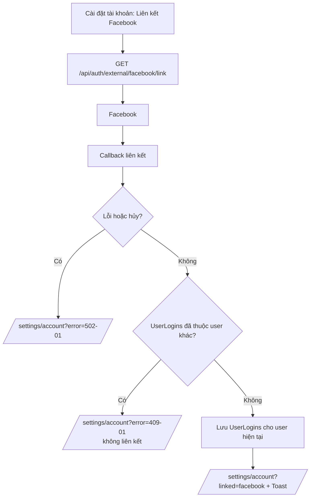
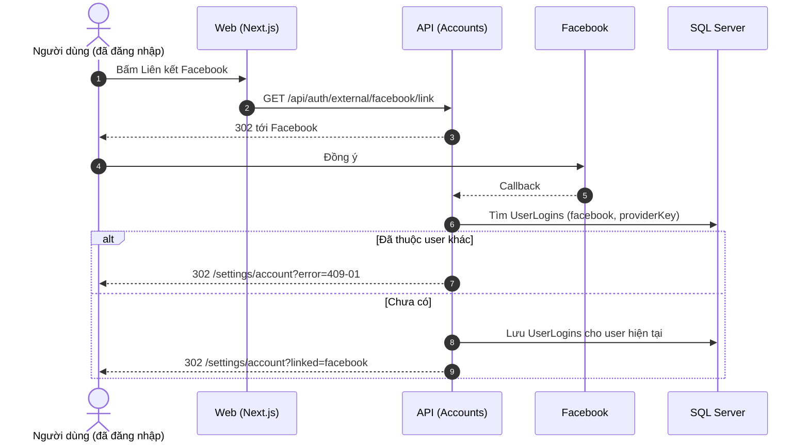

# SRS US-AUTH-06 — Liên kết Google hoặc Facebook trong Cài đặt tài khoản

- Tính năng: FEAT-01 Tài khoản và thư viện riêng tư (`accounts`).
- User story: [US-AUTH-06](../requirements/user-stories.md#us-auth-06--liên-kết-google-hoặc-facebook-trong-cài-đặt-tài-khoản).
- Phiên bản 0.3 (2026-11-09). Trạng thái: **chờ duyệt**.
- Tài liệu chung: [README.md](README.md) (danh mục FR, BR, ERR, NFR, quy ước API, ngữ cảnh).
- Test case: [testing/test-cases.md](../testing/test-cases.md).
- Skill OpenBA áp dụng: `srs` (FR, BR, ERR, NFR), `user-flow`, `sequence`, `wireframe-ascii`, `api-design`, `ac`.

## 1. Giới thiệu

Là người dùng đã đăng nhập, tôi muốn thêm Google hoặc Facebook để đăng nhập nhanh hơn.

**Trong phạm vi:**

- Mục "Phương thức đăng nhập" trong Cài đặt tài khoản.
- Liên kết Google hoặc Facebook vào tài khoản đang đăng nhập.

**Ngoài phạm vi:**

- Hủy liên kết (ngoài phạm vi MVP).
- Đổi email.

## 2. Yêu cầu áp dụng

### 2.1 Yêu cầu chức năng (FR)

**`FR-AUTH-EXT-003` — Liên kết Google hoặc Facebook với tài khoản đang đăng nhập**

- Input: Phiên đăng nhập hiện tại; kết quả callback của nhà cung cấp.
- Xử lý: Lấy `UserId` từ phiên. Nhà cung cấp trả danh tính (`provider`, `providerKey`). Danh tính đã thuộc user khác thì ERR-AUTH-409-01 (BR-AUTH-012). Ngược lại lưu `UserLogins` cho user hiện tại. Không cần mã vì đã đăng nhập.
- Output: `302` về `/settings/account?linked={provider}` hoặc `?error=...`.

**`FR-AUTH-SES-003` — Lấy thông tin người dùng hiện tại**

- Input: Cookie phiên.
- Xử lý: Đọc `UserId` từ phiên; trả thông tin cơ bản và các phương thức đăng nhập đã liên kết.
- Output: `200 {id, email, displayName, logins}` hoặc `401 ERR-AUTH-401-02`.

### 2.2 Quy tắc nghiệp vụ (BR)

Phát biểu theo dạng KHI, THÌ, NGOẠI LỆ (`rules/02`). Nội dung chính thức nằm ở [README.md](README.md); bảng dưới là bản sao các quy tắc áp dụng cho story này.

| Mã BR | Quy tắc | KHI | THÌ | NGOẠI LỆ |
| --- | --- | --- | --- | --- |
| `BR-AUTH-012` | Một tài khoản ngoài thuộc một người | Liên kết hoặc tạo bằng Google/Facebook | (`LoginProvider`, `ProviderKey`) là duy nhất; đã thuộc user khác thì ERR-AUTH-409-01 | — |

### 2.3 Ma trận lỗi (ERR)

Theo `rules/03` và `rules/11`. Nội dung chính thức nằm ở [README.md](README.md); bảng dưới là bản sao các lỗi áp dụng cho story này.

| Mã ERR | HTTP | Điều kiện phát sinh | Khóa i18n | Thông báo người dùng | Mức độ | Hành động trên giao diện | Ghi log (không chứa mã hay email đầy đủ) |
| --- | --- | --- | --- | --- | --- | --- | --- |
| `ERR-AUTH-409-01` | 409 | Danh tính Google hoặc Facebook đã liên kết với tài khoản Lingozi khác | `auth.error.409-01` | "Tài khoản {Google/Facebook} này đã liên kết với một tài khoản Lingozi khác." | Medium | Ở lại Cài đặt tài khoản | External login already linked: provider |
| `ERR-AUTH-502-01` | 502 | Nhà cung cấp ngoài lỗi, bị hủy, hoặc không phản hồi | `auth.error.502-01` | "Không đăng nhập được bằng {Google/Facebook}. Vui lòng thử lại." | High | Về trang "Đăng nhập" | External provider error or cancelled: provider |

### 2.4 Yêu cầu phi chức năng (NFR)

- `NFR-SEC-002`: Khóa HMAC, Google và Facebook client secret, cấu hình email chỉ đọc từ biến môi trường hoặc secret store.

## 3. Luồng

### 3.1 User flow

_Skill `user-flow`: màn hình và chuyển đổi, kèm các trạng thái giao diện._



Đã đăng nhập nên không cần mã: liên kết dựa trên phiên hiện tại và danh tính Facebook.

| Trạng thái | Hiển thị |
| --- | --- |
| Bình thường | Danh sách phương thức: Google/Facebook "Đã liên kết" hoặc nút "Liên kết ...". |
| Đang tải | `Skeleton` cho hai khối. |
| Trống | Không áp dụng (email luôn có). |
| Lỗi | `?error=409-01` hoặc `?error=502-01` hiện `InlineAlert`; lỗi tải hiện "Thử lại". |
| Mất kết nối | Không hỗ trợ ngoại tuyến. Hiện "Mất kết nối" và nút "Thử lại"; không mất dữ liệu đã nhập. |

### 3.2 Sequence

_Skill `sequence`: tương tác giữa các thành phần; nhánh lỗi ghi mã `ERR-xxx`._



## 4. Wireframe

_Skill `wireframe-ascii`. Figma: chưa dựng màn hình (`DES-01`); wireframe ASCII là căn cứ cho DoR. Quy tắc: vẽ đủ mọi màn hình, hộp thoại và trạng thái mà AC của story nhắc tới._

### W-AUTH-15 — Cài đặt tài khoản: mặc định (`/settings/account`)

```text
┌──────────────┬──────────────────────────────────────────────────────────────┐
│Lingozi       │ Cài đặt tài khoản                                            │
│              │ ┌─ Thông tin ──────────────────────────────────────────────┐ │
│▸ Thư viện    │ │ Email    an@example.com    ✓ Đã xác minh                 │ │
│▸ Luyện tập   │ └──────────────────────────────────────────────────────────┘ │
│              │ ┌─ Phương thức đăng nhập ──────────────────────────────────┐ │
│              │ │ Email (mã đăng nhập)     ✓ Luôn có                       │ │
│              │ │ Google                   ✓ Đã liên kết                   │ │
│⚙ Cài đặt     │ │ Facebook                 [ Liên kết Facebook ]           │ │
│              │ └──────────────────────────────────────────────────────────┘ │
│              │                                                              │
│              │ [ Đăng xuất ]                                                │
└──────────────┴──────────────────────────────────────────────────────────────┘
```

- Nằm trong khung ứng dụng có sidebar.
- Phương thức đã liên kết hiện "Đã liên kết" thay cho nút; chưa liên kết thì hiện nút "Liên kết ...".
- Không có mục đổi hoặc đặt mật khẩu.
- Nút "Đăng xuất": đang xử lý thì có spinner và giữ nguyên chiều rộng (xem W-AUTH-23).

### W-AUTH-16 — Cài đặt tài khoản: đang tải

```text
┌──────────────┬──────────────────────────────────────────────────────────────┐
│Lingozi       │ Cài đặt tài khoản                                            │
│              │ ┌─ Thông tin ──────────────────────────────────────────────┐ │
│▸ Thư viện    │ │ ░░░░░░░░░░░░░░░░░░░░░░░░                                 │ │
│▸ Luyện tập   │ │ ░░░░░░░░░░░░                                             │ │
│              │ └──────────────────────────────────────────────────────────┘ │
│              │ ┌─ Phương thức đăng nhập ──────────────────────────────────┐ │
│              │ │ ░░░░░░░░░░░░░░░░░░░░░░░░                                 │ │
│⚙ Cài đặt     │ │ ░░░░░░░░░░░░░░░░░░░░                                     │ │
│              │ │ ░░░░░░░░░░░░░░░░                                         │ │
│              │ └──────────────────────────────────────────────────────────┘ │
└──────────────┴──────────────────────────────────────────────────────────────┘
```

- `Skeleton` cho hai khối trong lúc gọi `/api/auth/me`; `aria-busy="true"`.

### W-AUTH-17 — Cài đặt tài khoản: đã liên kết Facebook (thông báo thành công)

```text
┌──────────────┬──────────────────────────────────────────────────────────────┐
│Lingozi       │ [ ✓ Đã liên kết Facebook. ]                                  │
│              │ Cài đặt tài khoản                                            │
│▸ Thư viện    │ ┌─ Thông tin ──────────────────────────────────────────────┐ │
│▸ Luyện tập   │ │ Email    an@example.com    ✓ Đã xác minh                 │ │
│              │ └──────────────────────────────────────────────────────────┘ │
│              │ ┌─ Phương thức đăng nhập ──────────────────────────────────┐ │
│              │ │ Email (mã đăng nhập)     ✓ Luôn có                       │ │
│⚙ Cài đặt     │ │ Google                   ✓ Đã liên kết                   │ │
│              │ │ Facebook                 ✓ Đã liên kết                   │ │
│              │ └──────────────────────────────────────────────────────────┘ │
│              │                                                              │
│              │ [ Đăng xuất ]                                                │
└──────────────┴──────────────────────────────────────────────────────────────┘
```

- Hiện khi trang mở với `?linked=facebook`; `Toast` có `role="status"`.
- Cả Google và Facebook đều hiện "Đã liên kết", không còn nút liên kết.

### W-AUTH-18 — Cài đặt tài khoản: tài khoản ngoài đã thuộc người khác (ERR-AUTH-409-01)

```text
┌──────────────┬──────────────────────────────────────────────────────────────┐
│Lingozi       │ (!) Tài khoản Facebook này đã liên kết với một               │
│              │     tài khoản Lingozi khác.                                  │
│▸ Thư viện    │ Cài đặt tài khoản                                            │
│▸ Luyện tập   │ ┌─ Thông tin ──────────────────────────────────────────────┐ │
│              │ │ Email    an@example.com    ✓ Đã xác minh                 │ │
│              │ └──────────────────────────────────────────────────────────┘ │
│              │ ┌─ Phương thức đăng nhập ──────────────────────────────────┐ │
│⚙ Cài đặt     │ │ Email (mã đăng nhập)     ✓ Luôn có                       │ │
│              │ │ Google                   ✓ Đã liên kết                   │ │
│              │ │ Facebook                 [ Liên kết Facebook ]           │ │
│              │ └──────────────────────────────────────────────────────────┘ │
│              │                                                              │
│              │ [ Đăng xuất ]                                                │
└──────────────┴──────────────────────────────────────────────────────────────┘
```

- Hiện khi trang mở với `?error=409-01`; không liên kết.
- Người dùng ở lại Cài đặt tài khoản.

### W-AUTH-19 — Cài đặt tài khoản: lỗi tải

```text
┌──────────────┬──────────────────────────────────────────────────────────────┐
│Lingozi       │ Cài đặt tài khoản                                            │
│              │ (!) Không tải được thông tin tài khoản.                      │
│▸ Thư viện    │ [ Thử lại ]                                                  │
│▸ Luyện tập   │                                                              │
│              │                                                              │
│              │                                                              │
│              │                                                              │
│⚙ Cài đặt     │                                                              │
└──────────────┴──────────────────────────────────────────────────────────────┘
```

- Hiện khi `/api/auth/me` lỗi (không phải 401). 401 thì chuyển tới đăng nhập.

## 5. API

_Skill `api-design`; lỗi theo Problem Details (RFC 9457) như ADR 0002. Quy ước chung ở [README.md](README.md)._

| Method và path | Quyền | Body | Thành công | Lỗi |
| --- | --- | --- | --- | --- |
| `GET /api/auth/me` | Đã đăng nhập | — | 200 `{ id, email, displayName, logins: ["google"?, "facebook"?] }` | 401-02 |
| `GET /api/auth/external/{provider}/link` | Đã đăng nhập | — | 302 tới nhà cung cấp; callback liên kết rồi 302 về `/settings/account?linked={provider}` | 409-01, 502-01 |

Bắt đầu: `GET /api/auth/external/facebook/link` (đã đăng nhập) trả `302` tới Facebook.

Kết quả: `302 /settings/account?linked=facebook` hoặc `?error=409-01`.

## 6. Acceptance criteria

_Skill `ac`. Văn bản Gherkin trùng với [user story](../requirements/user-stories.md) (nguồn chính thức); sửa ở đó rồi cập nhật lại đây. Script `tools/feature-docs/check_feature_docs.py` kiểm tra hai bản khớp nhau._

```gherkin
Scenario: AC-01 Liên kết thành công
  Given tôi đang đăng nhập và chưa liên kết Facebook
  When tôi chọn "Liên kết Facebook" và đồng ý trên Facebook
  Then Facebook xuất hiện trong danh sách phương thức đăng nhập của tôi

Scenario: AC-02 Tài khoản ngoài đã thuộc người khác
  Given Facebook này đã liên kết với một tài khoản Lingozi khác
  When tôi liên kết nó
  Then không liên kết và tôi thấy ERR-AUTH-409-01

Scenario: AC-03 Đã liên kết rồi
  Given tôi đã liên kết Google
  Then nút "Liên kết Google" không hiển thị; thay bằng "Đã liên kết"
```

| AC | Nội dung | FR | BR | ERR | Wireframe | Test case |
| --- | --- | --- | --- | --- | --- | --- |
| AC-01 | Liên kết thành công | `FR-AUTH-EXT-003` | `BR-AUTH-012` | — | W-AUTH-15, W-AUTH-17 | TC-AUTH-025 |
| AC-02 | Tài khoản ngoài đã thuộc người khác | `FR-AUTH-EXT-003` | `BR-AUTH-012` | `ERR-AUTH-409-01` | W-AUTH-18 | TC-AUTH-026 |
| AC-03 | Đã liên kết rồi | `FR-AUTH-SES-003` | — | — | W-AUTH-15 | TC-AUTH-027 |

## 7. Truy vết test case

| TC | Loại | Bước chính | Kết quả mong đợi |
| --- | --- | --- | --- |
| `TC-AUTH-025` | INT + E2E | Đã đăng nhập → liên kết Facebook | `UserLogins` facebook gắn với user hiện tại |
| `TC-AUTH-026` | INT | Facebook đã thuộc user khác | Không liên kết; 409-01 |
| `TC-AUTH-027` | UNIT (Vitest) | Render cài đặt với `logins` có google | Google hiện "Đã liên kết"; không có nút liên kết Google |

## 8. Lịch sử sửa đổi

| Phiên bản | Ngày | Thay đổi |
| --- | --- | --- |
| 0.3 | 2026-11-09 | Tách từ `srs.md` và `design/` thành file riêng cho story; thêm FR chi tiết, sequence, state, bảng AC → FR/BR/ERR/TC. |
