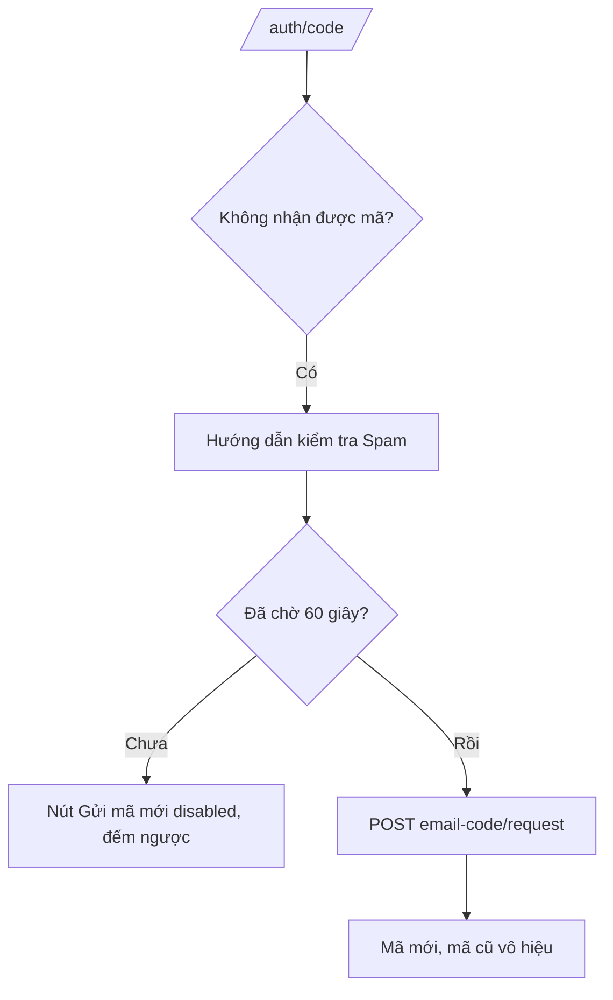
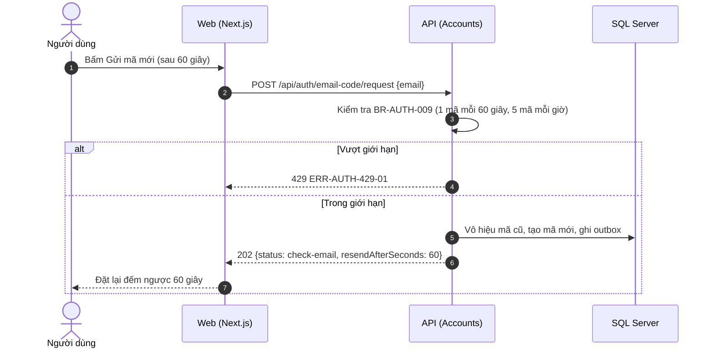

# SRS US-AUTH-07 — Mã không đến hoặc đã hết hạn

- Tính năng: FEAT-01 Tài khoản và thư viện riêng tư (`accounts`).
- User story: [US-AUTH-07](../requirements/user-stories.md#us-auth-07--mã-không-đến-hoặc-đã-hết-hạn).
- Phiên bản 0.3 (2026-11-09). Trạng thái: **chờ duyệt**.
- Tài liệu chung: [README.md](README.md) (danh mục FR, BR, ERR, NFR, quy ước API, ngữ cảnh).
- Test case: [testing/test-cases.md](../testing/test-cases.md).
- Skill OpenBA áp dụng: `srs` (FR, BR, ERR, NFR), `user-flow`, `sequence`, `wireframe-ascii`, `api-design`, `ac`.

## 1. Giới thiệu

Là người dùng không nhận được mã, tôi muốn biết cách xử lý và có thể yêu cầu mã mới. (Thay cho "quên mật khẩu" của v0.2.)

**Trong phạm vi:**

- Hướng dẫn khi không nhận được mã.
- Nút "Gửi mã mới" với thời gian chờ 60 giây.
- Phản hồi giống nhau cho email có và không có tài khoản.

**Ngoài phạm vi:**

- Đặt lại mật khẩu (không còn, BR-AUTH-010).

## 2. Yêu cầu áp dụng

### 2.1 Yêu cầu chức năng (FR)

**`FR-AUTH-CODE-001` — Gửi mã đăng nhập 6 số tới email**

- Input: `email`.
- Xử lý: Chuẩn hóa email (trim, không phân biệt hoa thường) và kiểm tra định dạng. Kiểm tra giới hạn gửi theo email và theo IP (BR-AUTH-009, BR-AUTH-013). Trong một transaction: vô hiệu mã còn hiệu lực cũ của email, sinh mã bằng bộ sinh ngẫu nhiên an toàn, lưu HMAC của mã vào `accounts.EmailLoginCodes`, ghi thư vào `accounts.EmailOutbox` (loại LoginCode). Worker gửi thư bất đồng bộ.
- Output: `202 {status: "check-email", resendAfterSeconds: 60}`. Luôn giống nhau dù email có tài khoản hay không (BR-AUTH-007).

### 2.2 Quy tắc nghiệp vụ (BR)

Phát biểu theo dạng KHI, THÌ, NGOẠI LỆ (`rules/02`). Nội dung chính thức nằm ở [README.md](README.md); bảng dưới là bản sao các quy tắc áp dụng cho story này.

| Mã BR | Quy tắc | KHI | THÌ | NGOẠI LỆ |
| --- | --- | --- | --- | --- |
| `BR-AUTH-001` | Mã đăng nhập | Gửi mã | Mã 6 chữ số, sinh bằng bộ sinh ngẫu nhiên an toàn. Dùng một lần. Chỉ lưu HMAC-SHA256 của mã với khóa bí mật từ biến môi trường, không lưu mã thô. Không ghi mã vào log | — |
| `BR-AUTH-007` | Không lộ sự tồn tại của tài khoản | Gửi mã, nhập email Facebook | Cùng phản hồi và cùng HTTP status cho email có và không có tài khoản; thư được ghi vào outbox, không gửi trực tiếp trong request | — |
| `BR-AUTH-009` | Giới hạn gửi mã | Gửi mã | Mỗi email tối đa 1 mã mỗi 60 giây và 5 mã mỗi giờ. Vượt thì 429 và không gửi | — |

### 2.3 Ma trận lỗi (ERR)

Theo `rules/03` và `rules/11`. Nội dung chính thức nằm ở [README.md](README.md); bảng dưới là bản sao các lỗi áp dụng cho story này.

| Mã ERR | HTTP | Điều kiện phát sinh | Khóa i18n | Thông báo người dùng | Mức độ | Hành động trên giao diện | Ghi log (không chứa mã hay email đầy đủ) |
| --- | --- | --- | --- | --- | --- | --- | --- |
| `ERR-AUTH-429-01` | 429 | Vượt giới hạn gửi mã hoặc giới hạn theo IP (BR-AUTH-009, BR-AUTH-013) | `auth.error.429-01` | "Bạn thao tác quá nhanh. Vui lòng đợi {giây} giây." | Medium | Vô hiệu nút, đếm ngược theo `Retry-After` | Rate limited: policy |

### 2.4 Yêu cầu phi chức năng (NFR)

- `NFR-A11Y-001`: Ô mã là 6 ô có nhãn, `autocomplete="one-time-code"`, dán được cả 6 số vào ô đầu; thông báo lỗi có `role="alert"`; thao tác được bằng bàn phím.

## 3. Luồng

### 3.1 User flow

_Skill `user-flow`: màn hình và chuyển đổi, kèm các trạng thái giao diện._



Phản hồi và thời gian chờ giống hệt với email chưa có tài khoản (BR-AUTH-007).

| Trạng thái | Hiển thị |
| --- | --- |
| Bình thường | Hướng dẫn kiểm tra Spam; "Gửi mã mới" bị khóa trong 60 giây. |
| Đang tải | "Gửi mã mới" có spinner. |
| Trống | Không áp dụng. |
| Lỗi | 429-01: đếm ngược theo `Retry-After`. |
| Mất kết nối | Không hỗ trợ ngoại tuyến. Hiện "Mất kết nối" và nút "Thử lại"; không mất dữ liệu đã nhập. |

### 3.2 Sequence

_Skill `sequence`: tương tác giữa các thành phần; nhánh lỗi ghi mã `ERR-xxx`._



## 4. Acceptance criteria

_Skill `ac`. Văn bản Gherkin trùng với [user story](../requirements/user-stories.md) (nguồn chính thức); sửa ở đó rồi cập nhật lại đây. Script `tools/feature-docs/check_feature_docs.py` kiểm tra hai bản khớp nhau._

```gherkin
Scenario: AC-01 Gửi lại mã sau thời gian chờ
  Given tôi đã chờ 60 giây kể từ lần gửi trước
  When tôi bấm "Gửi mã mới"
  Then một mã mới được gửi và mã cũ bị vô hiệu (US-AUTH-02 AC-07)

Scenario: AC-02 Không thấy thư
  When tôi bấm "Không nhận được mã?"
  Then tôi thấy hướng dẫn kiểm tra mục Spam, và thời gian chờ để gửi lại

Scenario: AC-03 Email không có tài khoản
  Given "chua-co@example.com" chưa có tài khoản
  When tôi yêu cầu mã cho email đó
  Then màn hình và thời gian chờ giống hệt trường hợp email đã có tài khoản (BR-AUTH-007)
```

| AC | Nội dung | FR | BR | ERR | Wireframe | Test case |
| --- | --- | --- | --- | --- | --- | --- |
| AC-01 | Gửi lại mã sau thời gian chờ | `FR-AUTH-CODE-001` | `BR-AUTH-009` | — | W-AUTH-09 | TC-AUTH-028 |
| AC-02 | Không thấy thư | `FR-AUTH-CODE-001` | `BR-AUTH-009` | — | W-AUTH-09 | TC-AUTH-029 |
| AC-03 | Email không có tài khoản | `FR-AUTH-CODE-001` | `BR-AUTH-007` | — | W-AUTH-05, W-AUTH-09 | TC-AUTH-030 |

## 5. Wireframe

_Skill `wireframe-ascii`. Figma: chưa dựng màn hình (`DES-01`); wireframe ASCII là căn cứ cho DoR. Quy tắc: vẽ đủ mọi màn hình, hộp thoại và trạng thái mà AC của story nhắc tới._

### W-AUTH-05 — Nhập mã: trạng thái ban đầu (`/auth/code`)

```text
┌────────────────────────────────────────────────────────────────┐
│                         [Logo Lingozi]                         │
│                                                                │
│         ┌────────────────────────────────────────────┐         │
│         │ Nhập mã                                    │         │
│         │ Chúng tôi đã gửi mã 6 số tới               │         │
│         │ an@example.com.                            │         │
│         │ Mã có hiệu lực 10 phút (còn 09:58).        │         │
│         │                                            │         │
│         │ [ ] [ ] [ ] [ ] [ ] [ ]                    │         │
│         │                                            │         │
│         │ [            Xác nhận            ]         │         │
│         │                                            │         │
│         │ Không nhận được mã?   Đổi email            │         │
│         └────────────────────────────────────────────┘         │
│                                                                │
│            Chính sách quyền riêng tư · Xóa dữ liệu             │
└────────────────────────────────────────────────────────────────┘
```

- Sáu ô, mỗi ô có nhãn riêng; `autocomplete="one-time-code"`, `inputmode="numeric"`.
- Dán 6 số vào ô đầu thì điền cả sáu ô; đủ 6 số thì tự gửi xác nhận.
- Đếm ngược 10 phút theo thời hạn của mã.
- Không có ô mật khẩu.

### W-AUTH-09 — Nhập mã: không nhận được mã

```text
┌────────────────────────────────────────────────────────────────┐
│                         [Logo Lingozi]                         │
│                                                                │
│         ┌────────────────────────────────────────────┐         │
│         │ Nhập mã                                    │         │
│         │ Chúng tôi đã gửi mã 6 số tới               │         │
│         │ an@example.com.                            │         │
│         │ Mã có hiệu lực 10 phút (còn 09:58).        │         │
│         │                                            │         │
│         │ [ ] [ ] [ ] [ ] [ ] [ ]                    │         │
│         │                                            │         │
│         │ [            Xác nhận            ]         │         │
│         │                                            │         │
│         │ Không nhận được mã? (đang mở)              │         │
│         │ • Kiểm tra mục Spam hoặc Quảng cáo.        │         │
│         │ • Mã có hiệu lực 10 phút.                  │         │
│         │ [    Gửi mã mới (sau 42 giây)    ]         │         │
│         │ Đổi email                                  │         │
│         └────────────────────────────────────────────┘         │
│                                                                │
│            Chính sách quyền riêng tư · Xóa dữ liệu             │
└────────────────────────────────────────────────────────────────┘
```

- "Gửi mã mới" bị vô hiệu trong 60 giây, đếm ngược; hết thời gian thì bật.
- Gửi mã mới làm mã cũ mất hiệu lực.
- Hướng dẫn và thời gian chờ giống hệt cho email có và không có tài khoản (BR-AUTH-007).

## 6. API

_Skill `api-design`; lỗi theo Problem Details (RFC 9457) như ADR 0002. Quy ước chung ở [README.md](README.md)._

| Method và path | Quyền | Body | Thành công | Lỗi |
| --- | --- | --- | --- | --- |
| `POST /api/auth/email-code/request` | Công khai | `{ email }` | 202 `{ status: "check-email", resendAfterSeconds: 60 }`, luôn giống nhau (BR-AUTH-007) | 400-01, 429-01 |

Dùng lại endpoint của [US-AUTH-01](US-AUTH-01-request-email-code.md#6-api): `POST /api/auth/email-code/request`. Phản hồi và thời gian chờ giống hệt với email chưa có tài khoản (BR-AUTH-007).

## 7. Truy vết test case

| TC | Loại | Bước chính | Kết quả mong đợi |
| --- | --- | --- | --- |
| `TC-AUTH-028` | INT + E2E | Chờ 60 giây; gửi mã mới | Mã mới gửi; mã cũ bị từ chối |
| `TC-AUTH-029` | E2E | Bấm "Không nhận được mã?" | Hiện hướng dẫn Spam; nút gửi lại disabled với đếm ngược |
| `TC-AUTH-030` | INT | Email chưa có tài khoản và đã có tài khoản | Cùng body, cùng HTTP status, thời gian phản hồi trong ngưỡng chênh lệch cho phép |

## 8. Lịch sử sửa đổi

| Phiên bản | Ngày | Thay đổi |
| --- | --- | --- |
| 0.3 | 2026-11-09 | Tách từ `srs.md` và `design/` thành file riêng cho story; thêm FR chi tiết, sequence, state, bảng AC → FR/BR/ERR/TC. |
