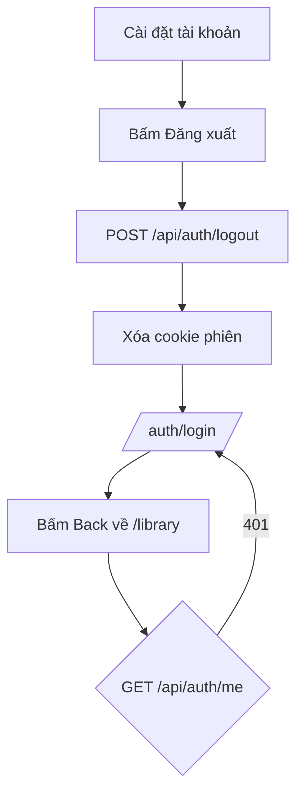
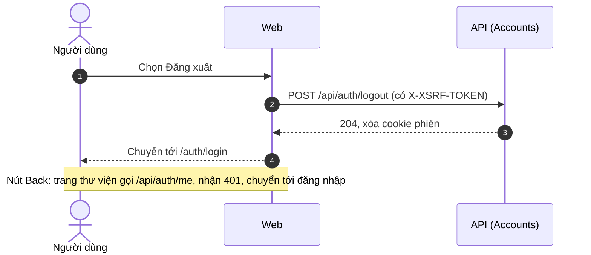

# SRS US-AUTH-08 — Đăng xuất

- Tính năng: FEAT-01 Tài khoản và thư viện riêng tư (`accounts`).
- User story: [US-AUTH-08](../requirements/user-stories.md#us-auth-08--đăng-xuất).
- Phiên bản 0.3 (2026-11-09). Trạng thái: **chờ duyệt**.
- Tài liệu chung: [README.md](README.md) (danh mục FR, BR, ERR, NFR, quy ước API, ngữ cảnh).
- Test case: [testing/test-cases.md](../testing/test-cases.md).
- Skill OpenBA áp dụng: `srs` (FR, BR, ERR, NFR), `user-flow`, `sequence`, `wireframe-ascii`, `api-design`, `ac`.

## 1. Giới thiệu

**Trong phạm vi:**

- Nút "Đăng xuất" trong Cài đặt tài khoản.
- Xóa cookie phiên; idempotent.

**Ngoài phạm vi:**

- Đăng xuất khỏi mọi thiết bị.

## 2. Yêu cầu áp dụng

### 2.1 Yêu cầu chức năng (FR)

**`FR-AUTH-SES-002` — Đăng xuất**

- Input: Cookie phiên (không bắt buộc), header `X-XSRF-TOKEN`.
- Xử lý: Xóa cookie phiên. Idempotent: gọi khi không có phiên hoặc phiên đã hết hạn vẫn thành công.
- Output: `204`.

### 2.2 Quy tắc nghiệp vụ (BR)

Phát biểu theo dạng KHI, THÌ, NGOẠI LỆ (`rules/02`). Nội dung chính thức nằm ở [README.md](README.md); bảng dưới là bản sao các quy tắc áp dụng cho story này.

| Mã BR | Quy tắc | KHI | THÌ | NGOẠI LỆ |
| --- | --- | --- | --- | --- |
| `BR-AUTH-008` | Phiên đăng nhập | Đăng nhập thành công | Cookie `__Host-lingozi.session`: HttpOnly, Secure, SameSite=Lax; hết hạn trượt 14 ngày không hoạt động | Development dùng HTTP: không có tiền tố `__Host-` và không Secure |

### 2.3 Ma trận lỗi (ERR)

Theo `rules/03` và `rules/11`. Nội dung chính thức nằm ở [README.md](README.md); bảng dưới là bản sao các lỗi áp dụng cho story này.

| Mã ERR | HTTP | Điều kiện phát sinh | Khóa i18n | Thông báo người dùng | Mức độ | Hành động trên giao diện | Ghi log (không chứa mã hay email đầy đủ) |
| --- | --- | --- | --- | --- | --- | --- | --- |
| `ERR-AUTH-400-05` | 400 | Thiếu hoặc sai token antiforgery ở request thay đổi dữ liệu | `auth.error.400-05` | "Phiên làm việc không hợp lệ. Vui lòng tải lại trang." | High | Lấy lại token, cho thử lại một lần | Antiforgery validation failed |
| `ERR-AUTH-401-02` | 401 | Không có phiên hợp lệ khi truy cập API hoặc trang cần đăng nhập | `auth.error.401-02` | "Vui lòng đăng nhập để tiếp tục." | Medium | Chuyển tới "Đăng nhập" kèm `returnUrl` | Unauthenticated request: đường dẫn |

### 2.4 Yêu cầu phi chức năng (NFR)

- `NFR-SEC-001`: Mã: HMAC-SHA256, hiệu lực 10 phút, 5 lần sai, giới hạn gửi (BR-AUTH-001, 002, 009). HTTPS ngoài Development.

## 3. Luồng

### 3.1 User flow

_Skill `user-flow`: màn hình và chuyển đổi, kèm các trạng thái giao diện._



| Trạng thái | Hiển thị |
| --- | --- |
| Bình thường | Nút "Đăng xuất" trong Cài đặt tài khoản. |
| Đang tải | Nút có spinner, giữ nguyên chiều rộng. |
| Trống | Không áp dụng. |
| Lỗi | Không hiển thị lỗi: đăng xuất luôn thành công (AC-03). |
| Mất kết nối | Không hỗ trợ ngoại tuyến. Hiện "Mất kết nối" và nút "Thử lại"; không mất dữ liệu đã nhập. |

### 3.2 Sequence

_Skill `sequence`: tương tác giữa các thành phần; nhánh lỗi ghi mã `ERR-xxx`._



## 4. Wireframe

_Skill `wireframe-ascii`. Figma: chưa dựng màn hình (`DES-01`); wireframe ASCII là căn cứ cho DoR._

Dùng nút "Đăng xuất" của [W-AUTH-06](US-AUTH-06-link-providers.md#4-wireframe). Sau khi đăng xuất, chuyển tới [W-AUTH-01](US-AUTH-01-request-email-code.md#4-wireframe).

## 5. API

_Skill `api-design`; lỗi theo Problem Details (RFC 9457) như ADR 0002. Quy ước chung ở [README.md](README.md)._

| Method và path | Quyền | Body | Thành công | Lỗi |
| --- | --- | --- | --- | --- |
| `POST /api/auth/logout` | Công khai, idempotent | — | 204, xóa cookie | — |
| `GET /api/auth/me` | Đã đăng nhập | — | 200 `{ id, email, displayName, logins: ["google"?, "facebook"?] }` | 401-02 |

```http
POST /api/auth/logout
X-XSRF-TOKEN: <token>
```

Phản hồi: `204`, cookie phiên bị xóa. Gọi khi không có phiên cũng trả `204`.

## 6. Acceptance criteria

_Skill `ac`. Văn bản Gherkin trùng với [user story](../requirements/user-stories.md) (nguồn chính thức); sửa ở đó rồi cập nhật lại đây. Script `tools/feature-docs/check_feature_docs.py` kiểm tra hai bản khớp nhau._

```gherkin
Scenario: AC-01 Đăng xuất
  Given tôi đang đăng nhập
  When tôi chọn "Đăng xuất"
  Then cookie phiên bị xóa và tôi về "Đăng nhập"

Scenario: AC-02 Quay lại trang cũ sau khi đăng xuất
  Given tôi vừa đăng xuất
  When tôi bấm "Quay lại" của trình duyệt về "Thư viện"
  Then tôi không thấy dữ liệu thư viện và được chuyển tới "Đăng nhập"

Scenario: AC-03 Đăng xuất khi phiên đã hết hạn
  Given phiên của tôi đã hết hạn
  When tôi chọn "Đăng xuất"
  Then thao tác vẫn thành công và không hiện lỗi
```

| AC | Nội dung | FR | BR | ERR | Test case |
| --- | --- | --- | --- | --- | --- |
| AC-01 | Đăng xuất | `FR-AUTH-SES-002` | `BR-AUTH-008` | — | TC-AUTH-031 |
| AC-02 | Quay lại trang cũ sau khi đăng xuất | `FR-AUTH-SES-002`, `FR-AUTH-SES-003` | `BR-AUTH-008` | `ERR-AUTH-401-02` | TC-AUTH-032 |
| AC-03 | Đăng xuất khi phiên đã hết hạn | `FR-AUTH-SES-002` | `BR-AUTH-008` | — | TC-AUTH-033 |

## 7. Truy vết test case

| TC | Loại | Bước chính | Kết quả mong đợi |
| --- | --- | --- | --- |
| `TC-AUTH-031` | INT + E2E | Đăng xuất khi đang đăng nhập | 204; cookie bị xóa; về `/auth/login` |
| `TC-AUTH-032` | E2E | Đăng xuất rồi bấm Back về thư viện | Không thấy dữ liệu; chuyển tới đăng nhập |
| `TC-AUTH-033` | INT | Đăng xuất khi phiên đã hết hạn | 204; không lỗi |

## 8. Lịch sử sửa đổi

| Phiên bản | Ngày | Thay đổi |
| --- | --- | --- |
| 0.3 | 2026-11-09 | Tách từ `srs.md` và `design/` thành file riêng cho story; thêm FR chi tiết, sequence, state, bảng AC → FR/BR/ERR/TC. |
