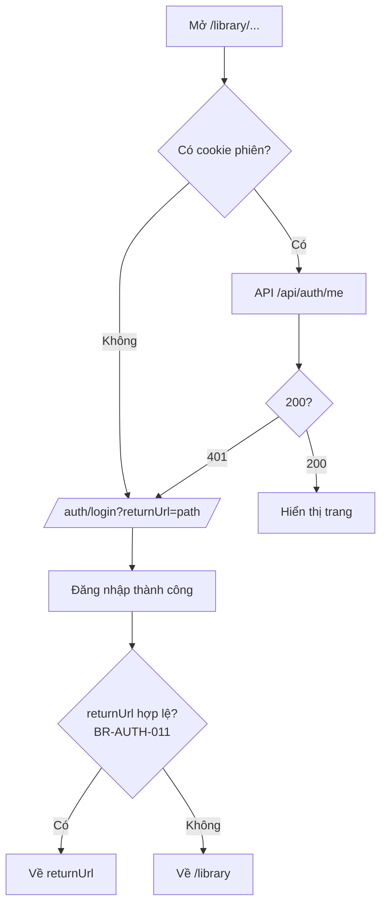
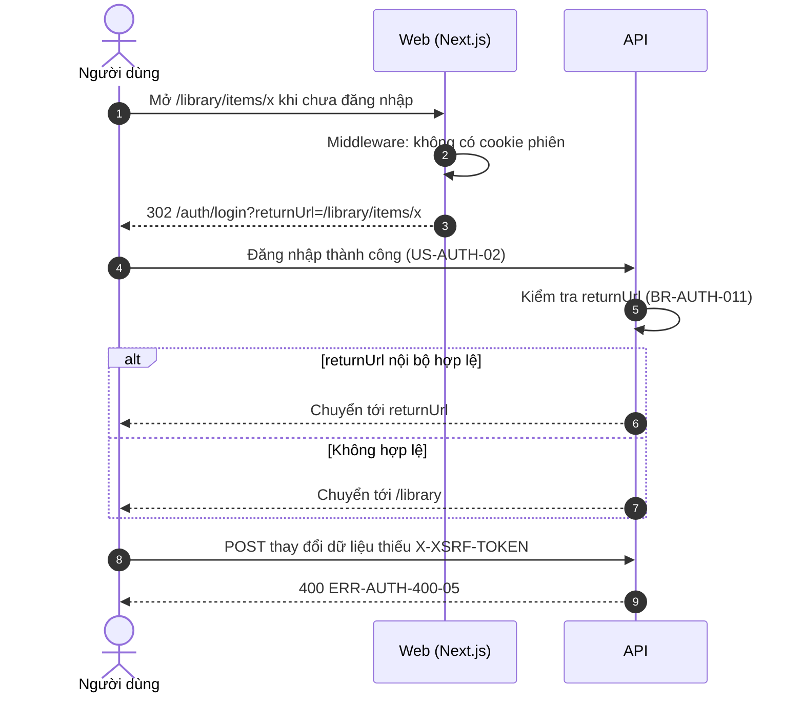

# SRS US-AUTH-09 — Bảo vệ thư viện riêng tư

- Tính năng: FEAT-01 Tài khoản và thư viện riêng tư (`accounts`).
- User story: [US-AUTH-09](../requirements/user-stories.md#us-auth-09--bảo-vệ-thư-viện-riêng-tư).
- Phiên bản 0.3 (2026-11-09). Trạng thái: **chờ duyệt**.
- Tài liệu chung: [README.md](README.md) (danh mục FR, BR, ERR, NFR, quy ước API, ngữ cảnh).
- Test case: [testing/test-cases.md](../testing/test-cases.md).
- Skill OpenBA áp dụng: `srs` (FR, BR, ERR, NFR), `user-flow`, `sequence`, `wireframe-ascii`, `api-design`, `ac`.

## 1. Giới thiệu

**Trong phạm vi:**

- Chuyển trang không công khai về "Đăng nhập" kèm `returnUrl`.
- API trả 401 khi không có phiên.
- Antiforgery cho request thay đổi dữ liệu.
- Chống chuyển hướng ra ngoài.

**Ngoài phạm vi:**

- Phân quyền dữ liệu của từng tính năng (xem FEAT-02, US-LIB-07).

## 2. Yêu cầu áp dụng

### 2.1 Yêu cầu chức năng (FR)

**`FR-AUTH-SEC-001` — Bảo vệ trang và API theo phiên và chủ sở hữu**

- Input: Mọi request tới trang hoặc API không công khai.
- Xử lý: Middleware Next.js chuyển trang không công khai về đăng nhập khi thiếu cookie phiên. API luôn kiểm tra phiên (quyết định cuối). Mọi request thay đổi dữ liệu yêu cầu header antiforgery. `returnUrl` chỉ nhận đường dẫn nội bộ (BR-AUTH-011).
- Output: Cho phép, hoặc `401 ERR-AUTH-401-02`, `400 ERR-AUTH-400-05`.

### 2.2 Quy tắc nghiệp vụ (BR)

Phát biểu theo dạng KHI, THÌ, NGOẠI LỆ (`rules/02`). Nội dung chính thức nằm ở [README.md](README.md); bảng dưới là bản sao các quy tắc áp dụng cho story này.

| Mã BR | Quy tắc | KHI | THÌ | NGOẠI LỆ |
| --- | --- | --- | --- | --- |
| `BR-AUTH-011` | Chống chuyển hướng mở | Có `returnUrl` | Chỉ chấp nhận đường dẫn nội bộ bắt đầu bằng `/` và không bắt đầu bằng `//`; ngược lại dùng `/library` | — |
| `BR-AUTH-013` | Giới hạn theo IP | Gọi endpoint xác thực | Gửi mã: 10 lần/10 phút/IP. Xác minh mã: 20 lần/10 phút/IP. Bắt đầu đăng nhập ngoài: 20 lần/phút/IP. Vượt thì ERR-AUTH-429-01 | — |

### 2.3 Ma trận lỗi (ERR)

Theo `rules/03` và `rules/11`. Nội dung chính thức nằm ở [README.md](README.md); bảng dưới là bản sao các lỗi áp dụng cho story này.

| Mã ERR | HTTP | Điều kiện phát sinh | Khóa i18n | Thông báo người dùng | Mức độ | Hành động trên giao diện | Ghi log (không chứa mã hay email đầy đủ) |
| --- | --- | --- | --- | --- | --- | --- | --- |
| `ERR-AUTH-400-05` | 400 | Thiếu hoặc sai token antiforgery ở request thay đổi dữ liệu | `auth.error.400-05` | "Phiên làm việc không hợp lệ. Vui lòng tải lại trang." | High | Lấy lại token, cho thử lại một lần | Antiforgery validation failed |
| `ERR-AUTH-401-02` | 401 | Không có phiên hợp lệ khi truy cập API hoặc trang cần đăng nhập | `auth.error.401-02` | "Vui lòng đăng nhập để tiếp tục." | Medium | Chuyển tới "Đăng nhập" kèm `returnUrl` | Unauthenticated request: đường dẫn |

### 2.4 Yêu cầu phi chức năng (NFR)

- `NFR-PRIV-001`: Truy cập tài nguyên của người khác trả 404; integration test truy cập chéo.
- `NFR-SEC-001`: Mã: HMAC-SHA256, hiệu lực 10 phút, 5 lần sai, giới hạn gửi (BR-AUTH-001, 002, 009). HTTPS ngoài Development.

## 3. Luồng

### 3.1 User flow

_Skill `user-flow`: màn hình và chuyển đổi, kèm các trạng thái giao diện._



| Trạng thái | Hiển thị |
| --- | --- |
| Bình thường | Trang cần đăng nhập hiển thị khi có phiên hợp lệ. |
| Đang tải | `Skeleton` trong lúc kiểm tra `/api/auth/me`. |
| Trống | Không áp dụng. |
| Lỗi | 401-02 chuyển tới "Đăng nhập" kèm `returnUrl`; 400-05 lấy lại token và cho thử lại một lần. |
| Mất kết nối | Không hỗ trợ ngoại tuyến. Hiện "Mất kết nối" và nút "Thử lại"; không mất dữ liệu đã nhập. |

### 3.2 Sequence

_Skill `sequence`: tương tác giữa các thành phần; nhánh lỗi ghi mã `ERR-xxx`._



## 4. Wireframe

_Skill `wireframe-ascii`. Figma: chưa dựng màn hình (`DES-01`); wireframe ASCII là căn cứ cho DoR. Quy tắc: vẽ đủ mọi màn hình, hộp thoại và trạng thái mà AC của story nhắc tới._

### W-AUTH-01 — Đăng nhập: trạng thái ban đầu (`/auth/login`)

```text
┌────────────────────────────────────────────────────────────────┐
│                         [Logo Lingozi]                         │
│                                                                │
│         ┌────────────────────────────────────────────┐         │
│         │ Đăng nhập                                  │         │
│         │ Đăng nhập hoặc tạo tài khoản mới.          │         │
│         │                                            │         │
│         │ [ G   Tiếp tục với Google     ]            │         │
│         │ [ f   Tiếp tục với Facebook   ]            │         │
│         │ ────────────── hoặc ──────────────         │         │
│         │ [     Tiếp tục với email      ]            │         │
│         └────────────────────────────────────────────┘         │
│                                                                │
│            Chính sách quyền riêng tư · Xóa dữ liệu             │
└────────────────────────────────────────────────────────────────┘
```

- Ba phương thức theo thứ tự: Google, Facebook, email. Facebook thay cho Apple.
- Ô email ẩn cho tới khi bấm "Tiếp tục với email".
- Không có ô mật khẩu và không có liên kết "Quên mật khẩu".
- Chân trang có liên kết tới `/privacy` và `/data-deletion`.
- Nút của nhà cung cấp chưa được cấu hình bị ẩn (API `start` trả 404).

### W-AUTH-22 — Thông báo lỗi phiên làm việc (ERR-AUTH-400-05)

```text
┌──────────────┬──────────────────────────────────────────────────────────────┐
│Lingozi       │ Lưu kiến thức mới                                            │
│              │ ┌──────────────────────────────────────────────────────────┐ │
│▸ Thư viện    │ │ (!) Phiên làm việc không hợp lệ.                         │ │
│▸ Luyện tập   │ │     Vui lòng tải lại trang.        [ Tải lại ]           │ │
│              │ └──────────────────────────────────────────────────────────┘ │
│              │                                                              │
│              │ (nội dung form giữ nguyên)                                   │
│⚙ Cài đặt     │                                                              │
└──────────────┴──────────────────────────────────────────────────────────────┘
```

- Hiện trên mọi form khi request thay đổi dữ liệu thiếu hoặc sai token antiforgery.
- Giao diện lấy lại token và cho thử lại một lần; không mất dữ liệu đã nhập.

### Điều hướng và liên kết màn hình

- Trang đích sau khi đăng nhập là trang người dùng định mở trước đó (`returnUrl`), ví dụ [W-LIB-01](../../knowledge-items/srs/US-LIB-03-list-items.md).

## 5. API

_Skill `api-design`; lỗi theo Problem Details (RFC 9457) như ADR 0002. Quy ước chung ở [README.md](README.md)._

| Method và path | Quyền | Body | Thành công | Lỗi |
| --- | --- | --- | --- | --- |
| `GET /api/auth/antiforgery` | Công khai | — | 204 + cookie `XSRF-TOKEN` | — |
| `GET /api/auth/me` | Đã đăng nhập | — | 200 `{ id, email, displayName, logins: ["google"?, "facebook"?] }` | 401-02 |

Antiforgery: `GET /api/auth/antiforgery` trả `204` và cookie `XSRF-TOKEN`; mọi `POST`, `PUT`, `DELETE` gửi header `X-XSRF-TOKEN` mang giá trị đó.

Thiếu hoặc sai token:

```json
{ "status": 400, "code": "ERR-AUTH-400-05" }
```

## 6. Acceptance criteria

_Skill `ac`. Văn bản Gherkin trùng với [user story](../requirements/user-stories.md) (nguồn chính thức); sửa ở đó rồi cập nhật lại đây. Script `tools/feature-docs/check_feature_docs.py` kiểm tra hai bản khớp nhau._

```gherkin
Scenario: AC-01 Chưa đăng nhập
  When tôi mở một trang trong "Thư viện" khi chưa đăng nhập
  Then tôi được chuyển tới "Đăng nhập", rồi quay lại đúng trang đó sau khi đăng nhập
  And mọi API thư viện trả 401 ERR-AUTH-401-02

Scenario: AC-02 Request thay đổi dữ liệu thiếu token antiforgery
  Given tôi đang đăng nhập
  When một request POST/PUT/DELETE không có header antiforgery hợp lệ
  Then API trả 400 ERR-AUTH-400-05 và không thay đổi dữ liệu

Scenario: AC-03 Không chuyển hướng ra ngoài
  When tôi mở đăng nhập với returnUrl trỏ tới domain khác
  Then sau khi đăng nhập tôi về "Thư viện", không bị chuyển ra domain đó (BR-AUTH-011)
```

| AC | Nội dung | FR | BR | ERR | Wireframe | Test case |
| --- | --- | --- | --- | --- | --- | --- |
| AC-01 | Chưa đăng nhập | `FR-AUTH-SEC-001` | — | `ERR-AUTH-401-02` | W-AUTH-01 | TC-AUTH-034 |
| AC-02 | Request thay đổi dữ liệu thiếu token antiforgery | `FR-AUTH-SEC-001` | — | `ERR-AUTH-400-05` | W-AUTH-22 | TC-AUTH-035 |
| AC-03 | Không chuyển hướng ra ngoài | `FR-AUTH-SEC-001` | `BR-AUTH-011` | — | W-AUTH-01 | TC-AUTH-036 |

## 7. Truy vết test case

| TC | Loại | Bước chính | Kết quả mong đợi |
| --- | --- | --- | --- |
| `TC-AUTH-034` | INT + E2E | Mở `/library/x` khi chưa đăng nhập | Chuyển tới đăng nhập với returnUrl; API 401-02 |
| `TC-AUTH-035` | INT | POST không có hoặc sai `X-XSRF-TOKEN` | 400-05; dữ liệu không đổi |
| `TC-AUTH-036` | UNIT (.NET) | returnUrl: `https://evil.test`, `//evil.test`, `/\evil.test`, `/library/x` | Chỉ `/library/x` được chấp nhận |

## 8. Lịch sử sửa đổi

| Phiên bản | Ngày | Thay đổi |
| --- | --- | --- |
| 0.3 | 2026-11-09 | Tách từ `srs.md` và `design/` thành file riêng cho story; thêm FR chi tiết, sequence, state, bảng AC → FR/BR/ERR/TC. |
