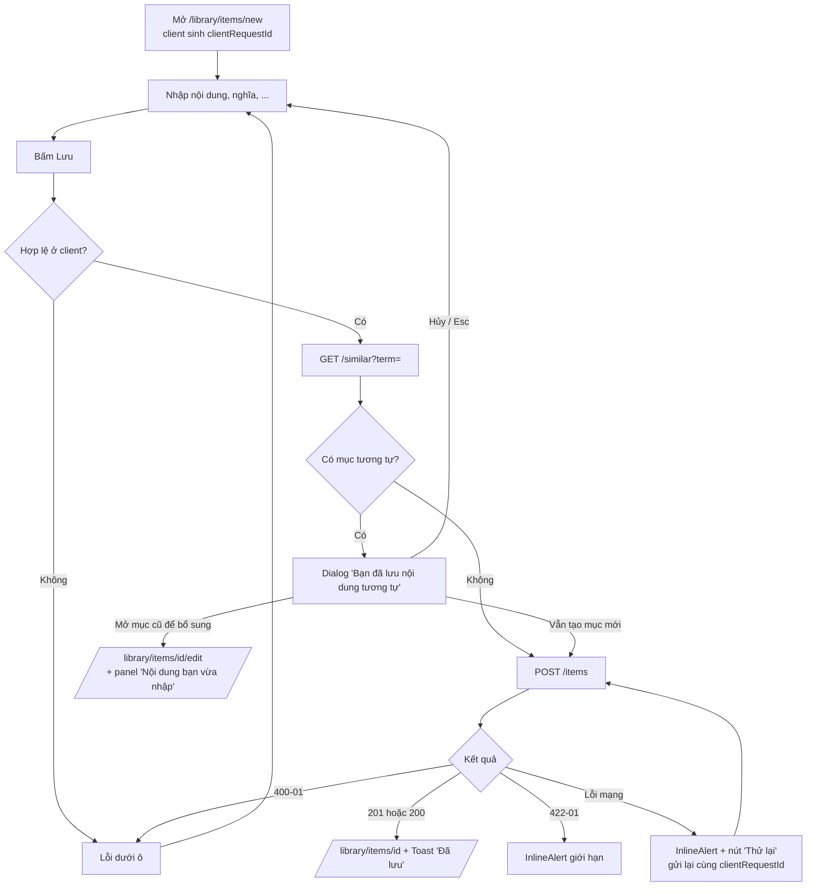
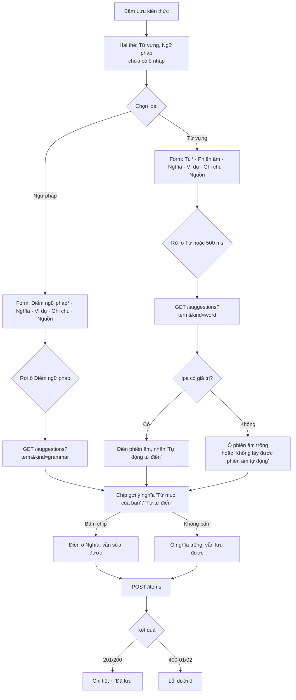

# Luồng — FEAT-02 Mục kiến thức

- Cập nhật: 2026-11-08. Trạng thái: **chờ duyệt**.

## 1. Tạo mục và gợi ý mục tương tự



Panel "Nội dung bạn vừa nhập" chỉ hiển thị để người dùng tự chép sang mục cũ, không tự gộp vào mục cũ (tổng quan §4.1). Dữ liệu panel chỉ nằm trong bộ nhớ của trang. Nếu rời trang thì mất, và trước khi rời có hộp thoại xác nhận.

## 2. Sửa có kiểm tra xung đột

```mermaid
sequenceDiagram
    actor U as Người dùng
    participant W as Web
    participant A as API (Library)
    participant DB as SQL Server
    U->>W: Mở /library/items/{id}/edit
    W->>A: GET /api/library/items/{id}
    A->>DB: SELECT ... WHERE Id=@id AND UserId=@currentUser
    A-->>W: 200 Detail (version=V1)
    U->>W: Sửa, bấm Lưu thay đổi
    W->>A: PUT /api/library/items/{id} { ..., version: V1 }
    A->>DB: UPDATE ... WHERE Id=@id AND UserId=@u AND RowVersion=V1; thay ví dụ (một transaction)
    alt 0 dòng bị ảnh hưởng, nhưng mục vẫn tồn tại
        A-->>W: 409 ERR-LIB-409-01 + current (version=V2)
        W-->>U: Giữ form, nút 'Tải bản mới nhất'
    else Mục không tồn tại hoặc không thuộc người dùng
        A-->>W: 404 ERR-LIB-404-01
    else Thành công
        A-->>W: 200 Detail (version=V2)
        W-->>U: /library/items/{id} + 'Đã lưu thay đổi'
    end
```

## 3. Chọn loại, form theo loại và gợi ý (cập nhật 2026-11-08)



- Gợi ý chỉ gọi khi có term; với Ngữ pháp không gọi nguồn phiên âm (AC-08 US-LIB-08).
- Đổi loại khi đã nhập dữ liệu: giữ các trường chung (nội dung, nghĩa, ví dụ, ghi chú, nguồn); phiên âm bị xóa khi chuyển sang Ngữ pháp, có hộp xác nhận trước khi xóa.

