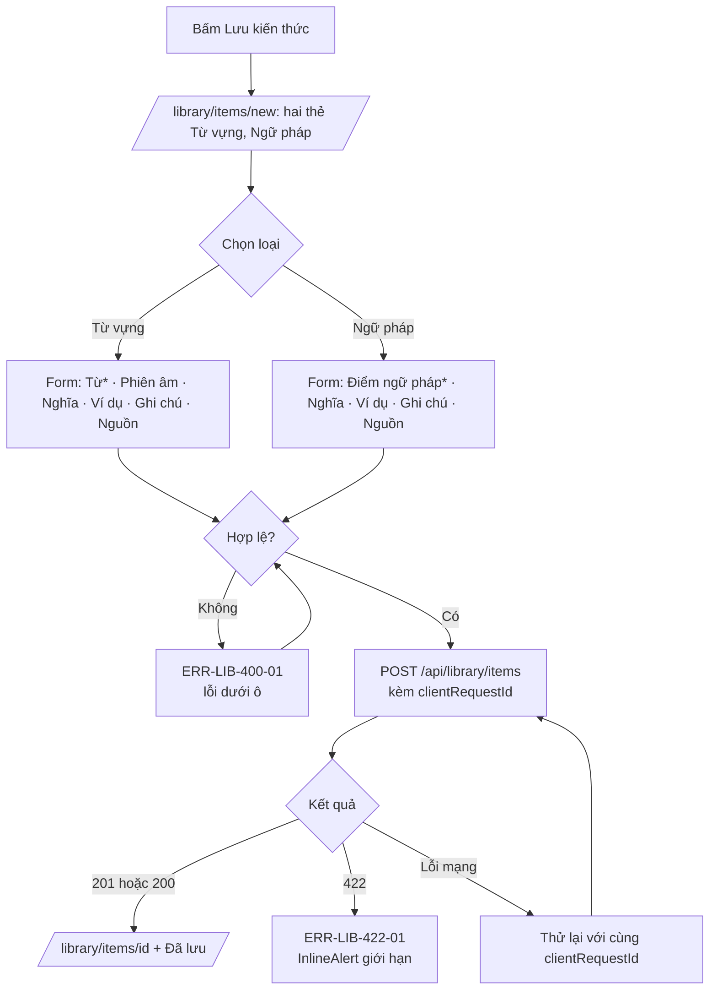
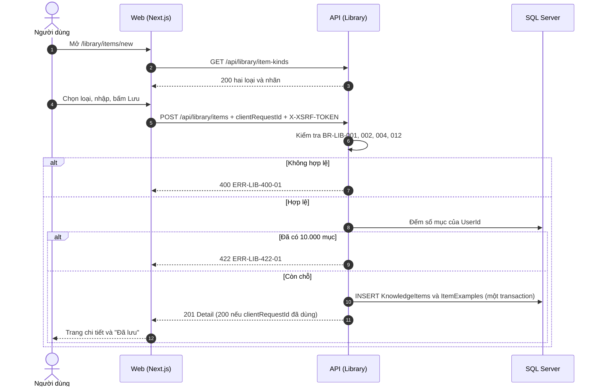

# SRS US-LIB-01 — Chọn loại và lưu mục kiến thức

- Tính năng: FEAT-02 Mục kiến thức (`knowledge-items`).
- User story: [US-LIB-01](../requirements/user-stories.md#us-lib-01--chọn-loại-và-lưu-mục-kiến-thức).
- Phiên bản 0.3 (2026-11-09). Trạng thái: **chờ duyệt**.
- Tài liệu chung: [README.md](README.md) (danh mục FR, BR, ERR, NFR, quy ước API, ngữ cảnh).
- Test case: [testing/test-cases.md](../testing/test-cases.md).
- Skill OpenBA áp dụng: `srs` (FR, BR, ERR, NFR), `user-flow`, `sequence`, `wireframe-ascii`, `api-design`, `ac`.

## 1. Giới thiệu

Là người tự học, tôi muốn chọn loại kiến thức trước (từ vựng, ngữ pháp, cụm từ…) và chỉ phải nhập đúng phần bắt buộc của loại đó, để lưu nhanh.

Quy ước (cập nhật 2026-11-08): loại không có mặc định; Vòng 1 chỉ có hai loại là Từ vựng và Ngữ pháp; mỗi loại chỉ có một trường bắt buộc; nghĩa không bắt buộc và được gợi ý (US-LIB-09).

**Trong phạm vi:**

- Màn hình chọn loại (Từ vựng, Ngữ pháp) trước khi nhập.
- Form theo loại; trường bắt buộc duy nhất là "Từ" hoặc "Điểm ngữ pháp".
- Ví dụ (tối đa 20), ghi chú, nguồn đều không bắt buộc.
- Lưu mục; chống tạo trùng khi gửi lại (`clientRequestId`).

**Ngoài phạm vi:**

- Kiểm tra mục tương tự (US-LIB-02).
- Phiên âm IPA (US-LIB-08).
- Gợi ý nghĩa (US-LIB-09).
- Các loại khác ngoài hai loại trên.

## 2. Yêu cầu áp dụng

### 2.1 Yêu cầu chức năng (FR)

**`FR-LIB-ITEM-007` — Chọn loại trước (Từ vựng, Ngữ pháp), form và nhãn theo loại**

- Input: `kind` (bắt buộc, `word` hoặc `grammar`).
- Xử lý: `GET /api/library/item-kinds` trả danh mục hai loại, nhãn và trường bắt buộc (BR-LIB-012). Giao diện lấy danh mục này, không tự khai báo lại. API từ chối `kind` ngoài danh mục.
- Output: Danh mục loại; hoặc `400 ERR-LIB-400-01` ở trường `kind`.

**`FR-LIB-ITEM-001` — Tạo mục kiến thức kèm ví dụ**

- Input: `clientRequestId`, `kind`, `term`, `meaning?`, `ipa?`, `ipaSource?`, `note?`, `source?`, `examples[] {text, translation?}`.
- Xử lý: Trim các chuỗi. Tính `NormalizedTerm` (BR-LIB-003) và `SearchText` (chuẩn bị cho Vòng 2). Kiểm tra BR-LIB-001, 002, 004, 005, 012, 013. Ghi mục và ví dụ trong một transaction. `UserId` lấy từ phiên, bỏ qua `userId` trong body (BR-LIB-006).
- Output: `201` với mục vừa tạo và `Location`; `200` nếu `clientRequestId` đã dùng (BR-LIB-008).

### 2.2 Quy tắc nghiệp vụ (BR)

Phát biểu theo dạng KHI, THÌ, NGOẠI LỆ (`rules/02`). Nội dung chính thức nằm ở [README.md](README.md); bảng dưới là bản sao các quy tắc áp dụng cho story này.

| Mã BR | Quy tắc | KHI | THÌ | NGOẠI LỆ |
| --- | --- | --- | --- | --- |
| `BR-LIB-001` | Trường bắt buộc và độ dài | Tạo hoặc sửa | Sau khi trim: `term` 1–1000 ký tự và là trường bắt buộc của mọi loại (xem BR-LIB-012); `meaning` không bắt buộc, rỗng sau trim thì lưu null, có thì 1–2000; `note` ≤ 4000, `source` ≤ 300; mỗi ví dụ `text` 1–1000, `translation` ≤ 1000 ký tự; chuỗi tùy chọn rỗng sau trim được lưu là null | — |
| `BR-LIB-002` | Loại nội dung | Tạo hoặc sửa | `kind` là **bắt buộc**, không có mặc định, và thuộc danh mục mở trong Vòng 1: `word` (Từ vựng) và `grammar` (Ngữ pháp). Database lưu `Kind` = 1 và 5 (ERD, CHECK `Kind IN (1, 5)`). Các loại khác (cụm từ, thành ngữ…) đã có mã dự phòng nhưng **chưa mở**; mở thêm cần đổi đặc tả và migration. Đổi loại khi sửa thì áp dụng quy tắc của loại mới | — |
| `BR-LIB-004` | Số ví dụ | Tạo hoặc sửa | Tối đa 20 ví dụ mỗi mục | — |
| `BR-LIB-005` | Giới hạn số mục | Tạo | Tối đa 10.000 mục mỗi người (`ERD-03`) | — |
| `BR-LIB-008` | Idempotency khi tạo | Tạo | `clientRequestId` (UUID do client sinh mỗi lần mở form) là duy nhất theo người dùng. Gửi lại cùng mã thì trả lại mục đã tạo, không tạo thêm | Cùng mã nhưng nội dung khác vẫn trả lại mục đã tạo; không coi là lỗi |
| `BR-LIB-010` | Thời gian | Tạo hoặc sửa | `CreatedAt` và `UpdatedAt` lưu UTC; hiển thị theo múi giờ `Asia/Ho_Chi_Minh` (MVP) | — |
| `BR-LIB-012` | Trường bắt buộc theo loại | Tạo hoặc sửa | Nhãn và trường bắt buộc: `word` → "Từ"; `grammar` → "Điểm ngữ pháp". Trường này là `term`, luôn bắt buộc. Nghĩa, ví dụ, ghi chú, nguồn và phiên âm không bắt buộc | — |

### 2.3 Ma trận lỗi (ERR)

Theo `rules/03` và `rules/11`. Nội dung chính thức nằm ở [README.md](README.md); bảng dưới là bản sao các lỗi áp dụng cho story này.

| Mã ERR | HTTP | Điều kiện phát sinh | Khóa i18n | Thông báo người dùng | Mức độ | Hành động trên giao diện | Ghi log (không ghi nội dung người dùng) |
| --- | --- | --- | --- | --- | --- | --- | --- |
| `ERR-LIB-400-01` | 400 | Thiếu trường bắt buộc, vượt độ dài, `kind` ngoài danh mục, `page` hoặc `pageSize` không hợp lệ | `library.error.400-01` | "Vui lòng kiểm tra lại thông tin đã nhập." kèm lỗi theo từng ô | Medium | Lỗi dưới ô; focus ô lỗi đầu tiên | Validation failed: tên trường |
| `ERR-LIB-422-01` | 422 | Người dùng đã có 10.000 mục | `library.error.422-01` | "Bạn đã đạt giới hạn 10.000 mục." | High | `InlineAlert` trên form | Item limit reached: userId |

### 2.4 Yêu cầu phi chức năng (NFR)

- `NFR-A11Y-001`: Form có nhãn hiển thị; thêm và xóa ví dụ bằng bàn phím; xóa ví dụ thì focus chuyển sang ví dụ kế bên; dialog giữ focus bên trong; gợi ý cập nhật có `aria-live="polite"`.
- `NFR-UX-001`: Form 2 cột ở ≥ 1280 px (trái: nội dung, loại, nghĩa; phải: ví dụ, ghi chú, nguồn); 1 cột ở < 1024 px; không cuộn ngang.
- `NFR-PERF-001`: GET danh sách và chi tiết, POST, PUT có P95 ≤ 300 ms với 5.000 mục mỗi người; đo trên staging. Index (`UserId`, `CreatedAt` DESC) và (`UserId`, `NormalizedTerm`) theo ERD.

## 3. Luồng

### 3.1 User flow

_Skill `user-flow`: màn hình và chuyển đổi, kèm các trạng thái giao diện._



| Trạng thái | Hiển thị |
| --- | --- |
| Bình thường | Chọn loại, rồi form theo loại; chỉ một ô bắt buộc. |
| Đang tải | Nút "Lưu" có spinner; các ô bị khóa; "Hủy" vẫn dùng được. |
| Trống | Form mới trống; chưa chọn loại thì không có ô nhập và "Tiếp tục" bị khóa. |
| Lỗi | 400-01 dưới từng ô và tóm tắt có liên kết tới ô lỗi; 422-01 `InlineAlert`; lỗi mạng "Thử lại". |
| Mất kết nối | Không hỗ trợ ngoại tuyến. Hiện "Mất kết nối" và nút "Thử lại"; không mất dữ liệu đã nhập. |

### 3.2 Sequence

_Skill `sequence`: tương tác giữa các thành phần; nhánh lỗi ghi mã `ERR-xxx`._



## 4. Wireframe

_Skill `wireframe-ascii`. Figma: chưa dựng màn hình (`DES-01`); wireframe ASCII là căn cứ cho DoR._

### W-LIB-02a Chọn loại (`/library/items/new`, bước 1)

```text
┌ Sidebar 240 ┬──────────────────────────────────────────────────────────────┐
│ Lingozi     │ ← Thư viện    Lưu kiến thức mới                             h1 │
│             │ Bạn muốn lưu loại nào?                                       h2 │
│             │ ┌ Từ vựng ──────────────────┐ ┌ Ngữ pháp ─────────────────┐   │
│             │ │ Một từ hoặc cụm từ ngắn,   │ │ Một điểm ngữ pháp hoặc    │   │
│             │ │ có nghĩa và phiên âm IPA   │ │ mẫu câu, ví dụ đi kèm     │   │
│             │ └────────────────────────────┘ └───────────────────────────┘   │
│             │                                    [ Tiếp tục ] (disabled)     │
└─────────────┴──────────────────────────────────────────────────────────────┘
```

- Hai thẻ là một `radiogroup`; chọn bằng phím mũi tên, Enter hoặc Space. Mỗi thẻ có tên loại và một dòng mô tả.
- Chưa chọn thì không có ô nhập nào; nút "Tiếp tục" disabled.
- Sau khi chọn, bấm "Tiếp tục" hoặc Enter để sang form. Nút "Đổi loại" có ở đầu form.

### W-LIB-02 Form theo loại (`/library/items/new` sau khi chọn loại, `/library/items/{id}/edit`)

```text
┌ Sidebar ┬───────────────────────────────────────────────────────────────────────┐
│         │ ← Thư viện   Từ vựng · [Đổi loại]                                  h1 │
│         │ ┌─ cột trái ──────────────────────┐ ┌─ cột phải ──────────────────┐ │
│         │ │ Từ *                            │ │ Ví dụ (0/20)                │ │
│         │ │ [give up_______________________]│ │ ┌ Ví dụ 1 ───────────────┐  │ │
│         │ │ Phiên âm                        │ │ │ Câu ví dụ               │  │ │
│         │ │ [/ˈwɔːtə/_____________________] │ │ │ [Drink some water.____] │  │ │
│         │ │ ✓ Tự động (Anh-Anh) · Wiktionary [Sửa] │ │ │ Bản dịch                │  │ │
│         │ │ Nghĩa (không bắt buộc)          │ │ │ [Đừng bỏ cuộc.________] │  │ │
│         │ │ [từ bỏ_________________________]│ │ │            [🗑 Xóa ví dụ]│  │ │
│         │ │ Gợi ý: (từ mục của bạn) từ bỏ   │ │ └────────────────────────┘  │ │
│         │ │        (từ từ điển) bỏ cuộc     │ │ [ + Thêm ví dụ ]            │ │
│         │ └─────────────────────────────────┘ │ Ghi chú cá nhân             │ │
│         │                                     │ Nguồn                       │ │
│         │                                     └─────────────────────────────┘ │
│         │                                   [ Hủy ]   [ Lưu ] / [ Lưu thay đổi ]│
└─────────┴───────────────────────────────────────────────────────────────────────┘
```

Form của **Ngữ pháp** giống form Từ vựng, trừ:

- Nhãn trường bắt buộc là "Điểm ngữ pháp".
- Không có ô Phiên âm và không gọi nguồn phiên âm.

| Trạng thái | Hiển thị |
| --- | --- |
| Phiên âm từ nguồn | Nhãn "✓ Tự động (Anh-Anh)" kèm dòng nguồn "Wiktionary, CC BY-SA 3.0" và nút "Sửa" (nhãn đổi thành "Bạn đã chỉnh sửa" sau khi sửa) |
| Phiên âm trống | Gợi ý "Chưa có phiên âm, bạn có thể tự nhập" |
| Nguồn lỗi | Dòng "Không lấy được phiên âm tự động" (màu `text.muted`, không đỏ) |
| Ô phiên âm sai ký tự | Lỗi dưới ô (ERR-LIB-400-02) |
| Gợi ý nghĩa | Chip nhỏ dưới ô Nghĩa, nhãn nguồn bằng chữ; bấm để điền; không tự điền |
| Không có gợi ý | Không hiện chip và không có thông báo |
| Lỗi 400-01 (trường bắt buộc) | "Vui lòng nhập từ" hoặc "Vui lòng nhập điểm ngữ pháp" dưới ô |
| Đổi loại khi đã nhập | Hộp xác nhận nếu sẽ mất phiên âm (khi chuyển sang Ngữ pháp); giữ các trường chung |
| Đang lưu, 409-01, 422-01, lỗi mạng, rời trang | Như bản trước (giữ nguyên) |

## 5. API

_Skill `api-design`; lỗi theo Problem Details (RFC 9457) như ADR 0002. Quy ước chung ở [README.md](README.md)._

| Method và path | Body | Thành công | Lỗi |
| --- | --- | --- | --- |
| `GET /api/library/item-kinds` | — | `200 { kinds: [{ kind: "word", label: "Từ vựng", termLabel: "Từ", showsIpa: true }, { kind: "grammar", label: "Ngữ pháp", termLabel: "Điểm ngữ pháp", showsIpa: false }] }` (Vòng 1: hai loại theo BR-LIB-002/012) | — |
| `POST /api/library/items` | `Input` + `clientRequestId` (uuid, bắt buộc) | `201 Detail` + `Location`; `200 Detail` nếu `clientRequestId` đã dùng (BR-LIB-008) | 400-01, 400-02, 422-01 |

```http
POST /api/library/items
Content-Type: application/json
X-XSRF-TOKEN: <token>

{
  "clientRequestId": "5d3b0f0c-6a3e-4c43-9f5e-9a1a7a0a0a01",
  "kind": "word",
  "term": "give up",
  "meaning": null,
  "examples": [ { "text": "Don't give up.", "translation": "Đừng bỏ cuộc." } ]
}
```

Phản hồi `201` (chi tiết mục, có `version`), kèm header `Location`. Lỗi: `400 ERR-LIB-400-01`, `422 ERR-LIB-422-01`.

## 6. Acceptance criteria

_Skill `ac`. Văn bản Gherkin trùng với [user story](../requirements/user-stories.md) (nguồn chính thức); sửa ở đó rồi cập nhật lại đây. Script `tools/feature-docs/check_feature_docs.py` kiểm tra hai bản khớp nhau._

```gherkin
Scenario: AC-01 Chọn loại trước khi nhập
  Given tôi mở "Lưu kiến thức"
  Then tôi thấy hai loại: "Từ vựng" và "Ngữ pháp"
  And chưa có ô nhập nào hiện ra cho tới khi tôi chọn một loại

Scenario: AC-02 Từ vựng chỉ bắt buộc "Từ"
  Given tôi chọn "Từ vựng"
  When tôi nhập "Từ" là "give up", để trống nghĩa, rồi bấm "Lưu"
  Then mục được lưu với loại "word" và nghĩa là null
  And tôi thấy trang chi tiết với thông báo "Đã lưu"

Scenario: AC-03 Ngữ pháp chỉ bắt buộc "Điểm ngữ pháp"
  Given tôi chọn "Ngữ pháp"
  When tôi để trống "Điểm ngữ pháp" và bấm "Lưu"
  Then mục không được lưu và ô hiện "Vui lòng nhập điểm ngữ pháp" (ERR-LIB-400-01)
  When tôi nhập "Present perfect" và để trống nghĩa rồi bấm "Lưu"
  Then mục được lưu với loại "grammar"

Scenario: AC-04 Chỉ có hai loại trong Vòng 1
  Given tôi mở form tạo
  Then không có loại nào khác "Từ vựng" và "Ngữ pháp" để chọn
  And API từ chối "kind" nằm ngoài {word, grammar} với ERR-LIB-400-01

Scenario: AC-05 Nghĩa không bắt buộc, khoảng trắng được coi là trống
  Given tôi chọn "Ngữ pháp" và nhập điểm ngữ pháp "Present perfect"
  When tôi nhập nghĩa chỉ gồm khoảng trắng rồi bấm "Lưu"
  Then mục được lưu và nghĩa được lưu là null

Scenario: AC-06 Giới hạn độ dài
  When tôi nhập nội dung dài 1001 ký tự, hoặc nghĩa dài 2001 ký tự
  Then không lưu được và ô tương ứng hiện lỗi ERR-LIB-400-01
  And nội dung dài đúng 1000 ký tự và nghĩa dài đúng 2000 ký tự thì lưu được

Scenario: AC-07 Ví dụ không bắt buộc
  Given tôi đã nhập đủ trường bắt buộc
  When tôi không thêm ví dụ nào
  Then mục vẫn được lưu
  And khi thêm ví dụ thứ 21 thì hiện "Tối đa 20 ví dụ" (BR-LIB-004)

Scenario: AC-08 Bấm Lưu hai lần hoặc mạng gửi lại
  When cùng một yêu cầu tạo được gửi hai lần với cùng clientRequestId
  Then chỉ có một mục được tạo (BR-LIB-008)

Scenario: AC-09 Đạt giới hạn số mục
  Given tôi đã có 10.000 mục
  When tôi lưu thêm một mục
  Then không lưu được và thấy ERR-LIB-422-01

Scenario: AC-10 API từ chối yêu cầu thiếu loại
  When một client gửi POST không có "kind"
  Then API trả 400 ERR-LIB-400-01 với lỗi ở trường "kind" và không tạo mục
```

| AC | Nội dung | FR | BR | ERR | Test case |
| --- | --- | --- | --- | --- | --- |
| AC-01 | Chọn loại trước khi nhập | `FR-LIB-ITEM-007` | `BR-LIB-002`, `BR-LIB-012` | — | TC-LIB-033 |
| AC-02 | Từ vựng chỉ bắt buộc "Từ" | `FR-LIB-ITEM-001` | `BR-LIB-001`, `BR-LIB-012` | — | TC-LIB-001, TC-LIB-034, TC-LIB-050 |
| AC-03 | Ngữ pháp chỉ bắt buộc "Điểm ngữ pháp" | `FR-LIB-ITEM-001` | `BR-LIB-012` | `ERR-LIB-400-01` | TC-LIB-003, TC-LIB-035 |
| AC-04 | Chỉ có hai loại trong Vòng 1 | `FR-LIB-ITEM-007` | `BR-LIB-002` | `ERR-LIB-400-01` | TC-LIB-036 |
| AC-05 | Nghĩa không bắt buộc, khoảng trắng được coi là trống | `FR-LIB-ITEM-001` | `BR-LIB-001` | — | TC-LIB-003, TC-LIB-005 |
| AC-06 | Giới hạn độ dài | `FR-LIB-ITEM-001` | `BR-LIB-001` | `ERR-LIB-400-01` | TC-LIB-004 |
| AC-07 | Ví dụ không bắt buộc | `FR-LIB-ITEM-001` | `BR-LIB-004` | — | TC-LIB-002 |
| AC-08 | Bấm Lưu hai lần hoặc mạng gửi lại | `FR-LIB-ITEM-001` | `BR-LIB-008` | — | TC-LIB-002 |
| AC-09 | Đạt giới hạn số mục | `FR-LIB-ITEM-001` | `BR-LIB-005` | `ERR-LIB-422-01` | TC-LIB-006 |
| AC-10 | API từ chối yêu cầu thiếu loại | `FR-LIB-ITEM-007` | `BR-LIB-002` | `ERR-LIB-400-01` | TC-LIB-037 |

## 7. Truy vết test case

| TC | Loại | Bước chính | Kết quả mong đợi |
| --- | --- | --- | --- |
| `TC-LIB-001` | INT + E2E | POST `kind=word`, term "give up", không có meaning | 201; `kind=word`; `meaning` null; có `Location`; UI hiện trang chi tiết và toast "Đã lưu" |
| `TC-LIB-002` | INT | POST đủ trường (`kind=word`, 2 ví dụ, ghi chú, nguồn) | Chi tiết trả đúng mọi trường; ví dụ đúng thứ tự; `ipa` null nếu không nhập |
| `TC-LIB-003` | INT + UNIT (Vitest) | `kind=grammar` không có term; `kind=word` term "  "; grammar có meaning chỉ khoảng trắng | 400 ERR-LIB-400-01 với nhãn đúng ("Điểm ngữ pháp" hoặc "Từ"); meaning chỉ khoảng trắng → lưu null; UI focus ô lỗi đầu tiên |
| `TC-LIB-004` | INT | term 1000 và 1001 ký tự; meaning 2000 và 2001; 20 và 21 ví dụ; note 4000 và 4001 | Đúng giới hạn: 201; vượt: 400-01 |
| `TC-LIB-005` | INT | POST 2 lần cùng `clientRequestId`, gồm cả gửi song song | Đúng 1 dòng trong database; lần sau trả 200 với cùng `id` |
| `TC-LIB-006` | INT | Seed 10.000 mục (insert hàng loạt bằng SQL) → POST | 422 ERR-LIB-422-01 |
| `TC-LIB-033` | E2E | Mở "Lưu kiến thức" | Thấy đúng 2 thẻ "Từ vựng" và "Ngữ pháp"; không có ô nhập nào; nút Tiếp tục disabled |
| `TC-LIB-034` | E2E | Chọn Từ vựng, nhập "give up", để trống nghĩa, Lưu | Lưu được; nghĩa hiển thị là trống (không có chuỗi "null") |
| `TC-LIB-035` | E2E | Chọn Ngữ pháp, để trống; nhập "Present perfect", Lưu | Lỗi "Vui lòng nhập điểm ngữ pháp" rồi lưu được với `kind=grammar` |
| `TC-LIB-036` | INT + E2E | Mở form (chỉ 2 thẻ); POST với `kind=idiom` (mã ngoài Vòng 1) | UI không có loại thứ ba; API trả 400-01 ở trường `kind`; không tạo mục |
| `TC-LIB-037` | INT | POST không có `kind`; `kind=99` | 400-01 ở trường `kind`; không tạo mục |
| `TC-LIB-050` | E2E | Chọn Từ vựng, nhập phiên âm, đổi sang Ngữ pháp rồi xác nhận | Hộp xác nhận; khi đồng ý phiên âm bị xóa, nội dung chung giữ lại |

## 8. Lịch sử sửa đổi

| Phiên bản | Ngày | Thay đổi |
| --- | --- | --- |
| 0.3 | 2026-11-09 | Tách từ `srs.md` và `design/` thành file riêng cho story; thêm FR chi tiết, sequence, state, bảng AC → FR/BR/ERR/TC. |
