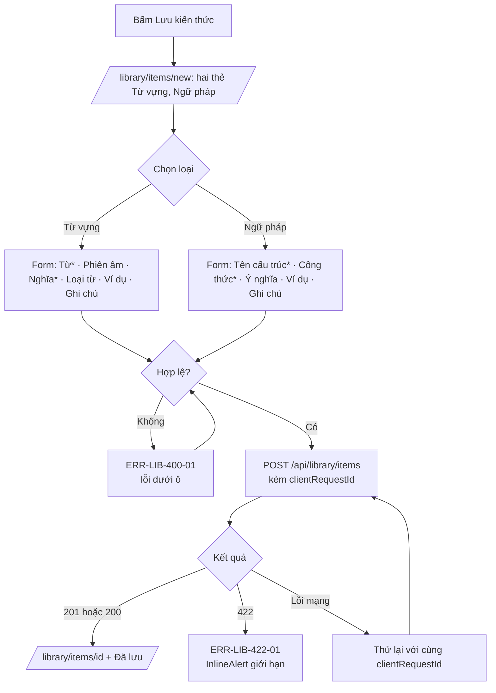
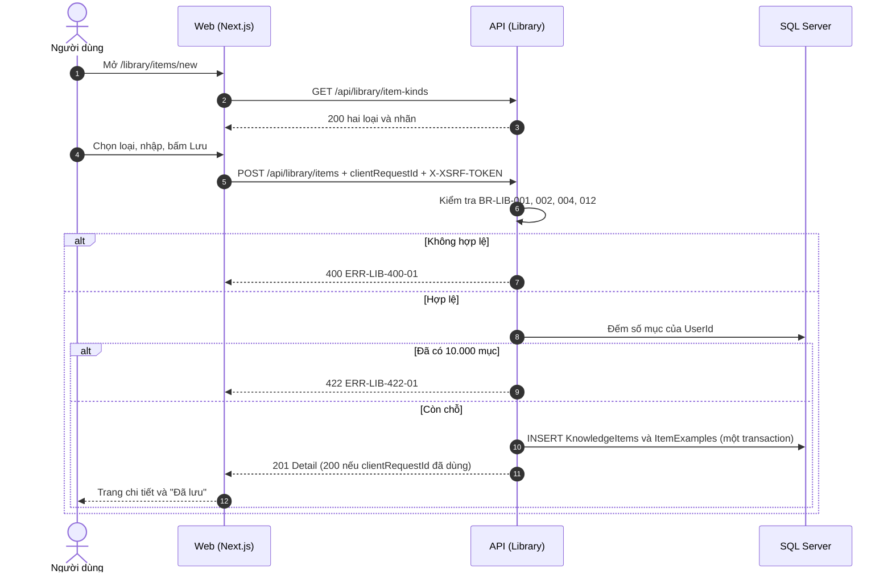

# SRS US-LIB-01 — Chọn loại và lưu mục kiến thức

- Tính năng: FEAT-02 Mục kiến thức (`knowledge-items`).
- User story: [US-LIB-01](../requirements/user-stories.md#us-lib-01--chọn-loại-và-lưu-mục-kiến-thức).
- Phiên bản 0.4 (2026-11-11). Trạng thái: **chờ duyệt**.
- Tài liệu chung: [README.md](README.md) (danh mục FR, BR, ERR, NFR, quy ước API, ngữ cảnh).
- Test case: [testing/test-cases.md](../testing/test-cases.md).
- Skill OpenBA áp dụng: `srs` (FR, BR, ERR, NFR), `user-flow`, `sequence`, `wireframe-ascii`, `api-design`, `ac`.

## 1. Giới thiệu

Là người tự học, tôi muốn chọn loại kiến thức trước (từ vựng, ngữ pháp, cụm từ…) và chỉ phải nhập đúng phần bắt buộc của loại đó, để lưu nhanh.

Quy ước (cập nhật 2026-11-11): loại không có mặc định; Vòng 1 chỉ có hai loại là Từ vựng và Ngữ pháp. Từ vựng bắt buộc "Từ" và "Nghĩa"; Ngữ pháp bắt buộc "Tên cấu trúc" và "Công thức". Các trường còn lại không bắt buộc. Form không có trường "Nguồn". Gợi ý nghĩa (US-LIB-09) vẫn áp dụng cho ô "Nghĩa" của từ vựng.

**Trong phạm vi:**

- Màn hình chọn loại (Từ vựng, Ngữ pháp) trước khi nhập.
- Form theo loại. Từ vựng: bắt buộc "Từ" và "Nghĩa"; các trường còn lại (phiên âm, loại từ, ví dụ, ghi chú) không bắt buộc. Ngữ pháp: bắt buộc "Tên cấu trúc" và "Công thức"; ý nghĩa, ví dụ, ghi chú không bắt buộc.
- Ví dụ (tối đa 20) và ghi chú không bắt buộc.
- Lưu mục; chống tạo trùng khi gửi lại (`clientRequestId`).

**Ngoài phạm vi:**

- Kiểm tra mục tương tự (US-LIB-02).
- Phiên âm IPA (US-LIB-08).
- Gợi ý nghĩa (US-LIB-09) ngoài phạm vi story này, chỉ được nhắc tới ở ô "Nghĩa".
- Các loại khác ngoài hai loại trên.

## 2. Yêu cầu áp dụng

### 2.1 Yêu cầu chức năng (FR)

**`FR-LIB-ITEM-007` — Chọn loại trước (Từ vựng, Ngữ pháp), form và nhãn theo loại**

- Input: `kind` (bắt buộc, `word` hoặc `grammar`).
- Xử lý: `GET /api/library/item-kinds` trả danh mục hai loại, nhãn và trường bắt buộc (BR-LIB-012). Giao diện lấy danh mục này, không tự khai báo lại. API từ chối `kind` ngoài danh mục.
- Output: Danh mục loại; hoặc `400 ERR-LIB-400-01` ở trường `kind`.

**`FR-LIB-ITEM-001` — Tạo mục kiến thức kèm ví dụ**

- Input: `clientRequestId`, `kind`, `term`, `meaning` (bắt buộc với `word`), `formula` (bắt buộc với `grammar`), `partOfSpeech?` (chỉ `word`), `ipa?`, `ipaSource?`, `note?`, `examples[] {text, translation?}`.
- Xử lý: Trim các chuỗi. Tính `NormalizedTerm` (BR-LIB-003) và `SearchText` (chuẩn bị cho Vòng 2). Kiểm tra BR-LIB-001, 002, 004, 005, 012, 013, 016. Ghi mục và ví dụ trong một transaction. `UserId` lấy từ phiên, bỏ qua `userId` trong body (BR-LIB-006).
- Output: `201` với mục vừa tạo và `Location`; `200` nếu `clientRequestId` đã dùng (BR-LIB-008).

### 2.2 Quy tắc nghiệp vụ (BR)

Phát biểu theo dạng KHI, THÌ, NGOẠI LỆ (`rules/02`). Nội dung chính thức nằm ở [README.md](README.md); bảng dưới là bản sao các quy tắc áp dụng cho story này.

| Mã BR | Quy tắc | KHI | THÌ | NGOẠI LỆ |
| --- | --- | --- | --- | --- |
| `BR-LIB-001` | Trường bắt buộc và độ dài | Tạo hoặc sửa | Sau khi trim: `term` 1–1000 ký tự và bắt buộc với mọi loại; `meaning` bắt buộc với `word` (1–2000); với `grammar` không bắt buộc (rỗng sau trim thì null, có thì 1–2000); `formula` bắt buộc với `grammar` (1–1000), null với `word`; `note` ≤ 4000; mỗi ví dụ `text` 1–1000, `translation` ≤ 1000 ký tự; chuỗi tùy chọn rỗng sau trim được lưu là null | — |
| `BR-LIB-002` | Loại nội dung | Tạo hoặc sửa | `kind` là **bắt buộc**, không có mặc định, và thuộc danh mục mở trong Vòng 1: `word` (Từ vựng) và `grammar` (Ngữ pháp). Database lưu `Kind` = 1 và 5 (ERD, CHECK `Kind IN (1, 5)`). Các loại khác (cụm từ, thành ngữ…) đã có mã dự phòng nhưng **chưa mở**; mở thêm cần đổi đặc tả và migration. Đổi loại khi sửa thì áp dụng quy tắc của loại mới | — |
| `BR-LIB-004` | Số ví dụ | Tạo hoặc sửa | Tối đa 20 ví dụ mỗi mục | — |
| `BR-LIB-005` | Giới hạn số mục | Tạo | Tối đa 10.000 mục mỗi người (`ERD-03`) | — |
| `BR-LIB-008` | Idempotency khi tạo | Tạo | `clientRequestId` (UUID do client sinh mỗi lần mở form) là duy nhất theo người dùng. Gửi lại cùng mã thì trả lại mục đã tạo, không tạo thêm | Cùng mã nhưng nội dung khác vẫn trả lại mục đã tạo; không coi là lỗi |
| `BR-LIB-010` | Thời gian | Tạo hoặc sửa | `CreatedAt` và `UpdatedAt` lưu UTC; hiển thị theo múi giờ `Asia/Ho_Chi_Minh` (MVP) | — |
| `BR-LIB-012` | Trường bắt buộc theo loại | Tạo hoặc sửa | `word` (Từ vựng): bắt buộc "Từ" (`term`) và "Nghĩa" (`meaning`). `grammar` (Ngữ pháp): bắt buộc "Tên cấu trúc" (`term`) và "Công thức" (`formula`). Ý nghĩa (ngữ pháp), ví dụ, ghi chú, phiên âm và loại từ không bắt buộc. Form không có trường nguồn | — |
| `BR-LIB-016` | Loại từ | Tạo hoặc sửa | `partOfSpeech` chỉ dùng cho `word`, không bắt buộc. Giá trị thuộc danh sách: Danh từ, Động từ, Tính từ, Trạng từ, Giới từ, Liên từ, Thán từ, Cụm từ, Khác. Giá trị khác bị từ chối với ERR-LIB-400-01 ở trường `partOfSpeech`. Với `grammar` luôn là null | — |

### 2.3 Ma trận lỗi (ERR)

Theo `rules/03` và `rules/11`. Nội dung chính thức nằm ở [README.md](README.md); bảng dưới là bản sao các lỗi áp dụng cho story này.

| Mã ERR | HTTP | Điều kiện phát sinh | Khóa i18n | Thông báo người dùng | Mức độ | Hành động trên giao diện | Ghi log (không ghi nội dung người dùng) |
| --- | --- | --- | --- | --- | --- | --- | --- |
| `ERR-LIB-400-01` | 400 | Thiếu trường bắt buộc, vượt độ dài, `kind` ngoài danh mục, `page` hoặc `pageSize` không hợp lệ | `library.error.400-01` | "Vui lòng kiểm tra lại thông tin đã nhập." kèm lỗi theo từng ô | Medium | Lỗi dưới ô; focus ô lỗi đầu tiên | Validation failed: tên trường |
| `ERR-LIB-422-01` | 422 | Người dùng đã có 10.000 mục | `library.error.422-01` | "Bạn đã đạt giới hạn 10.000 mục." | High | `InlineAlert` trên form | Item limit reached: userId |

### 2.4 Yêu cầu phi chức năng (NFR)

- `NFR-A11Y-001`: Form có nhãn hiển thị; thêm và xóa ví dụ bằng bàn phím; xóa ví dụ thì focus chuyển sang ví dụ kế bên; dialog giữ focus bên trong; gợi ý cập nhật có `aria-live="polite"`.
- `NFR-UX-001`: Form 2 cột ở ≥ 1280 px (trái: nội dung, loại, nghĩa; phải: ví dụ, ghi chú); 1 cột ở < 1024 px; không cuộn ngang.
- `NFR-PERF-001`: GET danh sách và chi tiết, POST, PUT có P95 ≤ 300 ms với 5.000 mục mỗi người; đo trên staging. Index (`UserId`, `CreatedAt` DESC) và (`UserId`, `NormalizedTerm`) theo ERD.

## 3. Luồng

### 3.1 User flow

_Skill `user-flow`: màn hình và chuyển đổi, kèm các trạng thái giao diện._



| Trạng thái | Hiển thị |
| --- | --- |
| Bình thường | Chọn loại, rồi form theo loại; mỗi loại có hai ô bắt buộc (dấu *). |
| Đang tải | Nút "Lưu" có spinner; các ô bị khóa; "Hủy" vẫn dùng được. |
| Trống | Form mới trống; chưa chọn loại thì không có ô nhập và "Tiếp tục" bị khóa. |
| Lỗi | 400-01 dưới từng ô và tóm tắt có liên kết tới ô lỗi; 422-01 `InlineAlert`; lỗi mạng "Thử lại". |
| Mất kết nối | Không hỗ trợ ngoại tuyến. Hiện "Mất kết nối" và nút "Thử lại"; không mất dữ liệu đã nhập. |

### 3.2 Sequence

_Skill `sequence`: tương tác giữa các thành phần; nhánh lỗi ghi mã `ERR-xxx`._



## 4. Acceptance criteria

_Skill `ac`. Văn bản Gherkin trùng với [user story](../requirements/user-stories.md) (nguồn chính thức); sửa ở đó rồi cập nhật lại đây. Script `tools/feature-docs/check_feature_docs.py` kiểm tra hai bản khớp nhau._

```gherkin
Scenario: AC-01 Chọn loại trước khi nhập
  Given tôi mở "Lưu kiến thức"
  Then tôi thấy hai loại: "Từ vựng" và "Ngữ pháp"
  And chưa có ô nhập nào hiện ra cho tới khi tôi chọn một loại

Scenario: AC-02 Từ vựng bắt buộc "Từ" và "Nghĩa"
  Given tôi chọn "Từ vựng"
  When tôi nhập "Từ" là "give up", "Nghĩa" là "từ bỏ", rồi bấm "Lưu"
  Then mục được lưu với loại "word", và tôi thấy trang chi tiết với thông báo "Đã lưu"
  When tôi để trống "Nghĩa" hoặc chỉ nhập khoảng trắng, rồi bấm "Lưu"
  Then mục không được lưu và ô "Nghĩa" hiện "Vui lòng nhập nghĩa." (ERR-LIB-400-01)

Scenario: AC-03 Ngữ pháp bắt buộc "Tên cấu trúc" và "Công thức"
  Given tôi chọn "Ngữ pháp"
  When tôi để trống "Tên cấu trúc" hoặc "Công thức", rồi bấm "Lưu"
  Then mục không được lưu và ô trống hiện "Vui lòng nhập tên cấu trúc." hoặc "Vui lòng nhập công thức." (ERR-LIB-400-01)
  When tôi nhập "Tên cấu trúc" là "Present perfect" và "Công thức" là "have/has + V3", rồi bấm "Lưu"
  Then mục được lưu với loại "grammar"

Scenario: AC-04 Chỉ có hai loại trong Vòng 1
  Given tôi mở form tạo
  Then không có loại nào khác "Từ vựng" và "Ngữ pháp" để chọn
  And API từ chối "kind" nằm ngoài {word, grammar} với ERR-LIB-400-01

Scenario: AC-05 Ý nghĩa ngữ pháp không bắt buộc, khoảng trắng được coi là trống
  Given tôi chọn "Ngữ pháp" và đã nhập "Tên cấu trúc" và "Công thức"
  When tôi nhập "Ý nghĩa" chỉ gồm khoảng trắng rồi bấm "Lưu"
  Then mục được lưu và ý nghĩa được lưu là null

Scenario: AC-06 Giới hạn độ dài
  When tôi nhập "Từ", "Tên cấu trúc" hoặc "Công thức" dài 1001 ký tự, hoặc "Nghĩa" hoặc "Ý nghĩa" dài 2001 ký tự
  Then không lưu được và ô tương ứng hiện lỗi ERR-LIB-400-01
  And độ dài đúng 1000 ký tự (với "Từ", "Tên cấu trúc", "Công thức") và đúng 2000 ký tự (với "Nghĩa", "Ý nghĩa") thì lưu được

Scenario: AC-07 Ví dụ không bắt buộc
  Given tôi đã nhập đủ trường bắt buộc
  When tôi không thêm ví dụ nào
  Then mục vẫn được lưu
  And khi thêm ví dụ thứ 21 thì hiện "Tối đa 20 ví dụ" (BR-LIB-004)

Scenario: AC-08 Bấm Lưu hai lần hoặc mạng gửi lại
  When cùng một yêu cầu tạo được gửi hai lần với cùng clientRequestId
  Then chỉ có một mục được tạo (BR-LIB-008)

Scenario: AC-09 Đạt giới hạn số mục
  Given tôi đã có 10.000 mục
  When tôi lưu thêm một mục
  Then không lưu được và thấy ERR-LIB-422-01

Scenario: AC-10 API từ chối yêu cầu thiếu loại
  When một client gửi POST không có "kind"
  Then API trả 400 ERR-LIB-400-01 với lỗi ở trường "kind" và không tạo mục

Scenario: AC-11 Loại từ không bắt buộc, chỉ nhận giá trị trong danh sách
  Given tôi chọn "Từ vựng" và đã nhập "Từ" và "Nghĩa"
  When tôi không chọn "Loại từ" rồi bấm "Lưu", hoặc chọn "Động từ" rồi bấm "Lưu"
  Then mục được lưu và loại từ được lưu là null hoặc "Động từ"
  And API từ chối loại từ ngoài danh sách với ERR-LIB-400-01 ở trường "partOfSpeech"
```

| AC | Nội dung | FR | BR | ERR | Wireframe | Test case |
| --- | --- | --- | --- | --- | --- | --- |
| AC-01 | Chọn loại trước khi nhập | `FR-LIB-ITEM-007` | `BR-LIB-002`, `BR-LIB-012` | — | W-LIB-06, W-LIB-07 | TC-LIB-033 |
| AC-02 | Từ vựng bắt buộc "Từ" và "Nghĩa" | `FR-LIB-ITEM-001` | `BR-LIB-001`, `BR-LIB-012` | `ERR-LIB-400-01` | W-LIB-08, W-LIB-10, W-LIB-14 | TC-LIB-001, TC-LIB-034 |
| AC-03 | Ngữ pháp bắt buộc "Tên cấu trúc" và "Công thức" | `FR-LIB-ITEM-001` | `BR-LIB-001`, `BR-LIB-012` | `ERR-LIB-400-01` | W-LIB-09, W-LIB-10 | TC-LIB-003, TC-LIB-035 |
| AC-04 | Chỉ có hai loại trong Vòng 1 | `FR-LIB-ITEM-007` | `BR-LIB-002` | `ERR-LIB-400-01` | W-LIB-10 | TC-LIB-036 |
| AC-05 | Ý nghĩa ngữ pháp không bắt buộc, khoảng trắng được coi là trống | `FR-LIB-ITEM-001` | `BR-LIB-001` | — | W-LIB-09 | TC-LIB-003 |
| AC-06 | Giới hạn độ dài | `FR-LIB-ITEM-001` | `BR-LIB-001` | `ERR-LIB-400-01` | W-LIB-10 | TC-LIB-004 |
| AC-07 | Ví dụ không bắt buộc | `FR-LIB-ITEM-001` | `BR-LIB-004` | — | W-LIB-08, W-LIB-10 | TC-LIB-002 |
| AC-08 | Bấm Lưu hai lần hoặc mạng gửi lại | `FR-LIB-ITEM-001` | `BR-LIB-008` | — | W-LIB-08, W-LIB-11 | TC-LIB-005 |
| AC-09 | Đạt giới hạn số mục | `FR-LIB-ITEM-001` | `BR-LIB-005` | `ERR-LIB-422-01` | W-LIB-11 | TC-LIB-006 |
| AC-10 | API từ chối yêu cầu thiếu loại | `FR-LIB-ITEM-007` | `BR-LIB-002` | `ERR-LIB-400-01` | Không có UI | TC-LIB-037 |
| AC-11 | Loại từ không bắt buộc, chỉ nhận giá trị trong danh sách | `FR-LIB-ITEM-001` | `BR-LIB-016` | `ERR-LIB-400-01` | W-LIB-08 | TC-LIB-051 |

## 5. Wireframe

_Skill `wireframe-ascii`. Figma: chưa dựng màn hình (`DES-01`); wireframe ASCII là căn cứ cho DoR. Quy tắc: vẽ đủ mọi màn hình, hộp thoại và trạng thái mà AC của story nhắc tới._

### W-LIB-06 — Chọn loại: chưa chọn (`/library/items/new`)

```text
┌──────────────┬────────────────────────────────────────────────────────────────┐
│Lingozi       │ ← Thư viện     Lưu kiến thức mới   h1                          │
│              │ Bạn muốn lưu loại nào?   h2                                    │
│▸ Thư viện    │ ┌────────────────────────────┐  ┌────────────────────────────┐ │
│▸ Luyện tập   │ │ ( ) Từ vựng                │  │ ( ) Ngữ pháp               │ │
│              │ │ Một từ hoặc cụm từ ngắn,   │  │ Một điểm ngữ pháp hoặc     │ │
│              │ │ có nghĩa và phiên âm IPA.  │  │ mẫu câu, có ví dụ.         │ │
│              │ └────────────────────────────┘  └────────────────────────────┘ │
│⚙ Cài đặt     │                                                                │
│              │                 [ Tiếp tục ] (vô hiệu)                         │
└──────────────┴────────────────────────────────────────────────────────────────┘
```

- Chỉ có hai loại ở Vòng 1: Từ vựng và Ngữ pháp; chưa có ô nhập nào.
- Hai thẻ là một `radiogroup`, chọn bằng phím mũi tên hoặc Space; loại không có mặc định.

### W-LIB-07 — Chọn loại: đã chọn Từ vựng

```text
┌──────────────┬────────────────────────────────────────────────────────────────┐
│Lingozi       │ ← Thư viện     Lưu kiến thức mới   h1                          │
│              │ Bạn muốn lưu loại nào?   h2                                    │
│▸ Thư viện    │ ┌────────────────────────────┐  ┌────────────────────────────┐ │
│▸ Luyện tập   │ │ (●) Từ vựng                │  │ ( ) Ngữ pháp               │ │
│              │ │ Một từ hoặc cụm từ ngắn,   │  │ Một điểm ngữ pháp hoặc     │ │
│              │ │ có nghĩa và phiên âm IPA.  │  │ mẫu câu, có ví dụ.         │ │
│              │ └────────────────────────────┘  └────────────────────────────┘ │
│⚙ Cài đặt     │                                                                │
│              │                 [ Tiếp tục ]                                   │
└──────────────┴────────────────────────────────────────────────────────────────┘
```

- Nút "Tiếp tục" bật sau khi chọn; Enter cũng tiếp tục.
- Trong form có nút "Đổi loại".

### W-LIB-08 — Form Từ vựng: mặc định (`/library/items/new`, sau khi chọn)

```text
┌──────────────┬────────────────────────────────────────────────────────────────┐
│Lingozi       │ ← Thư viện    Từ vựng · [Đổi loại]   h1                        │
│              │ ┌────────────────────────────┐  ┌────────────────────────────┐ │
│▸ Thư viện    │ │ Từ *                       │  │ Ví dụ (0/20)               │ │
│▸ Luyện tập   │ │ [give up__________]        │  │ [ + Thêm ví dụ ]           │ │
│              │ │ Phiên âm (tự điền)         │  │                            │ │
│              │ │ [________________]         │  │ Ghi chú cá nhân            │ │
│              │ │ Nghĩa *                    │  │ [________________]         │ │
│⚙ Cài đặt     │ │ [________________]         │  └────────────────────────────┘ │
│              │ │ Loại từ                    │                                 │
│              │ │ [Chọn loại từ       ▾]     │                                 │
│              │ └────────────────────────────┘                                 │
│              │                                                                │
│              │                      [ Hủy ]   [ Lưu ]                         │
└──────────────┴────────────────────────────────────────────────────────────────┘
```

- Từ vựng: bắt buộc "Từ" và "Nghĩa" (dấu *). Phiên âm (tự điền từ nguồn, sửa được), loại từ, ví dụ và ghi chú không bắt buộc.
- Loại từ là danh sách chọn: Danh từ, Động từ, Tính từ, Trạng từ, Giới từ, Liên từ, Thán từ, Cụm từ, Khác; để trống được.
- Đang lưu: nút "Lưu" có spinner, các ô bị khóa, "Hủy" vẫn dùng được.
- Mỗi lần mở form sinh một `clientRequestId`; bấm Lưu hai lần hoặc gửi lại chỉ tạo một mục.
- Form 2 cột ở ≥ 1280 px, 1 cột ở < 1024 px.
### W-LIB-09 — Form Ngữ pháp: mặc định

```text
┌──────────────┬────────────────────────────────────────────────────────────────┐
│Lingozi       │ ← Thư viện    Ngữ pháp · [Đổi loại]   h1                       │
│              │ ┌────────────────────────────┐  ┌────────────────────────────┐ │
│▸ Thư viện    │ │ Tên cấu trúc *             │  │ Ví dụ (0/20)               │ │
│▸ Luyện tập   │ │ [Present perfect___]       │  │ [ + Thêm ví dụ ]           │ │
│              │ │ Công thức *                │  │                            │ │
│              │ │ [have/has + V3_____]       │  │ Ghi chú cá nhân            │ │
│              │ │ Ý nghĩa (không bắt buộc)   │  │ [________________]         │ │
│⚙ Cài đặt     │ │ [________________]         │  └────────────────────────────┘ │
│              │ └────────────────────────────┘                                 │
│              │                                                                │
│              │                      [ Hủy ]   [ Lưu ]                         │
└──────────────┴────────────────────────────────────────────────────────────────┘
```

- Ngữ pháp: bắt buộc "Tên cấu trúc" và "Công thức"; ý nghĩa, ví dụ và ghi chú không bắt buộc.
- Không có ô phiên âm và không có ô loại từ.
- Ý nghĩa chỉ gồm khoảng trắng được lưu là trống.
### W-LIB-10 — Form: lỗi nhập liệu (ERR-LIB-400-01)

```text
┌──────────────┬────────────────────────────────────────────────────────────────┐
│Lingozi       │ ← Thư viện    Từ vựng · [Đổi loại]   h1                        │
│              │ ┌──────────────────────────────────────────────────────────┐   │
│▸ Thư viện    │ │ (!) Vui lòng kiểm tra lại thông tin đã nhập.             │   │
│▸ Luyện tập   │ │     Từ · Nghĩa                                           │   │
│              │ └──────────────────────────────────────────────────────────┘   │
│              │ ┌────────────────────────────┐  ┌────────────────────────────┐ │
│              │ │ Từ *                       │  │ Ví dụ (20/20)              │ │
│⚙ Cài đặt     │ │ [________________]         │  │ [ + Thêm ví dụ ] (vô hiệu) │ │
│              │ │ (!) Vui lòng nhập từ.      │  │ Tối đa 20 ví dụ.           │ │
│              │ │ Nghĩa *                    │  │                            │ │
│              │ │ [... 2001 ký tự ...]       │  │ Ghi chú cá nhân            │ │
│              │ │ (!) Tối đa 2000 ký tự.     │  │ [________________]         │ │
│              │ └────────────────────────────┘  └────────────────────────────┘ │
│              │                                                                │
│              │                      [ Hủy ]   [ Lưu ]                         │
└──────────────┴────────────────────────────────────────────────────────────────┘
```

- Lỗi dưới từng ô; tóm tắt phía trên có liên kết tới ô lỗi; focus vào ô lỗi đầu tiên.
- Trống hoặc chỉ có khoảng trắng: "Vui lòng nhập từ." (từ vựng), "Vui lòng nhập nghĩa." (từ vựng), "Vui lòng nhập tên cấu trúc." và "Vui lòng nhập công thức." (ngữ pháp).
- Độ dài: "Từ", "Tên cấu trúc", "Công thức" tối đa 1000 ký tự; "Nghĩa" và "Ý nghĩa" tối đa 2000 ký tự; "Ghi chú" tối đa 4000; tối đa 20 ví dụ (nút thêm bị vô hiệu ở ví dụ thứ 20).
- Đếm ký tự hiện dưới ô khi còn dưới 10% giới hạn.
### W-LIB-11 — Form: đã đạt giới hạn số mục (ERR-LIB-422-01)

```text
┌──────────────┬────────────────────────────────────────────────────────────────┐
│Lingozi       │ ← Thư viện    Từ vựng   h1                                     │
│              │ ┌──────────────────────────────────────────────────────────┐   │
│▸ Thư viện    │ │ (!) Bạn đã đạt giới hạn 10.000 mục.                      │   │
│▸ Luyện tập   │ └──────────────────────────────────────────────────────────┘   │
│              │ ┌────────────────────────────┐  ┌────────────────────────────┐ │
│              │ │ Từ *                       │  │ Ví dụ (0/20)               │ │
│              │ │ [give up__________]        │  │ [ + Thêm ví dụ ]           │ │
│⚙ Cài đặt     │ │ Phiên âm (tự điền)         │  │                            │ │
│              │ │ [/ɡɪv ʌp/_________]        │  │ Ghi chú cá nhân            │ │
│              │ │ Nghĩa *                    │  │ [________________]         │ │
│              │ │ [từ bỏ____________]        │  └────────────────────────────┘ │
│              │ │ Loại từ                    │                                 │
│              │ │ [Động từ          ▾]       │                                 │
│              │ └────────────────────────────┘                                 │
│              │                                                                │
│              │                      [ Hủy ]   [ Lưu ]                         │
└──────────────┴────────────────────────────────────────────────────────────────┘
```

- `InlineAlert` (danger) trên form; mục không được lưu.
- Lỗi mạng dùng cùng kiểu thông báo "(!) Mất kết nối" với nút "Thử lại"; thử lại gửi cùng `clientRequestId` nên không tạo trùng.
### W-LIB-14 — Chi tiết mục: đầy đủ (`/library/items/{id}`)

```text
┌──────────────┬────────────────────────────────────────────────────────────────┐
│Lingozi       │ [ ✓ Đã lưu ]  (toast sau khi lưu)                              │
│              │ ← Thư viện                            [ Sửa ]  [ x Xóa ]       │
│▸ Thư viện    │ give up                                         term           │
│▸ Luyện tập   │ Từ vựng · /ɡɪv ʌp/ · Động từ                                   │
│              │                                                                │
│              │ Nghĩa   h2                                                     │
│              │ từ bỏ                                                          │
│⚙ Cài đặt     │                                                                │
│              │ Ví dụ   h2                                                     │
│              │ 1. Don't give up. — Đừng bỏ cuộc.                              │
│              │                                                                │
│              │ Ghi chú: Thường dùng trong văn nói                             │
│              │                                                                │
│              │ Tạo 08/11/2026 14:00 · Sửa 08/11/2026 14:05                    │
└──────────────┴────────────────────────────────────────────────────────────────┘
```
- Nội dung hiện cỡ `text.term`. Từ vựng: hiện loại từ (nếu có) và phiên âm (nếu có; kèm nguồn khi do hệ thống điền). Ngữ pháp: thay khối Nghĩa bằng khối Công thức; hiện Ý nghĩa nếu có. Ghi chú hiện ở cuối; không còn dòng Nguồn.
- Nút "Xóa" kiểu viền, có icon cảnh báo, không dùng nền đặc giống nút chính.
- Toast "Đã lưu" (`role="status"`) chỉ hiện ngay sau khi lưu.
## 6. API

_Skill `api-design`; lỗi theo Problem Details (RFC 9457) như ADR 0002. Quy ước chung ở [README.md](README.md)._

| Method và path | Body | Thành công | Lỗi |
| --- | --- | --- | --- |
| `GET /api/library/item-kinds` | — | `200 { kinds: [{ kind: "word", label: "Từ vựng", requiredFields: [{ name: "term", label: "Từ" }, { name: "meaning", label: "Nghĩa" }], showsIpa: true, partOfSpeech: ["Danh từ", "Động từ", "Tính từ", "Trạng từ", "Giới từ", "Liên từ", "Thán từ", "Cụm từ", "Khác"] }, { kind: "grammar", label: "Ngữ pháp", requiredFields: [{ name: "term", label: "Tên cấu trúc" }, { name: "formula", label: "Công thức" }], showsIpa: false }] }` (Vòng 1: hai loại theo BR-LIB-002/012/016) | — |
| `POST /api/library/items` | `Input` + `clientRequestId` (uuid, bắt buộc) | `201 Detail` + `Location`; `200 Detail` nếu `clientRequestId` đã dùng (BR-LIB-008) | 400-01, 400-02, 422-01 |

```http
POST /api/library/items
Content-Type: application/json
X-XSRF-TOKEN: <token>

{
  "clientRequestId": "5d3b0f0c-6a3e-4c43-9f5e-9a1a7a0a0a01",
  "kind": "word",
  "term": "give up",
  "meaning": "từ bỏ",
  "partOfSpeech": "Động từ",
  "examples": [ { "text": "Don't give up.", "translation": "Đừng bỏ cuộc." } ]
}
```

Phản hồi `201` (chi tiết mục, có `version`), kèm header `Location`. Lỗi: `400 ERR-LIB-400-01`, `422 ERR-LIB-422-01`.

## 7. Truy vết test case

| TC | Loại | Bước chính | Kết quả mong đợi |
| --- | --- | --- | --- |
| `TC-LIB-001` | INT + E2E | POST `kind=word`, term "give up", meaning "từ bỏ", không có partOfSpeech | 201; `kind=word`; `meaning` "từ bỏ"; `partOfSpeech` null; có `Location`; UI hiện trang chi tiết và toast "Đã lưu" |
| `TC-LIB-002` | INT | POST đủ trường (`kind=word`, `partOfSpeech` "Động từ", 2 ví dụ, ghi chú) | Chi tiết trả đúng mọi trường; ví dụ đúng thứ tự; `ipa` null nếu không nhập |
| `TC-LIB-003` | INT + UNIT (Vitest) | `kind=grammar` thiếu `term` hoặc `formula`; `kind=word` thiếu `meaning` hoặc `term` chỉ khoảng trắng; `kind=grammar` có `meaning` chỉ khoảng trắng | 400 ERR-LIB-400-01 đúng trường (`term`, `formula`, `meaning`); meaning grammar chỉ khoảng trắng → lưu null; UI focus ô lỗi đầu tiên |
| `TC-LIB-004` | INT | term 1000 và 1001 ký tự; meaning (word) 2000 và 2001; formula 1000 và 1001; 20 và 21 ví dụ; note 4000 và 4001 | Đúng giới hạn: 201; vượt: 400-01 |
| `TC-LIB-005` | INT | POST 2 lần cùng `clientRequestId`, gồm cả gửi song song | Đúng 1 dòng trong database; lần sau trả 200 với cùng `id` |
| `TC-LIB-006` | INT | Seed 10.000 mục (insert hàng loạt bằng SQL) → POST | 422 ERR-LIB-422-01 |
| `TC-LIB-033` | E2E | Mở "Lưu kiến thức" | Thấy đúng 2 thẻ "Từ vựng" và "Ngữ pháp"; không có ô nhập nào; nút Tiếp tục disabled |
| `TC-LIB-034` | E2E | Chọn Từ vựng, nhập "give up", để trống "Nghĩa", Lưu; rồi nhập "từ bỏ" và Lưu | Lần đầu: lỗi "Vui lòng nhập nghĩa." dưới ô Nghĩa, không lưu; lần sau lưu được |
| `TC-LIB-035` | E2E | Chọn Ngữ pháp; để trống "Tên cấu trúc", Lưu; nhập "Present perfect", để trống "Công thức", Lưu; nhập "have/has + V3", Lưu | Lỗi "Vui lòng nhập tên cấu trúc.", rồi "Vui lòng nhập công thức."; cuối cùng lưu được với `kind=grammar` |
| `TC-LIB-036` | INT + E2E | Mở form (chỉ 2 thẻ); POST với `kind=idiom` (mã ngoài Vòng 1) | UI không có loại thứ ba; API trả 400-01 ở trường `kind`; không tạo mục |
| `TC-LIB-037` | INT | POST không có `kind`; `kind=99` | 400-01 ở trường `kind`; không tạo mục |
| `TC-LIB-051` | AC-11 | INT + E2E | POST `kind=word` không có `partOfSpeech`; có "Động từ"; có "Idiom" (ngoài danh sách) | Lưu được với null hoặc "Động từ"; "Idiom" → 400-01 ở trường `partOfSpeech`; form chỉ có danh sách cố định |
| `TC-LIB-050` | E2E | Chọn Từ vựng, nhập phiên âm, đổi sang Ngữ pháp rồi xác nhận | Hộp xác nhận; khi đồng ý phiên âm bị xóa, nội dung chung giữ lại |

## 8. Lịch sử sửa đổi

| Phiên bản | Ngày | Thay đổi |
| --- | --- | --- |
| 0.3 | 2026-11-09 | Tách từ `srs.md` và `design/` thành file riêng cho story; thêm FR chi tiết, sequence, state, bảng AC → FR/BR/ERR/TC. |
| 0.4 | 2026-11-11 | Theo chủ dự án: form Từ vựng (Từ*, Nghĩa*, phiên âm, loại từ, ví dụ, ghi chú); form Ngữ pháp (Tên cấu trúc*, Công thức*, ý nghĩa, ví dụ, ghi chú); bỏ trường Nguồn khỏi form. Thêm AC-11, BR-LIB-016; sửa AC-02, 03, 05, 06, 08 (TC-LIB-005 thay cho AC-05 cũ); vẽ lại W-LIB-08 đến 11. |
