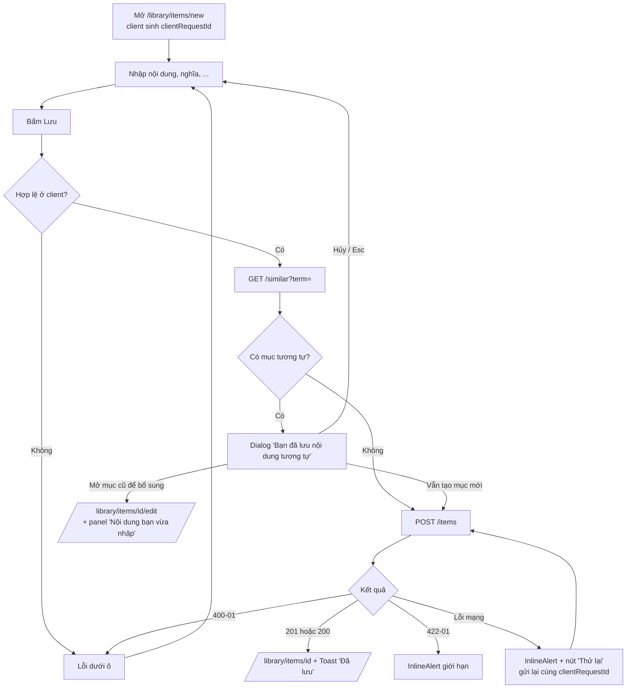
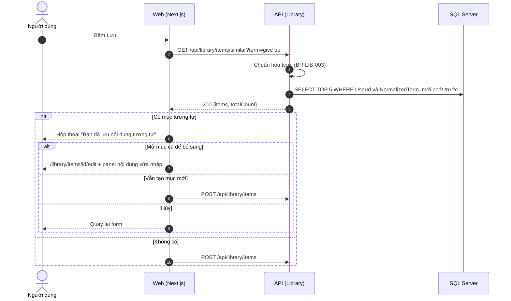

# SRS US-LIB-02 — Được gợi ý khi lưu mục tương tự

- Tính năng: FEAT-02 Mục kiến thức (`knowledge-items`).
- User story: [US-LIB-02](../requirements/user-stories.md#us-lib-02--được-gợi-ý-khi-lưu-mục-tương-tự).
- Phiên bản 0.3 (2026-11-09). Trạng thái: **chờ duyệt**.
- Tài liệu chung: [README.md](README.md) (danh mục FR, BR, ERR, NFR, quy ước API, ngữ cảnh).
- Test case: [testing/test-cases.md](../testing/test-cases.md).
- Skill OpenBA áp dụng: `srs` (FR, BR, ERR, NFR), `user-flow`, `sequence`, `wireframe-ascii`, `api-design`, `ac`.

## 1. Giới thiệu

Là người tự học, tôi muốn biết mình đã lưu nội dung này chưa, để bổ sung vào mục cũ thay vì tạo bản trùng.

**Trong phạm vi:**

- Gọi kiểm tra mục tương tự khi bấm "Lưu".
- Hộp thoại liệt kê tối đa 5 mục với hai lựa chọn: mở mục cũ để bổ sung hoặc vẫn tạo mục mới.
- Không bao giờ tự gộp.

**Ngoài phạm vi:**

- Tìm kiếm toàn văn (Vòng 2).
- Gộp mục tự động.

## 2. Yêu cầu áp dụng

### 2.1 Yêu cầu chức năng (FR)

**`FR-LIB-ITEM-002` — Kiểm tra mục tương tự trước khi tạo**

- Input: `term`.
- Xử lý: Chuẩn hóa `term` (BR-LIB-003), tìm mục của chính người dùng có cùng `NormalizedTerm`. Giao diện gọi trước khi tạo. API tạo **không** tự chặn khi có mục trùng.
- Output: Tối đa 5 mục mới nhất và `totalCount`.

### 2.2 Quy tắc nghiệp vụ (BR)

Phát biểu theo dạng KHI, THÌ, NGOẠI LỆ (`rules/02`). Nội dung chính thức nằm ở [README.md](README.md); bảng dưới là bản sao các quy tắc áp dụng cho story này.

| Mã BR | Quy tắc | KHI | THÌ | NGOẠI LỆ |
| --- | --- | --- | --- | --- |
| `BR-LIB-003` | Chuẩn hóa và mục tương tự | Tạo, sửa, kiểm tra trùng | `NormalizedTerm` = `term` chuyển chữ thường (culture-invariant), trim, gộp mọi chuỗi khoảng trắng thành một dấu cách. Hai mục là "tương tự" khi `NormalizedTerm` bằng nhau và cùng chủ sở hữu. Chỉ **gợi ý**, không chặn và không tự gộp (tổng quan §4.1) | — |
| `BR-LIB-006` | Chủ sở hữu | Mọi thao tác | `UserId` lấy từ phiên đăng nhập. Mục không thuộc người dùng thì xử lý như không tồn tại (404). Bỏ qua `userId` trong body | — |

### 2.3 Ma trận lỗi (ERR)

Theo `rules/03` và `rules/11`. Nội dung chính thức nằm ở [README.md](README.md); bảng dưới là bản sao các lỗi áp dụng cho story này.

| Mã ERR | HTTP | Điều kiện phát sinh | Khóa i18n | Thông báo người dùng | Mức độ | Hành động trên giao diện | Ghi log (không ghi nội dung người dùng) |
| --- | --- | --- | --- | --- | --- | --- | --- |
| `ERR-LIB-400-01` | 400 | Thiếu trường bắt buộc, vượt độ dài, `kind` ngoài danh mục, `page` hoặc `pageSize` không hợp lệ | `library.error.400-01` | "Vui lòng kiểm tra lại thông tin đã nhập." kèm lỗi theo từng ô | Medium | Lỗi dưới ô; focus ô lỗi đầu tiên | Validation failed: tên trường |

### 2.4 Yêu cầu phi chức năng (NFR)

- `NFR-A11Y-001`: Form có nhãn hiển thị; thêm và xóa ví dụ bằng bàn phím; xóa ví dụ thì focus chuyển sang ví dụ kế bên; dialog giữ focus bên trong; gợi ý cập nhật có `aria-live="polite"`.
- `NFR-PERF-001`: GET danh sách và chi tiết, POST, PUT có P95 ≤ 300 ms với 5.000 mục mỗi người; đo trên staging. Index (`UserId`, `CreatedAt` DESC) và (`UserId`, `NormalizedTerm`) theo ERD.

## 3. Luồng

### 3.1 User flow

_Skill `user-flow`: màn hình và chuyển đổi, kèm các trạng thái giao diện._



Panel "Nội dung bạn vừa nhập" chỉ hiển thị để người dùng tự chép sang mục cũ, không tự gộp vào mục cũ (tổng quan §4.1). Dữ liệu panel chỉ nằm trong bộ nhớ của trang. Nếu rời trang thì mất, và trước khi rời có hộp thoại xác nhận.

| Trạng thái | Hiển thị |
| --- | --- |
| Bình thường | Hộp thoại "Bạn đã lưu nội dung tương tự" liệt kê tối đa 5 mục. |
| Đang tải | Nút "Lưu" có spinner trong lúc gọi kiểm tra. |
| Trống | Không có mục tương tự: không hiện hộp thoại, lưu ngay. |
| Lỗi | Lỗi mạng: `InlineAlert` "Thử lại"; không chặn việc lưu. |
| Mất kết nối | Không hỗ trợ ngoại tuyến. Hiện "Mất kết nối" và nút "Thử lại"; không mất dữ liệu đã nhập. |

### 3.2 Sequence

_Skill `sequence`: tương tác giữa các thành phần; nhánh lỗi ghi mã `ERR-xxx`._



## 4. Wireframe

_Skill `wireframe-ascii`. Figma: chưa dựng màn hình (`DES-01`); wireframe ASCII là căn cứ cho DoR._

### W-LIB-03 Dialog mục tương tự

```text
┌──────────── Dialog (role=dialog, aria-modal) ─────────────────┐
│ Bạn đã lưu nội dung tương tự                               h2 │
│ ┌──────────────────────────────────────────────────────────┐  │
│ │ Give up · Từ vựng · từ bỏ · 02/11/2026          [Mở] │  │
│ └──────────────────────────────────────────────────────────┘  │
│ và 2 mục khác                                                 │
│ Bạn muốn bổ sung vào mục cũ hay tạo mục riêng?                │
│        [ Hủy ]  [ Vẫn tạo mục mới ]  [ Mở mục cũ để bổ sung ] │
└───────────────────────────────────────────────────────────────┘
```

- Khi mở dialog, focus vào tiêu đề. Esc tương đương "Hủy" và trả focus về nút Lưu.
- Khi có nhiều mục, nút "Mở mục cũ để bổ sung" mở mục mới nhất. Nút "Mở" trên từng dòng mở đúng mục đó.

## 5. API

_Skill `api-design`; lỗi theo Problem Details (RFC 9457) như ADR 0002. Quy ước chung ở [README.md](README.md)._

| Method và path | Body | Thành công | Lỗi |
| --- | --- | --- | --- |
| `GET /api/library/items/similar?term=` | — | `200 { items: Summary[] (tối đa 5), totalCount }`; `term` rỗng thì danh sách rỗng | 400-01 (`term` > 1000 ký tự) |

```http
GET /api/library/items/similar?term=give%20up
```

Phản hồi:

```json
{ "items": [ { "id": "1b2c...", "kind": "word", "term": "Give up", "meaning": "từ bỏ", "ipa": null, "createdAt": "2026-11-02T03:00:00Z" } ], "totalCount": 1 }
```

`term` rỗng trả danh sách rỗng; `term` dài hơn 1000 ký tự trả `400 ERR-LIB-400-01`.

## 6. Acceptance criteria

_Skill `ac`. Văn bản Gherkin trùng với [user story](../requirements/user-stories.md) (nguồn chính thức); sửa ở đó rồi cập nhật lại đây. Script `tools/feature-docs/check_feature_docs.py` kiểm tra hai bản khớp nhau._

```gherkin
Scenario: AC-01 Có mục tương tự
  Given tôi đã có mục "Give up" nghĩa "từ bỏ"
  When tôi tạo mục mới với nội dung "  give   UP " và bấm "Lưu"
  Then mục chưa được lưu
  And hộp thoại "Bạn đã lưu nội dung tương tự" liệt kê mục "Give up" với nghĩa và ngày tạo
  And có hai lựa chọn "Mở mục cũ để bổ sung" và "Vẫn tạo mục mới"

Scenario: AC-02 Mở mục cũ
  When tôi chọn "Mở mục cũ để bổ sung"
  Then tôi tới màn hình sửa mục cũ, và nội dung đang nhập không bị lưu thành mục mới
  And nghĩa, ví dụ, ghi chú tôi đã nhập được giữ lại, hiện bên cạnh để tôi tự chép sang (không tự gộp)

Scenario: AC-03 Vẫn tạo mục mới
  When tôi chọn "Vẫn tạo mục mới"
  Then mục mới được lưu, và mục cũ không thay đổi

Scenario: AC-04 Không gợi ý mục của người khác
  Given người dùng khác có mục "give up"
  And tôi chưa có
  When tôi lưu "give up"
  Then không có hộp thoại gợi ý và mục được lưu ngay

Scenario: AC-05 Nhiều mục tương tự
  Given tôi có 7 mục cùng nội dung chuẩn hóa "give up"
  Then hộp thoại hiện 5 mục mới nhất và dòng "và 2 mục khác"
```

| AC | Nội dung | FR | BR | ERR | Test case |
| --- | --- | --- | --- | --- | --- |
| AC-01 | Có mục tương tự | `FR-LIB-ITEM-002` | `BR-LIB-003` | — | TC-LIB-008 |
| AC-02 | Mở mục cũ | `FR-LIB-ITEM-002` | `BR-LIB-003` | — | TC-LIB-009 |
| AC-03 | Vẫn tạo mục mới | `FR-LIB-ITEM-002` | `BR-LIB-003` | — | TC-LIB-010 |
| AC-04 | Không gợi ý mục của người khác | `FR-LIB-ITEM-002` | `BR-LIB-006` | — | TC-LIB-011 |
| AC-05 | Nhiều mục tương tự | `FR-LIB-ITEM-002` | `BR-LIB-003` | — | TC-LIB-012 |

## 7. Truy vết test case

| TC | Loại | Bước chính | Kết quả mong đợi |
| --- | --- | --- | --- |
| `TC-LIB-008` | INT + E2E | Có "Give up" → tạo "  give   UP " | `/similar` trả 1 mục; UI hiện dialog; database chưa có mục mới |
| `TC-LIB-009` | E2E | Chọn "Mở mục cũ để bổ sung" | Tới trang sửa mục cũ; panel hiện nội dung vừa nhập; số mục không đổi |
| `TC-LIB-010` | E2E | Chọn "Vẫn tạo mục mới" | Có 2 mục cùng `NormalizedTerm`; mục cũ không đổi |
| `TC-LIB-011` | INT | User B có "give up", user A gọi `/similar` | A nhận danh sách rỗng |
| `TC-LIB-012` | INT | 7 mục trùng → `/similar` | 5 mục mới nhất; `totalCount = 7` |

## 8. Lịch sử sửa đổi

| Phiên bản | Ngày | Thay đổi |
| --- | --- | --- |
| 0.3 | 2026-11-09 | Tách từ `srs.md` và `design/` thành file riêng cho story; thêm FR chi tiết, sequence, state, bảng AC → FR/BR/ERR/TC. |
