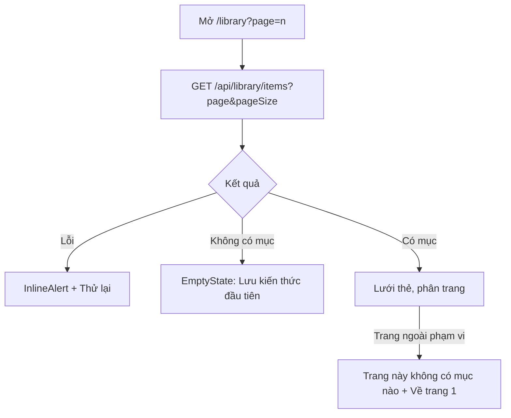
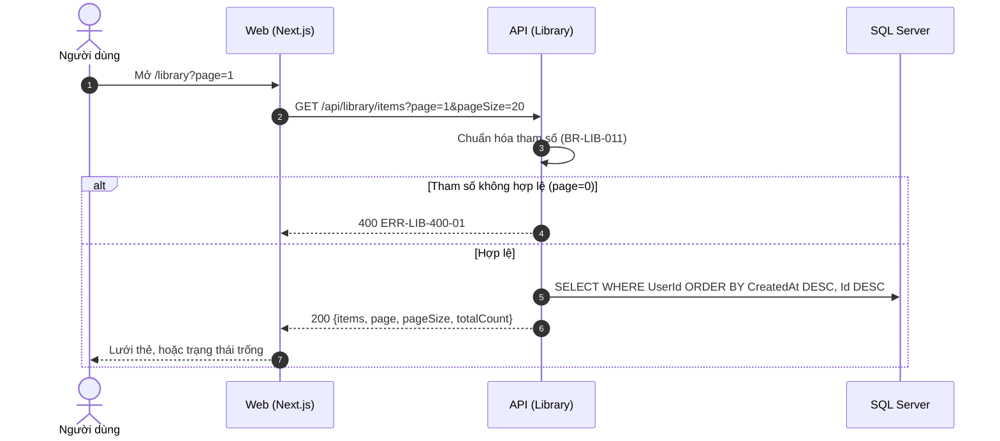

# SRS US-LIB-03 — Xem danh sách thư viện

- Tính năng: FEAT-02 Mục kiến thức (`knowledge-items`).
- User story: [US-LIB-03](../requirements/user-stories.md#us-lib-03--xem-danh-sách-thư-viện).
- Phiên bản 0.3 (2026-11-09). Trạng thái: **chờ duyệt**.
- Tài liệu chung: [README.md](README.md) (danh mục FR, BR, ERR, NFR, quy ước API, ngữ cảnh).
- Test case: [testing/test-cases.md](../testing/test-cases.md).
- Skill OpenBA áp dụng: `srs` (FR, BR, ERR, NFR), `user-flow`, `sequence`, `wireframe-ascii`, `api-design`, `ac`.

## 1. Giới thiệu

Là người tự học, tôi muốn xem các mục đã lưu, mới nhất trước.

**Trong phạm vi:**

- Danh sách mới nhất trước, 20 mục mỗi trang (tối đa 50).
- Trạng thái trống, lỗi, trang ngoài phạm vi.

**Ngoài phạm vi:**

- Tìm kiếm, lọc theo bộ sưu tập hoặc thẻ (Vòng 2).

## 2. Yêu cầu áp dụng

### 2.1 Yêu cầu chức năng (FR)

**`FR-LIB-ITEM-003` — Liệt kê mục, mới nhất trước, phân trang**

- Input: `page` (mặc định 1), `pageSize` (mặc định 20, tối đa 50).
- Xử lý: Lọc theo `UserId` của phiên. Sắp theo `CreatedAt` giảm dần, rồi `Id` giảm dần (BR-LIB-011).
- Output: `200 {items, page, pageSize, totalCount}`.

### 2.2 Quy tắc nghiệp vụ (BR)

Phát biểu theo dạng KHI, THÌ, NGOẠI LỆ (`rules/02`). Nội dung chính thức nằm ở [README.md](README.md); bảng dưới là bản sao các quy tắc áp dụng cho story này.

| Mã BR | Quy tắc | KHI | THÌ | NGOẠI LỆ |
| --- | --- | --- | --- | --- |
| `BR-LIB-006` | Chủ sở hữu | Mọi thao tác | `UserId` lấy từ phiên đăng nhập. Mục không thuộc người dùng thì xử lý như không tồn tại (404). Bỏ qua `userId` trong body | — |
| `BR-LIB-011` | Phân trang | Liệt kê | `page` ≥ 1 (mặc định 1), `pageSize` 1–50 (mặc định 20; lớn hơn thì giới hạn về 50). Sắp theo `CreatedAt` giảm dần, rồi `Id` giảm dần để thứ tự ổn định | — |

### 2.3 Ma trận lỗi (ERR)

Theo `rules/03` và `rules/11`. Nội dung chính thức nằm ở [README.md](README.md); bảng dưới là bản sao các lỗi áp dụng cho story này.

| Mã ERR | HTTP | Điều kiện phát sinh | Khóa i18n | Thông báo người dùng | Mức độ | Hành động trên giao diện | Ghi log (không ghi nội dung người dùng) |
| --- | --- | --- | --- | --- | --- | --- | --- |
| `ERR-LIB-400-01` | 400 | Thiếu trường bắt buộc, vượt độ dài, `kind` ngoài danh mục, `page` hoặc `pageSize` không hợp lệ | `library.error.400-01` | "Vui lòng kiểm tra lại thông tin đã nhập." kèm lỗi theo từng ô | Medium | Lỗi dưới ô; focus ô lỗi đầu tiên | Validation failed: tên trường |

### 2.4 Yêu cầu phi chức năng (NFR)

- `NFR-PERF-001`: GET danh sách và chi tiết, POST, PUT có P95 ≤ 300 ms với 5.000 mục mỗi người; đo trên staging. Index (`UserId`, `CreatedAt` DESC) và (`UserId`, `NormalizedTerm`) theo ERD.
- `NFR-UX-001`: Form 2 cột ở ≥ 1280 px (trái: nội dung, loại, nghĩa; phải: ví dụ, ghi chú); 1 cột ở < 1024 px; không cuộn ngang.

## 3. Luồng

### 3.1 User flow

_Skill `user-flow`: màn hình và chuyển đổi, kèm các trạng thái giao diện._



| Trạng thái | Hiển thị |
| --- | --- |
| Bình thường | Lưới thẻ 2 cột ở ≥ 1280 px, 1 cột ở < 1024 px; phân trang. |
| Đang tải | 6 `Skeleton` dạng thẻ; `aria-busy="true"`. |
| Trống | `EmptyState`: "Thư viện của bạn đang trống" và nút "Lưu kiến thức đầu tiên". |
| Lỗi | `InlineAlert` "Không tải được thư viện" và nút "Thử lại". |
| Mất kết nối | Không hỗ trợ ngoại tuyến. Hiện "Mất kết nối" và nút "Thử lại"; không mất dữ liệu đã nhập. |

### 3.2 Sequence

_Skill `sequence`: tương tác giữa các thành phần; nhánh lỗi ghi mã `ERR-xxx`._



## 4. Acceptance criteria

_Skill `ac`. Văn bản Gherkin trùng với [user story](../requirements/user-stories.md) (nguồn chính thức); sửa ở đó rồi cập nhật lại đây. Script `tools/feature-docs/check_feature_docs.py` kiểm tra hai bản khớp nhau._

```gherkin
Scenario: AC-01 Danh sách có dữ liệu
  Given tôi có 25 mục
  When tôi mở Thư viện
  Then tôi thấy 20 mục mới nhất, mỗi mục hiện nội dung, nghĩa (cắt ở 2 dòng), loại và ngày tạo
  And có phân trang để xem 5 mục còn lại

Scenario: AC-02 Thư viện trống
  Given tôi chưa có mục nào
  Then tôi thấy trạng thái trống "Thư viện của bạn đang trống" kèm nút "Lưu kiến thức đầu tiên"

Scenario: AC-03 Lỗi tải
  When API trả lỗi hoặc mạng mất
  Then tôi thấy "Không tải được thư viện" kèm nút "Thử lại", và không hiện dữ liệu cũ của người khác

Scenario: AC-04 Tham số trang ngoài giới hạn
  When tôi mở trang 999 hoặc pageSize 1000 qua URL
  Then trang ngoài phạm vi hiện danh sách trống kèm link về trang 1
  And pageSize lớn hơn 50 được giới hạn về 50
```

| AC | Nội dung | FR | BR | ERR | Wireframe | Test case |
| --- | --- | --- | --- | --- | --- | --- |
| AC-01 | Danh sách có dữ liệu | `FR-LIB-ITEM-003` | `BR-LIB-011` | — | W-LIB-01 | TC-LIB-013 |
| AC-02 | Thư viện trống | `FR-LIB-ITEM-003` | — | — | W-LIB-02 | TC-LIB-014 |
| AC-03 | Lỗi tải | `FR-LIB-ITEM-003` | — | — | W-LIB-03 | TC-LIB-015 |
| AC-04 | Tham số trang ngoài giới hạn | `FR-LIB-ITEM-003` | `BR-LIB-011` | — | W-LIB-04 | TC-LIB-016 |

## 5. Wireframe

_Skill `wireframe-ascii`. Figma: chưa dựng màn hình (`DES-01`); wireframe ASCII là căn cứ cho DoR. Quy tắc: vẽ đủ mọi màn hình, hộp thoại và trạng thái mà AC của story nhắc tới._

### W-LIB-01 — Danh sách thư viện: có dữ liệu (`/library`)

```text
┌──────────────┬────────────────────────────────────────────────────────────────┐
│Lingozi       │                                   [ + Lưu kiến thức (N) ]      │
│              │ Thư viện                         25 mục   h1                   │
│▸ Thư viện    │ ┌────────────────────────────┐  ┌────────────────────────────┐ │
│▸ Luyện tập   │ │ give up         Từ vựng    │  │ Present perfect Ngữ pháp   │ │
│              │ │ từ bỏ                      │  │ Thì hiện tại hoàn thành    │ │
│              │ │                 08/11/2026 │  │                 07/11/2026 │ │
│              │ └────────────────────────────┘  └────────────────────────────┘ │
│⚙ Cài đặt     │ ┌────────────────────────────┐  ┌────────────────────────────┐ │
│              │ │ break the ice   Từ vựng    │  │ Used to V       Ngữ pháp   │ │
│              │ │ phá vỡ sự ngại ngùng ban   │  │ đã từng làm gì             │ │
│              │ │                 06/11/2026 │  │                 05/11/2026 │ │
│              │ └────────────────────────────┘  └────────────────────────────┘ │
│              │                                                                │
│              │         ‹ Trước     Trang 1 / 2     Sau ›                      │
└──────────────┴────────────────────────────────────────────────────────────────┘
```

- Mới nhất trước, 20 mục mỗi trang (tối đa 50); lưới 2 cột ở ≥ 1280 px, 1 cột ở < 1024 px.
- Mỗi thẻ là một liên kết tới trang chi tiết: nội dung (h3), loại (`Badge`), nghĩa cắt ở 2 dòng, ngày tạo trong thẻ `<time>`.
- Chưa có ô tìm kiếm (Vòng 2).

### W-LIB-02 — Danh sách thư viện: trống

```text
┌──────────────┬────────────────────────────────────────────────────────────────┐
│Lingozi       │                                   [ + Lưu kiến thức (N) ]      │
│              │ Thư viện                          0 mục   h1                   │
│▸ Thư viện    │ ┌──────────────────────────────────────────────────────────┐   │
│▸ Luyện tập   │ │                                                          │   │
│              │ │         (hình linh vật, lz-decor)                        │   │
│              │ │                                                          │   │
│              │ │    Thư viện của bạn đang trống                           │   │
│⚙ Cài đặt     │ │    Lưu từ hoặc cách diễn đạt đầu tiên                    │   │
│              │ │    bạn gặp hôm nay.                                      │   │
│              │ │                                                          │   │
│              │ │      [ Lưu kiến thức đầu tiên ]                          │   │
│              │ │                                                          │   │
│              │ └──────────────────────────────────────────────────────────┘   │
└──────────────┴────────────────────────────────────────────────────────────────┘
```

- `EmptyState` có nút hành động chính; hình trang trí `aria-hidden`, ẩn khi giảm trang trí.

### W-LIB-03 — Danh sách thư viện: lỗi tải

```text
┌──────────────┬────────────────────────────────────────────────────────────────┐
│Lingozi       │                                   [ + Lưu kiến thức (N) ]      │
│              │ Thư viện   h1                                                  │
│▸ Thư viện    │ ┌──────────────────────────────────────────────────────────┐   │
│▸ Luyện tập   │ │ (!) Không tải được thư viện.                             │   │
│              │ │     [ Thử lại ]                                          │   │
│              │ └──────────────────────────────────────────────────────────┘   │
│              │                                                                │
│⚙ Cài đặt     │                                                                │
└──────────────┴────────────────────────────────────────────────────────────────┘
```

- `InlineAlert` (danger) kèm icon và chữ; "Thử lại" gọi lại API.
- Không hiện dữ liệu cũ hay dữ liệu của người khác.

### W-LIB-04 — Danh sách thư viện: trang ngoài phạm vi

```text
┌──────────────┬────────────────────────────────────────────────────────────────┐
│Lingozi       │                                   [ + Lưu kiến thức (N) ]      │
│              │ Thư viện   h1                                                  │
│▸ Thư viện    │ ┌──────────────────────────────────────────────────────────┐   │
│▸ Luyện tập   │ │ Trang này không có mục nào.                              │   │
│              │ │     Về trang 1                                           │   │
│              │ └──────────────────────────────────────────────────────────┘   │
│              │                                                                │
│⚙ Cài đặt     │                                                                │
└──────────────┴────────────────────────────────────────────────────────────────┘
```

- Hiện khi `page` vượt tổng số trang; `pageSize` lớn hơn 50 được giới hạn về 50 và không hiện thông báo riêng.

### W-LIB-05 — Danh sách thư viện: đang tải

```text
┌──────────────┬────────────────────────────────────────────────────────────────┐
│Lingozi       │                                   [ + Lưu kiến thức (N) ]      │
│              │ Thư viện   h1                                                  │
│▸ Thư viện    │ ┌────────────────────────────┐  ┌────────────────────────────┐ │
│▸ Luyện tập   │ │ ░░░░░░░░░░░░░░░░░░         │  │ ░░░░░░░░░░░░░░░░░░         │ │
│              │ │ ░░░░░░░░░░                 │  │ ░░░░░░░░░░                 │ │
│              │ │             ░░░░░░░░       │  │             ░░░░░░░░       │ │
│              │ └────────────────────────────┘  └────────────────────────────┘ │
│⚙ Cài đặt     │ ┌────────────────────────────┐  ┌────────────────────────────┐ │
│              │ │ ░░░░░░░░░░░░░░░░░░         │  │ ░░░░░░░░░░░░░░░░░░         │ │
│              │ │ ░░░░░░░░░░                 │  │ ░░░░░░░░░░                 │ │
│              │ │             ░░░░░░░░       │  │             ░░░░░░░░       │ │
│              │ └────────────────────────────┘  └────────────────────────────┘ │
│              │ ┌────────────────────────────┐  ┌────────────────────────────┐ │
│              │ │ ░░░░░░░░░░░░░░░░░░         │  │ ░░░░░░░░░░░░░░░░░░         │ │
│              │ │ ░░░░░░░░░░                 │  │ ░░░░░░░░░░                 │ │
│              │ │             ░░░░░░░░       │  │             ░░░░░░░░       │ │
│              │ └────────────────────────────┘  └────────────────────────────┘ │
└──────────────┴────────────────────────────────────────────────────────────────┘
```

- 6 `Skeleton` dạng thẻ; danh sách có `aria-busy="true"`.

## 6. API

_Skill `api-design`; lỗi theo Problem Details (RFC 9457) như ADR 0002. Quy ước chung ở [README.md](README.md)._

| Method và path | Body | Thành công | Lỗi |
| --- | --- | --- | --- |
| `GET /api/library/items?page=1&pageSize=20` | — | `200 { items: Summary[], page, pageSize, totalCount }` | 400-01 |

```http
GET /api/library/items?page=1&pageSize=20
```

Phản hồi:

```json
{ "items": [ { "id": "...", "kind": "word", "term": "give up", "meaning": "từ bỏ", "ipa": null, "createdAt": "2026-11-08T07:00:00Z" } ],
  "page": 1, "pageSize": 20, "totalCount": 25 }
```

`pageSize` lớn hơn 50 được giới hạn về 50; trang vượt phạm vi trả `items` rỗng; `page` hoặc `pageSize` không phải số trả `400 ERR-LIB-400-01`.

## 7. Truy vết test case

| TC | Loại | Bước chính | Kết quả mong đợi |
| --- | --- | --- | --- |
| `TC-LIB-013` | INT + E2E | 25 mục → trang 1 và trang 2 | Trang 1 có 20 mục mới nhất, trang 2 có 5; `totalCount = 25`; thứ tự ổn định khi cùng `CreatedAt` |
| `TC-LIB-014` | E2E | User mới mở /library | `EmptyState` và nút "Lưu kiến thức đầu tiên" |
| `TC-LIB-015` | UNIT (Vitest) | Render danh sách khi fetch lỗi | Hiện `InlineAlert` + "Thử lại"; bấm Thử lại thì gọi lại |
| `TC-LIB-016` | INT | `page=999`; `pageSize=1000`; `page=0`; `pageSize=abc` | 999: items rỗng; 1000 → 50; 0 và abc → 400-01 |

## 8. Lịch sử sửa đổi

| Phiên bản | Ngày | Thay đổi |
| --- | --- | --- |
| 0.3 | 2026-11-09 | Tách từ `srs.md` và `design/` thành file riêng cho story; thêm FR chi tiết, sequence, state, bảng AC → FR/BR/ERR/TC. |
