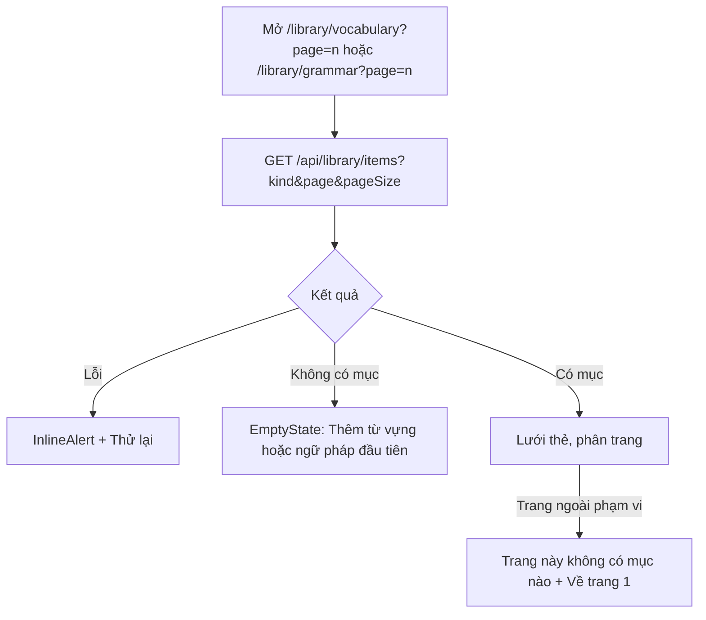
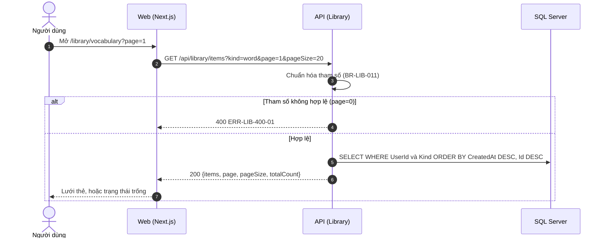
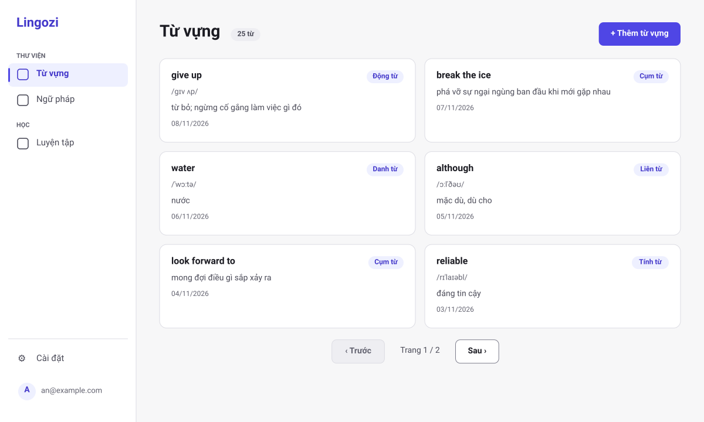
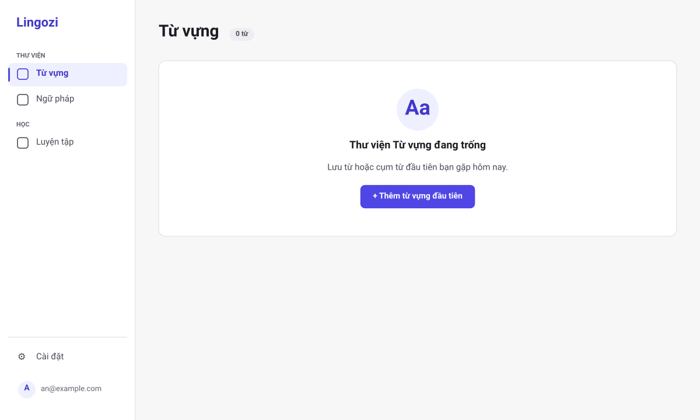
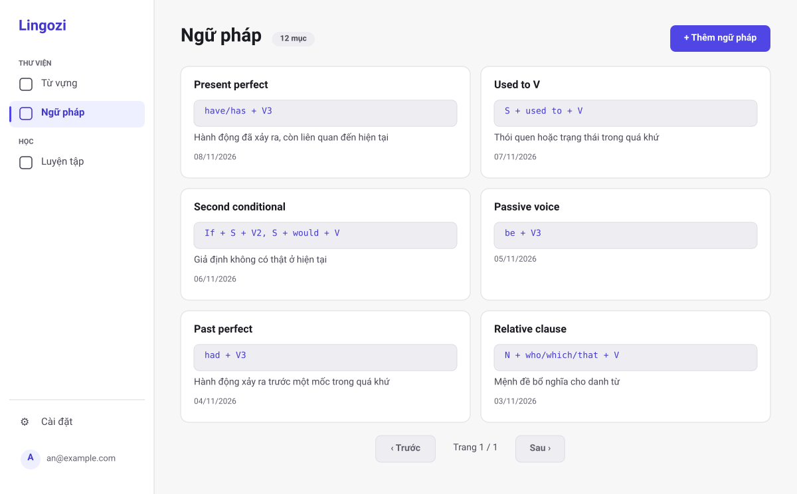
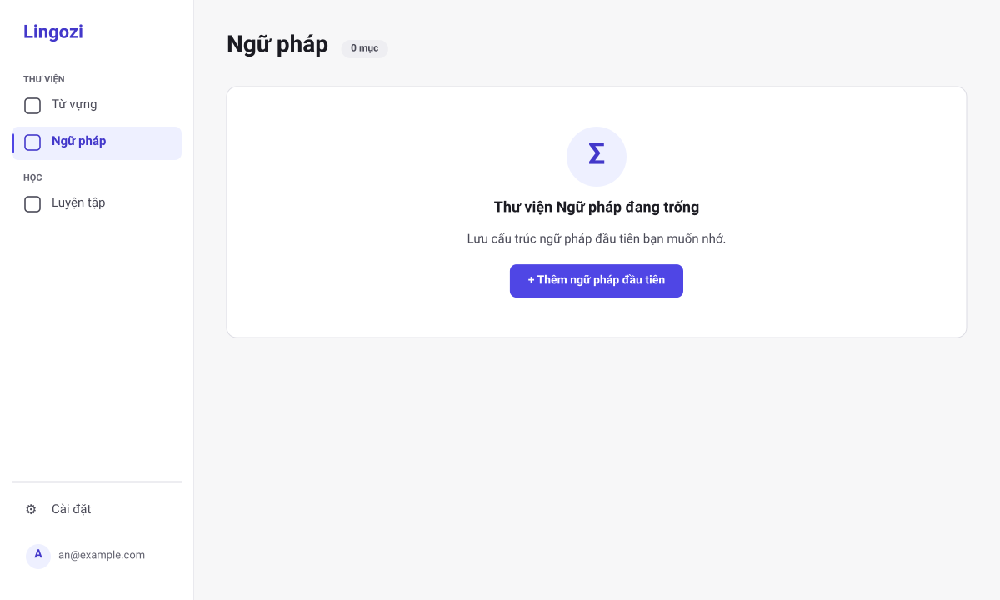
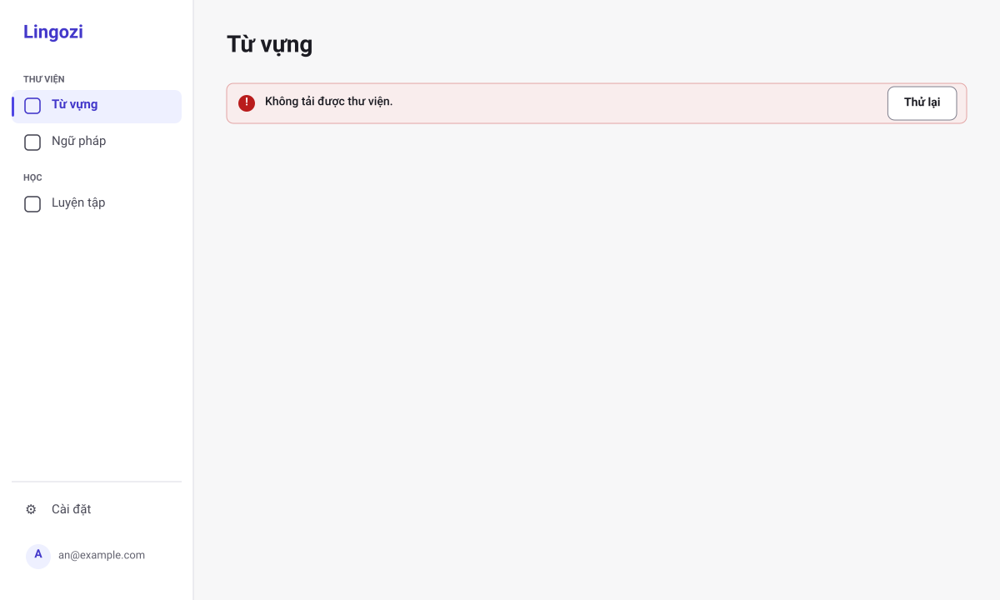
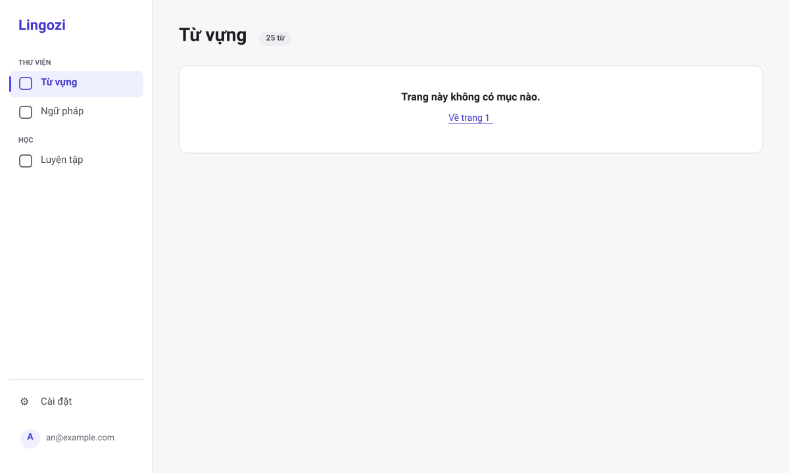
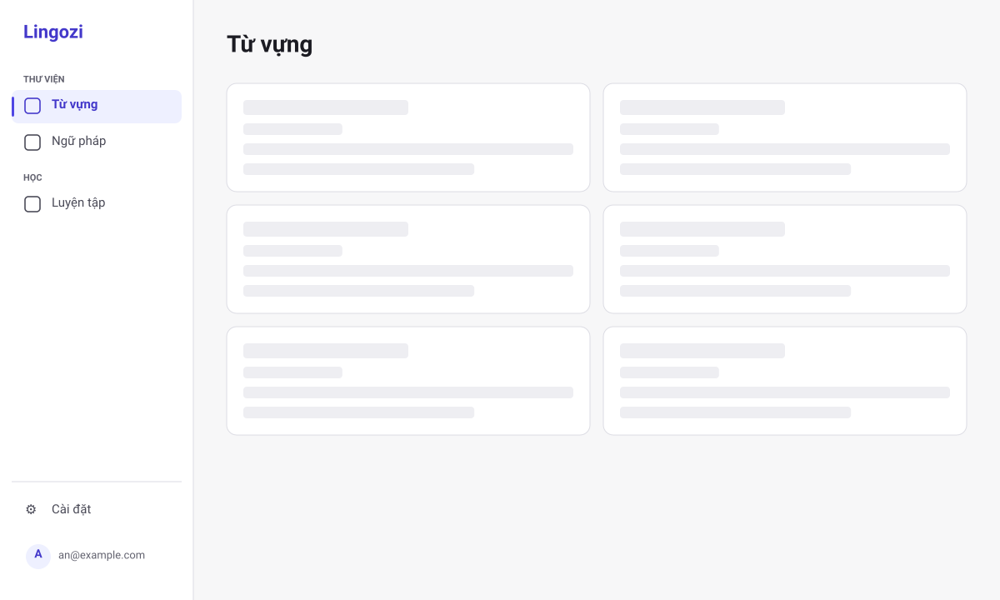

# SRS US-LIB-03 — Xem danh sách thư viện

- Tính năng: FEAT-02 Mục kiến thức (`knowledge-items`).
- User story: [US-LIB-03](../requirements/user-stories.md#us-lib-03--xem-danh-sách-thư-viện).
- Phiên bản 0.4 (2026-11-11). Trạng thái: **chờ duyệt**.
- Tài liệu chung: [README.md](README.md) (danh mục FR, BR, ERR, NFR, quy ước API, ngữ cảnh).
- Test case: [testing/test-cases.md](../testing/test-cases.md).
- Skill OpenBA áp dụng: `srs` (FR, BR, ERR, NFR), `user-flow`, `sequence`, wireframe SVG (`tools/wireframes/`), `api-design`, `ac`.

## 1. Giới thiệu

Là người tự học, tôi muốn xem các từ vựng và các cấu trúc ngữ pháp đã lưu ở hai thư viện riêng, mới nhất trước.

**Trong phạm vi:**

- Hai mục menu riêng "Từ vựng" và "Ngữ pháp", mỗi mục có danh sách riêng.
- Danh sách mới nhất trước, 20 mục mỗi trang (tối đa 50).
- Trạng thái trống, lỗi, trang ngoài phạm vi.

**Ngoài phạm vi:**

- Tìm kiếm, lọc theo bộ sưu tập hoặc thẻ (Vòng 2).

## 2. Yêu cầu áp dụng

### 2.1 Yêu cầu chức năng (FR)

**`FR-LIB-ITEM-003` — Liệt kê mục của một thư viện, mới nhất trước, phân trang**

- Input: `kind` (bắt buộc), `page` (mặc định 1), `pageSize` (mặc định 20, tối đa 50).
- Xử lý: Lọc theo `UserId` của phiên và `kind` (BR-LIB-017). Sắp theo `CreatedAt` giảm dần, rồi `Id` giảm dần (BR-LIB-011).
- Output: `200 {items, page, pageSize, totalCount}`.

### 2.2 Quy tắc nghiệp vụ (BR)

Phát biểu theo dạng KHI, THÌ, NGOẠI LỆ (`rules/02`). Nội dung chính thức nằm ở [README.md](README.md); bảng dưới là bản sao các quy tắc áp dụng cho story này.

| Mã BR | Quy tắc | KHI | THÌ | NGOẠI LỆ |
| --- | --- | --- | --- | --- |
| `BR-LIB-006` | Chủ sở hữu | Mọi thao tác | `UserId` lấy từ phiên đăng nhập. Mục không thuộc người dùng thì xử lý như không tồn tại (404). Bỏ qua `userId` trong body | — |
| `BR-LIB-011` | Phân trang | Liệt kê | `kind` (`word` hoặc `grammar`) bắt buộc: mỗi thư viện chỉ liệt kê mục cùng loại. `page` ≥ 1 (mặc định 1), `pageSize` 1–50 (mặc định 20; lớn hơn thì giới hạn về 50). Sắp theo `CreatedAt` giảm dần, rồi `Id` giảm dần để thứ tự ổn định | — |
| `BR-LIB-017` | Hai thư viện tách nhau | Mở, liệt kê, tạo, xem, sửa, xóa, gợi ý | Từ vựng (`/library/vocabulary`, `kind` = `word`) và Ngữ pháp (`/library/grammar`, `kind` = `grammar`) là hai mục riêng trong menu. Danh sách, form, gợi ý mục tương tự và gợi ý nghĩa chỉ dùng mục cùng loại. Mục mở bằng route của thư viện kia thì web hiện "Không tìm thấy" như ERR-LIB-404-01. Giới hạn 10.000 mục (BR-LIB-005) tính chung cả hai thư viện | — |

### 2.3 Ma trận lỗi (ERR)

Theo `rules/03` và `rules/11`. Nội dung chính thức nằm ở [README.md](README.md); bảng dưới là bản sao các lỗi áp dụng cho story này.

| Mã ERR | HTTP | Điều kiện phát sinh | Khóa i18n | Thông báo người dùng | Mức độ | Hành động trên giao diện | Ghi log (không ghi nội dung người dùng) |
| --- | --- | --- | --- | --- | --- | --- | --- |
| `ERR-LIB-400-01` | 400 | Thiếu trường bắt buộc, vượt độ dài, `kind` ngoài danh mục, `page` hoặc `pageSize` không hợp lệ | `library.error.400-01` | "Vui lòng kiểm tra lại thông tin đã nhập." kèm lỗi theo từng ô | Medium | Lỗi dưới ô; focus ô lỗi đầu tiên | Validation failed: tên trường |

### 2.4 Yêu cầu phi chức năng (NFR)

- `NFR-PERF-001`: GET danh sách và chi tiết, POST, PUT có P95 ≤ 300 ms với 5.000 mục mỗi người; đo trên staging. Index (`UserId`, `CreatedAt` DESC) và (`UserId`, `NormalizedTerm`) theo ERD.
- `NFR-UX-001`: Form thêm và sửa là một cột rộng tối đa 720 px, các ô xếp từ trên xuống đúng thứ tự trường của thư viện (Từ vựng: Từ, Phiên âm, Nghĩa, Loại từ, Ví dụ, Ghi chú; Ngữ pháp: Tên cấu trúc, Công thức, Ý nghĩa, Ví dụ, Ghi chú); nút Hủy và Lưu ở cuối form; không cuộn ngang. Danh sách là lưới thẻ 2 cột ở ≥ 1280 px, 1 cột ở < 1024 px.

## 3. Luồng

### 3.1 User flow

_Skill `user-flow`: màn hình và chuyển đổi, kèm các trạng thái giao diện._



| Trạng thái | Hiển thị |
| --- | --- |
| Bình thường | Lưới thẻ 2 cột ở ≥ 1280 px, 1 cột ở < 1024 px; phân trang. Thẻ từ vựng: từ, loại từ, phiên âm, nghĩa, ngày tạo. Thẻ ngữ pháp: tên cấu trúc, công thức, ý nghĩa, ngày tạo. |
| Đang tải | 6 `Skeleton` dạng thẻ; `aria-busy="true"`. |
| Trống | `EmptyState`: "Chưa có từ vựng nào" và nút "Thêm từ vựng đầu tiên" (Từ vựng); "Chưa có ngữ pháp nào" và nút "Thêm ngữ pháp đầu tiên" (Ngữ pháp). |
| Lỗi | `InlineAlert` "Không tải được thư viện" và nút "Thử lại". |
| Mất kết nối | Không hỗ trợ ngoại tuyến. Hiện "Mất kết nối" và nút "Thử lại"; không mất dữ liệu đã nhập. |

### 3.2 Sequence

_Skill `sequence`: tương tác giữa các thành phần; nhánh lỗi ghi mã `ERR-xxx`._



## 4. Acceptance criteria

_Skill `ac`. Văn bản Gherkin trùng với [user story](../requirements/user-stories.md) (nguồn chính thức); sửa ở đó rồi cập nhật lại đây. Script `tools/feature-docs/check_feature_docs.py` kiểm tra hai bản khớp nhau._

```gherkin
Scenario: AC-01 Danh sách có dữ liệu
  Given tôi có 25 từ vựng và 12 mục ngữ pháp
  When tôi mở thư viện "Từ vựng"
  Then tôi thấy 20 từ vựng mới nhất, mỗi mục hiện từ, phiên âm (nếu có), loại từ (nếu có), nghĩa (cắt ở 2 dòng) và ngày tạo
  And có phân trang để xem 5 mục còn lại
  When tôi mở thư viện "Ngữ pháp"
  Then tôi thấy 12 mục mới nhất, mỗi mục hiện tên cấu trúc, công thức, ý nghĩa (nếu có, cắt ở 2 dòng) và ngày tạo

Scenario: AC-02 Thư viện trống
  Given tôi chưa có từ vựng nào
  When tôi mở thư viện "Từ vựng"
  Then tôi thấy trạng thái trống "Chưa có từ vựng nào" kèm nút "Thêm từ vựng đầu tiên"
  Given tôi chưa có mục ngữ pháp nào
  When tôi mở thư viện "Ngữ pháp"
  Then tôi thấy trạng thái trống "Chưa có ngữ pháp nào" kèm nút "Thêm ngữ pháp đầu tiên"

Scenario: AC-03 Lỗi tải
  When API trả lỗi hoặc mạng mất
  Then tôi thấy "Không tải được thư viện" kèm nút "Thử lại", và không hiện dữ liệu cũ của người khác

Scenario: AC-04 Tham số trang ngoài giới hạn
  When tôi mở trang 999 hoặc pageSize 1000 qua URL
  Then trang ngoài phạm vi hiện danh sách trống kèm link về trang 1
  And pageSize lớn hơn 50 được giới hạn về 50

Scenario: AC-05 Hai thư viện tách nhau trong menu
  Given tôi có 3 từ vựng và 2 mục ngữ pháp
  Then menu bên trái có hai mục riêng "Từ vựng" và "Ngữ pháp", mục đang mở được đánh dấu
  When tôi mở "Từ vựng"
  Then tôi chỉ thấy 3 từ vựng, không thấy mục ngữ pháp
  When tôi mở "Ngữ pháp"
  Then tôi chỉ thấy 2 mục ngữ pháp, không thấy từ vựng
```

| AC | Nội dung | FR | BR | ERR | Wireframe | Test case |
| --- | --- | --- | --- | --- | --- | --- |
| AC-01 | Danh sách có dữ liệu | `FR-LIB-ITEM-003` | `BR-LIB-011` | — | W-LIB-01, W-LIB-03 | TC-LIB-013 |
| AC-02 | Thư viện trống | `FR-LIB-ITEM-003` | — | — | W-LIB-02, W-LIB-04 | TC-LIB-014 |
| AC-03 | Lỗi tải | `FR-LIB-ITEM-003` | — | — | W-LIB-05 | TC-LIB-015 |
| AC-04 | Tham số trang ngoài giới hạn | `FR-LIB-ITEM-003` | `BR-LIB-011` | — | W-LIB-06 | TC-LIB-016 |
| AC-05 | Hai thư viện tách nhau trong menu | `FR-LIB-ITEM-003`, `FR-LIB-ITEM-007` | `BR-LIB-011`, `BR-LIB-017` | `ERR-LIB-400-01` | W-LIB-01, W-LIB-03 | TC-LIB-054 |

## 5. Wireframe

_Wireframe mức thấp (khung xám, đúng bố cục màn hình thật) vẽ bằng script `tools/wireframes/` và lưu ở [wireframes/](../wireframes/); sửa script rồi chạy `python3 tools/wireframes/build.py` và `python3 tools/wireframes/sync_docs.py`, không sửa tay file SVG. Quy tắc: vẽ đủ mọi màn hình, hộp thoại và trạng thái mà AC của story nhắc tới._

### W-LIB-01 — Thư viện Từ vựng: có dữ liệu (`/library/vocabulary`)



- Thư viện Từ vựng chỉ có từ vựng; ngữ pháp nằm ở thư viện riêng (menu Ngữ pháp).
- Mới nhất trước, 20 mục mỗi trang (tối đa 50); lưới 2 cột ở ≥ 1280 px, 1 cột ở < 1024 px.
- Mỗi thẻ là một liên kết tới trang chi tiết: từ (h3), loại từ (`Badge`), phiên âm nếu có, nghĩa cắt ở 2 dòng, ngày tạo trong thẻ `<time>`.
- Nút "+ Thêm từ vựng" ở đầu trang (phím tắt `N`) mở `/library/vocabulary/new`. Chưa có ô tìm kiếm (Vòng 2).

### W-LIB-02 — Thư viện Từ vựng: trống



- `EmptyState` có nút hành động chính "+ Thêm từ vựng đầu tiên"; hình trang trí `aria-hidden`, ẩn khi giảm trang trí.
- Chỉ hiện khi chưa có từ vựng nào; việc có hay không ngữ pháp không ảnh hưởng.

### W-LIB-03 — Thư viện Ngữ pháp: có dữ liệu (`/library/grammar`)



- Thư viện Ngữ pháp chỉ có ngữ pháp, tách khỏi thư viện Từ vựng.
- Mới nhất trước, 20 mục mỗi trang; mỗi thẻ hiện tên cấu trúc (h3), công thức trong khối mã, ý nghĩa cắt ở 2 dòng (nếu có), ngày tạo.
- Nút "+ Thêm ngữ pháp" mở `/library/grammar/new`.

### W-LIB-04 — Thư viện Ngữ pháp: trống



- `EmptyState` có nút hành động chính "+ Thêm ngữ pháp đầu tiên".

### W-LIB-05 — Danh sách: lỗi tải



- `InlineAlert` (danger) kèm icon và chữ; "Thử lại" gọi lại API. Thư viện Ngữ pháp có màn hình giống hệt, chỉ đổi tiêu đề.
- Không hiện dữ liệu cũ hay dữ liệu của người khác.

### W-LIB-06 — Danh sách: trang ngoài phạm vi



- Hiện khi `page` vượt tổng số trang; `pageSize` lớn hơn 50 được giới hạn về 50 và không hiện thông báo riêng.
- Thư viện Ngữ pháp có màn hình giống hệt, chỉ đổi tiêu đề.

### W-LIB-07 — Danh sách: đang tải



- 6 `Skeleton` dạng thẻ; danh sách có `aria-busy="true"`. Thư viện Ngữ pháp giống hệt.

## 6. API

_Skill `api-design`; lỗi theo Problem Details (RFC 9457) như ADR 0002. Quy ước chung ở [README.md](README.md)._

| Method và path | Body | Thành công | Lỗi |
| --- | --- | --- | --- |
| `GET /api/library/items?kind=word&page=1&pageSize=20` | — | `200 { items: Summary[], page, pageSize, totalCount }` | 400-01 |

```http
GET /api/library/items?kind=word&page=1&pageSize=20
```

Phản hồi:

```json
{ "items": [ { "id": "...", "kind": "word", "term": "give up", "meaning": "từ bỏ", "ipa": null, "createdAt": "2026-11-08T07:00:00Z" } ],
  "page": 1, "pageSize": 20, "totalCount": 25 }
```

`pageSize` lớn hơn 50 được giới hạn về 50; trang vượt phạm vi trả `items` rỗng; `page` hoặc `pageSize` không phải số trả `400 ERR-LIB-400-01`.

## 7. Truy vết test case

| TC | Loại | Bước chính | Kết quả mong đợi |
| --- | --- | --- | --- |
| `TC-LIB-013` | INT + E2E | 25 mục → trang 1 và trang 2 | Trang 1 có 20 mục mới nhất, trang 2 có 5; `totalCount = 25`; thứ tự ổn định khi cùng `CreatedAt` |
| `TC-LIB-014` | E2E | User mới mở /library/vocabulary rồi /library/grammar | `EmptyState` "Chưa có từ vựng nào" và nút "Thêm từ vựng đầu tiên"; `EmptyState` "Chưa có ngữ pháp nào" và nút "Thêm ngữ pháp đầu tiên" |
| `TC-LIB-015` | UNIT (Vitest) | Render danh sách khi fetch lỗi | Hiện `InlineAlert` + "Thử lại"; bấm Thử lại thì gọi lại |
| `TC-LIB-054` | INT + E2E | Có 3 từ vựng và 2 ngữ pháp; GET `kind=word`, `kind=grammar`, không có `kind`; mở hai mục menu | `word` trả đúng 3, `grammar` trả đúng 2; thiếu `kind` → 400-01; menu có hai mục riêng, mục đang mở được đánh dấu |
| `TC-LIB-016` | INT | `page=999`; `pageSize=1000`; `page=0`; `pageSize=abc` | 999: items rỗng; 1000 → 50; 0 và abc → 400-01 |

## 8. Lịch sử sửa đổi

| Phiên bản | Ngày | Thay đổi |
| --- | --- | --- |
| 0.3 | 2026-11-09 | Tách từ `srs.md` và `design/` thành file riêng cho story; thêm FR chi tiết, sequence, state, bảng AC → FR/BR/ERR/TC. |
| 0.4 | 2026-11-11 | Tách hai thư viện: `kind` bắt buộc khi liệt kê, route `/library/vocabulary` và `/library/grammar`, hai trạng thái trống; thêm AC-05, TC-LIB-054; thay wireframe ASCII bằng SVG. |
