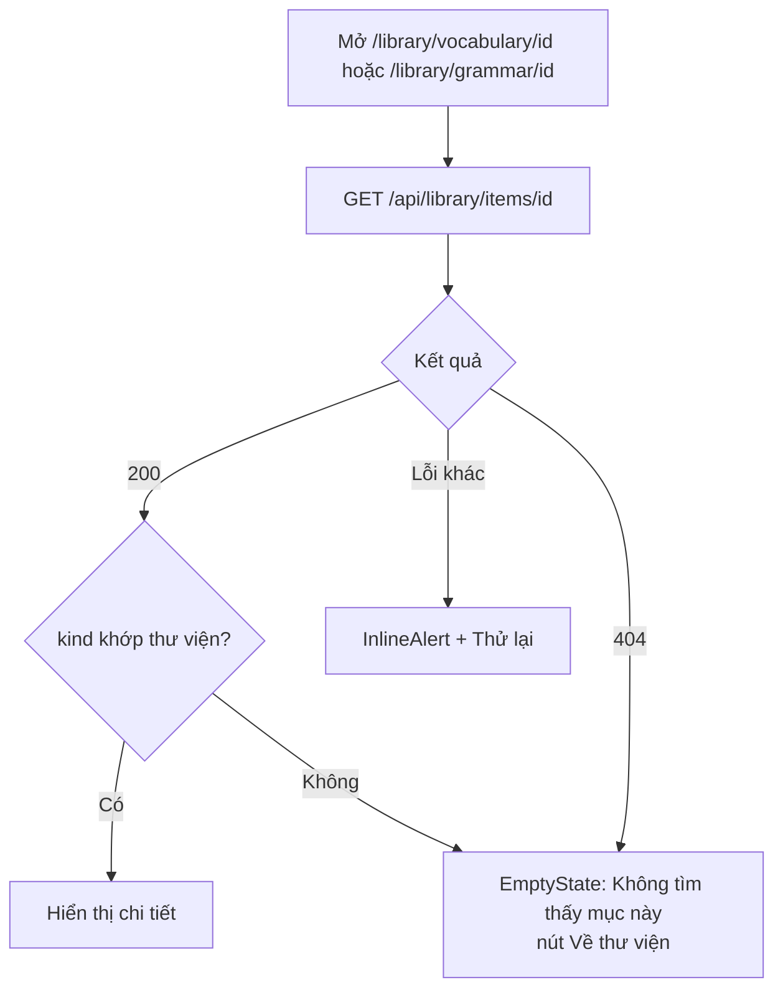
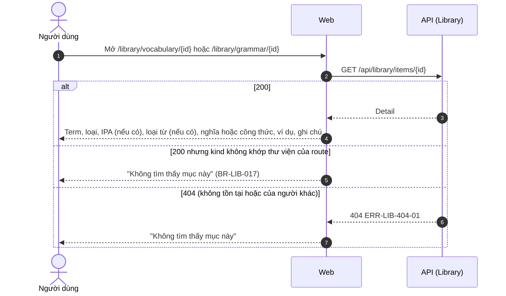
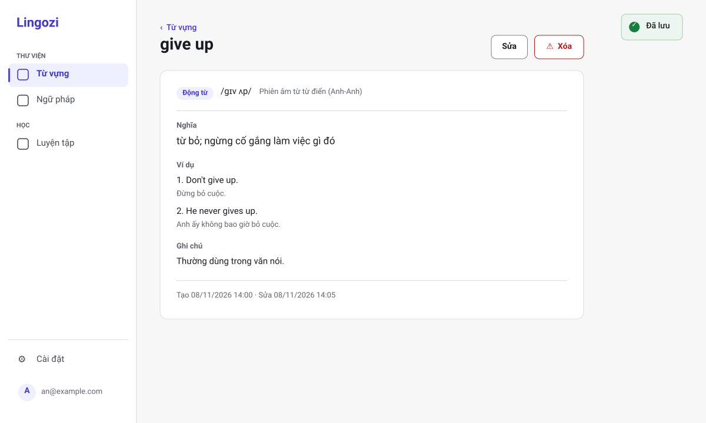
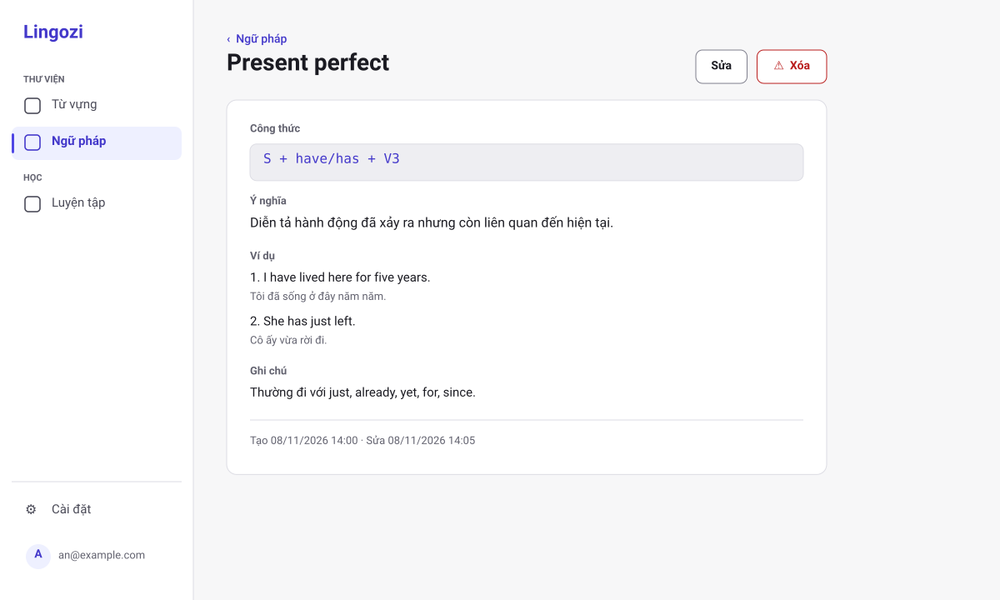
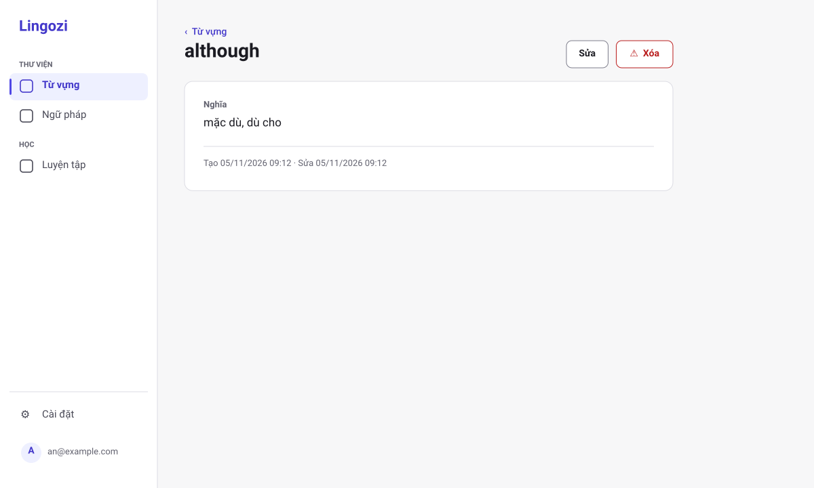
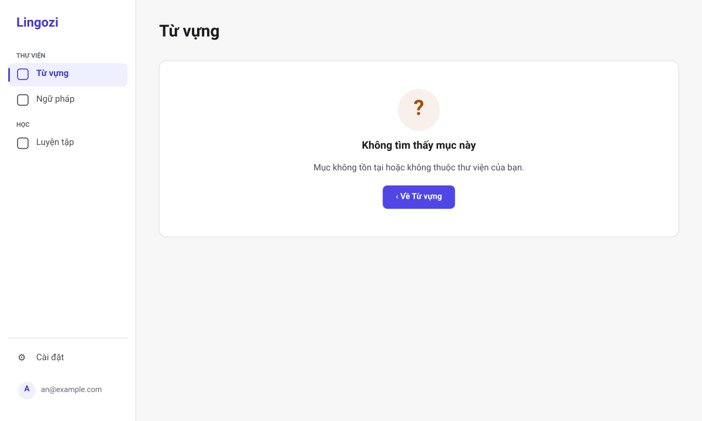
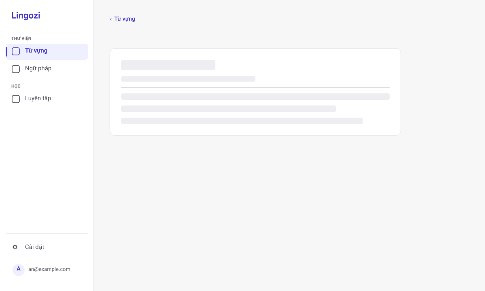

# SRS US-LIB-04 — Xem chi tiết từ vựng hoặc ngữ pháp

- Tính năng: FEAT-02 Mục kiến thức (`knowledge-items`).
- User story: [US-LIB-04](../requirements/user-stories.md#us-lib-04--xem-chi-tiết-từ-vựng-hoặc-ngữ-pháp).
- Phiên bản 0.5 (2026-11-11). Trạng thái: **chờ duyệt**.
- Tài liệu chung: [README.md](README.md) (danh mục FR, BR, ERR, NFR, quy ước API, ngữ cảnh).
- Test case: [testing/test-cases.md](../testing/test-cases.md).
- Skill OpenBA áp dụng: `srs` (FR, BR, ERR, NFR), `user-flow`, `sequence`, wireframe SVG (`tools/wireframes/`), `api-design`, `ac`.

## 1. Giới thiệu

**Trong phạm vi:**

- Hai trang chi tiết riêng: từ vựng (từ, phiên âm, loại từ, nghĩa) và ngữ pháp (tên cấu trúc, công thức, ý nghĩa); cả hai có ví dụ, ghi chú, ngày tạo và sửa, nút "Sửa" và "Xóa", nút quay lại thư viện của mục.
- Không hiện khối trống cho trường không có dữ liệu.

**Ngoài phạm vi:**

- Sửa (US-LIB-05) và xóa (US-LIB-06) ở các story riêng.

## 2. Yêu cầu áp dụng

### 2.1 Yêu cầu chức năng (FR)

**`FR-LIB-ITEM-004` — Xem chi tiết mục**

- Input: `id`.
- Xử lý: Tìm mục theo `Id` và `UserId` của phiên. Không tìm thấy hoặc không thuộc người dùng thì xử lý như nhau (BR-LIB-006). Web so `kind` của mục với thư viện của route; không khớp thì hiện cùng màn hình "Không tìm thấy" (BR-LIB-017).
- Output: `200` chi tiết (gồm `version`) hoặc `404 ERR-LIB-404-01`.

### 2.2 Quy tắc nghiệp vụ (BR)

Phát biểu theo dạng KHI, THÌ, NGOẠI LỆ (`rules/02`). Nội dung chính thức nằm ở [README.md](README.md); bảng dưới là bản sao các quy tắc áp dụng cho story này.

| Mã BR | Quy tắc | KHI | THÌ | NGOẠI LỆ |
| --- | --- | --- | --- | --- |
| `BR-LIB-006` | Chủ sở hữu | Mọi thao tác | `UserId` lấy từ phiên đăng nhập. Mục không thuộc người dùng thì xử lý như không tồn tại (404). Bỏ qua `userId` trong body | — |
| `BR-LIB-017` | Hai thư viện tách nhau | Mở, liệt kê, tạo, xem, sửa, xóa, gợi ý | Từ vựng (`/library/vocabulary`, `kind` = `word`) và Ngữ pháp (`/library/grammar`, `kind` = `grammar`) là hai mục riêng trong menu. Danh sách, form, gợi ý mục tương tự và gợi ý nghĩa chỉ dùng mục cùng loại. Mục mở bằng route của thư viện kia thì web hiện "Không tìm thấy" như ERR-LIB-404-01. Giới hạn 10.000 mục (BR-LIB-005) tính chung cả hai thư viện | — |

### 2.3 Ma trận lỗi (ERR)

Theo `rules/03` và `rules/11`. Nội dung chính thức nằm ở [README.md](README.md); bảng dưới là bản sao các lỗi áp dụng cho story này.

| Mã ERR | HTTP | Điều kiện phát sinh | Khóa i18n | Thông báo người dùng | Mức độ | Hành động trên giao diện | Ghi log (không ghi nội dung người dùng) |
| --- | --- | --- | --- | --- | --- | --- | --- |
| `ERR-LIB-404-01` | 404 | Mục không tồn tại, không thuộc người dùng, hoặc `id` sai định dạng | `library.error.404-01` | "Không tìm thấy mục này." | Medium | Màn hình "Không tìm thấy", nút "Về thư viện" (thư viện đang mở) | Item not found for user: itemId |

### 2.4 Yêu cầu phi chức năng (NFR)

- `NFR-PRIV-001`: Integration test truy cập chéo cho mọi endpoint (US-LIB-07); truy cập tài nguyên người khác trả 404.
- `NFR-PERF-001`: GET danh sách và chi tiết, POST, PUT có P95 ≤ 300 ms với 5.000 mục mỗi người; đo trên staging. Index (`UserId`, `CreatedAt` DESC) và (`UserId`, `NormalizedTerm`) theo ERD.

## 3. Luồng

### 3.1 User flow

_Skill `user-flow`: màn hình và chuyển đổi, kèm các trạng thái giao diện._



| Trạng thái | Hiển thị |
| --- | --- |
| Bình thường | Hiển thị đầy đủ; chỉ hiện các khối có dữ liệu. |
| Đang tải | `Skeleton` cho nội dung, nghĩa và ví dụ. |
| Trống | Mục chỉ có trường bắt buộc: không hiện ví dụ, ghi chú, loại từ, phiên âm, ý nghĩa. |
| Lỗi | 404-01: `EmptyState` "Không tìm thấy mục này"; lỗi khác: "Thử lại". |
| Mất kết nối | Không hỗ trợ ngoại tuyến. Hiện "Mất kết nối" và nút "Thử lại"; không mất dữ liệu đã nhập. |

### 3.2 Sequence

_Skill `sequence`: tương tác giữa các thành phần; nhánh lỗi ghi mã `ERR-xxx`._



## 4. Acceptance criteria

_Skill `ac`. Văn bản Gherkin trùng với [user story](../requirements/user-stories.md) (nguồn chính thức); sửa ở đó rồi cập nhật lại đây. Script `tools/feature-docs/check_feature_docs.py` kiểm tra hai bản khớp nhau._

```gherkin
Scenario: AC-01 Xem chi tiết
  When tôi mở một mục của mình trong thư viện tương ứng
  Then với từ vựng tôi thấy từ (cỡ chữ term), phiên âm (nếu có), loại từ (nếu có) và nghĩa
  And với ngữ pháp tôi thấy tên cấu trúc (cỡ chữ term), công thức và ý nghĩa (nếu có)
  And cả hai đều có các ví dụ theo thứ tự, ghi chú, ngày tạo và ngày sửa, cùng nút "Sửa" và "Xóa", và nút quay lại về đúng thư viện của mục

Scenario: AC-02 Mục không tồn tại hoặc của người khác
  When tôi mở đường dẫn tới mục không tồn tại, mục của người khác, hoặc mục mở sai thư viện (ví dụ một mục ngữ pháp mở bằng đường dẫn của từ vựng)
  Then tôi thấy cùng màn hình "Không tìm thấy mục này" (ERR-LIB-404-01)

Scenario: AC-03 Mục không có trường tùy chọn
  Given mục từ vựng chỉ có từ và nghĩa
  Then các khối ví dụ, ghi chú, loại từ, phiên âm không hiển thị, không để khối trống
  Given mục ngữ pháp chỉ có tên cấu trúc và công thức
  Then các khối ý nghĩa, ví dụ, ghi chú không hiển thị, không để khối trống
```

| AC | Nội dung | FR | BR | ERR | Wireframe | Test case |
| --- | --- | --- | --- | --- | --- | --- |
| AC-01 | Xem chi tiết | `FR-LIB-ITEM-004` | `BR-LIB-006` | — | W-LIB-16, W-LIB-17 | TC-LIB-017 |
| AC-02 | Mục không tồn tại hoặc của người khác | `FR-LIB-ITEM-004` | `BR-LIB-006` | `ERR-LIB-404-01` | W-LIB-19 | TC-LIB-018 |
| AC-03 | Mục không có trường tùy chọn | `FR-LIB-ITEM-004` | — | — | W-LIB-18 | TC-LIB-017 |

## 5. Wireframe

_Wireframe mức thấp (khung xám, đúng bố cục màn hình thật) vẽ bằng script `tools/wireframes/` và lưu ở [wireframes/](../wireframes/); sửa script rồi chạy `python3 tools/wireframes/build.py` và `python3 tools/wireframes/sync_docs.py`, không sửa tay file SVG. Quy tắc: vẽ đủ mọi màn hình, hộp thoại và trạng thái mà AC của story nhắc tới._

### W-LIB-16 — Chi tiết từ vựng: đầy đủ (`/library/vocabulary/{id}`)



- Từ cỡ `text.term`; hàng thông tin: loại từ (nếu có), phiên âm (nếu có, kèm nguồn khi do hệ thống điền). Các khối: Nghĩa, Ví dụ theo thứ tự, Ghi chú; ngày tạo và ngày sửa ở cuối.
- Nút "Xóa" kiểu viền, có icon cảnh báo, không dùng nền đặc giống nút chính.
- Toast "Đã lưu" (`role="status"`) chỉ hiện ngay sau khi lưu; sau khi sửa thì toast là "Đã lưu thay đổi".

### W-LIB-17 — Chi tiết ngữ pháp: đầy đủ (`/library/grammar/{id}`)



- Tên cấu trúc cỡ `text.term`; các khối: Công thức (khối mã), Ý nghĩa (nếu có), Ví dụ, Ghi chú; không có phiên âm và loại từ.
- Nút "Sửa" mở `/library/grammar/{id}/edit`; "Xóa" như thư viện Từ vựng.

### W-LIB-18 — Chi tiết: tối thiểu (không có trường tùy chọn)



- Mục từ vựng chỉ có từ và nghĩa: không hiện khối Ví dụ, Ghi chú, phiên âm, loại từ.
- Khối không có dữ liệu không hiển thị và không để khoảng trống. Mục ngữ pháp tối thiểu chỉ có tên cấu trúc và công thức.

### W-LIB-19 — Chi tiết: không tìm thấy (ERR-LIB-404-01)



- Cùng một màn hình cho mục không tồn tại, mục của người khác và mục thuộc thư viện khác loại (ví dụ mở ngữ pháp ở `/library/vocabulary/{id}`); không để lộ sự tồn tại.
- Nút về đúng thư viện đang mở ("Về Từ vựng" hoặc "Về Ngữ pháp"). Body lỗi giống hệt giữa các trường hợp.

### W-LIB-20 — Chi tiết: đang tải



- `Skeleton` cho tiêu đề, nghĩa hoặc công thức và ví dụ; trang có `aria-busy="true"`.

## 6. API

_Skill `api-design`; lỗi theo Problem Details (RFC 9457) như ADR 0002. Quy ước chung ở [README.md](README.md)._

| Method và path | Body | Thành công | Lỗi |
| --- | --- | --- | --- |
| `GET /api/library/items/{id}` | — | `200 Detail` | 404-01 |

```http
GET /api/library/items/{id}
```

Phản hồi `200` là chi tiết mục (gồm `ipa`, `ipaSource`, `examples`, `createdAt`, `updatedAt`, `version`). Không tồn tại, của người khác hoặc `id` sai định dạng đều trả `404 ERR-LIB-404-01` với body giống hệt.

## 7. Truy vết test case

| TC | Loại | Bước chính | Kết quả mong đợi |
| --- | --- | --- | --- |
| `TC-LIB-017` | E2E | Mở mục đủ trường và mục tối thiểu | Đủ khối với mục đủ trường; không có khối trống với mục tối thiểu |
| `TC-LIB-052` | E2E | Mở mục ngữ pháp bằng `/library/vocabulary/{id}` và mục từ vựng bằng `/library/grammar/{id}` | Cả hai hiện màn hình "Không tìm thấy mục này" như ERR-LIB-404-01, nút "Về thư viện" |
| `TC-LIB-018` | INT | GET id không tồn tại; id của user khác; id sai định dạng | Đều trả 404-01 với body giống nhau |

## 8. Lịch sử sửa đổi

| Phiên bản | Ngày | Thay đổi |
| --- | --- | --- |
| 0.3 | 2026-11-09 | Tách từ `srs.md` và `design/` thành file riêng cho story; thêm FR chi tiết, sequence, state, bảng AC → FR/BR/ERR/TC. |
| 0.4 | 2026-11-11 | Theo quyết định của chủ dự án (2026-11-11): bỏ "Nguồn" khỏi chi tiết và form sửa; thêm loại từ, công thức, ý nghĩa theo loại; gợi ý nghĩa vẫn có; sửa nhãn "Nghĩa" thành bắt buộc khi là từ vựng. |
| 0.5 | 2026-11-11 | Hai trang chi tiết riêng theo thư viện; mục mở sai thư viện hiện "Không tìm thấy" (TC-LIB-052); thay wireframe ASCII bằng SVG (W-LIB-16 → 20). |
