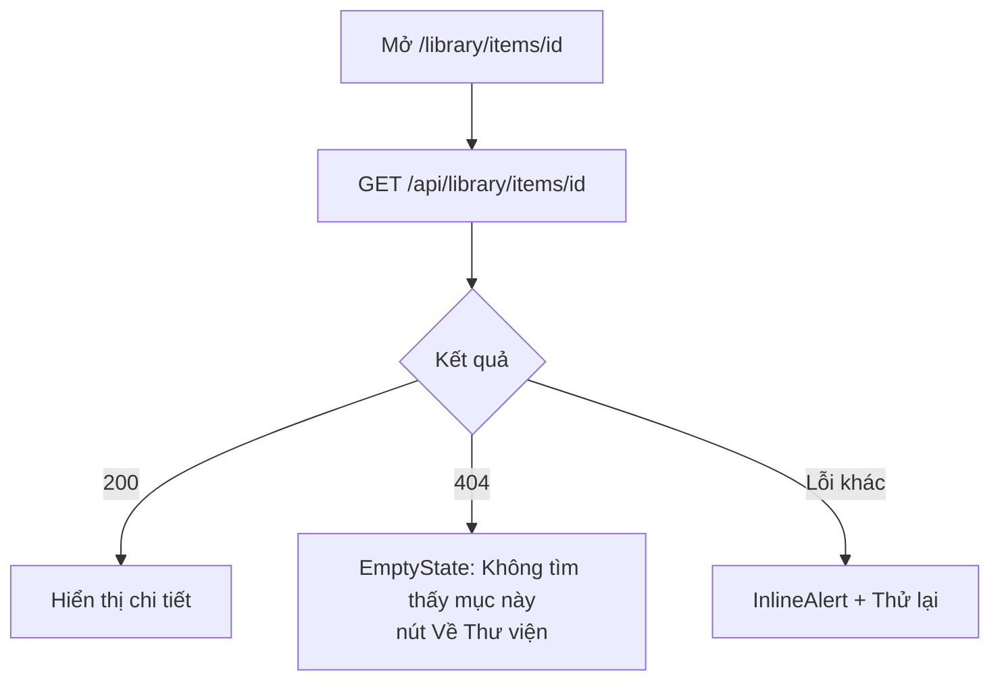
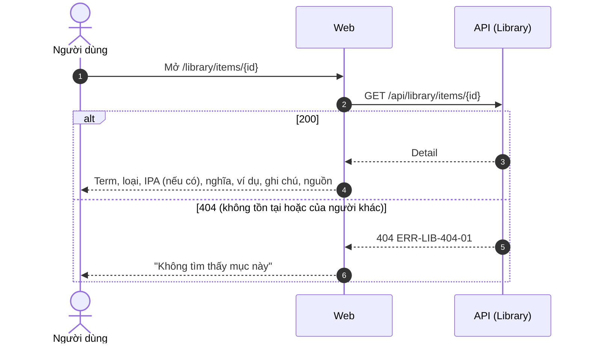

# SRS US-LIB-04 — Xem chi tiết một mục

- Tính năng: FEAT-02 Mục kiến thức (`knowledge-items`).
- User story: [US-LIB-04](../requirements/user-stories.md#us-lib-04--xem-chi-tiết-một-mục).
- Phiên bản 0.3 (2026-11-09). Trạng thái: **chờ duyệt**.
- Tài liệu chung: [README.md](README.md) (danh mục FR, BR, ERR, NFR, quy ước API, ngữ cảnh).
- Test case: [testing/test-cases.md](../testing/test-cases.md).
- Skill OpenBA áp dụng: `srs` (FR, BR, ERR, NFR), `user-flow`, `sequence`, `wireframe-ascii`, `api-design`, `ac`.

## 1. Giới thiệu

**Trong phạm vi:**

- Trang chi tiết: nội dung, loại, phiên âm (nếu có), nghĩa, ví dụ, ghi chú, nguồn, ngày tạo và sửa.
- Không hiện khối trống cho trường không có dữ liệu.

**Ngoài phạm vi:**

- Sửa (US-LIB-05) và xóa (US-LIB-06) ở các story riêng.

## 2. Yêu cầu áp dụng

### 2.1 Yêu cầu chức năng (FR)

**`FR-LIB-ITEM-004` — Xem chi tiết mục**

- Input: `id`.
- Xử lý: Tìm mục theo `Id` và `UserId` của phiên. Không tìm thấy hoặc không thuộc người dùng thì xử lý như nhau (BR-LIB-006).
- Output: `200` chi tiết (gồm `version`) hoặc `404 ERR-LIB-404-01`.

### 2.2 Quy tắc nghiệp vụ (BR)

Phát biểu theo dạng KHI, THÌ, NGOẠI LỆ (`rules/02`). Nội dung chính thức nằm ở [README.md](README.md); bảng dưới là bản sao các quy tắc áp dụng cho story này.

| Mã BR | Quy tắc | KHI | THÌ | NGOẠI LỆ |
| --- | --- | --- | --- | --- |
| `BR-LIB-006` | Chủ sở hữu | Mọi thao tác | `UserId` lấy từ phiên đăng nhập. Mục không thuộc người dùng thì xử lý như không tồn tại (404). Bỏ qua `userId` trong body | — |

### 2.3 Ma trận lỗi (ERR)

Theo `rules/03` và `rules/11`. Nội dung chính thức nằm ở [README.md](README.md); bảng dưới là bản sao các lỗi áp dụng cho story này.

| Mã ERR | HTTP | Điều kiện phát sinh | Khóa i18n | Thông báo người dùng | Mức độ | Hành động trên giao diện | Ghi log (không ghi nội dung người dùng) |
| --- | --- | --- | --- | --- | --- | --- | --- |
| `ERR-LIB-404-01` | 404 | Mục không tồn tại, không thuộc người dùng, hoặc `id` sai định dạng | `library.error.404-01` | "Không tìm thấy mục này." | Medium | Màn hình "Không tìm thấy", nút về Thư viện | Item not found for user: itemId |

### 2.4 Yêu cầu phi chức năng (NFR)

- `NFR-PRIV-001`: Integration test truy cập chéo cho mọi endpoint (US-LIB-07); truy cập tài nguyên người khác trả 404.
- `NFR-PERF-001`: GET danh sách và chi tiết, POST, PUT có P95 ≤ 300 ms với 5.000 mục mỗi người; đo trên staging. Index (`UserId`, `CreatedAt` DESC) và (`UserId`, `NormalizedTerm`) theo ERD.

## 3. Luồng

### 3.1 User flow

_Skill `user-flow`: màn hình và chuyển đổi, kèm các trạng thái giao diện._



| Trạng thái | Hiển thị |
| --- | --- |
| Bình thường | Hiển thị đầy đủ; chỉ hiện các khối có dữ liệu. |
| Đang tải | `Skeleton` cho nội dung, nghĩa và ví dụ. |
| Trống | Mục chỉ có nội dung (và loại): không hiện ví dụ, ghi chú, nguồn. |
| Lỗi | 404-01: `EmptyState` "Không tìm thấy mục này"; lỗi khác: "Thử lại". |
| Mất kết nối | Không hỗ trợ ngoại tuyến. Hiện "Mất kết nối" và nút "Thử lại"; không mất dữ liệu đã nhập. |

### 3.2 Sequence

_Skill `sequence`: tương tác giữa các thành phần; nhánh lỗi ghi mã `ERR-xxx`._



## 4. Acceptance criteria

_Skill `ac`. Văn bản Gherkin trùng với [user story](../requirements/user-stories.md) (nguồn chính thức); sửa ở đó rồi cập nhật lại đây. Script `tools/feature-docs/check_feature_docs.py` kiểm tra hai bản khớp nhau._

```gherkin
Scenario: AC-01 Xem chi tiết
  When tôi mở một mục của mình
  Then tôi thấy nội dung (cỡ chữ term), loại, nghĩa, các ví dụ theo thứ tự, ghi chú, nguồn, ngày tạo và ngày sửa

Scenario: AC-02 Mục không tồn tại hoặc của người khác
  When tôi mở đường dẫn tới mục không tồn tại, hoặc mục của người khác
  Then tôi thấy cùng màn hình "Không tìm thấy mục này" (ERR-LIB-404-01)

Scenario: AC-03 Mục không có trường tùy chọn
  Given mục chỉ có nội dung và nghĩa
  Then các khối ví dụ, ghi chú, nguồn không hiển thị, không để khối trống
```

| AC | Nội dung | FR | BR | ERR | Wireframe | Test case |
| --- | --- | --- | --- | --- | --- | --- |
| AC-01 | Xem chi tiết | `FR-LIB-ITEM-004` | `BR-LIB-006` | — | W-LIB-14 | TC-LIB-017 |
| AC-02 | Mục không tồn tại hoặc của người khác | `FR-LIB-ITEM-004` | `BR-LIB-006` | `ERR-LIB-404-01` | W-LIB-16 | TC-LIB-018 |
| AC-03 | Mục không có trường tùy chọn | `FR-LIB-ITEM-004` | — | — | W-LIB-15 | TC-LIB-017 |

## 5. Wireframe

_Skill `wireframe-ascii`. Figma: chưa dựng màn hình (`DES-01`); wireframe ASCII là căn cứ cho DoR. Quy tắc: vẽ đủ mọi màn hình, hộp thoại và trạng thái mà AC của story nhắc tới._

### W-LIB-14 — Chi tiết mục: đầy đủ (`/library/items/{id}`)

```text
┌──────────────┬────────────────────────────────────────────────────────────────┐
│Lingozi       │ [ ✓ Đã lưu ]  (toast sau khi lưu)                              │
│              │ ← Thư viện                            [ Sửa ]  [ x Xóa ]       │
│▸ Thư viện    │ give up                                         term           │
│▸ Luyện tập   │ Từ vựng · /ɡɪv ʌp/                                             │
│              │                                                                │
│              │ Nghĩa   h2                                                     │
│              │ từ bỏ                                                          │
│⚙ Cài đặt     │                                                                │
│              │ Ví dụ   h2                                                     │
│              │ 1. Don't give up. — Đừng bỏ cuộc.                              │
│              │                                                                │
│              │ Ghi chú · Nguồn: Friends S01E01                                │
│              │                                                                │
│              │ Tạo 08/11/2026 14:00 · Sửa 08/11/2026 14:05                    │
└──────────────┴────────────────────────────────────────────────────────────────┘
```

- Nội dung hiện cỡ `text.term`; phiên âm chỉ có với Từ vựng, kèm nguồn khi do hệ thống điền.
- Nút "Xóa" kiểu viền, có icon cảnh báo, không dùng nền đặc giống nút chính.
- Toast "Đã lưu" (`role="status"`) chỉ hiện ngay sau khi lưu.

### W-LIB-15 — Chi tiết mục: tối thiểu (không có trường tùy chọn)

```text
┌──────────────┬────────────────────────────────────────────────────────────────┐
│Lingozi       │ ← Thư viện                            [ Sửa ]  [ x Xóa ]       │
│              │ in a nutshell                                   term           │
│▸ Thư viện    │ Ngữ pháp                                                       │
│▸ Luyện tập   │                                                                │
│              │ Tạo 08/11/2026 14:00 · Sửa 08/11/2026 14:00                    │
│              │                                                                │
│              │ (không có khối Nghĩa, Ví dụ, Ghi chú, Nguồn)                   │
│⚙ Cài đặt     │                                                                │
└──────────────┴────────────────────────────────────────────────────────────────┘
```

- Khối không có dữ liệu không hiển thị và không để khoảng trống.

### W-LIB-16 — Chi tiết mục: không tìm thấy (ERR-LIB-404-01)

```text
┌──────────────┬────────────────────────────────────────────────────────────────┐
│Lingozi       │ ┌──────────────────────────────────────────────────────────┐   │
│              │ │                                                          │   │
│▸ Thư viện    │ │         (hình minh họa, lz-decor)                        │   │
│▸ Luyện tập   │ │                                                          │   │
│              │ │        Không tìm thấy mục này.                           │   │
│              │ │                                                          │   │
│              │ │          [ Về Thư viện ]                                 │   │
│⚙ Cài đặt     │ │                                                          │   │
│              │ └──────────────────────────────────────────────────────────┘   │
└──────────────┴────────────────────────────────────────────────────────────────┘
```

- Cùng một màn hình cho mục không tồn tại và mục của người khác (không để lộ sự tồn tại).
- Body lỗi giống hệt giữa hai trường hợp.

### W-LIB-17 — Chi tiết mục: đang tải

```text
┌──────────────┬────────────────────────────────────────────────────────────────┐
│Lingozi       │ ░░░░░░░░░░░░░░                                                 │
│              │ ░░░░░░░░                                                       │
│▸ Thư viện    │                                                                │
│▸ Luyện tập   │ ░░░░░░░░░░░░░░░░░░░░                                           │
│              │                                                                │
│              │ ░░░░░░░░░░░░░░░░░░░░░░░░░░░░                                   │
│              │                                                                │
│⚙ Cài đặt     │                                                                │
└──────────────┴────────────────────────────────────────────────────────────────┘
```

- `Skeleton` cho nội dung, nghĩa và ví dụ.

## 6. API

_Skill `api-design`; lỗi theo Problem Details (RFC 9457) như ADR 0002. Quy ước chung ở [README.md](README.md)._

| Method và path | Body | Thành công | Lỗi |
| --- | --- | --- | --- |
| `GET /api/library/items/{id}` | — | `200 Detail` | 404-01 |

```http
GET /api/library/items/{id}
```

Phản hồi `200` là chi tiết mục (gồm `ipa`, `ipaSource`, `examples`, `createdAt`, `updatedAt`, `version`). Không tồn tại, của người khác hoặc `id` sai định dạng đều trả `404 ERR-LIB-404-01` với body giống hệt.

## 7. Truy vết test case

| TC | Loại | Bước chính | Kết quả mong đợi |
| --- | --- | --- | --- |
| `TC-LIB-017` | E2E | Mở mục đủ trường và mục tối thiểu | Đủ khối với mục đủ trường; không có khối trống với mục tối thiểu |
| `TC-LIB-018` | INT | GET id không tồn tại; id của user khác; id sai định dạng | Đều trả 404-01 với body giống nhau |

## 8. Lịch sử sửa đổi

| Phiên bản | Ngày | Thay đổi |
| --- | --- | --- |
| 0.3 | 2026-11-09 | Tách từ `srs.md` và `design/` thành file riêng cho story; thêm FR chi tiết, sequence, state, bảng AC → FR/BR/ERR/TC. |
