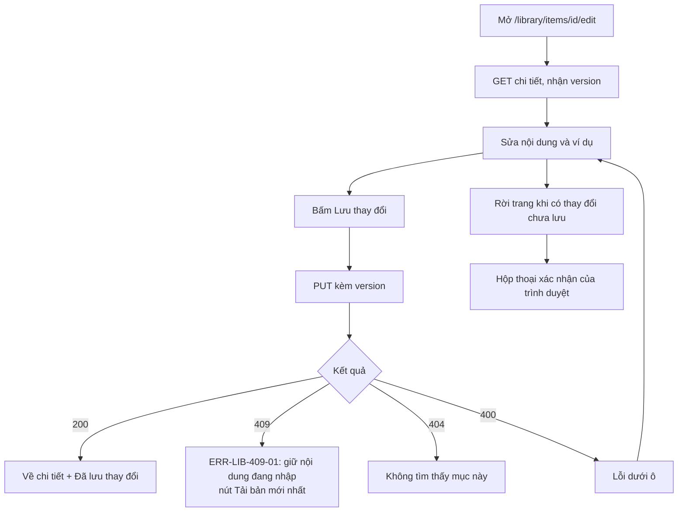
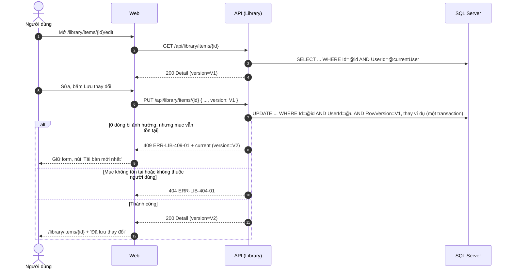

# SRS US-LIB-05 — Sửa mục

- Tính năng: FEAT-02 Mục kiến thức (`knowledge-items`).
- User story: [US-LIB-05](../requirements/user-stories.md#us-lib-05--sửa-mục).
- Phiên bản 0.3 (2026-11-09). Trạng thái: **chờ duyệt**.
- Tài liệu chung: [README.md](README.md) (danh mục FR, BR, ERR, NFR, quy ước API, ngữ cảnh).
- Test case: [testing/test-cases.md](../testing/test-cases.md).
- Skill OpenBA áp dụng: `srs` (FR, BR, ERR, NFR), `user-flow`, `sequence`, `wireframe-ascii`, `api-design`, `ac`.

## 1. Giới thiệu

Là người tự học, tôi muốn bổ sung hoặc sửa mục đã lưu khi hiểu thêm về nó.

**Trong phạm vi:**

- Form sửa dùng lại form của US-LIB-01.
- Phát hiện xung đột khi sửa ở hai nơi (khóa lạc quan bằng `version`).
- Cảnh báo khi rời trang chưa lưu.

**Ngoài phạm vi:**

- Lịch sử phiên bản của mục.

## 2. Yêu cầu áp dụng

### 2.1 Yêu cầu chức năng (FR)

**`FR-LIB-ITEM-005` — Sửa mục và ví dụ, kiểm tra xung đột**

- Input: `id`, nội dung như tạo, `version`.
- Xử lý: Thay toàn bộ nội dung mục và danh sách ví dụ bằng dữ liệu gửi lên (PUT). `version` phải khớp `RowVersion` hiện tại (BR-LIB-007); không khớp thì trả 409 kèm bản mới nhất, không ghi.
- Output: `200` chi tiết với `version` mới; `404`, `409`, hoặc `400`.

### 2.2 Quy tắc nghiệp vụ (BR)

Phát biểu theo dạng KHI, THÌ, NGOẠI LỆ (`rules/02`). Nội dung chính thức nằm ở [README.md](README.md); bảng dưới là bản sao các quy tắc áp dụng cho story này.

| Mã BR | Quy tắc | KHI | THÌ | NGOẠI LỆ |
| --- | --- | --- | --- | --- |
| `BR-LIB-001` | Trường bắt buộc và độ dài | Tạo hoặc sửa | Sau khi trim: `term` 1–1000 ký tự và bắt buộc với mọi loại; `meaning` bắt buộc với `word` (1–2000); với `grammar` không bắt buộc (rỗng sau trim thì null, có thì 1–2000); `formula` bắt buộc với `grammar` (1–1000), null với `word`; `note` ≤ 4000; mỗi ví dụ `text` 1–1000, `translation` ≤ 1000 ký tự; chuỗi tùy chọn rỗng sau trim được lưu là null | — |
| `BR-LIB-002` | Loại nội dung | Tạo hoặc sửa | `kind` là **bắt buộc**, không có mặc định, và thuộc danh mục mở trong Vòng 1: `word` (Từ vựng) và `grammar` (Ngữ pháp). Database lưu `Kind` = 1 và 5 (ERD, CHECK `Kind IN (1, 5)`). Các loại khác (cụm từ, thành ngữ…) đã có mã dự phòng nhưng **chưa mở**; mở thêm cần đổi đặc tả và migration. Đổi loại khi sửa thì áp dụng quy tắc của loại mới | — |
| `BR-LIB-003` | Chuẩn hóa và mục tương tự | Tạo, sửa, kiểm tra trùng | `NormalizedTerm` = `term` chuyển chữ thường (culture-invariant), trim, gộp mọi chuỗi khoảng trắng thành một dấu cách. Hai mục là "tương tự" khi `NormalizedTerm` bằng nhau và cùng chủ sở hữu. Chỉ **gợi ý**, không chặn và không tự gộp (tổng quan §4.1) | — |
| `BR-LIB-004` | Số ví dụ | Tạo hoặc sửa | Tối đa 20 ví dụ mỗi mục | — |
| `BR-LIB-006` | Chủ sở hữu | Mọi thao tác | `UserId` lấy từ phiên đăng nhập. Mục không thuộc người dùng thì xử lý như không tồn tại (404). Bỏ qua `userId` trong body | — |
| `BR-LIB-007` | Xung đột khi sửa | Sửa | `version` gửi lên phải khớp `RowVersion` hiện tại; không khớp thì trả 409, không ghi | — |

### 2.3 Ma trận lỗi (ERR)

Theo `rules/03` và `rules/11`. Nội dung chính thức nằm ở [README.md](README.md); bảng dưới là bản sao các lỗi áp dụng cho story này.

| Mã ERR | HTTP | Điều kiện phát sinh | Khóa i18n | Thông báo người dùng | Mức độ | Hành động trên giao diện | Ghi log (không ghi nội dung người dùng) |
| --- | --- | --- | --- | --- | --- | --- | --- |
| `ERR-LIB-400-01` | 400 | Thiếu trường bắt buộc, vượt độ dài, `kind` ngoài danh mục, `page` hoặc `pageSize` không hợp lệ | `library.error.400-01` | "Vui lòng kiểm tra lại thông tin đã nhập." kèm lỗi theo từng ô | Medium | Lỗi dưới ô; focus ô lỗi đầu tiên | Validation failed: tên trường |
| `ERR-LIB-404-01` | 404 | Mục không tồn tại, không thuộc người dùng, hoặc `id` sai định dạng | `library.error.404-01` | "Không tìm thấy mục này." | Medium | Màn hình "Không tìm thấy", nút về Thư viện | Item not found for user: itemId |
| `ERR-LIB-409-01` | 409 | `version` không khớp `RowVersion` khi sửa | `library.error.409-01` | "Mục này vừa được sửa ở nơi khác." | High | Giữ nội dung đang nhập; nút "Tải bản mới nhất" | Concurrency conflict: itemId |

### 2.4 Yêu cầu phi chức năng (NFR)

- `NFR-PRIV-001`: Integration test truy cập chéo cho mọi endpoint (US-LIB-07); truy cập tài nguyên người khác trả 404.
- `NFR-A11Y-001`: Form có nhãn hiển thị; thêm và xóa ví dụ bằng bàn phím; xóa ví dụ thì focus chuyển sang ví dụ kế bên; dialog giữ focus bên trong; gợi ý cập nhật có `aria-live="polite"`.
- `NFR-UX-001`: Form 2 cột ở ≥ 1280 px (trái: nội dung, loại, nghĩa; phải: ví dụ, ghi chú, nguồn); 1 cột ở < 1024 px; không cuộn ngang.

## 3. Luồng

### 3.1 User flow

_Skill `user-flow`: màn hình và chuyển đổi, kèm các trạng thái giao diện._



| Trạng thái | Hiển thị |
| --- | --- |
| Bình thường | Form đã điền sẵn dữ liệu hiện tại. |
| Đang tải | `Skeleton` lúc tải; nút "Lưu thay đổi" có spinner khi lưu. |
| Trống | Không áp dụng. |
| Lỗi | 409-01 giữ nội dung và nút "Tải bản mới nhất"; 404-01 "Không tìm thấy mục này"; 400-01 dưới ô. |
| Mất kết nối | Không hỗ trợ ngoại tuyến. Hiện "Mất kết nối" và nút "Thử lại"; không mất dữ liệu đã nhập. |

### 3.2 Sequence

_Skill `sequence`: tương tác giữa các thành phần; nhánh lỗi ghi mã `ERR-xxx`._



## 4. Acceptance criteria

_Skill `ac`. Văn bản Gherkin trùng với [user story](../requirements/user-stories.md) (nguồn chính thức); sửa ở đó rồi cập nhật lại đây. Script `tools/feature-docs/check_feature_docs.py` kiểm tra hai bản khớp nhau._

```gherkin
Scenario: AC-01 Sửa thành công
  When tôi sửa nghĩa, thêm một ví dụ, xóa một ví dụ cũ và bấm "Lưu thay đổi"
  Then mục được cập nhật, ngày sửa đổi theo, và tôi thấy "Đã lưu thay đổi"

Scenario: AC-02 Xung đột do sửa ở hai nơi
  Given tôi mở form sửa mục ở hai tab
  And tab 1 đã lưu thay đổi
  When tab 2 bấm "Lưu thay đổi"
  Then tab 2 không ghi đè, và thấy "Mục này vừa được sửa ở nơi khác" (ERR-LIB-409-01)
  And có lựa chọn "Tải bản mới nhất", nội dung đang nhập ở tab 2 được giữ để tự chép lại

Scenario: AC-03 Rời trang khi chưa lưu
  Given tôi đã thay đổi form
  When tôi rời trang
  Then trình duyệt hỏi xác nhận trước khi rời

Scenario: AC-04 Sửa mục của người khác
  When có request sửa mục của người khác
  Then API trả 404 ERR-LIB-404-01, dữ liệu không đổi
```

| AC | Nội dung | FR | BR | ERR | Wireframe | Test case |
| --- | --- | --- | --- | --- | --- | --- |
| AC-01 | Sửa thành công | `FR-LIB-ITEM-005` | `BR-LIB-001`, `BR-LIB-004` | — | W-LIB-18, W-LIB-14 | TC-LIB-019 |
| AC-02 | Xung đột do sửa ở hai nơi | `FR-LIB-ITEM-005` | `BR-LIB-007` | `ERR-LIB-409-01` | W-LIB-19 | TC-LIB-020 |
| AC-03 | Rời trang khi chưa lưu | `FR-LIB-ITEM-005` | — | — | W-LIB-18 | TC-LIB-021 |
| AC-04 | Sửa mục của người khác | `FR-LIB-ITEM-005` | `BR-LIB-006` | `ERR-LIB-404-01` | W-LIB-16 | TC-LIB-022 |

## 5. Wireframe

_Skill `wireframe-ascii`. Figma: chưa dựng màn hình (`DES-01`); wireframe ASCII là căn cứ cho DoR. Quy tắc: vẽ đủ mọi màn hình, hộp thoại và trạng thái mà AC của story nhắc tới._

### W-LIB-18 — Form sửa: mặc định (`/library/items/{id}/edit`)

```text
┌──────────────┬────────────────────────────────────────────────────────────────┐
│Lingozi       │ ← Thư viện    Sửa "give up" · Từ vựng   h1                     │
│              │ ┌────────────────────────────┐  ┌────────────────────────────┐ │
│▸ Thư viện    │ │ Từ *                       │  │ Ví dụ (1/20)               │ │
│▸ Luyện tập   │ │ [give up__________]        │  │ 1. Don't give up.          │ │
│              │ │ Phiên âm                   │  │ [ x Xóa ví dụ ]            │ │
│              │ │ [/ɡɪv ʌp/_________]        │  │ [ + Thêm ví dụ ]           │ │
│              │ │                            │  │ Ghi chú cá nhân            │ │
│⚙ Cài đặt     │ │ Nghĩa                      │  │ [________________]         │ │
│              │ │ [từ bỏ____________]        │  └────────────────────────────┘ │
│              │ └────────────────────────────┘                                 │
│              │                                                                │
│              │                 [ Hủy ]   [ Lưu thay đổi ]                     │
└──────────────┴────────────────────────────────────────────────────────────────┘
```

- Điền sẵn dữ liệu hiện tại; thêm, xóa ví dụ bằng bàn phím; xóa ví dụ thì focus sang ví dụ kế bên.
- Có thay đổi chưa lưu mà rời trang thì trình duyệt hiện hộp thoại xác nhận của chính nó (`beforeunload`).
- Đang lưu: nút "Lưu thay đổi" có spinner.

### W-LIB-19 — Form sửa: xung đột khi sửa ở hai nơi (ERR-LIB-409-01)

```text
┌──────────────┬────────────────────────────────────────────────────────────────┐
│Lingozi       │ ← Thư viện    Sửa "give up"   h1                               │
│              │ ┌──────────────────────────────────────────────────────────┐   │
│▸ Thư viện    │ │ (!) Mục này vừa được sửa ở nơi khác.                     │   │
│▸ Luyện tập   │ └──────────────────────────────────────────────────────────┘   │
│              │ ┌────────────────────────────┐  ┌────────────────────────────┐ │
│              │ │ Từ *                       │  │ Bản bạn đang sửa (giữ lại) │ │
│              │ │ [give up__________]        │  │ Nghĩa: bỏ cuộc             │ │
│⚙ Cài đặt     │ │ Nghĩa                      │  │                            │ │
│              │ │ [bỏ cuộc__________]        │  │ [ Tải bản mới nhất ]       │ │
│              │ └────────────────────────────┘  └────────────────────────────┘ │
│              │                                                                │
│              │                 [ Hủy ]   [ Lưu thay đổi ]                     │
└──────────────┴────────────────────────────────────────────────────────────────┘
```

- Không ghi đè; nội dung đang nhập được giữ để người dùng tự chép lại.
- "Tải bản mới nhất" thay form bằng bản mới nhất từ máy chủ.

### W-LIB-14 — Chi tiết mục: đầy đủ (`/library/items/{id}`)

```text
┌──────────────┬────────────────────────────────────────────────────────────────┐
│Lingozi       │ [ ✓ Đã lưu ]  (toast sau khi lưu)                              │
│              │ ← Thư viện                            [ Sửa ]  [ x Xóa ]       │
│▸ Thư viện    │ give up                                         term           │
│▸ Luyện tập   │ Từ vựng · /ɡɪv ʌp/                                             │
│              │                                                                │
│              │ Nghĩa   h2                                                     │
│              │ từ bỏ                                                          │
│⚙ Cài đặt     │                                                                │
│              │ Ví dụ   h2                                                     │
│              │ 1. Don't give up. — Đừng bỏ cuộc.                              │
│              │                                                                │
│              │ Ghi chú · Nguồn: Friends S01E01                                │
│              │                                                                │
│              │ Tạo 08/11/2026 14:00 · Sửa 08/11/2026 14:05                    │
└──────────────┴────────────────────────────────────────────────────────────────┘
```

- Nội dung hiện cỡ `text.term`; phiên âm chỉ có với Từ vựng, kèm nguồn khi do hệ thống điền.
- Nút "Xóa" kiểu viền, có icon cảnh báo, không dùng nền đặc giống nút chính.
- Toast "Đã lưu" (`role="status"`) chỉ hiện ngay sau khi lưu.

### W-LIB-16 — Chi tiết mục: không tìm thấy (ERR-LIB-404-01)

```text
┌──────────────┬────────────────────────────────────────────────────────────────┐
│Lingozi       │ ┌──────────────────────────────────────────────────────────┐   │
│              │ │                                                          │   │
│▸ Thư viện    │ │         (hình minh họa, lz-decor)                        │   │
│▸ Luyện tập   │ │                                                          │   │
│              │ │        Không tìm thấy mục này.                           │   │
│              │ │                                                          │   │
│              │ │          [ Về Thư viện ]                                 │   │
│⚙ Cài đặt     │ │                                                          │   │
│              │ └──────────────────────────────────────────────────────────┘   │
└──────────────┴────────────────────────────────────────────────────────────────┘
```

- Cùng một màn hình cho mục không tồn tại và mục của người khác (không để lộ sự tồn tại).
- Body lỗi giống hệt giữa hai trường hợp.

## 6. API

_Skill `api-design`; lỗi theo Problem Details (RFC 9457) như ADR 0002. Quy ước chung ở [README.md](README.md)._

| Method và path | Body | Thành công | Lỗi |
| --- | --- | --- | --- |
| `GET /api/library/items/{id}` | — | `200 Detail` | 404-01 |
| `PUT /api/library/items/{id}` | `Input` + `version` (bắt buộc) | `200 Detail` (có `version` mới) | 400-01, 400-02, 404-01, 409-01 kèm `current: Detail` |

```http
PUT /api/library/items/{id}
Content-Type: application/json
X-XSRF-TOKEN: <token>

{ "version": "AAAAAAAAB9E=", "kind": "word", "term": "give up", "meaning": "từ bỏ", "examples": [] }
```

Thành công: `200` chi tiết với `version` mới. Xung đột: `409 ERR-LIB-409-01` kèm trường `current` là chi tiết mới nhất.

## 7. Truy vết test case

| TC | Loại | Bước chính | Kết quả mong đợi |
| --- | --- | --- | --- |
| `TC-LIB-019` | INT + E2E | PUT sửa nghĩa, thêm và xóa ví dụ | 200; `version` mới; `UpdatedAt` tăng; ví dụ đúng như gửi lên |
| `TC-LIB-020` | INT + E2E | Hai PUT cùng `version` | Lần sau trả 409-01 kèm `current`; dữ liệu bằng kết quả lần đầu; UI giữ nội dung đang nhập |
| `TC-LIB-021` | E2E | Sửa form rồi điều hướng đi | Có hộp thoại `beforeunload` |
| `TC-LIB-022` | INT | A gọi PUT và DELETE trên mục của B | 404-01; dữ liệu của B không đổi |

## 8. Lịch sử sửa đổi

| Phiên bản | Ngày | Thay đổi |
| --- | --- | --- |
| 0.3 | 2026-11-09 | Tách từ `srs.md` và `design/` thành file riêng cho story; thêm FR chi tiết, sequence, state, bảng AC → FR/BR/ERR/TC. |
