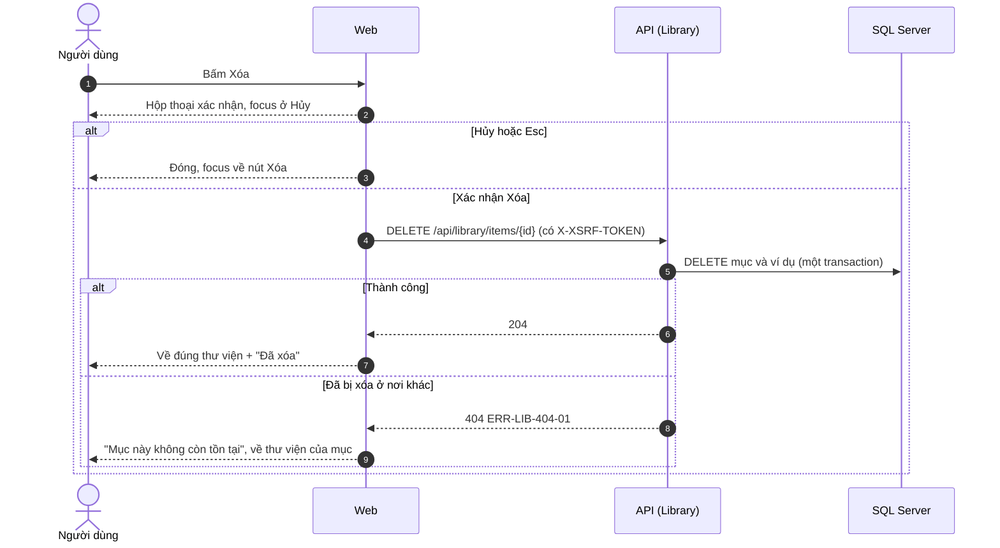
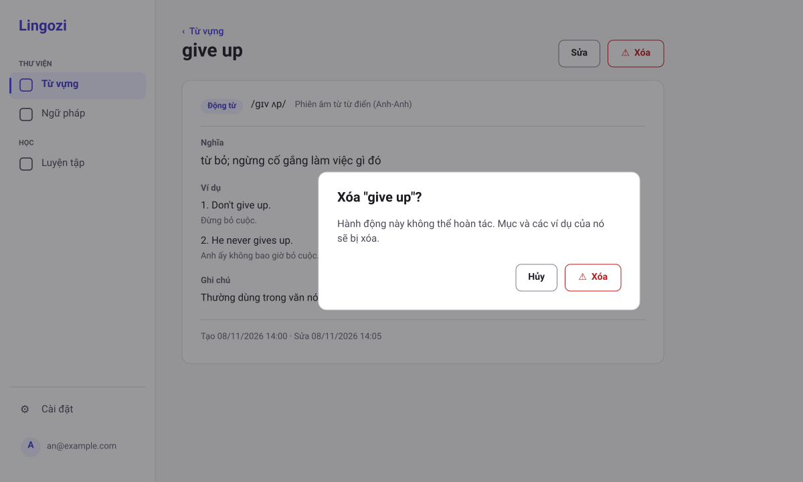
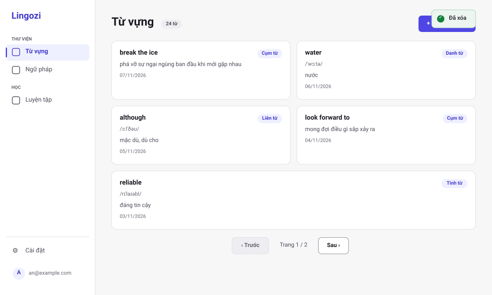
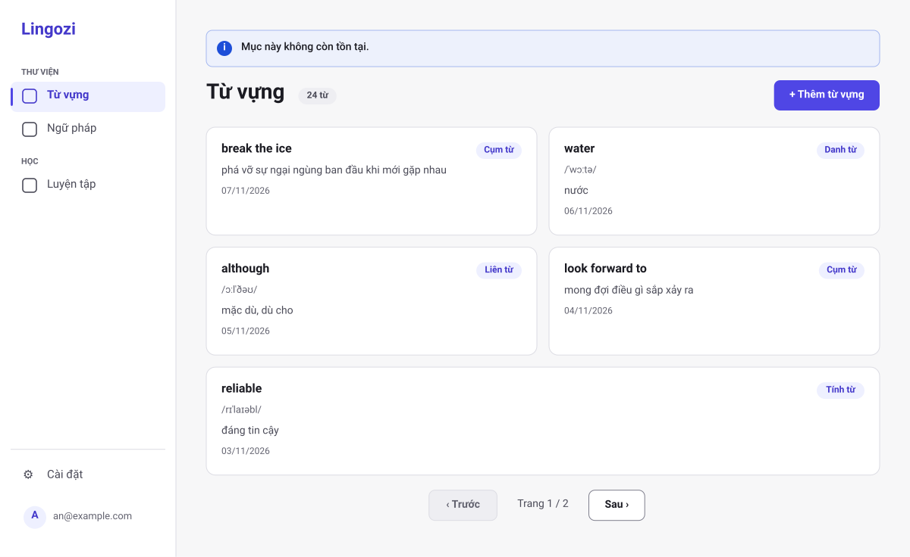

# SRS US-LIB-06 — Xóa từ vựng hoặc ngữ pháp

- Tính năng: FEAT-02 Mục kiến thức (`knowledge-items`).
- User story: [US-LIB-06](../requirements/user-stories.md#us-lib-06--xóa-từ-vựng-hoặc-ngữ-pháp).
- Phiên bản 0.4 (2026-11-11). Trạng thái: **chờ duyệt**.
- Tài liệu chung: [README.md](README.md) (danh mục FR, BR, ERR, NFR, quy ước API, ngữ cảnh).
- Test case: [testing/test-cases.md](../testing/test-cases.md).
- Skill OpenBA áp dụng: `srs` (FR, BR, ERR, NFR), `user-flow`, `sequence`, wireframe SVG (`tools/wireframes/`), `api-design`, `ac`.

## 1. Giới thiệu

**Trong phạm vi:**

- Hộp thoại xác nhận xóa, focus mặc định ở "Hủy".
- Xóa cứng mục và ví dụ trong một transaction.

**Ngoài phạm vi:**

- Phục hồi sau khi xóa.
- Xóa hàng loạt.

## 2. Yêu cầu áp dụng

### 2.1 Yêu cầu chức năng (FR)

**`FR-LIB-ITEM-006` — Xóa mục kèm ví dụ**

- Input: `id`.
- Xử lý: Xóa cứng mục và các ví dụ trong một transaction; không phục hồi được ở MVP (BR-LIB-009).
- Output: `204`; xóa mục không tồn tại thì `404`.

### 2.2 Quy tắc nghiệp vụ (BR)

Phát biểu theo dạng KHI, THÌ, NGOẠI LỆ (`rules/02`). Nội dung chính thức nằm ở [README.md](README.md); bảng dưới là bản sao các quy tắc áp dụng cho story này.

| Mã BR | Quy tắc | KHI | THÌ | NGOẠI LỆ |
| --- | --- | --- | --- | --- |
| `BR-LIB-006` | Chủ sở hữu | Mọi thao tác | `UserId` lấy từ phiên đăng nhập. Mục không thuộc người dùng thì xử lý như không tồn tại (404). Bỏ qua `userId` trong body | — |
| `BR-LIB-009` | Xóa | Xóa | Xóa cứng mục và các ví dụ trong một transaction; không phục hồi được (MVP). Xóa mục không tồn tại thì trả 404 | — |
| `BR-LIB-017` | Hai thư viện tách nhau | Mở, liệt kê, tạo, xem, sửa, xóa, gợi ý | Từ vựng (`/library/vocabulary`, `kind` = `word`) và Ngữ pháp (`/library/grammar`, `kind` = `grammar`) là hai mục riêng trong menu. Danh sách, form, gợi ý mục tương tự và gợi ý nghĩa chỉ dùng mục cùng loại. Mục mở bằng route của thư viện kia thì web hiện "Không tìm thấy" như ERR-LIB-404-01. Giới hạn 10.000 mục (BR-LIB-005) tính chung cả hai thư viện | — |

### 2.3 Ma trận lỗi (ERR)

Theo `rules/03` và `rules/11`. Nội dung chính thức nằm ở [README.md](README.md); bảng dưới là bản sao các lỗi áp dụng cho story này.

| Mã ERR | HTTP | Điều kiện phát sinh | Khóa i18n | Thông báo người dùng | Mức độ | Hành động trên giao diện | Ghi log (không ghi nội dung người dùng) |
| --- | --- | --- | --- | --- | --- | --- | --- |
| `ERR-LIB-404-01` | 404 | Mục không tồn tại, không thuộc người dùng, hoặc `id` sai định dạng | `library.error.404-01` | "Không tìm thấy mục này." | Medium | Màn hình "Không tìm thấy", nút "Về thư viện" (thư viện đang mở) | Item not found for user: itemId |

### 2.4 Yêu cầu phi chức năng (NFR)

- `NFR-A11Y-001`: Form có nhãn hiển thị; thêm và xóa ví dụ bằng bàn phím; xóa ví dụ thì focus chuyển sang ví dụ kế bên; dialog giữ focus bên trong; gợi ý cập nhật có `aria-live="polite"`.

## 3. Luồng

### 3.1 User flow

_Skill `user-flow`: màn hình và chuyển đổi, kèm các trạng thái giao diện._

```mermaid
flowchart TD
    A[Trang chi tiết] --> B[Bấm Xóa]
    B --> C[Hộp thoại xác nhận, focus ở Hủy]
    C -- Hủy hoặc Esc --> D[Đóng, focus về nút Xóa]
    C -- Xóa --> E[DELETE /api/library/items/id]
    E --> F{Kết quả}
    F -- 204 --> G[Về đúng thư viện (Từ vựng hoặc Ngữ pháp) + Đã xóa]
    F -- 404 --> H[Mục này không còn tồn tại, về thư viện của mục]
```

| Trạng thái | Hiển thị |
| --- | --- |
| Bình thường | Nút "Xóa" kiểu viền, có icon cảnh báo, ở trang chi tiết. |
| Đang tải | Nút "Xóa" trong hộp thoại có spinner. |
| Trống | Không áp dụng. |
| Lỗi | 404-01: "Mục này không còn tồn tại", về thư viện của mục. |
| Mất kết nối | Không hỗ trợ ngoại tuyến. Hiện "Mất kết nối" và nút "Thử lại"; không mất dữ liệu đã nhập. |

### 3.2 Sequence

_Skill `sequence`: tương tác giữa các thành phần; nhánh lỗi ghi mã `ERR-xxx`._



## 4. Acceptance criteria

_Skill `ac`. Văn bản Gherkin trùng với [user story](../requirements/user-stories.md) (nguồn chính thức); sửa ở đó rồi cập nhật lại đây. Script `tools/feature-docs/check_feature_docs.py` kiểm tra hai bản khớp nhau._

```gherkin
Scenario: AC-01 Xóa có xác nhận
  When tôi chọn "Xóa" ở một mục
  Then hộp thoại "Xóa mục 'give up'? Hành động này không thể hoàn tác." hiện ra, focus mặc định ở nút "Hủy"
  And khi tôi chọn "Xóa" (nút kiểu viền, có icon cảnh báo, theo design system) thì mục và các ví dụ bị xóa
  And tôi về đúng thư viện của mục đó (Từ vựng hoặc Ngữ pháp) với thông báo "Đã xóa"

Scenario: AC-02 Hủy xóa
  When tôi chọn "Hủy" hoặc nhấn Esc
  Then mục không bị xóa và focus quay về nút "Xóa"

Scenario: AC-03 Xóa mục đã bị xóa ở nơi khác
  When tôi xác nhận xóa một mục vừa bị xóa ở tab khác
  Then tôi thấy "Mục này không còn tồn tại" và được đưa về đúng thư viện của mục (không hiện lỗi hệ thống)
```

| AC | Nội dung | FR | BR | ERR | Wireframe | Test case |
| --- | --- | --- | --- | --- | --- | --- |
| AC-01 | Xóa có xác nhận | `FR-LIB-ITEM-006` | `BR-LIB-009` | — | W-LIB-24, W-LIB-25 | TC-LIB-023 |
| AC-02 | Hủy xóa | `FR-LIB-ITEM-006` | — | — | W-LIB-24 | TC-LIB-024 |
| AC-03 | Xóa mục đã bị xóa ở nơi khác | `FR-LIB-ITEM-006` | `BR-LIB-009` | `ERR-LIB-404-01` | W-LIB-26 | TC-LIB-025 |

## 5. Wireframe

_Wireframe mức thấp (khung xám, đúng bố cục màn hình thật) vẽ bằng script `tools/wireframes/` và lưu ở [wireframes/](../wireframes/); sửa script rồi chạy `python3 tools/wireframes/build.py` và `python3 tools/wireframes/sync_docs.py`, không sửa tay file SVG. Quy tắc: vẽ đủ mọi màn hình, hộp thoại và trạng thái mà AC của story nhắc tới._

### W-LIB-24 — Hộp thoại xác nhận xóa



- Focus mặc định ở "Hủy"; Esc tương đương "Hủy" và trả focus về nút "Xóa".
- Nút "Xóa" kiểu viền, màu `status.danger`, có icon cảnh báo, phân biệt với nút chính. Xác nhận xong thì xóa cứng; không phục hồi được ở MVP.
- Hộp thoại giống hệt cho ngữ pháp, chỉ đổi tên mục trong câu hỏi.

### W-LIB-25 — Thư viện sau khi xóa



- Xóa thành công: về đúng thư viện của mục vừa xóa (Từ vựng hoặc Ngữ pháp) với toast "Đã xóa".

### W-LIB-26 — Thư viện: mục không còn tồn tại



- Mục đã bị xóa ở nơi khác: hiện thông báo "Mục này không còn tồn tại" và về thư viện của loại đó; không hiện lỗi hệ thống.

## 6. API

_Skill `api-design`; lỗi theo Problem Details (RFC 9457) như ADR 0002. Quy ước chung ở [README.md](README.md)._

| Method và path | Body | Thành công | Lỗi |
| --- | --- | --- | --- |
| `DELETE /api/library/items/{id}` | — | `204` | 404-01 |

```http
DELETE /api/library/items/{id}
X-XSRF-TOKEN: <token>
```

Phản hồi `204`. Mục không tồn tại hoặc đã bị xóa: `404 ERR-LIB-404-01`.

## 7. Truy vết test case

| TC | Loại | Bước chính | Kết quả mong đợi |
| --- | --- | --- | --- |
| `TC-LIB-023` | INT + E2E | DELETE | 204; mục và ví dụ không còn trong database; UI về /library với toast "Đã xóa" |
| `TC-LIB-024` | E2E | Mở dialog xóa → Esc | Focus về nút "Xóa"; mục vẫn còn |
| `TC-LIB-025` | INT + E2E | DELETE 2 lần | Lần 2 trả 404-01; UI hiện "Mục này không còn tồn tại" và về /library |

## 8. Lịch sử sửa đổi

| Phiên bản | Ngày | Thay đổi |
| --- | --- | --- |
| 0.3 | 2026-11-09 | Tách từ `srs.md` và `design/` thành file riêng cho story; thêm FR chi tiết, sequence, state, bảng AC → FR/BR/ERR/TC. |
| 0.4 | 2026-11-11 | Xóa xong về đúng thư viện của mục; thay wireframe ASCII bằng SVG (W-LIB-24 → 26). |
