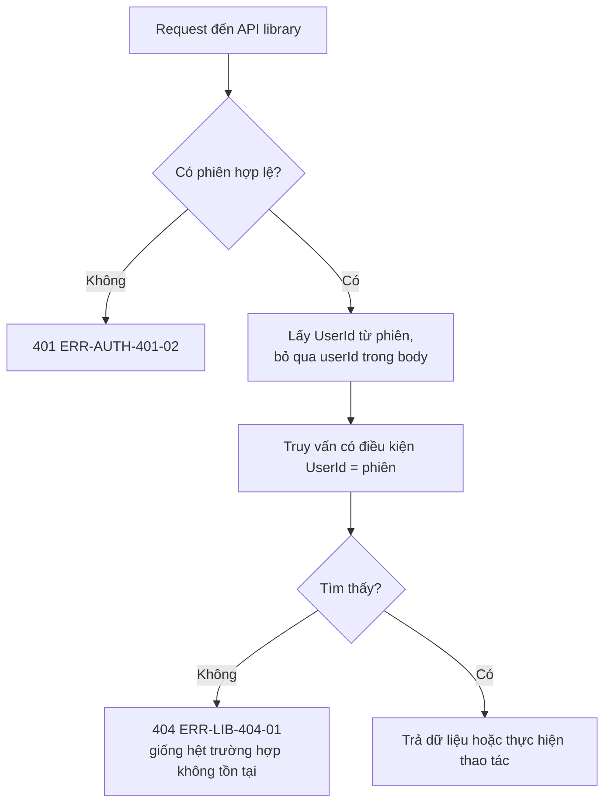
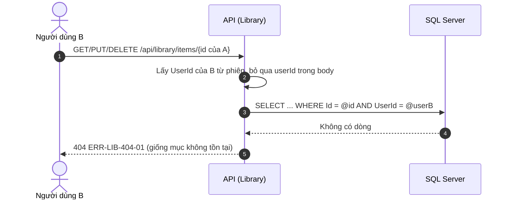
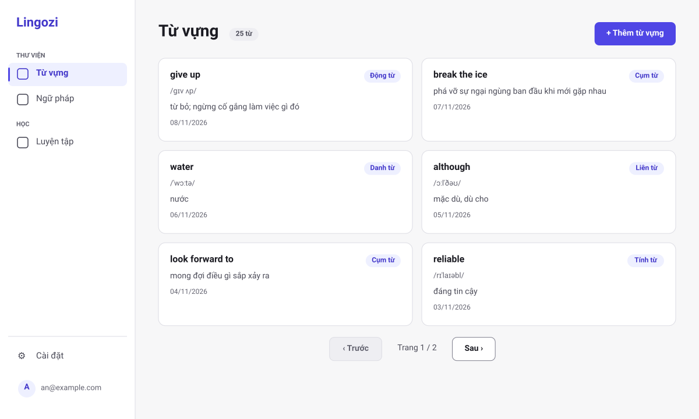
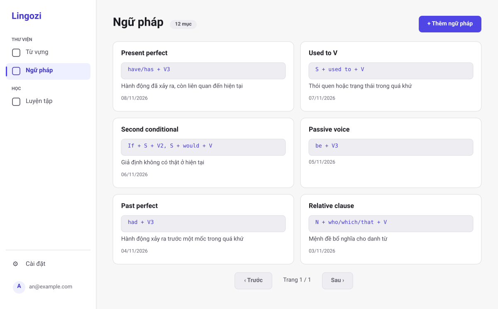
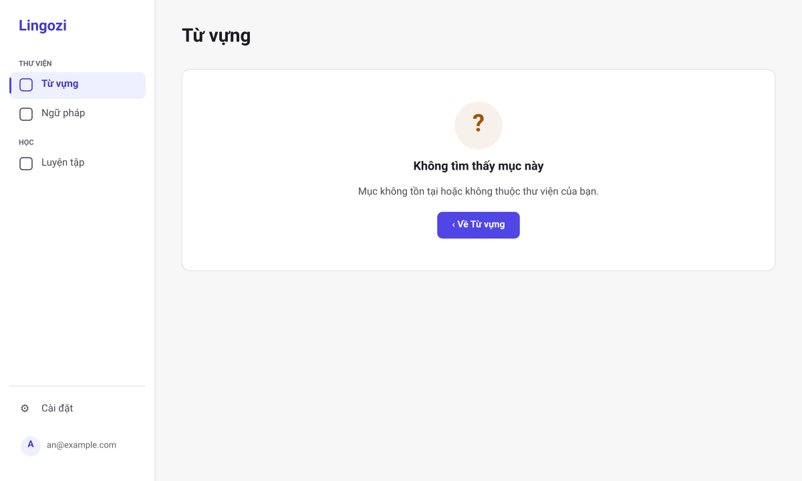

# SRS US-LIB-07 — Thư viện riêng tư

- Tính năng: FEAT-02 Mục kiến thức (`knowledge-items`).
- User story: [US-LIB-07](../requirements/user-stories.md#us-lib-07--thư-viện-riêng-tư).
- Phiên bản 0.4 (2026-11-11). Trạng thái: **chờ duyệt**.
- Tài liệu chung: [README.md](README.md) (danh mục FR, BR, ERR, NFR, quy ước API, ngữ cảnh).
- Test case: [testing/test-cases.md](../testing/test-cases.md).
- Skill OpenBA áp dụng: `srs` (FR, BR, ERR, NFR), `user-flow`, `sequence`, wireframe SVG (`tools/wireframes/`), `api-design`, `ac`.

## 1. Giới thiệu

**Trong phạm vi:**

- Mọi thao tác thư viện chỉ trên dữ liệu của người đang đăng nhập.
- Bỏ qua `userId` do client gửi.
- Khóa ngoại ghép ở database chặn liên kết khác chủ.

**Ngoài phạm vi:**

- Chia sẻ thư viện (ngoài phạm vi sản phẩm).

## 2. Yêu cầu áp dụng

### 2.1 Yêu cầu chức năng (FR)

**`FR-LIB-SEC-001` — Mọi thao tác chỉ trên dữ liệu của người đang đăng nhập**

- Input: Mọi request tới API thư viện.
- Xử lý: Yêu cầu phiên hợp lệ (FEAT-01). `UserId` luôn lấy từ phiên, không nhận từ client. Mọi truy vấn có điều kiện `UserId`. Khóa ngoại ghép (`ItemId`, `UserId`) chặn liên kết khác chủ ở cấp database.
- Output: Dữ liệu của chính người dùng, hoặc `404 ERR-LIB-404-01`.

### 2.2 Quy tắc nghiệp vụ (BR)

Phát biểu theo dạng KHI, THÌ, NGOẠI LỆ (`rules/02`). Nội dung chính thức nằm ở [README.md](README.md); bảng dưới là bản sao các quy tắc áp dụng cho story này.

| Mã BR | Quy tắc | KHI | THÌ | NGOẠI LỆ |
| --- | --- | --- | --- | --- |
| `BR-LIB-006` | Chủ sở hữu | Mọi thao tác | `UserId` lấy từ phiên đăng nhập. Mục không thuộc người dùng thì xử lý như không tồn tại (404). Bỏ qua `userId` trong body | — |
| `BR-LIB-017` | Hai thư viện tách nhau | Mở, liệt kê, tạo, xem, sửa, xóa, gợi ý | Từ vựng (`/library/vocabulary`, `kind` = `word`) và Ngữ pháp (`/library/grammar`, `kind` = `grammar`) là hai mục riêng trong menu. Danh sách, form, gợi ý mục tương tự và gợi ý nghĩa chỉ dùng mục cùng loại. Mục mở bằng route của thư viện kia thì web hiện "Không tìm thấy" như ERR-LIB-404-01. Giới hạn 10.000 mục (BR-LIB-005) tính chung cả hai thư viện | — |

### 2.3 Ma trận lỗi (ERR)

Theo `rules/03` và `rules/11`. Nội dung chính thức nằm ở [README.md](README.md); bảng dưới là bản sao các lỗi áp dụng cho story này.

| Mã ERR | HTTP | Điều kiện phát sinh | Khóa i18n | Thông báo người dùng | Mức độ | Hành động trên giao diện | Ghi log (không ghi nội dung người dùng) |
| --- | --- | --- | --- | --- | --- | --- | --- |
| `ERR-LIB-404-01` | 404 | Mục không tồn tại, không thuộc người dùng, hoặc `id` sai định dạng | `library.error.404-01` | "Không tìm thấy mục này." | Medium | Màn hình "Không tìm thấy", nút "Về thư viện" (thư viện đang mở) | Item not found for user: itemId |

### 2.4 Yêu cầu phi chức năng (NFR)

- `NFR-PRIV-001`: Integration test truy cập chéo cho mọi endpoint (US-LIB-07); truy cập tài nguyên người khác trả 404.

## 3. Luồng

### 3.1 User flow

_Skill `user-flow`: màn hình và chuyển đổi, kèm các trạng thái giao diện._



| Trạng thái | Hiển thị |
| --- | --- |
| Bình thường | Chỉ thấy mục của chính mình. |
| Đang tải | Như các màn hình thư viện khác. |
| Trống | Người dùng mới thấy thư viện trống. |
| Lỗi | 404-01 giống hệt cho mục không tồn tại và mục của người khác. |
| Mất kết nối | Không hỗ trợ ngoại tuyến. Hiện "Mất kết nối" và nút "Thử lại"; không mất dữ liệu đã nhập. |

### 3.2 Sequence

_Skill `sequence`: tương tác giữa các thành phần; nhánh lỗi ghi mã `ERR-xxx`._



## 4. Acceptance criteria

_Skill `ac`. Văn bản Gherkin trùng với [user story](../requirements/user-stories.md) (nguồn chính thức); sửa ở đó rồi cập nhật lại đây. Script `tools/feature-docs/check_feature_docs.py` kiểm tra hai bản khớp nhau._

```gherkin
Scenario: AC-01 Không thấy dữ liệu người khác
  Given user A và user B đều có mục
  Then danh sách (cả Từ vựng và Ngữ pháp), chi tiết, gợi ý trùng của A chỉ chứa mục của A

Scenario: AC-02 Mọi thao tác với ID của người khác
  When A gọi GET, PUT, DELETE với ID mục của B
  Then đều trả 404 ERR-LIB-404-01 và dữ liệu của B không đổi

Scenario: AC-03 Không tin UserId từ client
  When request tạo hoặc sửa gửi kèm trường userId của người khác
  Then trường đó bị bỏ qua; mục luôn thuộc người đang đăng nhập
```

| AC | Nội dung | FR | BR | ERR | Wireframe | Test case |
| --- | --- | --- | --- | --- | --- | --- |
| AC-01 | Không thấy dữ liệu người khác | `FR-LIB-SEC-001` | `BR-LIB-006` | — | W-LIB-01, W-LIB-03 | TC-LIB-026 |
| AC-02 | Mọi thao tác với ID của người khác | `FR-LIB-SEC-001` | `BR-LIB-006` | `ERR-LIB-404-01` | W-LIB-19 | TC-LIB-022 |
| AC-03 | Không tin UserId từ client | `FR-LIB-SEC-001` | `BR-LIB-006` | — | Không có UI | TC-LIB-027 |

## 5. Wireframe

_Wireframe mức thấp (khung xám, đúng bố cục màn hình thật) vẽ bằng script `tools/wireframes/` và lưu ở [wireframes/](../wireframes/); sửa script rồi chạy `python3 tools/wireframes/build.py` và `python3 tools/wireframes/sync_docs.py`, không sửa tay file SVG. Quy tắc: vẽ đủ mọi màn hình, hộp thoại và trạng thái mà AC của story nhắc tới._

### W-LIB-01 — Thư viện Từ vựng: có dữ liệu (`/library/vocabulary`)



- Thư viện Từ vựng chỉ có từ vựng; ngữ pháp nằm ở thư viện riêng (menu Ngữ pháp).
- Mới nhất trước, 20 mục mỗi trang (tối đa 50); lưới 2 cột ở ≥ 1280 px, 1 cột ở < 1024 px.
- Mỗi thẻ là một liên kết tới trang chi tiết: từ (h3), loại từ (`Badge`), phiên âm nếu có, nghĩa cắt ở 2 dòng, ngày tạo trong thẻ `<time>`.
- Nút "+ Thêm từ vựng" ở đầu trang (phím tắt `N`) mở `/library/vocabulary/new`. Chưa có ô tìm kiếm (Vòng 2).

### W-LIB-03 — Thư viện Ngữ pháp: có dữ liệu (`/library/grammar`)



- Thư viện Ngữ pháp chỉ có ngữ pháp, tách khỏi thư viện Từ vựng.
- Mới nhất trước, 20 mục mỗi trang; mỗi thẻ hiện tên cấu trúc (h3), công thức trong khối mã, ý nghĩa cắt ở 2 dòng (nếu có), ngày tạo.
- Nút "+ Thêm ngữ pháp" mở `/library/grammar/new`.

### W-LIB-19 — Chi tiết: không tìm thấy (ERR-LIB-404-01)



- Cùng một màn hình cho mục không tồn tại, mục của người khác và mục thuộc thư viện khác loại (ví dụ mở ngữ pháp ở `/library/vocabulary/{id}`); không để lộ sự tồn tại.
- Nút về đúng thư viện đang mở ("Về Từ vựng" hoặc "Về Ngữ pháp"). Body lỗi giống hệt giữa các trường hợp.

## 6. API

_Skill `api-design`; lỗi theo Problem Details (RFC 9457) như ADR 0002. Quy ước chung ở [README.md](README.md)._

| Method và path | Body | Thành công | Lỗi |
| --- | --- | --- | --- |
| `GET /api/library/items?kind=word&page=1&pageSize=20` | — | `200 { items: Summary[], page, pageSize, totalCount }` | 400-01 |
| `GET /api/library/items/similar?kind=&term=` | — | `200 { items: Summary[] (tối đa 5), totalCount }`; `term` rỗng thì danh sách rỗng | 400-01 (`term` > 1000 ký tự) |
| `POST /api/library/items` | `Input` + `clientRequestId` (uuid, bắt buộc) | `201 Detail` + `Location`; `200 Detail` nếu `clientRequestId` đã dùng (BR-LIB-008) | 400-01, 400-02, 422-01 |
| `GET /api/library/items/{id}` | — | `200 Detail` | 404-01 |
| `PUT /api/library/items/{id}` | `Input` + `version` (bắt buộc) | `200 Detail` (có `version` mới) | 400-01, 400-02, 404-01, 409-01 kèm `current: Detail` |
| `DELETE /api/library/items/{id}` | — | `204` | 404-01 |

Áp dụng cho mọi endpoint ở [README.md](README.md#danh-mục-endpoint). Request thay đổi dữ liệu cần `X-XSRF-TOKEN` và phiên hợp lệ (FEAT-01); `userId` trong body bị bỏ qua.

## 7. Truy vết test case

| TC | Loại | Bước chính | Kết quả mong đợi |
| --- | --- | --- | --- |
| `TC-LIB-022` | INT | A gọi PUT và DELETE trên mục của B | 404-01; dữ liệu của B không đổi |
| `TC-LIB-026` | INT | A và B mỗi người có mục → list, detail, similar | Mỗi người chỉ thấy mục của mình |
| `TC-LIB-027` | INT | POST và PUT kèm `userId` của B | Mục thuộc A; `userId` bị bỏ qua |

## 8. Lịch sử sửa đổi

| Phiên bản | Ngày | Thay đổi |
| --- | --- | --- |
| 0.3 | 2026-11-09 | Tách từ `srs.md` và `design/` thành file riêng cho story; thêm FR chi tiết, sequence, state, bảng AC → FR/BR/ERR/TC. |
| 0.4 | 2026-11-11 | Áp dụng cho cả hai thư viện; thay wireframe ASCII bằng SVG (W-LIB-01, 03, 19). |
