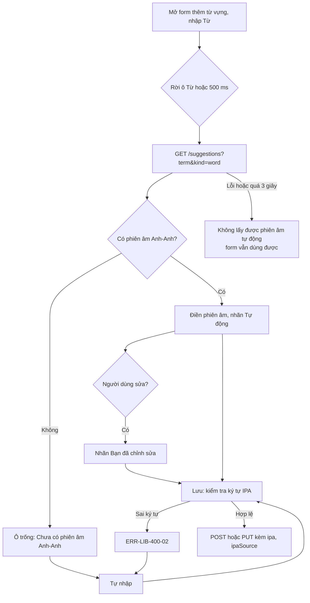
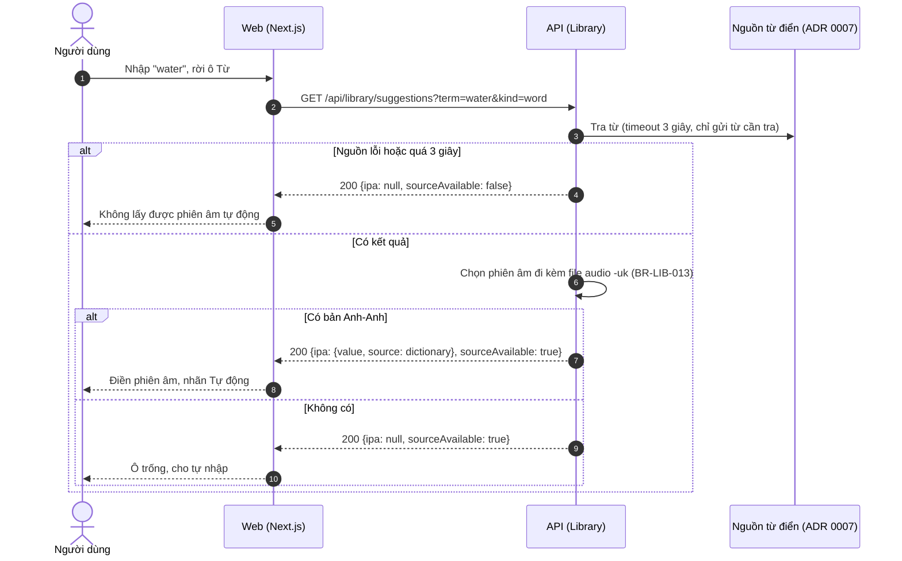
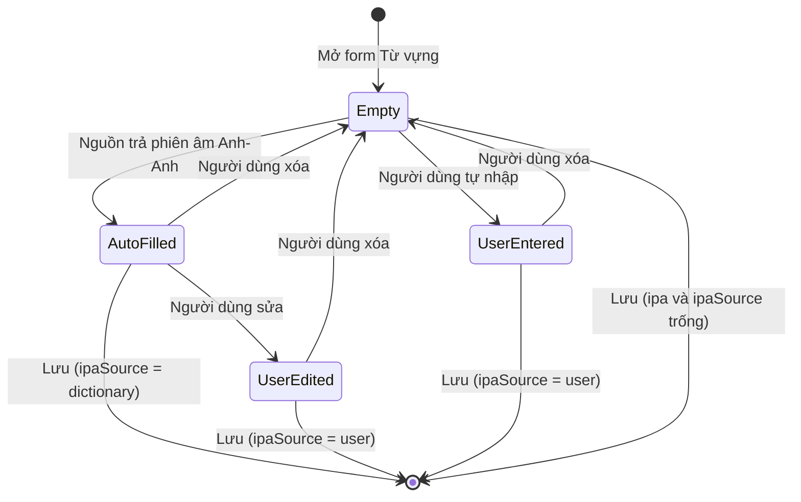
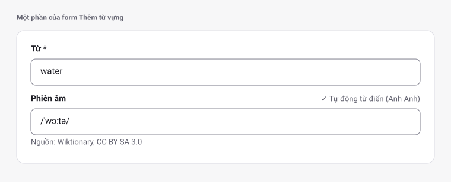
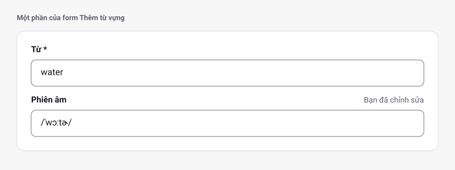
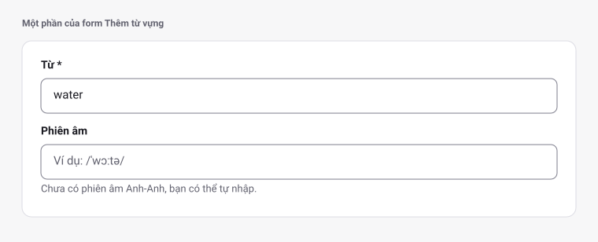
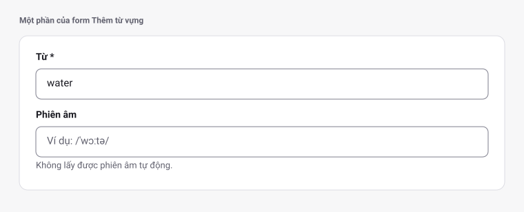
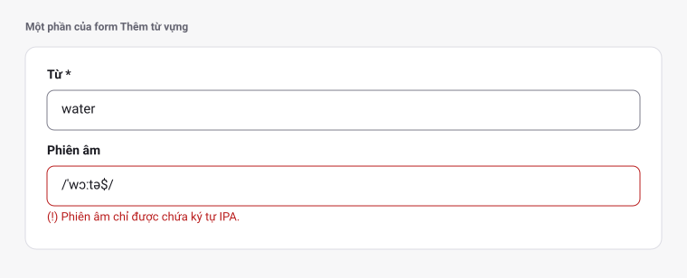
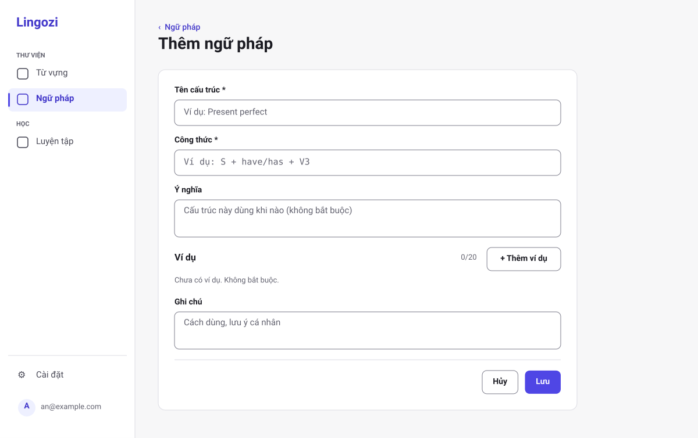

# SRS US-LIB-08 — Tự điền phiên âm IPA cho từ vựng

- Tính năng: FEAT-02 Mục kiến thức (`knowledge-items`).
- User story: [US-LIB-08](../requirements/user-stories.md#us-lib-08--tự-điền-phiên-âm-ipa-cho-từ-vựng).
- Phiên bản 0.5 (2026-11-11). Trạng thái: **chờ duyệt**.
- Tài liệu chung: [README.md](README.md) (danh mục FR, BR, ERR, NFR, quy ước API, ngữ cảnh).
- Test case: [testing/test-cases.md](../testing/test-cases.md).
- Skill OpenBA áp dụng: `srs` (FR, BR, ERR, NFR), `user-flow`, `sequence`, `state`, wireframe SVG (`tools/wireframes/`), `api-design`, `ac`.

## 1. Giới thiệu

Là người học từ vựng, tôi muốn có phiên âm IPA tự động, nhưng vẫn sửa được hoặc tự nhập nếu không có.

Phụ thuộc: nguồn từ điển chưa được chọn (ADR 0007). Trạng thái hiện tại: **integration ready** với provider giả trong test; không ghi là hoạt động cho tới khi có nguồn thật.

**Trong phạm vi:**

- Ô "Phiên âm" chỉ có ở form Từ vựng (nằm ngay sau ô "Từ"); form Ngữ pháp không có.
- Tự điền phiên âm Anh-Anh khi nguồn có (có nhãn "Tự động").
- Sửa, tự nhập, xóa phiên âm; kiểm tra ký tự.
- Ghi nguồn Wiktionary (CC BY-SA 3.0) khi hiển thị.

**Ngoài phạm vi:**

- Phiên âm cho Ngữ pháp.
- Phiên âm Anh-Mỹ.
- Âm thanh.

## 2. Yêu cầu áp dụng

### 2.1 Yêu cầu chức năng (FR)

**`FR-LIB-ITEM-008` — Tự điền và chỉnh sửa phiên âm IPA cho từ vựng**

- Input: `term`, `kind` (chỉ `word`).
- Xử lý: Gọi nguồn từ điển (ADR 0007) với timeout 3 giây; chỉ lấy phiên âm có nhãn Anh-Anh (BR-LIB-013). Người dùng sửa hoặc nhập tay rồi gửi `ipa` và `ipaSource` khi lưu; API kiểm tra theo BR-LIB-013 và đặt `ipaSource` ở phía server.
- Output: `ipa` gợi ý và `sourceAvailable`; hoặc `400 ERR-LIB-400-02`.

### 2.2 Quy tắc nghiệp vụ (BR)

Phát biểu theo dạng KHI, THÌ, NGOẠI LỆ (`rules/02`). Nội dung chính thức nằm ở [README.md](README.md); bảng dưới là bản sao các quy tắc áp dụng cho story này.

| Mã BR | Quy tắc | KHI | THÌ | NGOẠI LỆ |
| --- | --- | --- | --- | --- |
| `BR-LIB-012` | Trường bắt buộc theo loại | Tạo hoặc sửa | `word` (Từ vựng): bắt buộc "Từ" (`term`) và "Nghĩa" (`meaning`). `grammar` (Ngữ pháp): bắt buộc "Tên cấu trúc" (`term`) và "Công thức" (`formula`). Ý nghĩa (ngữ pháp), ví dụ, ghi chú, phiên âm và loại từ không bắt buộc. Form không có trường nguồn | — |
| `BR-LIB-013` | Phiên âm IPA | Tạo hoặc sửa | **Nguồn và giọng:** chỉ tự điền phiên âm có nhãn Anh-Anh, tức là mục phonetics có `audio` kết thúc bằng `-uk.mp3`; không có thì để trống. Không dùng phiên âm không nhãn hoặc nhãn Anh-Mỹ. Khi hiển thị, ghi "Nguồn: Wiktionary, CC BY-SA 3.0" (ghi nguồn bắt buộc theo giấy phép). Chỉ có với `word`; với `grammar` `ipa` phải null. Sau khi trim, 1–200 ký tự; chỉ chứa ký tự IPA (nhóm Unicode IPA Extensions và Spacing Modifier Letters), `/ [ ] ˈ ˌ ː . ‿` và dấu cách; không chứa `<`, `>`, `&` hay ký tự điều khiển. `IpaSource` = 1 (từ điển) khi giá trị khớp đúng gợi ý nhận được lúc lưu, ngược lại = 2 (người dùng); null khi `ipa` null | Khi nguồn không có phiên âm, người dùng tự nhập thì `IpaSource` = 2 |
| `BR-LIB-015` | Lỗi nguồn từ điển | Gọi nguồn | Timeout 3 giây. Lỗi hoặc timeout của nguồn **không phải lỗi nghiệp vụ**: API trả 200 với danh sách gợi ý rỗng kèm `sourceAvailable = false`, UI hiện dòng "Không lấy được phiên âm tự động" và cho phép nhập tay. Log ghi tên nguồn và loại lỗi, không ghi từ tra cứu gắn với người dùng | — |

### 2.3 Ma trận lỗi (ERR)

Theo `rules/03` và `rules/11`. Nội dung chính thức nằm ở [README.md](README.md); bảng dưới là bản sao các lỗi áp dụng cho story này.

| Mã ERR | HTTP | Điều kiện phát sinh | Khóa i18n | Thông báo người dùng | Mức độ | Hành động trên giao diện | Ghi log (không ghi nội dung người dùng) |
| --- | --- | --- | --- | --- | --- | --- | --- |
| `ERR-LIB-400-02` | 400 | `ipa` chứa ký tự ngoài tập IPA cho phép, hoặc dài hơn 200 ký tự | `library.error.400-02` | "Phiên âm chỉ được chứa ký tự IPA." | Medium | Lỗi dưới ô phiên âm | Validation failed: ipa charset |

### 2.4 Yêu cầu phi chức năng (NFR)

- `NFR-A11Y-001`: Form có nhãn hiển thị; thêm và xóa ví dụ bằng bàn phím; xóa ví dụ thì focus chuyển sang ví dụ kế bên; dialog giữ focus bên trong; gợi ý cập nhật có `aria-live="polite"`.
- `NFR-PERF-001`: GET danh sách và chi tiết, POST, PUT có P95 ≤ 300 ms với 5.000 mục mỗi người; đo trên staging. Index (`UserId`, `CreatedAt` DESC) và (`UserId`, `NormalizedTerm`) theo ERD.

## 3. Luồng

### 3.1 User flow

_Skill `user-flow`: màn hình và chuyển đổi, kèm các trạng thái giao diện._



| Trạng thái | Hiển thị |
| --- | --- |
| Bình thường | Ô phiên âm có giá trị từ nguồn hoặc do người dùng nhập; nhãn nguồn. |
| Đang tải | Chỉ báo nhỏ trong ô phiên âm; form vẫn nhập được. |
| Trống | "Chưa có phiên âm Anh-Anh, bạn có thể tự nhập". |
| Lỗi | Nguồn lỗi: dòng "Không lấy được phiên âm tự động" (không đỏ). 400-02: lỗi dưới ô. |
| Mất kết nối | Không hỗ trợ ngoại tuyến. Hiện "Mất kết nối" và nút "Thử lại"; không mất dữ liệu đã nhập. |

### 3.2 Sequence

_Skill `sequence`: tương tác giữa các thành phần; nhánh lỗi ghi mã `ERR-xxx`._



### 3.3 Trạng thái

_Skill `state`._

Trạng thái của ô phiên âm trên form, theo `rules/12`:



| Trạng thái hiện tại | Sự kiện | Điều kiện bảo vệ (Guard) | Trạng thái tiếp theo | Vai trò thực hiện |
| --- | --- | --- | --- | --- |
| Empty | Nguồn trả phiên âm | Có file audio `-uk`; `kind = word` | AutoFilled | Hệ thống |
| Empty | Gõ phiên âm | Ký tự IPA hợp lệ (BR-LIB-013) | UserEntered | Người dùng |
| AutoFilled | Sửa nội dung | Khác giá trị gợi ý | UserEdited | Người dùng |
| AutoFilled, UserEdited, UserEntered | Xóa hết | — | Empty | Người dùng |

## 4. Acceptance criteria

_Skill `ac`. Văn bản Gherkin trùng với [user story](../requirements/user-stories.md) (nguồn chính thức); sửa ở đó rồi cập nhật lại đây. Script `tools/feature-docs/check_feature_docs.py` kiểm tra hai bản khớp nhau._

```gherkin
Scenario: AC-01 Tự điền phiên âm Anh-Anh
  Given tôi mở form thêm từ vựng và nhập "water"
  When tôi rời ô "Từ" (hoặc sau 500 ms không gõ)
  Then ô "Phiên âm" được điền "/ˈwɔːtə/" với nhãn "Tự động từ điển (Anh-Anh)" và "Nguồn: Wiktionary, CC BY-SA 3.0"
  And tôi có thể lưu mà không sửa gì

Scenario: AC-01a Chỉ điền khi có phiên âm Anh-Anh được gắn nhãn
  Given tôi nhập "learn", nguồn có phiên âm nhưng không có bản Anh-Anh được gắn nhãn
  Then ô "Phiên âm" trống, không điền phiên âm Anh-Mỹ hay không nhãn vào ô này

Scenario: AC-02 Sửa phiên âm do máy điền
  Given ô phiên âm đang có giá trị từ điển
  When tôi sửa thành "/ˈwɔːtə/ (ghi chú của tôi)" hoặc thay bằng giá trị khác rồi lưu
  Then mục lưu IpaSource = 2 (người dùng) và nhãn chuyển thành "Bạn đã chỉnh sửa"

Scenario: AC-03 Không có phiên âm từ nguồn
  Given nguồn không có phiên âm Anh-Anh cho "learn"
  When tôi nhập "learn"
  Then ô phiên âm trống với gợi ý "Chưa có phiên âm Anh-Anh, bạn có thể tự nhập"
  And tôi lưu được mục với Ipa là null

Scenario: AC-04 Tự nhập phiên âm
  Given ô phiên âm trống
  When tôi nhập "/ˈzɪzli/" rồi lưu
  Then mục lưu Ipa = "/ˈzɪzli/" và IpaSource = 2

Scenario: AC-05 Phiên âm sai ký tự
  When tôi nhập "<b>give</b>" vào ô phiên âm
  Then không lưu được và thấy ERR-LIB-400-02 "Phiên âm chỉ được chứa ký tự IPA"

Scenario: AC-06 Nguồn lỗi hoặc quá thời gian
  Given nguồn không phản hồi trong 3 giây
  When tôi nhập "give up"
  Then form vẫn dùng được, ô phiên âm trống
  And có dòng "Không lấy được phiên âm tự động" (BR-LIB-015), không hiện lỗi đỏ

Scenario: AC-07 Xóa phiên âm
  Given ô phiên âm có giá trị
  When tôi xóa hết và lưu
  Then mục lưu Ipa = null và IpaSource = null

Scenario: AC-08 Không có ô phiên âm cho Ngữ pháp
  When tôi mở form thêm ngữ pháp
  Then không có ô phiên âm và không gọi nguồn phiên âm
```

| AC | Nội dung | FR | BR | ERR | Wireframe | Test case |
| --- | --- | --- | --- | --- | --- | --- |
| AC-01 | Tự điền phiên âm Anh-Anh | `FR-LIB-ITEM-008` | `BR-LIB-013` | — | W-LIB-27 | TC-LIB-038 |
| AC-01a | Chỉ điền khi có phiên âm Anh-Anh được gắn nhãn | `FR-LIB-ITEM-008` | `BR-LIB-013` | — | W-LIB-29 | TC-LIB-038 |
| AC-02 | Sửa phiên âm do máy điền | `FR-LIB-ITEM-008` | `BR-LIB-013` | — | W-LIB-28 | TC-LIB-039 |
| AC-03 | Không có phiên âm từ nguồn | `FR-LIB-ITEM-008` | `BR-LIB-013`, `BR-LIB-015` | — | W-LIB-29 | TC-LIB-040 |
| AC-04 | Tự nhập phiên âm | `FR-LIB-ITEM-008` | `BR-LIB-013` | — | W-LIB-28 | TC-LIB-040 |
| AC-05 | Phiên âm sai ký tự | `FR-LIB-ITEM-008` | `BR-LIB-013` | `ERR-LIB-400-02` | W-LIB-31 | TC-LIB-041 |
| AC-06 | Nguồn lỗi hoặc quá thời gian | `FR-LIB-ITEM-008` | `BR-LIB-015` | — | W-LIB-30 | TC-LIB-042 |
| AC-07 | Xóa phiên âm | `FR-LIB-ITEM-008` | `BR-LIB-013` | — | W-LIB-29 | TC-LIB-043 |
| AC-08 | Không có ô phiên âm cho Ngữ pháp | `FR-LIB-ITEM-008` | `BR-LIB-013` | — | W-LIB-09 | TC-LIB-044 |

## 5. Wireframe

_Wireframe mức thấp (khung xám, đúng bố cục màn hình thật) vẽ bằng script `tools/wireframes/` và lưu ở [wireframes/](../wireframes/); sửa script rồi chạy `python3 tools/wireframes/build.py` và `python3 tools/wireframes/sync_docs.py`, không sửa tay file SVG. Quy tắc: vẽ đủ mọi màn hình, hộp thoại và trạng thái mà AC của story nhắc tới._

### W-LIB-27 — Ô phiên âm: tự điền từ nguồn



- Gọi nguồn khi rời ô "Từ" hoặc sau 500 ms không gõ; chỉ điền khi nguồn có phiên âm Anh-Anh (file audio `-uk`). Chỉ có ở form từ vựng.
- Hiện nhãn nguồn bằng chữ và ghi nguồn bắt buộc theo giấy phép; lưu không sửa gì thì `ipaSource` là `dictionary`.

### W-LIB-28 — Ô phiên âm: người dùng sửa hoặc tự nhập



- Sau khi sửa phiên âm do hệ thống điền, nhãn đổi thành "Bạn đã chỉnh sửa"; tự nhập thì nhãn "Bạn đã nhập". Lưu thì `ipaSource` là `user`.

### W-LIB-29 — Ô phiên âm: trống (chưa có phiên âm Anh-Anh)



- Hiện khi nguồn không có phiên âm Anh-Anh được gắn nhãn; không điền phiên âm Anh-Mỹ hay không nhãn.
- Xóa hết phiên âm rồi lưu thì `ipa` và `ipaSource` là trống. Lưu vẫn được khi ô trống.

### W-LIB-30 — Ô phiên âm: nguồn lỗi hoặc quá 3 giây



- Dòng thông báo màu `text.muted`, không đỏ; form vẫn dùng bình thường.

### W-LIB-31 — Ô phiên âm: ký tự không hợp lệ (ERR-LIB-400-02)



- Lỗi dưới ô; không lưu được cho tới khi sửa.

### W-LIB-09 — Thêm ngữ pháp: form mặc định (`/library/grammar/new`)



- Mở từ nút "+ Thêm ngữ pháp" của thư viện Ngữ pháp.
- Thứ tự trường: Tên cấu trúc\*, Công thức\*, Ý nghĩa, Ví dụ, Ghi chú. Bắt buộc: Tên cấu trúc và Công thức.
- Không có ô phiên âm và không có ô loại từ. Ý nghĩa chỉ gồm khoảng trắng được lưu là trống.
- Ô "Công thức" dùng phông đơn cách (monospace) để thẳng hàng các ký hiệu.

## 6. API

_Skill `api-design`; lỗi theo Problem Details (RFC 9457) như ADR 0002. Quy ước chung ở [README.md](README.md)._

| Method và path | Body | Thành công | Lỗi |
| --- | --- | --- | --- |
| `GET /api/library/suggestions?term=&kind=` | — | `200 { ipa: { value, source: "dictionary" } \| null, sourceAvailable: bool, meanings: [{ text, source: "own" \| "dictionary" }] }` (tối đa 5 nghĩa; `ipa` chỉ khi `kind = word`) | 400-01 |

```http
GET /api/library/suggestions?term=water&kind=word
```

Phản hồi:

```json
{ "ipa": { "value": "/ˈwɔːtə/", "source": "dictionary" }, "sourceAvailable": true, "meanings": [] }
```

Khi lưu, client gửi `ipa` và `ipaSource`; server đặt lại `ipaSource` theo BR-LIB-013 (khớp gợi ý nhận được thì `dictionary`, còn lại `user`).

## 7. Truy vết test case

| TC | Loại | Bước chính | Kết quả mong đợi |
| --- | --- | --- | --- |
| `TC-LIB-038` | INT + E2E | Provider giả trả `/ˈwɔːtə/` (nhãn `-uk.mp3`) cho "water"; thêm trường hợp chỉ có bản Anh-Mỹ → ô trống → `GET /suggestions?kind=word` → UI | Ô phiên âm điền sẵn, nhãn "Tự động từ điển"; lưu được với `ipaSource=dictionary` |
| `TC-LIB-039` | INT + E2E | Sửa phiên âm do máy điền rồi lưu | `ipaSource=user`; nhãn "Bạn đã chỉnh sửa" |
| `TC-LIB-040` | INT + E2E | Provider không có phiên âm; người dùng nhập "/ˈzɪzli/" | Ô trống với gợi ý; lưu với `ipa="/ˈzɪzli/"`, `ipaSource=user` |
| `TC-LIB-041` | INT + UNIT (.NET) | Gửi `ipa = "<b>give</b>"`; ký tự điều khiển; 201 ký tự | 400-02; danh sách ký tự hợp lệ được chấp nhận: `/ ˈ ˌ ː . ‿ [ ]` và chữ IPA |
| `TC-LIB-042` | INT + UNIT (Vitest) | Provider timeout 3 giây | `suggestions` trả 200 với `sourceAvailable=false`; form lưu được; không có thông báo đỏ |
| `TC-LIB-043` | INT | Xóa phiên âm rồi lưu | `ipa` null; `ipaSource` null |
| `TC-LIB-044` | INT | POST `kind=grammar` kèm `ipa` khác null | 400-01 ở trường `ipa`; nguồn phiên âm không được gọi (đếm lần gọi bằng provider giả) |

## 8. Lịch sử sửa đổi

| Phiên bản | Ngày | Thay đổi |
| --- | --- | --- |
| 0.3 | 2026-11-09 | Tách từ `srs.md` và `design/` thành file riêng cho story; thêm FR chi tiết, sequence, state, bảng AC → FR/BR/ERR/TC. |
| 0.5 | 2026-11-11 | Form thêm từ vựng riêng (ô Phiên âm ngay sau ô Từ); thay wireframe ASCII bằng SVG (W-LIB-27 → 31, 09). |
