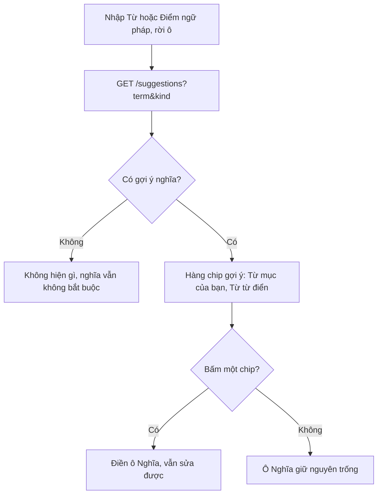
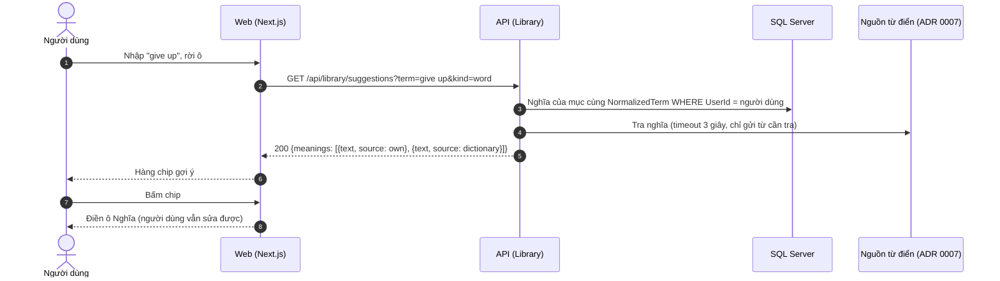

# SRS US-LIB-09 — Gợi ý nghĩa khi nhập

- Tính năng: FEAT-02 Mục kiến thức (`knowledge-items`).
- User story: [US-LIB-09](../requirements/user-stories.md#us-lib-09--gợi-ý-nghĩa-khi-nhập).
- Phiên bản 0.3 (2026-11-09). Trạng thái: **chờ duyệt**.
- Tài liệu chung: [README.md](README.md) (danh mục FR, BR, ERR, NFR, quy ước API, ngữ cảnh).
- Test case: [testing/test-cases.md](../testing/test-cases.md).
- Skill OpenBA áp dụng: `srs` (FR, BR, ERR, NFR), `user-flow`, `sequence`, `wireframe-ascii`, `api-design`, `ac`.

## 1. Giới thiệu

Là người học, tôi muốn được gợi ý nghĩa để nhanh hơn, nhưng gợi ý không tự điền vào form.

**Trong phạm vi:**

- Gợi ý nghĩa dưới ô "Nghĩa" cho cả Từ vựng và Ngữ pháp.
- Nguồn gợi ý: mục của chính người dùng và nguồn từ điển.
- Gợi ý chỉ điền khi người dùng bấm.

**Ngoài phạm vi:**

- Gợi ý từ dữ liệu của người dùng khác.
- Tự điền nghĩa bằng AI.

## 2. Yêu cầu áp dụng

### 2.1 Yêu cầu chức năng (FR)

**`FR-LIB-ITEM-009` — Gợi ý nghĩa từ mục của người dùng và nguồn từ điển**

- Input: `term`, `kind`.
- Xử lý: Lấy nghĩa từ mục của **chính người dùng** có cùng `NormalizedTerm` và từ nguồn từ điển (BR-LIB-014). Không lấy dữ liệu của người dùng khác. Không ghi gì vào database.
- Output: Tối đa 5 gợi ý, mỗi gợi ý có `text` và `source` (`own` hoặc `dictionary`).

### 2.2 Quy tắc nghiệp vụ (BR)

Phát biểu theo dạng KHI, THÌ, NGOẠI LỆ (`rules/02`). Nội dung chính thức nằm ở [README.md](README.md); bảng dưới là bản sao các quy tắc áp dụng cho story này.

| Mã BR | Quy tắc | KHI | THÌ | NGOẠI LỆ |
| --- | --- | --- | --- | --- |
| `BR-LIB-014` | Gợi ý nghĩa và phiên âm | Gọi gợi ý | Gợi ý chỉ lấy từ (a) mục của **chính người dùng** có cùng `NormalizedTerm`, và (b) nguồn từ điển được cấu hình (ADR 0007). Không bao giờ lấy dữ liệu của người dùng khác. Gợi ý chỉ điền vào form khi người dùng bấm; API không tự ghi gợi ý vào mục | — |
| `BR-LIB-015` | Lỗi nguồn từ điển | Gọi nguồn | Timeout 3 giây. Lỗi hoặc timeout của nguồn **không phải lỗi nghiệp vụ**: API trả 200 với danh sách gợi ý rỗng kèm `sourceAvailable = false`, UI hiện dòng "Không lấy được phiên âm tự động" và cho phép nhập tay. Log ghi tên nguồn và loại lỗi, không ghi từ tra cứu gắn với người dùng | — |

### 2.3 Ma trận lỗi (ERR)

Story này không phát sinh mã lỗi riêng.

### 2.4 Yêu cầu phi chức năng (NFR)

- `NFR-A11Y-001`: Form có nhãn hiển thị; thêm và xóa ví dụ bằng bàn phím; xóa ví dụ thì focus chuyển sang ví dụ kế bên; dialog giữ focus bên trong; gợi ý cập nhật có `aria-live="polite"`.
- `NFR-PERF-001`: GET danh sách và chi tiết, POST, PUT có P95 ≤ 300 ms với 5.000 mục mỗi người; đo trên staging. Index (`UserId`, `CreatedAt` DESC) và (`UserId`, `NormalizedTerm`) theo ERD.

## 3. Luồng

### 3.1 User flow

_Skill `user-flow`: màn hình và chuyển đổi, kèm các trạng thái giao diện._



| Trạng thái | Hiển thị |
| --- | --- |
| Bình thường | Hàng chip gợi ý dưới ô "Nghĩa", mỗi chip có nhãn nguồn. |
| Đang tải | Không chặn form; chip xuất hiện khi có kết quả. |
| Trống | Không có gợi ý: không hiện chip và không có thông báo. |
| Lỗi | Nguồn lỗi: chỉ còn gợi ý từ mục của người dùng (nếu có); không hiện lỗi đỏ. |
| Mất kết nối | Không hỗ trợ ngoại tuyến. Hiện "Mất kết nối" và nút "Thử lại"; không mất dữ liệu đã nhập. |

### 3.2 Sequence

_Skill `sequence`: tương tác giữa các thành phần; nhánh lỗi ghi mã `ERR-xxx`._



## 4. Wireframe

_Skill `wireframe-ascii`. Figma: chưa dựng màn hình (`DES-01`); wireframe ASCII là căn cứ cho DoR._

Dùng lại form [W-LIB-02](US-LIB-01-choose-type-and-save.md#4-wireframe), dưới ô "Nghĩa": hàng chip gợi ý, mỗi chip kèm nhãn nguồn bằng chữ ("Từ mục của bạn", "Từ từ điển"); bấm chip mới điền vào ô; không có gợi ý thì không hiện gì và không có thông báo lỗi. Vùng chip có `aria-live="polite"`.

## 5. API

_Skill `api-design`; lỗi theo Problem Details (RFC 9457) như ADR 0002. Quy ước chung ở [README.md](README.md)._

| Method và path | Body | Thành công | Lỗi |
| --- | --- | --- | --- |
| `GET /api/library/suggestions?term=&kind=` | — | `200 { ipa: { value, source: "dictionary" } \| null, sourceAvailable: bool, meanings: [{ text, source: "own" \| "dictionary" }] }` (tối đa 5 nghĩa; `ipa` chỉ khi `kind = word`) | 400-01 |

```http
GET /api/library/suggestions?term=give%20up&kind=word
```

Phản hồi:

```json
{ "ipa": null, "sourceAvailable": true,
  "meanings": [ { "text": "từ bỏ", "source": "own" }, { "text": "to stop trying", "source": "dictionary" } ] }
```

Tối đa 5 nghĩa. Nguồn lỗi hoặc quá 3 giây: `sourceAvailable = false`, `meanings` chỉ còn các mục `own`; vẫn là `200`.

## 6. Acceptance criteria

_Skill `ac`. Văn bản Gherkin trùng với [user story](../requirements/user-stories.md) (nguồn chính thức); sửa ở đó rồi cập nhật lại đây. Script `tools/feature-docs/check_feature_docs.py` kiểm tra hai bản khớp nhau._

```gherkin
Scenario: AC-01 Gợi ý từ mục của chính tôi
  Given tôi đã lưu "give up" với nghĩa "từ bỏ"
  When tôi nhập "give up" ở bất kỳ loại nào
  Then ô nghĩa hiện gợi ý "từ bỏ" với nhãn "Từ mục của bạn"
  And ô nghĩa vẫn trống cho tới khi tôi bấm gợi ý

Scenario: AC-02 Gợi ý từ nguồn từ điển
  Given nguồn trả về nghĩa "to stop trying" cho "give up"
  When tôi nhập "give up"
  Then gợi ý hiện với nhãn "Từ từ điển"

Scenario: AC-03 Không gợi ý dữ liệu của người khác
  Given người dùng B đã lưu "give up" với nghĩa "bỏ cuộc"
  When tôi (người dùng A, chưa có mục nào) nhập "give up"
  Then không có gợi ý "bỏ cuộc"

Scenario: AC-04 Bấm gợi ý mới điền
  When tôi bấm gợi ý "từ bỏ"
  Then ô nghĩa được điền "từ bỏ" và tôi vẫn sửa được

Scenario: AC-05 Không có gợi ý
  When không có nguồn nào trả nghĩa cho từ tôi nhập
  Then không hiện gợi ý, không có thông báo lỗi, và nghĩa vẫn không bắt buộc
```

| AC | Nội dung | FR | BR | ERR | Test case |
| --- | --- | --- | --- | --- | --- |
| AC-01 | Gợi ý từ mục của chính tôi | `FR-LIB-ITEM-009` | `BR-LIB-014` | — | TC-LIB-045 |
| AC-02 | Gợi ý từ nguồn từ điển | `FR-LIB-ITEM-009` | `BR-LIB-014` | — | TC-LIB-046 |
| AC-03 | Không gợi ý dữ liệu của người khác | `FR-LIB-ITEM-009` | `BR-LIB-014` | — | TC-LIB-047 |
| AC-04 | Bấm gợi ý mới điền | `FR-LIB-ITEM-009` | `BR-LIB-014` | — | TC-LIB-048 |
| AC-05 | Không có gợi ý | `FR-LIB-ITEM-009` | `BR-LIB-015` | — | TC-LIB-049 |

## 7. Truy vết test case

| TC | Loại | Bước chính | Kết quả mong đợi |
| --- | --- | --- | --- |
| `TC-LIB-045` | INT + E2E | Có mục "give up"/"từ bỏ" của A; A nhập "give up" ở loại grammar | `suggestions.meanings` có `{source: own}`; chip hiện; ô nghĩa trống cho tới khi bấm |
| `TC-LIB-046` | INT | Provider trả nghĩa | Gợi ý có `source=dictionary` |
| `TC-LIB-047` | INT | B có "give up"/"bỏ cuộc"; A không có mục nào, gọi suggestions | Không có "bỏ cuộc" trong kết quả của A; SQL truy vấn có điều kiện `UserId` |
| `TC-LIB-048` | E2E | Bấm chip "từ bỏ" | Ô nghĩa điền "từ bỏ"; sửa được |
| `TC-LIB-049` | UNIT (Vitest) | Suggestions rỗng | Không có chip và không có thông báo lỗi |

## 8. Lịch sử sửa đổi

| Phiên bản | Ngày | Thay đổi |
| --- | --- | --- |
| 0.3 | 2026-11-09 | Tách từ `srs.md` và `design/` thành file riêng cho story; thêm FR chi tiết, sequence, state, bảng AC → FR/BR/ERR/TC. |
